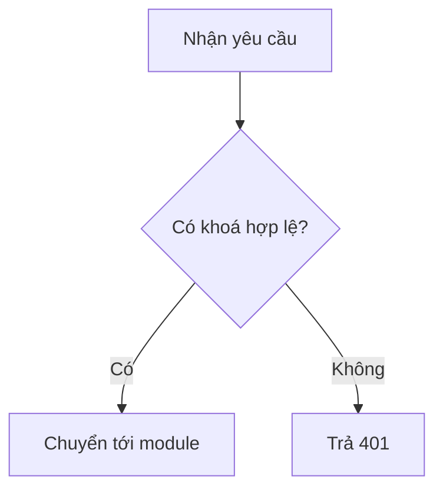
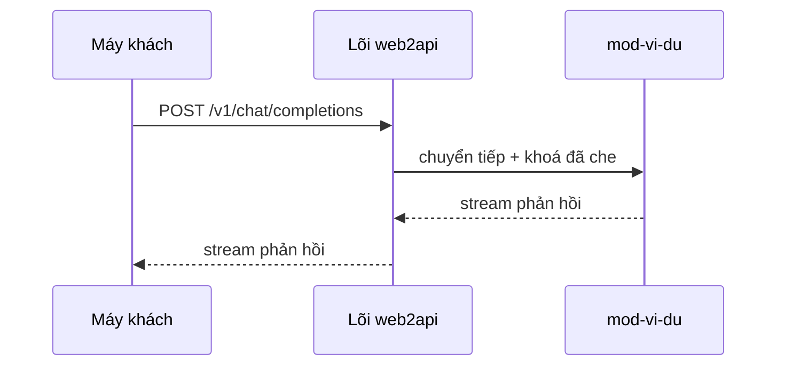
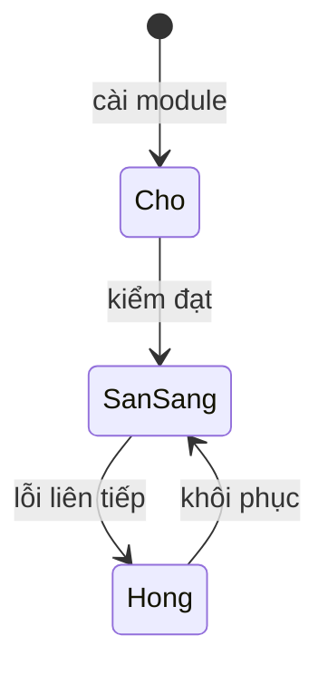
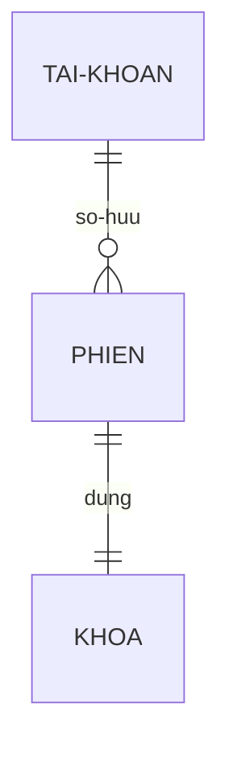

# Vẽ sơ đồ bằng Mermaid

Kho đã dùng Mermaid trong README. Sơ đồ viết bằng văn bản, nhúng thẳng vào markdown —
không cần công cụ ngoài, không cần ảnh.

## Bốn loại hay dùng

**flowchart** — luồng xử lý, cây quyết định:



**sequenceDiagram** — tương tác giữa các bên, luồng API:



**stateDiagram** — máy trạng thái, vòng đời:



**erDiagram** — quan hệ dữ liệu:



Chi tiết cú pháp: `references/cu-phap-4-loai.md`.

## Nhúng vào trang HTML (khi cần)

Nếu trang tài liệu cần dựng sơ đồ động, nhúng thư viện từ CDN **ghim đúng phiên bản**,
không bao giờ dùng `@latest`:

```html
<script src="https://cdn.jsdelivr.net/npm/mermaid@11.4.1/dist/mermaid.min.js"></script>
```

Phiên bản trên chỉ là ví dụ — **kiểm lại phiên bản mới nhất trước khi dùng**,
rồi ghim con số cụ thể vào mã.

## Không làm

- Không cài công cụ vẽ qua npm/npx.
- Không vẽ quá 4 loại trên trong tài liệu kho trừ khi có lý do ghi rõ.
- Không đặt tên nhà cung cấp AI thật trong sơ đồ ví dụ; dùng tên giả như `mod-vi-du`.

Phỏng theo claudekit-skills (MIT, mrgoonie) — đã Việt hoá và chỉnh theo luật kho web2api.
