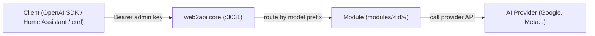

# web2api

An OpenAI-compatible AI gateway (`/v1/models`, `/v1/chat/completions`...) running in a lightweight Docker container. The core acts as a **"translator"** and contains no built-in AI providers. Each AI source is a **module** installed at runtime from git, without rebuilding the Docker image or restarting the service.



## Available Modules

| Module | Description | Status |
|---|---|---|
| `gemini-api` | Gemini API (Google AI Studio): streaming chat, images, Veo video | Available |
| `muse` | Muse (Meta AI VM): Noise XX protocol; needs a device key, so **not usable yet** | Experimental, not tested against the real service |
| `antigravity` | Chat through the Antigravity CLI (`agy`) on the host, needs a bridge | Skeleton, not tested with real `agy` |

## Quick Start with Docker Compose

Create a `docker-compose.yml` file:

```yaml
services:
  web2api:
    image: ghcr.io/tritue2011/web2api:latest
    container_name: web2api
    restart: unless-stopped
    ports:
      - "3031:8000"
    environment:
      WEB2API_DATA: /data
      WEB2API_GIT_REPO: TriTue2011/web2api
      WEB2API_GIT_NHANH: main
      WEB2API_GIT_THU_MUC: modules
      # WEB2API_ADMIN_KEY: "custom-key" # optional; auto-generated if omitted
    volumes:
      - web2api-data:/data
    user: "1000:1000"
    mem_limit: 256m
    cpus: 0.5
    pids_limit: 100

volumes:
  web2api-data:
    name: web2api-data
```

**3 steps to start:**
1. Start the container:
   ```bash
   docker compose up -d
   ```
2. Get the admin key (if not preconfigured in `WEB2API_ADMIN_KEY`):
   ```bash
   docker exec web2api cat /data/admin_key
   ```
3. Open `http://<host-ip>:3031` in your browser and paste the key, or test via API:
   ```bash
   curl -s -H "Authorization: Bearer <admin-key>" http://localhost:3031/v1/models
   ```

## Portainer and NAS

The service port is `3031` (mapped to `3031:8000`), and data is mounted to `/data` in the container.

### Portainer
1. Go to **Stacks** → **Add stack**, name the stack (e.g. `web2api`).
2. Paste the docker-compose YAML above into the editor.
3. Add environment variables (such as `WEB2API_ADMIN_KEY`) under **Environment variables** if needed.
4. Click **Deploy the stack**. To update later, click **Pull and redeploy**.

### Synology NAS (Container Manager)
1. Open **Container Manager** → **Project** → **Create**.
2. Name the project, set data path to `/volume1/docker/web2api`.
3. Paste the compose file, map `/volume1/docker/web2api:/data`.
4. Finish wizard and start the project; access port is `3031`.

### QNAP NAS (Container Station)
1. Open **Container Station** → **Applications** → **Create**.
2. Enter application name and paste the docker-compose YAML.
3. Ensure the volume maps the NAS data folder to `/data` in the container.
4. Click **Create** to pull the image and run on port `3031`.

### Unraid
1. Open the **Docker** tab (or use Compose Manager plugin).
2. Paste the compose YAML or add a container from `ghcr.io/tritue2011/web2api:latest`.
3. Map port `3031:8000`, set data path `/mnt/user/appdata/web2api` to `/data`.
4. Set user `1000:1000` and start the container.

## Private Repositories

Two different tokens are used for two distinct purposes — do not confuse them:

### 1. Pulling Docker image from ghcr.io when the package is private
GHCR packages are private by default (the repo owner can make it Public in repo Packages). When private:
- Create a GitHub Personal Access Token (classic) with `read:packages` permission.
- Log in on the Docker host:
  ```bash
  echo $TOKEN | docker login ghcr.io -u <github-username> --password-stdin
  ```
  Credentials are saved to `~/.docker/config.json`; do not put the token in compose.
- **Portainer**: Go to **Registries** → **Add registry** → Custom/GitHub `ghcr.io` + username + token, then select this registry when deploying the stack.
- **Synology**: **Container Manager** → **Registry** → **Settings** → **Add** (`ghcr.io`), or run `docker login` via SSH.
- **QNAP / Unraid**: SSH into the device and run `docker login ghcr.io`.
- **Watchtower (auto-update with private image)**: Mount the config into the watchtower container: `-v /root/.docker/config.json:/config.json:ro`.

### 2. Module source from a private GitHub repository
When fetching modules from a private GitHub repository or avoiding GitHub's 60 requests/hour/IP limit:
- Create a GitHub Fine-grained PAT with **Repository permissions → Contents: Read-only** (only for that repository).
- Set environment variable `WEB2API_GITHUB_TOKEN` in compose, Portainer (Environment variables), or NAS.
- Without a token, GitHub limits anonymous access to 60 req/hour/IP, which can cause module update rate limit errors; providing this token resolves the issue.

## Further Reading

For full technical documentation on architecture, components, detailed module guides, operation, security, and API/environment variable reference: see [docs/THAM-CHIEU.md](docs/THAM-CHIEU.md).
