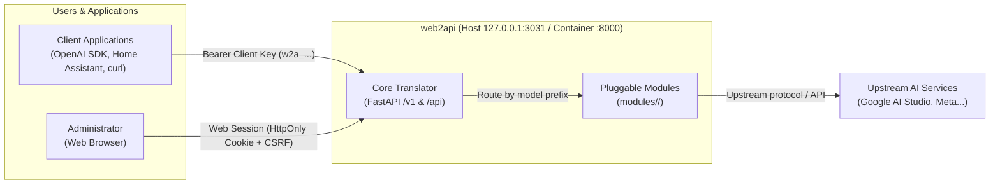

# web2api

<p>
  <a href="https://github.com/TriTue2011/web2api/actions/workflows/docker-build.yml"></a>
  <a href="https://github.com/TriTue2011/web2api/actions/workflows/security.yml"></a>
</p>

A lightweight, OpenAI-compatible AI gateway (`/v1/models`, `/v1/chat/completions`, streaming, image generation, video, audio, embeddings...) running in a single Docker container. Built for individuals and home-lab setups seeking to unify diverse AI sources (Google Gemini, Meta Muse, and more) into standard OpenAI client applications (e.g. OpenAI SDK, curl; not specifically verified with Home Assistant). Its core distinction: the engine acts as an unopinionated **"translator"** containing no vendor-specific code; all AI backends are modular extensions loaded on the fly from git without rebuilding Docker images or restarting containers.

[English](README.en.md) | [Tiếng Việt](README.md)



## Features

- **Comprehensive OpenAI Compatibility**:
  - Chat: `POST /v1/chat/completions` (full SSE streaming, keep-alive heartbeats, normalized `finish_reason` on tool calls).
  - Model Catalog: `GET /v1/models` and `GET /v1/models/{model}` (aggregated from connected modules and fallback combos).
  - Vision & Image: Image generation `POST /v1/images/generations`, image edits `POST /v1/images/edits`, and Responses API `POST /v1/responses` with `image_generation` tool calls (SSE streaming supported).
  - Video Generation: Asynchronous creation `POST /v1/videos`, polling status `GET /v1/videos/{id}`, streaming content download `GET /v1/videos/{id}/content`.
  - Audio: Text-to-speech `POST /v1/audio/speech` (binary chunked audio stream), speech-to-text `POST /v1/audio/transcriptions` (standard endpoints provided by core; requires capability-providing module, none bundled currently).
  - Embeddings & Reranking: Vector embeddings `POST /v1/embeddings`, document reranking `POST /v1/rerank` (standard endpoints provided by core; requires capability-providing module, none bundled currently).
- **Runtime Pluggable Architecture**: Install, update, or remove modules from git directly via the web UI without rebuilding images or restarting containers. Core engine contains no vendor-specific names.
- **Integrated Web Management Interface**:
  - **Studio**: Live chat with AI models, real-time markdown rendering, image previews, and local conversation history.
  - **System → Module**: Grid view of installed and catalog modules, one-click installation, permission and resource diff review.
  - **System → AI**: Multi-account management, adding/removing API keys per provider, model configuration.
  - **System → Security & Users**: User account administration, scoped client key generation, audit log hash chain validation.
  - **System → Devices**: Smart device entity discovery, permission controls, and action approval queues (standard endpoints provided by core; tab is automatically hidden when no device modules are loaded).
  - **System → Account sessions**: View per-module login sessions in collapsible groups, check status on demand and delete sessions (two-step confirmation); metadata only, cookies/tokens are never shown.
- **Multi-User Access & Role Separation**: Built-in `admin` and `user` roles. Passwords securely hashed using scrypt ($N=2^{14}$), two-tier login rate limiting against brute-force attacks, and enforcement of the last active administrator invariant. Web sessions managed via `HttpOnly`, `SameSite=Strict` cookies with automatic `Secure` and `__Host-` prefixes over HTTPS, fully protected against CSRF.
- **Scoped Client Keys & Key Rotation**: Issue client keys (prefixed with `w2a_`) restricted to specific capabilities (`chat`, `anh`, `anh_sua`, `video`, `noi`, `nghe`, `nhung`, `xep_hang`, `tim_kiem`, `thiet_bi`, `trinh_duyet`, `*`; scopes are open-ended like `thiet_bi:ghi`). Seamless key rotation with configurable grace periods for retired keys (default 7 days). Global and per-key concurrency limits.
- **Smart Failover & Redundancy**: Automatic round-robin across provider keys with temporary cooldowns upon receiving 429 rate limits or quota rejections. Combos (`/api/combo`) chain multiple fallback providers with circuit breaker logic.
- **Encrypted Backup & Restore**: Export configuration snapshots encrypted with AES-256-GCM using a passphrase (`POST /api/sao-luu`). Integrity-checked restoration with ownership validation and atomic rollback on failure (`POST /api/khoi-phuc`).
- **Tamper-Evident Hash-Chained Audit Logs**: Every log entry is cryptographically linked via SHA-256 hash chains (`truoc` and `bam`), enabling automated detection of alterations or broken chains (`GET /api/nhat-ky/chuoi`). Automatic redaction of secrets and keys in all responses and logs.
- **Remote noVNC Browser Workspace (`vnc-xa`)**: Host isolated browser workspaces via noVNC on the server (requires dedicated host browser service `dich-vu/trinh-duyet`, configured with `dich_vu_url` and `khoa_dich_vu`) for interactive login (CAPTCHA/OTP handling), preserving session state and routing authenticated cookies directly into backend modules.
- **Knowledge Retrieval (`/api/tim-kiem`)**: Core provides standard retrieval combining 5 schemes (provider/scheme switches, faceted filtering, hierarchical trees, table of contents, and cascading pipelines). External data safely tagged as untrusted input (requires capability-providing module, none bundled currently).
- **Device Tools for AI Agents (`/api/cong-cu`)**: Transforms smart device actions into OpenAI function-calling tools; approval queue (`/api/phe-duyet`) blocks dangerous physical actions until human confirmation (standard endpoints provided by core; requires capability-providing module, none bundled currently).

## Screenshots


*Initial administrator setup screen using the one-time setup code.*


*Web authentication screen for administrators and standard users.*


*Module management grid displaying runtime hot-reload statuses.*


*Studio chat interface with live streaming OpenAI-compatible responses.*


*User administration, scoped client key generation, and audit logging.*

## Quick Start

Official `docker-compose.yml`:

```yaml
services:
  web2api:
    image: ghcr.io/tritue2011/web2api:latest
    build: .
    container_name: web2api
    restart: unless-stopped
    ports:
      # Default: ONLY listens on localhost (127.0.0.1) for maximum security.
      # To allow LAN access, set WEB2API_BIND=<host-LAN-IP> in .env.
      - "${WEB2API_BIND:-127.0.0.1}:${WEB2API_PORT:-3031}:8000"
    environment:
      WEB2API_DATA: /data
      WEB2API_GIT_REPO: ${WEB2API_GIT_REPO-TriTue2011/web2api}
      WEB2API_GIT_NHANH: ${WEB2API_GIT_NHANH:-main}
      WEB2API_GIT_THU_MUC: ${WEB2API_GIT_THU_MUC:-modules}
    env_file:
      - path: .env
        required: false
    volumes:
      - ${WEB2API_DATA_DIR:-web2api-data}:/data
    user: "1000:1000"
    cap_drop:
      - ALL
    security_opt:
      - no-new-privileges:true
    # Resource limits (OPTIONAL — runs fine without them; see "Resource Limits" below): prevents a faulty module
    # from consuming all host RAM/CPU and crashing other services. Real-world usage is ~100 MB RAM, near 0% CPU.
    mem_limit: 1g
    cpus: 0.5
    pids_limit: 100
    labels:
      com.centurylinklabs.watchtower.enable: "false"

volumes:
  web2api-data:
    name: web2api-data
```

### Resource Limits (Optional)

The three lines `mem_limit`, `cpus`, `pids_limit` in compose are safety guardrails, NOT prerequisites for web2api to run: removing them (deleting the lines) works normally. They prevent a malfunctioning module (memory leak, infinite loop, unbounded process spawning) from exhausting host resources and bringing down co-located services (since git-installed modules execute in-process). Real-world usage is ~100 MB RAM, near 0% CPU. Standalone hosts can safely omit them; shared hosts should keep them.
- `mem_limit`: increase freely (`2g`, `4g`...) if running many modules or large image/video workloads. Update live without restarts via `docker update --memory 2g --memory-swap 2g web2api` (and update compose to persist across redeployments).
- `cpus`: first candidate to remove (only slows down scrypt password hashing during concurrent logins).
- `pids_limit`: recommended to keep as a safeguard against process bombs.
*(Detailed reference: [docs/THAM-CHIEU.md section 5](docs/THAM-CHIEU.md#5-cài-đặt-và-vận-hành-qua-docker)).*

### 3-Step Setup

1. **Start the container:**
   ```bash
   docker compose up -d
   ```

2. **Retrieve the initial setup code:**
   On first boot (when no administrator exists), web2api generates a random setup code stored at `/data/ma_thiet_lap` (mode 0600). The code is never written to logs. Read it using:
   ```bash
   docker exec web2api cat /data/ma_thiet_lap
   ```
   *(If `WEB2API_ADMIN_KEY` was explicitly set in environment, that key also acts as a valid setup code).*

3. **Configure the admin account, install module & test API:**
   - Open `http://127.0.0.1:3031` (or `http://<host-ip>:3031` if `WEB2API_BIND` was set) in your browser.
   - The **Setup** screen appears: paste the setup code from step 2, set a username and password, and click **Set up and log in**. The `ma_thiet_lap` file is automatically deleted.
   - The browser is logged in immediately.
   - **Install module and add API key**: Navigate to **System → Module**, find `gemini-api`, and click **Install**. Then go to **System → AI → Accounts** (`gemini-api` section) to add your Google AI Studio key. (Without installing a module and adding a key, the model catalog will be empty and chat will be unavailable).
   - Navigate to **System → Security & users** to create a Client Key or generate a personal key.
   - Test the endpoint using `curl`:
     ```bash
     # List available models:
     curl -s -H "Authorization: Bearer <client-key>" http://127.0.0.1:3031/v1/models
     # Send a test chat completion:
     curl -s -X POST http://127.0.0.1:3031/v1/chat/completions \
       -H "Authorization: Bearer <client-key>" \
       -H "Content-Type: application/json" \
       -d '{"model": "gemini/gemini-2.5-flash", "messages": [{"role": "user", "content": "Hello web2api!"}]}'
     ```
   > [!IMPORTANT]
   > All API endpoints strictly require authentication (Bearer client/admin key or authenticated web session cookie). The only unauthenticated open exceptions are: `GET /` (root landing page), `GET /health` (health check), `GET/POST /api/thiet-lap` (setup check & initial admin setup), `POST /api/dang-nhap` (login), static assets of installed modules `GET /m/<id>/...`, and noVNC session routes (`GET/POST /novnc/dang-nhap`, `/novnc/s/...`).

## Available Modules

| Module | Capabilities | Protocol | Status |
|---|---|---|---|
| `gemini-api` | Streaming chat, image generation, Veo video | OpenAI HTTP | Available (chat verified with real Google API; image and Veo video not tested with real Google API, requires paid Google AI Studio key) |
| `muse` | Chat completion | Noise XX WebSocket | Experimental, not tested against live service (requires X25519 device key) |
| `muse2api` | Free chat via cookies | WebSocket + Noise XX | Available (direct muse.ai web protocol, no API key required; not tested against live service) |
| `antigravity` | Multi-model chat via CLI | HTTP Bridge | Skeleton, not tested with live `agy` (requires host bridge service) |
| `vnc-xa` | Remote noVNC browser workspace | HTTP / WebSocket | Available (requires dedicated browser service `dich-vu/trinh-duyet`, configured with `dich_vu_url` and `khoa_dich_vu`; not tested with real Firefox; manual login, session persistence, cookie transfer to modules) |

- **Installing modules**: Navigate to **System → Module** in the web interface, browse available extensions from the configured git repository, and click **Install**.
- **Git Source Configuration**: Configured via `WEB2API_GIT_REPO` (defaults to `TriTue2011/web2api`, branch `main`, directory `modules`). Background auto-installation is DISABLED by default (`tu_dong: false`) — updates trigger notifications for manual permission approval.
- **For Module Developers**: Read the specification in [docs/CHUAN-MODULE.md](docs/CHUAN-MODULE.md) and security standards in [docs/CHUAN-BAO-MAT-MODULE.md](docs/CHUAN-BAO-MAT-MODULE.md).

## Configuration

Most common environment variables (set in `.env` or Docker Compose):

| Variable | Default | Purpose |
|---|---|---|
| `WEB2API_DATA` | `/data` | Data directory path inside the container (keys, configurations, sessions, installed modules) |
| `WEB2API_BIND` | `127.0.0.1` | Host bind IP address for Docker container port mapping (compose only) |
| `WEB2API_PORT` | `3031` | Host service port mapped to internal container port 8000 (compose only) |
| `WEB2API_ADMIN_KEY` | Auto-generated | Fallback Bearer administrative token; auto-saved to `<WEB2API_DATA>/admin_key` if omitted |
| `WEB2API_GIT_REPO` | `TriTue2011/web2api` | GitHub repository containing modules (`owner/repo`); set empty to disable git sync |
| `WEB2API_GIT_NHANH` | `main` | Git branch to track for module updates |
| `WEB2API_GIT_THU_MUC` | `modules` | Subdirectory inside git repository containing module manifests |
| `WEB2API_GITHUB_TOKEN` | None | GitHub Personal Access Token (`Contents: Read`) for private repos or rate limit prevention (`WEB2API_GIT_TOKEN` as alias) |
| `WEB2API_TIN_PROXY` | None | Set to `1` to trust `X-Forwarded-Proto` from reverse proxies, enabling `Secure` and `__Host-` cookies |
| `WEB2API_TRUST_PROXY` | None | Trusted reverse proxy / Cloudflare CIDR list used to accurately parse client IPs from `X-Forwarded-For` |
| `WEB2API_PUBLIC_URL` | None | Official public base URL (e.g. `https://ai.example.com`). When set, requests with other domain Hosts (including LAN `nas.local`) receive 421; IP and localhost always pass |
| `WEB2API_QT_IP_CHO_PHEP` | None | Allowed CIDR list (e.g. `192.0.2.0/24`) restricted to admin API routes and setup |
| `WEB2API_KHACH_DONG_THOI` | `4` | Maximum concurrent requests allowed per client key (`0` = unlimited) |
| `WEB2API_V1_DONG_THOI_TOAN_CUC` | `32` | Maximum concurrent requests allowed globally across `/v1` (`0` = unlimited) |
| `WEB2API_THAN_TOI_DA_MB` | `25` | Maximum JSON request body size limit in megabytes for `/v1` and `/api/*` |
| `WEB2API_TEP_TOI_DA_MB` | `25` | Maximum multipart/form-data upload size limit in megabytes |
| `WEB2API_RL_LOI_XAC_THUC` | `30` | Auth failure threshold within the window before temporarily locking client IP for `WEB2API_RL_KHOA_GIAY` (60s) |
| `WEB2API_DANG_NHAP_SAI_TOI_DA` | `5` | Maximum consecutive login failures per account before imposing a 15-minute lock |
| `TZ` | None | System IANA timezone (e.g. `Asia/Ho_Chi_Minh`) for accurate Studio timestamps |

- **Host environment (LXC / Proxmox)**: When the container cannot read host hardware specs, declare `WEB2API_MAY_RAM_MB` (host RAM in MB) and `WEB2API_MAY_CPU` (host CPU core count).
- **Web session lifetimes**: 8-hour idle timeout, 7-day absolute lifetime, maximum 5 concurrent sessions per account.
- For complete documentation of all configuration options, see [docs/THAM-CHIEU.md section 8](docs/THAM-CHIEU.md#8-tra-cứu-api-và-biến-môi-trường).

## Security

- **Secure by Default**:
  - Compose publishes ports exclusively on host localhost `127.0.0.1` (configurable via `WEB2API_BIND`) and runs under unprivileged `uid 1000:1000`.
  - Dropped all Linux capabilities (`cap_drop: [ALL]`) and prevented privilege escalation (`no-new-privileges:true`).
  - Automatic module installation is disabled by default (`tu_dong: false`), requiring explicit administrator review.
  - New client keys default to minimal scopes (`["chat"]`) rather than broad wildcard access (`*`).
  - Password storage using scrypt; two-tier distributed brute-force protection with dummy hashes to prevent timing attacks.
  - Web session cookies hardened with `HttpOnly`, `SameSite=Strict`, conditional `Secure` and `__Host-` prefix over HTTPS, and CSRF protection.
  - Strict SSRF and path traversal defenses: outbound HTTP requests validated via `app/tu_xa.py` with DNS pinning, and paths resolved under root.
  - Automatic redaction of API keys and secrets in all logs; audit log lines cryptographically secured via SHA-256 hash chains.
- **Recommended Production Deployment**:
  - Deploy behind Cloudflare Tunnel (recommended — no open router ports needed) or a reverse proxy as guided in [docs/TRIEN-KHAI.md](docs/TRIEN-KHAI.md).
  - Configure `WEB2API_TRUST_PROXY` and enable `WEB2API_TIN_PROXY=1` when running behind reverse proxies (otherwise, `Secure` cookies are only issued if `WEB2API_PUBLIC_URL` is https:// and Host matches).
  - Secure SSH with public keys only (`PasswordAuthentication no`), and disable UPnP on routers.
  - Step-by-step hardening guide available in [docs/TRIEN-KHAI.md](docs/TRIEN-KHAI.md).
- **Vulnerability Reporting**: Follow the private disclosure policy outlined in [SECURITY.md](SECURITY.md).
- **Known Limitations**:
  - Dynamic modules execute in-process within the main Python runtime, sharing container memory and process privileges.
  - Strict Content Security Policy (CSP) is enforced only on module pages `/m/<id>/` and noVNC frames; the main web UI lacks a global CSP (due to inline scripts) and HSTS.
  - Password-protected backup archives contain provider API keys and must be stored as securely as passwords.

## Portainer and NAS

The default service port is `3031` (mapped to internal `8000`), with persistent state stored in `/data`. To access the service over your local network, specify `WEB2API_BIND=<host-LAN-IP>` in `.env`.

### Portainer
1. Go to **Stacks** → **Add stack** and assign a name (e.g. `web2api`).
2. Paste the compose configuration from [Quick Start](#quick-start) into the web editor.
3. Add any required environment variables under **Environment variables** (such as `WEB2API_BIND`).
4. Click **Deploy the stack**. To update in the future, select **Pull and redeploy**. Retrieve the setup code using `docker exec web2api cat /data/ma_thiet_lap` in the container console to initialize the admin account (the code is never printed to logs).

### Synology NAS (Container Manager)
1. Open **Container Manager** → **Project** → **Create**.
2. Set project name and choose directory `/volume1/docker/web2api`. Host-bound directories created automatically by Docker are owned by `root`, preventing the container uid 1000 from writing and causing it to stop immediately: run `sudo chown -R 1000:1000 /volume1/docker/web2api` via SSH beforehand.
3. Paste compose contents, mapping volume `/volume1/docker/web2api:/data`.
4. Finish project startup, open the container Terminal and run `cat /data/ma_thiet_lap` to read the setup code (the code is never printed to logs).

### QNAP NAS (Container Station)
1. Open **Container Station** → **Applications** → **Create**.
2. Enter application name and paste the docker-compose YAML.
3. Ensure the volume binds the NAS folder to `/data` in the container, apply `chown -R 1000:1000` to the NAS storage folder before launch, and configure user `1000:1000`.
4. Click **Create** to deploy, then open the container Terminal and run `cat /data/ma_thiet_lap` to retrieve the setup code (the code is never printed to logs).

### Unraid
1. Open the **Docker** tab (or use Compose Manager plugin).
2. Paste the compose configuration or configure template from `ghcr.io/tritue2011/web2api:latest`.
3. The directory `/mnt/user/appdata/web2api` must be granted permissions via `chown -R 1000:1000` before launch.
4. Map port `127.0.0.1:3031:8000` (setting `3031:8000` exposes the port to the entire LAN), bind `/mnt/user/appdata/web2api` to `/data`, and set user `1000:1000`.

### Running in LXC / Proxmox
When running web2api inside an LXC container or Proxmox VM, cgroups virtualization may prevent the container from detecting host physical RAM and CPU core counts. Declare `WEB2API_MAY_RAM_MB` (e.g. `8192` for 8 GB RAM) and `WEB2API_MAY_CPU` (e.g. `4` for 4 cores) in `.env` to display accurate hardware stats on the System page.

## Private Repositories

Two distinct tokens serve completely different functions:

### 1. Pulling Docker Images from GHCR When Packages are Private
GHCR container images are private by default unless made public by the repository owner:
- Generate a GitHub Personal Access Token (classic) with `read:packages` scope.
- Log in on the Docker host:
  ```bash
  echo $TOKEN | docker login ghcr.io -u <github-username> --password-stdin
  ```
  Authentication data is stored in `~/.docker/config.json`.
- **Portainer**: Go to **Registries** → **Add registry** → Custom/GitHub with URL `ghcr.io`, enter username and token.
- **Synology / QNAP / Unraid**: SSH into the device and run `docker login ghcr.io`.

### 2. Module Updates from Private Repositories
When pulling custom modules from private GitHub repositories or bypassing the anonymous 60 req/hour rate limit:
- Create a Fine-grained PAT with **Repository permissions → Contents: Read-only** for the target repository.
- Supply the token via `WEB2API_GITHUB_TOKEN` (or `WEB2API_GIT_TOKEN`) in compose or `.env`. The system checks `WEB2API_GITHUB_TOKEN` first before falling back to `WEB2API_GIT_TOKEN`.

## Maintenance, Backups, and Troubleshooting

### Updating Container Image
```bash
docker compose pull && docker compose up -d
```

### Backup and Restoration
- **API Backup**: Send a `POST /api/sao-luu` request with JSON body `{"mat_khau": "...", "kem_phien": false}` (password ≥ 12 characters to encrypt all secrets using AES-256-GCM; omitting the password skips API keys in `bi_mat/`). The API backup bundle does NOT include user accounts (`nguoi_dung.json`), `admin_key`, logs, or git module code (only stores module IDs and commit SHAs).
- **API Restore**: Send a multipart request to `POST /api/khoi-phuc` (fields: `tep`, `mat_khau`, `che_do`, `sha256`). By default, `che_do=kiem` only previews changes and computes the backup file's `sha256` hash; call a second time with `che_do=ap_dung` along with the returned `sha256` to actually apply the restore.
- **Direct Docker Volume Backup**: To back up all data (including user accounts and admin key):
  ```bash
  docker run --rm -v web2api-data:/data -v $(pwd):/backup alpine tar czf /backup/web2api-data-backup.tar.gz -C /data .
  ```

### Common Issues & Troubleshooting

1. **Port 3031 Conflict:** Change the external mapped port using `WEB2API_PORT=3032` in `.env`.
2. **HTTP 429 Too Many Requests (Global Proxy Lockout):** Behind Cloudflare or reverse proxies, omitting `WEB2API_TRUST_PROXY` causes all incoming requests to share the proxy's IP. One bad key blocks all traffic. Configure proxy CIDRs in `WEB2API_TRUST_PROXY` as documented in [docs/TRIEN-KHAI.md](docs/TRIEN-KHAI.md).
3. **HTTP 401 Unauthorized / 403 Forbidden on API Calls:** Check the `Authorization: Bearer <key>` header. Ensure client keys are active and include the appropriate scope for the targeted endpoint (e.g. `anh` scope for image generation).
4. **Password Changes & Forgotten Administrator Password:**
   - *Regular Password Change*: Authenticated users can change their own password via `POST /api/toi/mat-khau`.
   - *Forgotten Admin Password - Option 1*: Use the administrative master key via Bearer header (`WEB2API_ADMIN_KEY` or from `/data/admin_key`) to invoke `POST /api/nguoi-dung/{id}/dat-lai-mat-khau` (obtain `id` via `GET /api/nguoi-dung`). The API responds with a new random `mat_khau_moi`.
   - *Forgotten Admin Password - Option 2*: Stop the container, delete or move `nguoi_dung.json` inside the `/data` volume (backup first), and restart the container.
     > [!WARNING]
     > Deleting `nguoi_dung.json` will ERASE ALL users and INVALIDATE ALL owned client keys. Detecting zero administrators, the system generates a fresh setup code at `/data/ma_thiet_lap` allowing re-initialization.
   - *Rotate Admin Key*: Stop the container, delete `/data/admin_key`, and restart; the system automatically generates a new 64-character admin key.
5. **Module Fails to Load:** Inspect container logs using `docker compose logs web2api` or check module errors in **System → Module**. If a module requires missing native packages, deploy it as a remote module instead.
6. **Session Cookies Not Saved or Insecure:** Behind an HTTPS reverse proxy, `WEB2API_TIN_PROXY=1` should be set in `.env` so web2api recognizes HTTPS and issues cookies with `Secure` flags (`__Host-w2a_phien`) (otherwise, `Secure` is only enabled if `WEB2API_PUBLIC_URL` is https:// and Host matches).
7. **GitHub API Rate Limit Exceeded:** Create a read-only GitHub PAT and supply it in `WEB2API_GITHUB_TOKEN`.
8. **HTTP 502 Bad Gateway from Upstream Models:** Upstream service dropped the connection or geo-blocked your server IP (e.g. Gemini region restrictions in Vietnam require configuring `base_url` through the Cloudflare Worker proxy in `deploy/`).

## Development & Contributing

Requires Python 3.13 (refer to `.python-version`):
```bash
uv venv && uv pip install -r requirements.txt -r requirements-dev.txt
# or with standard python venv:
python3 -m venv .venv && .venv/bin/pip install -r requirements.txt -r requirements-dev.txt
```

### Running Test Suites
Before opening pull requests, verify that all test suites pass cleanly:
```bash
.venv/bin/python -m pytest test -q -p no:cacheprovider    # Unit & integration tests with offline mock services
.venv/bin/python -m bandit -r app modules -lll -q          # AST-based security vulnerability scanner
docker build -t web2api:latest .                          # Image build verification
```
*(Browser UI tests using real Chrome and node are optional; they are automatically skipped if Chrome is not installed).*

### Directory Structure

| Path | Purpose |
|---|---|
| `app/` | Core FastAPI application: `main.py` (entrypoint), `tuyen.py` (API routing), `kham_pha.py` (module discovery), `so_module.py` (registry), `nguoi_dung.py` (users & scrypt), `khoa_khach.py` (client keys), `nhat_ky.py` (hash-chained logs), `sao_luu.py` (backup/restore), `chuyen_tiep.py` (shared OpenAI proxy) |
| `modules/<id>/` | Built-in module implementations: `manifest.json`, `module.py` |
| `web/` | Static front-end assets (DC-Lite): Studio, Module, AI, Security, Devices, Login, Setup |
| `test/` | Automated test suite with offline mock servers for Google, GitHub, and OpenAI |
| `docs/` | Technical documentation: `THAM-CHIEU.md`, `TRIEN-KHAI.md`, `CHUAN-MODULE.md`, `CHUAN-BAO-MAT-MODULE.md`, screenshots |
| `deploy/` | Deployment auxiliary files (Cloudflare Worker proxy) |
| `dich-vu/` | Auxiliary host services (Antigravity CLI bridge, remote noVNC browser) |
| `scripts/` | Tooling: `chup-man-hinh.sh`, `chan-lan-trinh-duyet.sh` |

For contribution guidelines and coding standards, refer to [CONTRIBUTING.md](CONTRIBUTING.md).

### License
Copyright (c) 2026 `TriTue2011`. **All rights reserved** (Proprietary, see [LICENSE](LICENSE)). Source code is made publicly visible on GitHub solely for transparency.

## Further Reading

- [docs/THAM-CHIEU.md](docs/THAM-CHIEU.md): Complete technical reference manual.
- [docs/TRIEN-KHAI.md](docs/TRIEN-KHAI.md): Secure production deployment guide (Cloudflare Tunnel, SSH, ports).
- [docs/CHUAN-MODULE.md](docs/CHUAN-MODULE.md): Specifications and contracts for developing new modules.
- [docs/CHUAN-BAO-MAT-MODULE.md](docs/CHUAN-BAO-MAT-MODULE.md): Security compliance standards for modules.
- [SECURITY.md](SECURITY.md): Security policy and private vulnerability reporting channels.
- [CONTRIBUTING.md](CONTRIBUTING.md): Guidelines for project contributions.
