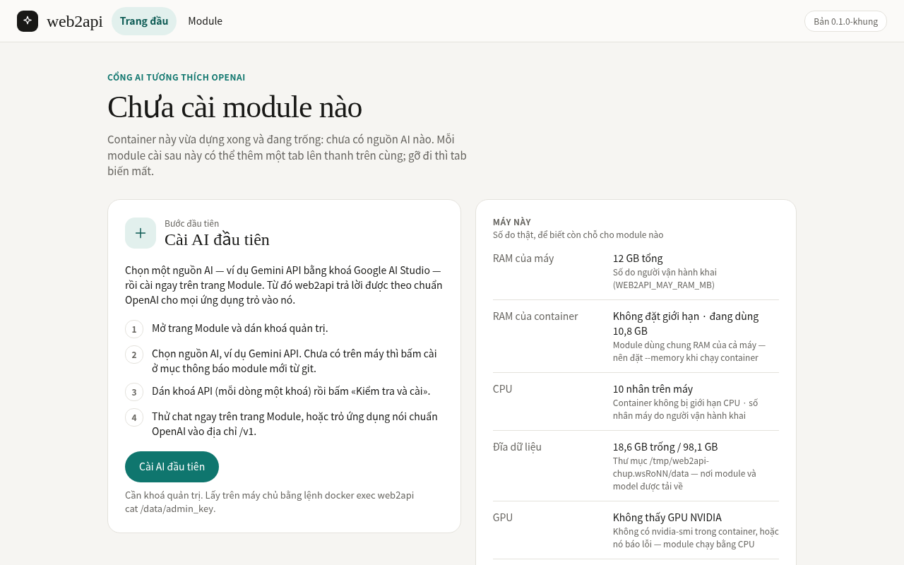
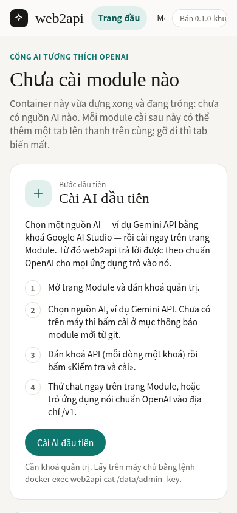
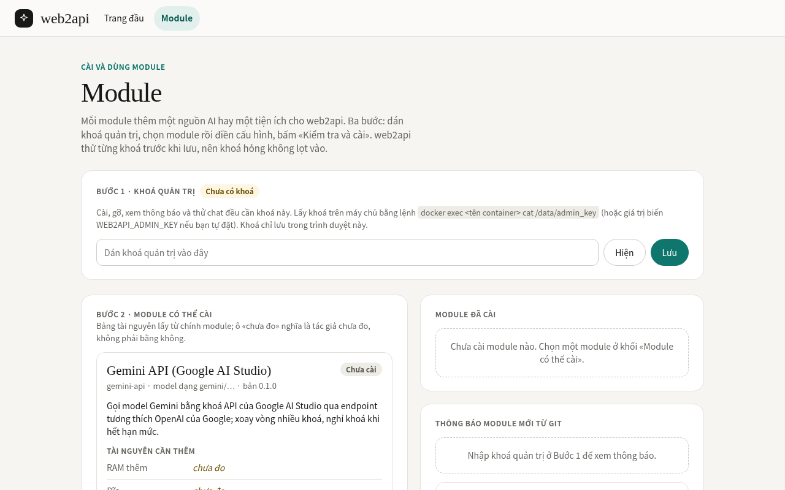
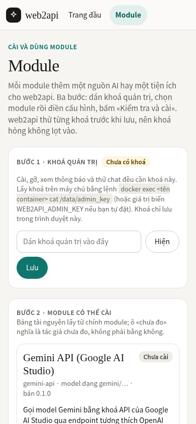

# web2api — hướng dẫn cài đặt và sử dụng

Tài liệu này viết cho người **chưa biết gì về dự án**. Đọc từ trên xuống là cài được, dùng được.

Kho của dự án: **https://github.com/TriTue2011/web2api** (public). web2api được **tách khỏi kho
chatgpt2api** ngày 10/10/2026; hệ thống c2a cũ trong kho đó chỉ còn là **hệ thống tham chiếu** (nơi đã đo
các bài học như chữ ký suy nghĩ của Gemini 3), web2api không cần nó để chạy. Mọi lệnh và đường dẫn trong
hướng dẫn này tính từ **gốc kho web2api**.
Tài liệu lớn dần theo từng module: mỗi module có một tiểu mục riêng trong mục «Module», và mục
«Trạng thái hiện tại» cho biết cái gì đã có, cái gì chưa.

**Giấy phép:** bản quyền thuộc chủ kho (`TriTue2011`), **giữ toàn quyền** (*All rights reserved*, xem tệp
[LICENSE](LICENSE)). Mã nguồn được xem công khai trên GitHub để minh bạch, nhưng việc dùng, sao chép, sửa,
phân phối hay triển khai (kể cả ảnh Docker đã đăng) cần có sự cho phép bằng văn bản của chủ kho.

## Mục lục

1. [web2api là gì](#1-web2api-là-gì)
2. [Trạng thái hiện tại](#2-trạng-thái-hiện-tại)
3. [Cần gì để chạy](#3-cần-gì-để-chạy)
4. [Cài đặt từng bước](#4-cài-đặt-từng-bước)
5. [Lần đầu mở trang và khoá quản trị](#5-lần-đầu-mở-trang-và-khoá-quản-trị)
6. [Module](#6-module)
7. [Dùng ngay từ ứng dụng khác](#7-dùng-ngay-từ-ứng-dụng-khác)
8. [Thêm module mới không cần dựng lại ảnh](#8-thêm-module-mới-không-cần-dựng-lại-ảnh)
9. [Bảo mật](#9-bảo-mật)
10. [Xử lý sự cố thường gặp](#10-xử-lý-sự-cố-thường-gặp)
11. [Gỡ module và nâng cấp lõi](#11-gỡ-module-và-nâng-cấp-lõi)
12. [Tra cứu: toàn bộ API và biến môi trường](#12-tra-cứu-toàn-bộ-api-và-biến-môi-trường)
13. [Dành cho người phát triển](#13-dành-cho-người-phát-triển)
14. [Nhật ký thay đổi](#14-nhật-ký-thay-đổi)
15. [Cách bổ sung README khi thêm module](#15-cách-bổ-sung-readme-khi-thêm-module)

## 1. web2api là gì

web2api là một **cổng AI nói chuẩn OpenAI** chạy trong một container Docker nhỏ trong mạng nhà.
Mọi ứng dụng biết gọi OpenAI (thư viện `openai` của Python, Home Assistant, ứng dụng chat…) chỉ cần
đổi «địa chỉ gốc» (base URL) sang web2api và dùng khoá quản trị làm «API key» là dùng được các
nguồn AI mà web2api đã cài.

Lõi web2api **không chứa sẵn nguồn AI nào**. Mỗi nguồn AI là một **module** cài thêm lúc chạy:
module được đặt trong kho git của dự án; web2api tự thấy module mới, báo cho bạn, và khi bạn bấm
cài thì tải về dùng ngay — không phải dựng lại ảnh Docker, không phải khởi động lại container.

Luồng một yêu cầu:

```
Ứng dụng của bạn (openai, Home Assistant, curl…)
        │  POST /v1/chat/completions   model = "gemini/gemini-2.5-flash"
        │  Authorization: Bearer <khoá quản trị>
        ▼
┌──────────────────────── web2api (lõi) ────────────────────────┐
│ 1. Kiểm khoá quản trị                                         │
│ 2. Tách tiền tố "gemini" → tìm module có tiền tố đó           │
│ 3. Module chuyển tiếp yêu cầu, giữ nguyên mọi trường           │
└───────────────────────────────┬───────────────────────────────┘
                                ▼
      Google Gemini API  (hoặc dịch vụ AI khác trong mạng nhà)
                                │
                                ▼
      Câu trả lời đi ngược lại, từng dòng nếu là stream
```

## 2. Trạng thái hiện tại

| Tính năng hoặc module | Trạng thái | Từ phiên bản / ngày |
|---|---|---|
| Lõi: trang khởi đầu, trang «Máy này» (`/api/he-thong`) | Có | 0.1.0-khung · 10/10/2026 |
| Khoá quản trị cho mọi API đổi trạng thái và `/v1` | Có | 0.1.0-khung · 10/10/2026 |
| `/v1/models`, `/v1/chat/completions` chuẩn OpenAI (có stream) | Có | 0.1.0-khung · 10/10/2026 |
| Module `gemini-api` (Gemini API, khoá Google AI Studio) | Có — đã kiểm với Google thật 10/10/2026 | 0.1.0-khung · 10/10/2026 |
| Nguồn module từ git: thông báo module mới, cài, tự cài có điều kiện | Có (chưa thử với GitHub thật) | 0.1.0-khung · 10/10/2026 |
| Nạp lại module nóng, không khởi động lại | Có | 0.1.0-khung · 10/10/2026 |
| Module từ xa (dịch vụ OpenAI trong mạng nhà, ví dụ máy GPU) | Có | 0.1.0-khung · 10/10/2026 |
| Tab giao diện riêng của module ở `/m/<id>/` | Có | 0.1.0-khung · 10/10/2026 |
| Trang «Module» (`/Cai-module.dc.html`): khoá quản trị, cài/gỡ, thông báo git, sức khoẻ, thử chat, module từ xa | Có | 0.1.0-khung · 10/10/2026 |
| Thanh trên: liên kết «Module», chấm báo module mới, tab của module đã cài | Có | 0.1.0-khung · 10/10/2026 |
| Nguồn git đặt sẵn trong `docker-compose.yml` (kho dự án, đọc ẩn danh) | Có | 0.1.0-khung · 10/10/2026 |
| `docker-compose.yml` cho người mới (ảnh GHCR, volume có tên, cập nhật, sao lưu) | Có (chưa thử kéo ảnh GHCR thật) | 0.1.0-khung · 11/10/2026 |
| Gemini: nhúng (embeddings), tạo ảnh, video | Chưa có | — |
| Chữ ký số cho module | Chưa có (chỉ kiểm chữ ký commit của GitHub, tuỳ chọn) | — |
| Các trang demo khác (Main, Hệ thống, AI, Nhà, Đời sống…) | Chưa đưa vào `web/` | — |

## 3. Cần gì để chạy

- **Docker** có `docker compose` 2.24 trở lên (cách cài: mục 4, bước 1). Không cần Python trên máy chủ.
- **RAM**: lõi rỗng chạy ổn định khoảng **32 MB**, gần như không tốn CPU lúc rảnh (đo thật 0,14%
  ngày 10/10/2026). Đặt giới hạn **256 MB** là đủ cho lõi và module Gemini API (module này chỉ chuyển
  tiếp, không chạy model tại chỗ).
- **Đĩa**: ảnh lõi nặng **198 MB** (đo thật ngày 10/10/2026, trước khi thêm gói `httpx`; `httpx` kéo
  thêm khoảng 1,8 MB gói — đo trong môi trường Python của dự án, ảnh mới chưa đo lại), cộng vài MB dữ liệu.
- **Mạng ra Internet** nếu dùng module Gemini API (tới `generativelanguage.googleapis.com`) và nếu
  muốn nhận module từ git (tới `api.github.com`).

## 4. Cài đặt từng bước

Cách chính là **docker compose** với tệp `docker-compose.yml` ở gốc kho. Ảnh lõi tên
`ghcr.io/tritue2011/web2api:latest`; ảnh chỉ chứa lõi (`app/` và `web/`) — module KHÔNG nằm trong ảnh
mà được cài lúc chạy từ thư mục `modules/` của kho git, vào chỗ giữ dữ liệu bên ngoài ảnh.

### Bước 1 — Cài Docker

Cần Docker Engine có lệnh `docker compose` (bản 2.24 trở lên, vì tệp compose dùng `env_file` tuỳ chọn).
Trên Debian/Ubuntu làm theo https://docs.docker.com/engine/install/ — hoặc dùng script chính thức:

```bash
curl -fsSL https://get.docker.com | sudo sh
docker compose version      # phải in ra phiên bản, ví dụ «Docker Compose version v2.x»
```

### Bước 2 — Lấy mã về

```bash
git clone https://github.com/TriTue2011/web2api.git
cd web2api                  # mọi lệnh sau chạy ở thư mục này (gốc kho)
```

### Bước 3 — Chạy

```bash
docker compose up -d        # kéo ảnh từ GHCR rồi chạy nền
```

Ảnh trên GHCR do quy trình phát hành của kho dựng. Nếu lệnh trên báo không tìm thấy ảnh (chưa phát
hành), hoặc bạn là nhà phát triển muốn chạy đúng mã đang có trên máy, thì dựng ảnh tại chỗ:

```bash
docker compose up -d --build
```

Không cần tạo thư mục hay đổi quyền gì: dữ liệu (khoá quản trị, cấu hình, module đã cài) nằm trong
**volume có tên `web2api-data`** của Docker. Chọn volume có tên chứ không chọn thư mục `./data` vì nó ít
bước nhất — Docker tự cho volume mới quyền của người dùng trong ảnh (uid 1000); còn thư mục gắn từ máy
chủ mà chưa có thì Docker tạo nó thuộc `root`, container không ghi được khoá quản trị và dừng ngay.

### Bước 4 — Mở trang

Mở `http://<IP-máy-chủ>:3031/` trong trình duyệt, rồi làm tiếp mục 5 (lấy khoá quản trị, cài Gemini).

Tệp `docker-compose.yml` đặt sẵn: tên container `web2api`; cổng `3031 → 8000`; giới hạn 256 MB RAM,
0,5 nhân CPU, 100 tiến trình; chạy bằng uid 1000 (không phải root); tự khởi động lại trừ khi bạn dừng;
kiểm sức khoẻ lấy từ ảnh (`/health` mỗi 30 giây, xem bằng `docker ps`); nguồn module git (dưới đây);
nhãn không cho Watchtower tự cập nhật (mục «Cập nhật»).

### Tuỳ chỉnh bằng tệp `.env` (không bắt buộc)

Tạo tệp `.env` cạnh `docker-compose.yml` (tệp này nằm trong `.gitignore`, không lên git) — ví dụ:

```
WEB2API_PORT=3031
WEB2API_MAY_RAM_MB=12288
WEB2API_MAY_CPU=8
```

- `WEB2API_PORT`: cổng trên máy chủ (mặc định 3031).
- `WEB2API_DATA_DIR`: muốn giữ dữ liệu ở một thư mục cụ thể thay cho volume `web2api-data`, ví dụ
  `WEB2API_DATA_DIR=./data`. Khi đó phải tạo và trao quyền thư mục **trước**:
  `mkdir -p data && sudo chown 1000:1000 data`.
- `WEB2API_MAY_RAM_MB`, `WEB2API_MAY_CPU`: số của **máy** (xem «Chạy trong LXC/Proxmox» dưới đây). Lấy
  bằng `awk '/MemTotal/{print int($2/1024)}' /proc/meminfo` và `nproc` chạy trên máy chủ.
- Các biến khác của web2api: mục 12.

Sau khi sửa `.env`, chạy lại `docker compose up -d` để áp dụng.

**Nguồn module đã đặt sẵn**: `docker-compose.yml` truyền `WEB2API_GIT_REPO=TriTue2011/web2api`,
`WEB2API_GIT_NHANH=main`, `WEB2API_GIT_THU_MUC=modules`. Kho đang public nên web2api đọc ẩn danh,
không cần token; vừa chạy lên là web2api tự kiểm git và báo module có thể cài (ví dụ Gemini API) — không
phải cấu hình tay. Muốn đổi thì ghi biến cùng tên vào `.env`; muốn **tắt** nguồn git thì ghi
`WEB2API_GIT_REPO=` (rỗng). Tự cài **không** bật sẵn: web2api chỉ báo, bạn bấm cài.

### Vận hành hằng ngày

```bash
docker compose logs -f web2api      # xem nhật ký (Ctrl+C để thoát)
docker compose ps                   # trạng thái, có cột sức khoẻ (healthy)
docker compose restart              # khởi động lại
docker compose down                 # dừng và xoá container — dữ liệu trong volume VẪN CÒN
docker volume rm web2api-data       # xoá HẲN dữ liệu (khoá, cấu hình, module) — không lấy lại được
```

**Cập nhật**:

```bash
git pull                            # lấy tệp compose/README mới
docker compose pull                 # kéo ảnh lõi mới nhất từ GHCR
docker compose up -d                # tạo lại container với ảnh mới; dữ liệu giữ nguyên
```

Dựng tại chỗ thì thay hai dòng cuối bằng `docker compose up -d --build`. Module **không** cập nhật theo
ảnh: bản mới của module được báo trên trang Module và cài bằng một nút bấm (mục 8). Nếu bạn dùng
Watchtower và muốn lõi tự cập nhật theo ảnh GHCR, đổi nhãn `com.centurylinklabs.watchtower.enable` trong
`docker-compose.yml` thành `"true"` — mặc định để `"false"` vì cập nhật tự động có thể khởi động lại
web2api lúc bạn không ngờ.

**Sao lưu** thư mục dữ liệu (container đang chạy), rồi khôi phục khi cần:

```bash
docker compose exec -T web2api tar czf - -C /data . > sao-luu-web2api.tgz     # sao lưu
docker compose exec -T web2api tar xzf - -C /data < sao-luu-web2api.tgz       # khôi phục, rồi: docker compose restart
```

Dùng `tar` chạy **bên trong** container (bằng chính người dùng uid 1000) để quyền tệp giữ nguyên: khoá
nằm trong tệp quyền 0600, chép bằng cách khác dễ làm tệp đổi chủ thành root và web2api không đọc được nữa.

Bản sao lưu chứa khoá quản trị và khoá API — cất ở nơi an toàn, đừng đưa lên git.

### Không dùng compose: docker build và docker run

Chạy từ gốc kho:

```bash
docker build -t web2api:latest .
docker run -d --name web2api \
  --memory 256m \
  -p 3031:8000 \
  -v web2api-data:/data \
  -e WEB2API_GIT_REPO=TriTue2011/web2api \
  -e WEB2API_MAY_RAM_MB=$(awk '/MemTotal/{print int($2/1024)}' /proc/meminfo) \
  -e WEB2API_MAY_CPU=$(nproc) \
  --label com.centurylinklabs.watchtower.enable=false \
  --restart unless-stopped \
  web2api:latest
```

- `--memory 256m`: giới hạn RAM của container. Trang «Máy này» đọc giới hạn này từ cgroup nên luôn đúng.
- `-v web2api-data:/data`: volume riêng cho dữ liệu, như compose.
- `WEB2API_GIT_REPO`: nơi web2api tìm module mới (mục 8); thư mục module mặc định là `modules`, nhánh
  `main`. Bỏ đi nếu không muốn nhận module từ git.
- `WEB2API_MAY_RAM_MB`, `WEB2API_MAY_CPU`: số RAM và số nhân của **máy**, tính lúc bạn gõ lệnh.

### Chạy trong LXC/Proxmox: số RAM và CPU của «Máy này»

Từ bên trong một container bị giới hạn, **không có cách đáng tin nào đọc được RAM/CPU của cả máy**.
Đo thật ngày 10/10/2026 trên máy chủ LXC: tệp `/proc/meminfo` trong container do lxcfs cung cấp và
tính theo giới hạn của chính tiến trình đọc, nên container `--memory 256m` thấy «máy» chỉ khoảng
0,2 GB. Gắn `-v /proc/meminfo:/proc/meminfo:ro` **không** sửa được điều này.

Vì vậy hãy **khai** số của máy bằng hai biến `WEB2API_MAY_RAM_MB` và `WEB2API_MAY_CPU` như lệnh ở trên.
Khi có khai, trang «Máy này» ghi rõ «Số do người vận hành khai»; khi không khai, trang ghi «Đọc từ
/proc — trong container có thể là số của máy chủ vật lý hoặc LXC, không phải phần bạn được cấp».
Số RAM mà **container** được cấp (giới hạn `--memory`) luôn đúng vì đọc từ cgroup.

## 5. Lần đầu mở trang và khoá quản trị



*Ảnh 1 — Trang khởi đầu ngay sau bước 4 (máy tính, 1280×800): chưa cài module nào; bên phải là
«Máy này» với số RAM/CPU do người vận hành khai. Ảnh chụp bằng `scripts/chup-man-hinh.sh` với
lõi chạy ngoài container trên máy phát triển, nên ô «RAM của container» hiện «Không đặt giới hạn»; chạy
bằng `--memory 256m` thì ô này hiện giới hạn 256 MB.*



*Ảnh 2 — Cùng trang đó trên điện thoại (khổ 390×844).*

Bấm **«Cài AI đầu tiên»** hoặc liên kết **«Module»** trên thanh trên cùng để sang trang Module — nơi cài,
gỡ và thử module. Khi có module mới trên git, cạnh chữ «Module» hiện một chấm đỏ.

### Lấy khoá quản trị

Lần chạy đầu tiên, web2api tự sinh một khoá quản trị ngẫu nhiên và lưu ở `/data/admin_key` trong
container (quyền chỉ chủ tệp đọc được). Khoá này không bao giờ được in ra nhật ký. Lấy nó bằng:

```bash
docker exec web2api cat /data/admin_key
```

Muốn tự đặt khoá thì truyền biến `WEB2API_ADMIN_KEY` khi chạy container (khi đó tệp `/data/admin_key`
không được dùng). Dán khoá vào ô «Khoá quản trị» (Bước 1) của trang Module rồi bấm «Lưu»: khoá chỉ được
lưu trong trình duyệt đó. Ứng dụng gọi `/v1` và các lệnh `curl` gửi khoá trong header
`Authorization: Bearer <khoá>`.

### Cài module AI đầu tiên trên trang Module (Gemini API)



*Ảnh 3 — Trang Module (máy tính, 1280×800) lúc chưa dán khoá quản trị. Thư mục dữ liệu chỉ có mã module
gemini-api — đúng trạng thái ngay sau khi bấm «Cài» ở khối thông báo git, chưa có khoá API nào.*



*Ảnh 4 — Cùng trang đó trên điện thoại (khổ 390×844).*

1. **Dán khoá quản trị** vào ô ở Bước 1, bấm «Lưu». Huy hiệu «Chưa có khoá» đổi thành đã có khoá; nếu
   khoá sai, trang báo «Khoá sai hoặc thiếu» ngay tại đó.
2. **Lấy module về máy** (chỉ lần đầu): ở khối «Thông báo module mới từ git», mục «Gemini API» có nhãn
   «Mới» — bấm «Cài». Vài giây sau, thẻ Gemini API xuất hiện ở khối «Module có thể cài» với form cấu
   hình mở sẵn. Không thấy thông báo thì xem mục 10.
3. **Dán khoá API của Google** vào ô «Khoá API», **mỗi dòng một khoá** (có thể nhiều khoá). Ô «Địa chỉ
   gốc (base_url)» để trống, trừ khi bị chặn vùng (xem tiểu mục gemini-api).
4. Bấm **«Kiểm tra và cài»**. web2api thử từng khoá (không tốn token) và hiện từng dòng: khoá (chỉ 4 ký
   tự cuối) · dùng được hay không · độ trễ · số model, hoặc lý do hỏng. Chỉ khoá dùng được mới được lưu;
   khoá vừa dán bị xoá khỏi trang ngay sau khi gửi.
5. Bấm **«Thử chat»**: chọn model (ví dụ `gemini/gemini-2.5-flash`), gõ câu hỏi, bấm «Gửi». Có ô chọn
   stream (chữ hiện dần). Khối «Dùng ngay» ở thẻ module ghi sẵn base URL và lệnh `curl` mẫu cho ứng dụng
   khác (mục 7).

Trên trang còn có: «Module đã cài» (kiểm sức khoẻ từng khoá, gỡ module), «Nguồn git» (xem/sửa kho,
token, tự cài) và «Module từ xa» (mục 8). Mọi việc trên đều làm được bằng `curl` như dưới đây.

Để các lệnh `curl` gọn, đặt sẵn hai biến trong cửa sổ dòng lệnh:

```bash
W=http://<IP-máy-chủ>:3031
K=$(docker exec web2api cat /data/admin_key)
curl -s $W/health                                      # {"ok": true, ...} — lõi đang chạy
curl -s -H "Authorization: Bearer $K" $W/v1/models     # danh sách model, lúc đầu rỗng
```

## 6. Module

Mỗi module có một **id** (ví dụ `gemini-api`) và một **tiền tố model** (ví dụ `gemini`). Khi gọi
`/v1/chat/completions`, bạn ghi tên model dạng `<tiền tố>/<tên model>`, ví dụ `gemini/gemini-2.5-flash`;
web2api dựa vào tiền tố để chọn module.

Xem module đang có trên máy (mở, không cần khoá): `curl -s $W/api/modules/catalog` (mọi module khám
phá được) và `curl -s $W/api/modules` (module đã cài).

### Module gemini-api — Gemini API (Google AI Studio)

**Mô tả.** Gọi các model Gemini của Google bằng khoá API của Google AI Studio. Module chuyển tiếp
thẳng tới endpoint tương thích OpenAI chính thức của Google
(`https://generativelanguage.googleapis.com/v1beta/openai`), giữ nguyên mọi trường của yêu cầu — kể cả
chữ ký suy nghĩ của Gemini 3 khi gọi công cụ nhiều bước. Module thêm vào: xoay vòng nhiều khoá, cho khoá
nghỉ khi hết hạn mức, đổi địa chỉ gốc để vượt chặn vùng, chuẩn hoá lỗi, danh sách model, kiểm sức khoẻ.
Mã nguồn: `modules/gemini-api/`. Tiền tố model: `gemini`.

**Cần gì.**
- Một hoặc nhiều khoá API lấy ở https://aistudio.google.com/apikey (đăng nhập tài khoản Google,
  bấm «Create API key»). Khoá có dạng bắt đầu bằng `AIza`.
- Container ra được Internet tới `generativelanguage.googleapis.com`.
- Nguồn git đã cấu hình (mục 8) để tải module về.

**Cách cài.** Trên giao diện: làm theo mục 5, «Cài module AI đầu tiên trên trang Module». Bằng `curl`:

1. Xem thông báo module mới (vòng thăm dò chạy ngay lúc khởi động, sau đó mỗi 300 giây):

   ```bash
   curl -s -H "Authorization: Bearer $K" $W/api/modules/thong-bao
   ```

   Trong `danh_sach` phải có `"id": "gemini-api"` với `"trang_thai": "moi"`.
2. Tải module về và nạp (không khởi động lại):

   ```bash
   curl -s -X POST -H "Authorization: Bearer $K" $W/api/nguon-git/cai/gemini-api
   ```

3. Nhập khoá và kiểm tra. web2api gọi thử `GET /models` với **từng** khoá (không tốn token), chỉ lưu
   những khoá dùng được, và báo kết quả từng khoá ở dạng che (chỉ 4 ký tự cuối):

   ```bash
   curl -s -X POST -H "Authorization: Bearer $K" -H "Content-Type: application/json" \
     -d '{"cau_hinh": {"api_keys": ["AIza...khoá-1", "AIza...khoá-2"]}}' \
     $W/api/modules/gemini-api/cai
   ```

   Thành công thì trả `{"ok": true, "ket_qua_tung_khoa": [...]}`. Không khoá nào dùng được thì trả mã
   400 với `"ok": false` và lý do — cấu hình **không** được lưu.

**Cấu hình.**

| Trường | Bắt buộc | Ý nghĩa |
|---|---|---|
| `api_keys` | Có | Danh sách khoá (hoặc một chuỗi, các khoá cách nhau bằng dấu phẩy/xuống dòng). Lưu ở `/data/bi_mat/gemini-api.json` quyền 0600; không API nào trả lại khoá. |
| `base_url` | Không | Mặc định gọi thẳng Google. Bị chặn vùng thì đặt địa chỉ proxy, ví dụ `https://<tên>.workers.dev`; thiếu `/v1beta/openai` thì web2api tự thêm. |

Nếu Google chặn vùng (lỗi chứa «User location is not supported»), dựng một Cloudflare Worker từ tệp
`deploy/cloudflare-gemini-proxy.js` trong kho (để trống `PROXY_TOKEN` của Worker — web2api chưa gửi được
header `X-Proxy-Token`) rồi cài lại với `base_url`:

```bash
curl -s -X POST -H "Authorization: Bearer $K" -H "Content-Type: application/json" \
  -d '{"cau_hinh": {"api_keys": ["AIza..."], "base_url": "https://<tên>.workers.dev"}}' \
  $W/api/modules/gemini-api/cai
```

**Ví dụ dùng.**

```bash
curl -s -H "Authorization: Bearer $K" -H "Content-Type: application/json" \
  -d '{"model": "gemini/gemini-2.5-flash", "messages": [{"role": "user", "content": "Chào bạn"}]}' \
  $W/v1/chat/completions
curl -s -H "Authorization: Bearer $K" $W/api/modules/gemini-api/suc-khoe   # sức khoẻ từng khoá
```

**Sự cố thường gặp.**
- `429` «Mọi khoá… đang nghỉ»: mọi khoá hết hạn mức. Khoá gặp 429 nghỉ theo `Retry-After` của Google
  (mặc định 60 giây, tối đa 10 phút) rồi tự dùng lại. Thêm khoá để chịu tải tốt hơn.
- `401`/`403` ở một khoá: khoá đó bị đánh dấu hỏng và nghỉ 1 giờ, web2api tự chuyển sang khoá kế.
- `403` hoặc `400` có «chặn vùng»: đặt `base_url` qua proxy như trên. Lỗi chặn vùng không làm khoá bị
  đánh dấu hỏng (mọi khoá đều sẽ bị như nhau).
- `504`: Google không trả lời trong 120 giây (stream: 60 giây giữa hai khúc).

**Đã kiểm với dịch vụ thật ngày 10/10/2026** (lõi mới + Google thật, khoá của c2a):

| Việc | Kết quả |
|---|---|
| Nạp lại nóng nhận module | Đạt |
| Cài 6 khoá | 6/6 khoá hợp lệ, 62 model |
| `/v1/models`; gọi không có khoá quản trị | Đạt; trả 401 |
| Chat thường | Đạt, khoảng 1,3 giây |
| Chat stream | Đạt — với câu trả lời ngắn Google gửi cả câu trong **một** khúc; đó không phải lỗi gom bộ đệm |
| Gọi công cụ 2 bước với Gemini 3 (chữ ký suy nghĩ trong `extra_content`) | Đạt — đúng ca từng hỏng ngày 06/10/2026 |
| Sức khoẻ module; danh sách mở không lộ khoá; gỡ module xoá bí mật | Đạt |

Chưa kiểm với dịch vụ thật: `base_url` qua proxy Cloudflare, khoá bị thu hồi sau khi cài, hết hạn mức
(429) thật của Google.

**Giới hạn.**
- Chưa có nhúng (embeddings), tạo ảnh, video của Gemini — chỉ có chat và danh sách model.
- Khoá bị thu hồi SAU khi cài mà Google trả `400` (không phải 401/403) thì web2api không tự đổi khoá,
  vì `400` được coi là lỗi của yêu cầu. Cài lại để loại khoá đó.
- Chưa đo RAM/đĩa thật của module (trường `ram_them_mb`, `dia_mb` trong manifest đang để trống).
- Proxy Cloudflare có đặt `PROXY_TOKEN` (header `X-Proxy-Token`) chưa dùng được: `base_url` không mang
  thêm header.

## 7. Dùng ngay từ ứng dụng khác

Mọi ứng dụng nói chuẩn OpenAI chỉ cần hai thông tin:

- **Base URL**: `http://<IP-máy-chủ>:3031/v1`
- **API key**: khoá quản trị (mục 5)
- **Model**: `<tiền tố>/<tên>`, ví dụ `gemini/gemini-2.5-flash` — lấy danh sách bằng `/v1/models`.

### curl

```bash
curl -s -H "Authorization: Bearer $K" $W/v1/models

# Không stream: trả một lần cả câu
curl -s -H "Authorization: Bearer $K" -H "Content-Type: application/json" \
  -d '{"model": "gemini/gemini-2.5-flash", "messages": [{"role": "user", "content": "Kể một câu chuyện ngắn"}]}' \
  $W/v1/chat/completions

# Stream: chữ về từng dòng "data: {...}" ngay khi Google gửi, kết thúc bằng "data: [DONE]"
curl -sN -H "Authorization: Bearer $K" -H "Content-Type: application/json" \
  -d '{"model": "gemini/gemini-2.5-flash", "stream": true, "messages": [{"role": "user", "content": "Đếm từ 1 đến 5"}]}' \
  $W/v1/chat/completions
```

### Python với thư viện `openai`

```python
from openai import OpenAI

client = OpenAI(base_url="http://<IP-máy-chủ>:3031/v1", api_key="<khoá quản trị>")
tra_loi = client.chat.completions.create(
    model="gemini/gemini-2.5-flash",
    messages=[{"role": "user", "content": "Xin chào"}],
)
print(tra_loi.choices[0].message.content)

for khuc in client.chat.completions.create(model="gemini/gemini-2.5-flash", stream=True,
                                           messages=[{"role": "user", "content": "Đếm từ 1 đến 5"}]):
    print(khuc.choices[0].delta.content or "", end="", flush=True)
```

### Home Assistant và ứng dụng khác

Dùng bất kỳ tích hợp hoặc ứng dụng nào **cho nhập base URL** kiểu OpenAI, rồi điền base URL, API key
và model như trên. Tích hợp «OpenAI Conversation» gốc của Home Assistant không cho đổi địa chỉ, nên cần
một tích hợp có ô base URL (ví dụ các tích hợp «OpenAI tương thích» trên HACS). Chưa thử cụ thể trên
Home Assistant của nhà.

## 8. Thêm module mới không cần dựng lại ảnh

### Cách hoạt động

1. Người viết module đặt module vào **git của dự án** (kho `TriTue2011/web2api`), thư mục
   `modules/<id>/`, rồi đẩy lên nhánh `main`. Không cần dựng lại ảnh nào.
2. web2api thăm dò git (mặc định mỗi 300 giây) và **báo «có module mới»** hoặc **«có bản mới»**:
   `GET /api/modules/thong-bao` (quản trị) trả danh sách; `GET /api/modules` (mở) có số `thong_bao_so`
   để thanh trên cùng hiện chấm báo.
3. Quản trị bấm «Cài» trong khối «Thông báo module mới từ git» của trang Module (hoặc gọi
   `POST /api/nguon-git/cai/<id>`). web2api tải đúng phiên bản đã báo, kiểm
   toàn vẹn từng tệp, đặt vào `/data/modules/<id>/` và **nạp nóng** — dùng được ngay.

### Cấu hình nguồn git

Kho `TriTue2011/web2api` đang **public** nên web2api đọc **ẩn danh**, không cần token.
`docker-compose.yml` đã đặt sẵn kho này (mục 4); chạy bằng `docker run` thì truyền `WEB2API_GIT_REPO`.
Các biến môi trường chỉ được dùng khi **chưa** lưu cấu hình qua trang Module hoặc API; đã lưu thì cấu hình
đã lưu thắng. Sửa trên trang Module (khối «Nguồn git», nút «Sửa») hoặc qua API:

```bash
curl -s -X PUT -H "Authorization: Bearer $K" -H "Content-Type: application/json" \
  -d '{"repo": "TriTue2011/web2api", "nhanh": "main", "thu_muc": "modules", "chu_ky_giay": 300, "tu_dong": false, "yeu_cau_chu_ky": false}' \
  $W/api/nguon-git
curl -s -H "Authorization: Bearer $K" $W/api/nguon-git      # xem cấu hình + trạng thái đồng bộ
```

| Trường | Mặc định | Ý nghĩa |
|---|---|---|
| `repo` | — | Kho dạng `chủ/kho`. Chỉ đọc qua `https://api.github.com`, không nhận địa chỉ tuỳ ý. |
| `nhanh` | `main` | Nhánh theo dõi. |
| `thu_muc` | `modules` | Thư mục chứa module trong kho. |
| `chu_ky_giay` | `300` | Khoảng thăm dò. Mỗi lần thăm dò bình thường tốn đúng **1 yêu cầu** có điều kiện (trả 304 khi không đổi). Tài liệu GitHub nói 304 không bị trừ hạn mức — chưa kiểm cho truy cập ẩn danh; dù có bị trừ, 300 giây/lần chỉ tốn 12 yêu cầu/giờ. |
| `token` | không có | Chỉ cần cho kho riêng tư hoặc để nâng hạn mức. Lưu ở thư mục bí mật quyền 0600, không bao giờ trả lại; gửi `""` để xoá. |
| `tu_dong` | `false` | Bật thì web2api tự cài module mới/bản mới. |
| `yeu_cau_chu_ky` | `false` | Bật thì chỉ **tự** cài khi commit được GitHub xác minh chữ ký (`verified`). |

Gửi lại `PUT /api/nguon-git` (thân `{}` giữ nguyên cấu hình) để web2api thăm dò **ngay** thay vì đợi chu kỳ.

**Hạn mức GitHub ẩn danh**: 60 yêu cầu/giờ cho mỗi địa chỉ IP. web2api đọc số còn lại sau mỗi phản hồi;
còn dưới 10 thì giãn nhịp tới giờ GitHub đặt lại hạn mức, hết hạn mức thì chờ tới giờ đó — trạng thái
ghi rõ `han_muc_con`, `reset_luc`.

**Tự cài** (`tu_dong: true`) có hai chốt an toàn: (a) nếu bật `yeu_cau_chu_ky`, commit chưa được xác minh
chữ ký thì không tự cài; (b) bản mới **xin thêm quyền** (thêm gói Python trong `yeu_cau_goi` hoặc thêm
máy trong `tai_nguyen.mang_ra`) thì không tự cài. Hai trường hợp này hiện trong thông báo (trường
`ghi_chu`) để quản trị xem và cài tay.

### Viết một module

Thư mục `modules/<id>/` gồm:

- `manifest.json`: `id` (chữ thường, số, `-`, `_`; 2–41 ký tự), `ten`, `mo_ta`, `phien_ban`, `loai`
  (`ai`), `giao_thuc` (`openai`), `tien_to`, `truong_cau_hinh` (danh sách `{khoa, nhan, kieu, bat_buoc,
  mac_dinh, mo_ta}`, `kieu` là `chuoi`, `bi_mat` hoặc `danh_sach_bi_mat` — trường bí mật tự được lưu
  riêng và che), `tai_nguyen` (`ram_them_mb`, `dia_mb`, `gpu`, `mang_ra`, `ghi_chu`), tuỳ chọn
  `yeu_cau_goi` (gói Python module cần import) và `tab_web` (`{"nhan": "...", "trang": "web/<tệp>.dc.html"}`).
- `module.py`: lớp `Module` với `__init__(manifest)`, `nap(cau_hinh)`, `async cai(cau_hinh)`,
  `async chat(body, stream)`, `async models()`, `async suc_khoe()`, `async dung()`. Hợp đồng chi tiết
  ghi ở đầu tệp `app/kham_pha.py`; module mẫu thật: `modules/gemini-api/`.
- Tuỳ chọn `web/`: giao diện riêng, được phục vụ ở `/m/<id>/` khi module đã cài, và `GET /api/modules`
  trả `tab_web` (`{"nhan", "duong"}`) để thanh trên cùng thêm tab.

Module cần gói Python mà ảnh lõi không có thì bị **từ chối nạp** với thông báo nêu tên gói — lõi không
tự cài gói lúc chạy. Khi đó hãy làm **module từ xa** (dưới đây). Một module hỏng (lỗi cú pháp, thiếu
lớp `Module`, lỗi khi khởi tạo) chỉ báo lỗi của riêng nó; lõi và module khác chạy tiếp. Cài đè một bản
mới bị hỏng thì web2api **hoàn về bản cũ** và báo lỗi.

Đã sửa tay tệp trong `/data/modules/` thì nạp lại không cần khởi động:

```bash
curl -s -X POST -H "Authorization: Bearer $K" $W/api/modules/nap-lai    # {"them": [], "doi": [], "go": [], "loi": []}
```

Module tìm thấy nhưng chưa cài cấu hình (ví dụ chép tay vào `/data/modules/`) thì cài bằng
`POST /api/modules/<id>/cai` với thân `{"cau_hinh": {...}}` (module không cần cấu hình: `{"cau_hinh": {}}`).
Module cài từ git mà không có trường bắt buộc thì được kích hoạt ngay khi cài.

### Module từ xa (dịch vụ nặng, máy GPU, máy khác)

Một dịch vụ đã nói chuẩn OpenAI (ví dụ chạy trên máy GPU trong mạng nhà) đăng ký bằng URL, web2api không
nạp mã nào của nó, chỉ chuyển tiếp `/v1`:

```bash
curl -s -X POST -H "Authorization: Bearer $K" -H "Content-Type: application/json" \
  -d '{"id": "gpu-lan", "ten": "Model trên máy GPU", "tien_to": "lan", "base_url": "http://192.168.1.220:8000/v1", "api_key": "tuỳ chọn"}' \
  $W/api/modules/tu-xa
```

`base_url` được phép là địa chỉ mạng nhà (192.168.x.x, 10.x.x.x, 172.16–31.x.x) và `http://`. Bị chặn:
địa chỉ của chính container (127.0.0.1, localhost), dải 169.254.0.0/16 (metadata đám mây), địa chỉ
không định tuyến.

## 9. Bảo mật

- **Khoá quản trị** mở được mọi thứ: gọi model (tiêu hạn mức của bạn), cài và gỡ module. Giữ kín như mật
  khẩu. Đổi khoá: `docker exec web2api rm /data/admin_key` — lần gọi kế tiếp web2api tự sinh khoá mới
  (đọc lại bằng `docker exec web2api cat /data/admin_key`); hoặc đặt `WEB2API_ADMIN_KEY`.
- **Đừng mở cổng web2api ra Internet** khi chưa có HTTPS và proxy ngược đứng trước: khoá đi trong header,
  không mã hoá trên `http://`.
- **Module chạy trong tiến trình lõi**, quyền như lõi: ai đẩy được lên nhánh git được theo dõi thì chạy
  được mã trong web2api. Chỉ theo dõi kho tin cậy; để `tu_dong` tắt (mặc định) hoặc bật kèm
  `yeu_cau_chu_ky`; nếu dùng token thì dùng token **chỉ đọc**. Chưa có chữ ký số riêng cho module.
- **Kho đang public**: mọi người đọc được mã module và toàn bộ lịch sử commit. **Không bao giờ** đưa
  khoá, mật khẩu, địa chỉ nội bộ nhạy cảm vào module — bí mật nhập lúc cài (trường `bi_mat`), lưu trong
  `/data/bi_mat/` quyền 0600.
- Khoá API, token không xuất hiện trong phản hồi API, nhật ký hay thông báo lỗi; chỉ hiện dạng che `…abcd`.
- Các GET mở (`/api/modules`, `/api/modules/catalog`) không chứa bí mật và không lộ tên kho git.

## 10. Xử lý sự cố thường gặp

| Hiện tượng | Nguyên nhân và cách xử lý |
|---|---|
| `401` «Thiếu hoặc sai khoá quản trị» / trang Module báo «Khoá sai hoặc thiếu» | Thiếu header `Authorization: Bearer <khoá>` hoặc khoá sai; trên trang Module dán lại khoá ở Bước 1. Lấy lại khoá: `docker exec web2api cat /data/admin_key`. |
| `404` «không thuộc module nào» | Tên model thiếu tiền tố hoặc tiền tố chưa cài. Xem `/v1/models`. |
| `404` «chưa cài» | Module đã tải về nhưng chưa cài cấu hình: `POST /api/modules/<id>/cai`. |
| Gemini báo «chặn vùng» / «User location is not supported» | Đặt `base_url` qua proxy (mục 6, module gemini-api). |
| `429` từ Gemini | Hết hạn mức Google; khoá tự nghỉ rồi dùng lại. Thêm khoá nếu hay gặp. |
| Module không hiện trong `/api/modules/catalog` | Xem trường `loi` của chính API đó: mỗi thư mục hỏng có lý do (manifest sai, trùng id/tiền tố, thiếu gói…). Sửa xong gọi `POST /api/modules/nap-lai`. |
| Thông báo module mới không đến | Xem khối «Nguồn git» trên trang Module (hoặc `GET /api/nguon-git`, trường `trang_thai.loi`). Kiểm `repo`/`nhanh`/`thu_muc`; module phải có `manifest.json` ở gốc thư mục và đã đẩy lên đúng nhánh. Gửi `PUT /api/nguon-git` thân `{}` để thăm dò ngay. |
| Trạng thái báo hết hạn mức GitHub | Ẩn danh chỉ 60 yêu cầu/giờ/IP (chung cho mọi máy cùng IP ra Internet). web2api tự chờ tới `reset_luc`. Muốn nâng: thêm `token` chỉ đọc. |
| Gỡ module rồi mà nó tự quay lại | Đang bật `tu_dong` và trên git có bản MỚI hơn bản vừa gỡ. Tắt `tu_dong` hoặc xoá module khỏi git. |
| Container dừng ngay lần đầu, nhật ký báo không ghi được `/data/...` | Bạn đặt `WEB2API_DATA_DIR` là thư mục trên máy chủ mà thư mục đó chưa thuộc uid 1000: `sudo chown 1000:1000 <thư mục>` (mục 4, tệp `.env`). Dùng volume mặc định thì không gặp. |
| `docker compose up -d` báo không kéo được ảnh `ghcr.io/tritue2011/web2api` | Ảnh chưa được phát hành hoặc máy không ra được GHCR: dựng tại chỗ bằng `docker compose up -d --build`. |
| Cài module báo «hoàn về bản cũ» | Bản mới trên git bị lỗi khi nạp; bản cũ vẫn chạy. Sửa module trên git rồi cài lại. |
| Số RAM «Máy này» sai | Khai `WEB2API_MAY_RAM_MB` và `WEB2API_MAY_CPU` (mục 4, LXC/Proxmox). |

## 11. Gỡ module và nâng cấp lõi

**Gỡ module**:

```bash
curl -s -X DELETE -H "Authorization: Bearer $K" $W/api/modules/gemini-api
```

Lệnh này dừng module, xoá cấu hình và khoá của nó, và xoá thư mục `/data/modules/<id>/`. Module còn trên
git sẽ lại hiện trạng thái «mới» trong thông báo (cài lại được bất cứ lúc nào). Khi đang bật tự cài
(`tu_dong`), web2api nhớ bản vừa gỡ và **không** tự cài lại đúng bản đó; khi trên git có bản mới hơn thì
bản mới vẫn được tự cài như thường — muốn ngừng hẳn thì tắt `tu_dong` hoặc xoá module khỏi git. Module từ xa gỡ cùng cách.
Module đi kèm ảnh (hiện không có) chỉ gỡ được cấu hình, không xoá được mã.

**Nâng cấp lõi**: làm theo «Cập nhật» ở mục 4 (`git pull`, `docker compose pull`, `docker compose up -d`).
Dữ liệu và module nằm trong volume nên giữ nguyên.

Nâng cấp **module** thì không cần làm gì với ảnh: đẩy bản mới lên git, web2api báo «có bản mới», cài.

## 12. Tra cứu: toàn bộ API và biến môi trường

Cột «Khoá» cho biết có cần `Authorization: Bearer <khoá quản trị>` không.

| Phương thức và đường | Khoá | Việc |
|---|---|---|
| `GET /` | Không | Trang khởi đầu |
| `GET /health` | Không | `{"ok": true, "phien_ban": ...}` |
| `GET /api/he-thong` | Không | RAM, CPU, đĩa, GPU của máy và container |
| `GET /api/modules` | Không | Module đã cài (kèm `tab_web`), module từ xa, `thong_bao_so` |
| `GET /api/modules/catalog` | Không | Mọi module khám phá được (`nguon`, `da_cai`) và `loi` của từng thư mục hỏng |
| `GET /api/modules/thong-bao` | Có | Module mới / bản mới trên git |
| `POST /api/modules/nap-lai` | Có | Quét lại thư mục module, nạp nóng |
| `POST /api/modules/tu-xa` | Có | Đăng ký module từ xa |
| `POST /api/modules/{id}/cai` | Có | Kiểm và lưu cấu hình module (thân `{"cau_hinh": {...}}`) |
| `DELETE /api/modules/{id}` | Có | Gỡ module |
| `GET /api/modules/{id}/suc-khoe` | Có | Sức khoẻ module (không tốn token, không lộ khoá) |
| `GET /api/nguon-git` | Có | Cấu hình nguồn git (token đã che) và trạng thái đồng bộ |
| `PUT /api/nguon-git` | Có | Đặt cấu hình nguồn git, thăm dò ngay |
| `POST /api/nguon-git/cai/{id}` | Có | Cài module từ git theo đúng commit đã báo |
| `GET /v1/models` | Có | Model của mọi module đã cài |
| `POST /v1/chat/completions` | Có | Chat chuẩn OpenAI, có stream |
| `GET /m/{id}/<tệp>` | Không | Giao diện riêng của module đã cài |

| Biến môi trường | Mặc định | Ý nghĩa |
|---|---|---|
| `WEB2API_DATA` | `/data` | Thư mục dữ liệu (khoá, cấu hình, module cài thêm) |
| `WEB2API_ADMIN_KEY` | tự sinh | Khoá quản trị; không đặt thì sinh và lưu `<WEB2API_DATA>/admin_key` |
| `WEB2API_MAY_RAM_MB` | không | Tổng RAM của máy (MB) do người vận hành khai |
| `WEB2API_MAY_CPU` | không | Số nhân CPU của máy do người vận hành khai |
| `WEB2API_GIT_REPO` | không | Kho git chứa module (`chủ/kho`), dùng khi chưa đặt qua API |
| `WEB2API_GIT_NHANH` | `main` | Nhánh git |
| `WEB2API_GIT_THU_MUC` | `modules` | Thư mục module trong kho |
| `WEB2API_GIT_TOKEN` | không | Token GitHub (chỉ cho kho riêng tư hoặc nâng hạn mức) |
| `WEB2API_GITHUB_API` | `https://api.github.com` | **Chỉ dùng cho kiểm thử** (trỏ GitHub giả); đặt khác mặc định thì nhật ký có cảnh báo |
| `WEB2API_TEST_CHO_PHEP_LOOPBACK` | không | **Chỉ dùng cho kiểm thử**: cho module từ xa trỏ 127.0.0.1 |
| `WEB2API_DEMO_DIR` | không | Chỉ dùng cho test giao diện dc-lite: thư mục các trang demo thiết kế (nằm ngoài kho) |

## 13. Dành cho người phát triển

Tạo môi trường Python riêng của kho (Python 3.13; một lần), rồi chạy toàn bộ kiểm thử — tất cả từ gốc kho:

```bash
uv venv && uv pip install -r requirements.txt -r requirements-dev.txt
# hoặc không có uv:  python3 -m venv .venv && .venv/bin/pip install -r requirements.txt -r requirements-dev.txt
.venv/bin/python -m pytest test -q -p no:cacheprovider
.venv/bin/python -m bandit -r app modules -lll          # quét bảo mật mã lõi và module
```

`requirements.txt` là gói của lõi (cũng là thứ ảnh Docker cài); `requirements-dev.txt` thêm gói kiểm thử
và chụp ảnh, ghim đúng phiên bản đã chạy bộ test.

- Mọi kiểm thử dùng máy chủ **giả** chạy cục bộ (Google, GitHub, dịch vụ OpenAI), không gọi Internet;
  `test/conftest.py` chặn mọi đường ra ngoài.
- `test/test_web2api_kiem_nghiem.py` chạy lõi bằng một tiến trình uvicorn thật, thêm/đổi/gỡ module qua
  git giả và kiểm tiến trình không khởi động lại.
- `test/test_web2api_cai_module_ui.py` kiểm trang Module bằng Chrome thật với API giả (ép được 401, lỗi,
  luồng stream nhỏ giọt); `test/test_web2api_ui_loi_that.py` đi trọn đường chủ máy sẽ đi trên **lõi thật**
  (thông báo git → cài → dán khoá → kiểm tra và cài → thử chat → sức khoẻ → gỡ) để xác nhận hợp đồng.
- `test/test_web2api_readme.py` kiểm README không lệch mã: mọi ảnh nhúng có thật, mọi module có tiểu mục
  và dòng trạng thái, mọi đường API và mọi biến `WEB2API_*` trong mã đều có trong README, mọi đường dẫn
  tệp trong lệnh mẫu tồn tại.
- Test giao diện cần `/usr/bin/google-chrome` (đổi bằng `WEB2API_CHROME`) và `node`; thiếu thì bỏ qua.
  Phần so các trang demo thiết kế chỉ chạy khi đặt `WEB2API_DEMO_DIR` trỏ tới thư mục demo (nằm ngoài kho);
  không đặt thì bỏ qua.
- Chụp lại ảnh màn hình cho README: `scripts/chup-man-hinh.sh` (dựng lõi tạm, chụp khổ máy tính
  1280×800 và điện thoại 390×844, lưu vào `docs/anh/`).

## 14. Nhật ký thay đổi

Mới nhất ở trên. Mỗi dòng: ngày — việc.

- 11/10/2026 — Thêm giấy phép: giữ toàn quyền (*All rights reserved*), chủ bản quyền `TriTue2011` (tệp `LICENSE`).
- 11/10/2026 — Lần CI đầu tiên trên GitHub: ảnh đa kiến trúc lên `ghcr.io/tritue2011/web2api`; sửa gitleaks bắt nhầm tên dự án; thêm `.pre-commit-config.yaml`.
- 11/10/2026 — `docker-compose.yml` cho người mới: ảnh `ghcr.io/tritue2011/web2api:latest` kèm `build: .`, dữ liệu trong volume có tên `web2api-data` (không phải chown), hướng dẫn compose từng bước, cập nhật, sao lưu.
- 10/10/2026 — Tách khỏi kho chatgpt2api thành kho riêng `TriTue2011/web2api`: nguồn module mặc định `modules/` của kho mới, `requirements-dev.txt`, `.gitignore`, chép `deploy/cloudflare-gemini-proxy.js` vào kho, test và script không còn phụ thuộc đường dẫn kho cũ.
- 10/10/2026 — Trang khởi đầu nối sang trang Module (nút «Cài AI đầu tiên», liên kết «Module», chấm báo, tab module); `docker-compose.yml` đặt sẵn nguồn git của dự án; ghi kết quả kiểm Gemini với Google thật; trang Module tải lại thông báo sau khi gỡ.
- 10/10/2026 — Trang «Module» (`Cai-module.dc.html`): khoá quản trị, cài/gỡ, thông báo git, sức khoẻ, thử chat, module từ xa.
- 10/10/2026 — «Máy này» cho người vận hành khai RAM/CPU của máy (`WEB2API_MAY_RAM_MB`, `WEB2API_MAY_CPU`) và ghi rõ nguồn số.
- 10/10/2026 — Nguồn module từ git: thăm dò có điều kiện, thông báo module mới/bản mới, cài chốt theo commit, kiểm băm từng tệp, tự cài có điều kiện; hướng dẫn này viết lại cho người mới.
- 10/10/2026 — Khám phá module từ hai nguồn, nạp lại nóng, module từ xa, tab giao diện `/m/<id>/`, `yeu_cau_goi`.
- 10/10/2026 — Khoá quản trị, `/v1` chuẩn OpenAI, module `gemini-api`.
- 10/10/2026 — Khung lõi rỗng `0.1.0-khung`: trang khởi đầu, `/api/he-thong`, `/api/modules`.

## 15. Cách bổ sung README khi thêm module

1. Chép `docs/MAU-TIEU-MUC-MODULE.md` thành một tiểu mục mới trong mục 6, tiêu đề có id module.
2. Thêm một dòng cho module vào bảng ở mục 2 «Trạng thái hiện tại» (ghi id module).
3. Chụp lại ảnh nếu giao diện đổi: `scripts/chup-man-hinh.sh` (thêm trang mới vào danh sách `TRANG` trong script).
4. Ghi một dòng vào mục 14 «Nhật ký thay đổi» (ngày — việc).
5. Chạy test README: `.venv/bin/python -m pytest test/test_web2api_readme.py -q -p no:cacheprovider` — đỏ là còn thiếu tài liệu.
