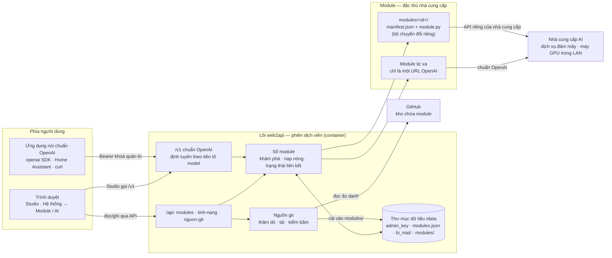
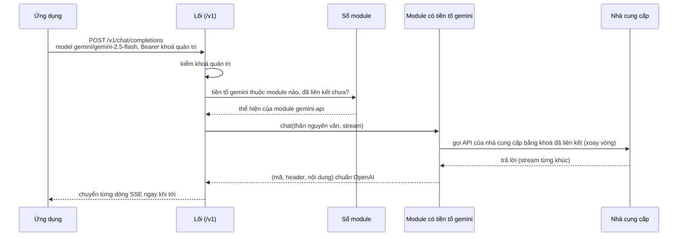
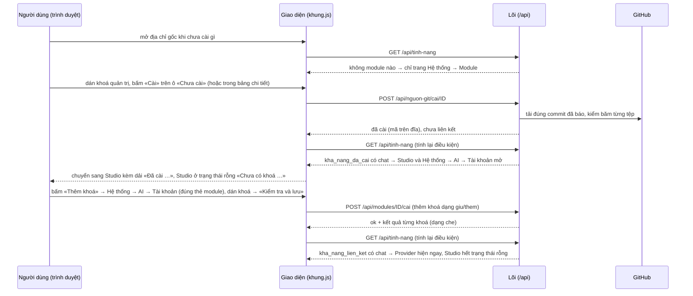

# web2api — tài liệu kỹ thuật

Cổng AI nói chuẩn OpenAI, lõi nhỏ, nguồn AI cài thêm lúc chạy dưới dạng **module**. Tài liệu viết cho người
**chưa biết gì về dự án**, đi theo thứ tự: tổng quan → kiến trúc → thành phần → triển khai → vận hành → lưu ý.
Mọi lệnh và đường dẫn tính từ **gốc kho**. Lịch sử thay đổi xem bằng `git log` — README không giữ nhật ký.

Kho: **https://github.com/TriTue2011/web2api** (public). web2api tách khỏi kho chatgpt2api ngày 10/10/2026;
hệ thống c2a cũ chỉ còn là hệ thống tham chiếu (nơi đã đo các bài học như chữ ký suy nghĩ của Gemini 3).

**Giấy phép:** bản quyền thuộc chủ kho (`TriTue2011`), **giữ toàn quyền** (*All rights reserved*, xem
[LICENSE](LICENSE)). Mã được xem công khai để minh bạch; dùng, sao chép, sửa, phân phối hay triển khai (kể cả
ảnh Docker đã đăng) cần sự cho phép bằng văn bản của chủ kho.

## Mục lục

1. [Tổng quan](#1-tổng-quan)
2. [Kiến trúc](#2-kiến-trúc)
3. [Thành phần](#3-thành-phần)
4. [Module có sẵn](#4-module-có-sẵn)
5. [Triển khai](#5-triển-khai)
6. [Vận hành](#6-vận-hành)
7. [Lưu ý: bảo mật, sự cố, giới hạn](#7-lưu-ý-bảo-mật-sự-cố-giới-hạn)
8. [Tra cứu: API và biến môi trường](#8-tra-cứu-api-và-biến-môi-trường)
9. [Phát triển](#9-phát-triển)

## 1. Tổng quan

web2api là một **cổng AI nói chuẩn OpenAI** chạy trong một container Docker nhỏ trong mạng nhà. Ứng dụng nào
biết gọi OpenAI (thư viện `openai` của Python, Home Assistant, ứng dụng chat…) chỉ cần đổi «địa chỉ gốc» (base
URL) sang web2api và dùng khoá quản trị làm «API key».

**Lõi chỉ là phiên dịch viên.** Lõi không chứa nguồn AI nào và không biết tên nhà cung cấp nào: nó nhận yêu cầu
chuẩn OpenAI, tách **tiền tố** của tên model (`<tiền tố>/<tên>`) để chọn module, rồi chuyển cho module. Mọi thứ
riêng của một nhà cung cấp — địa chỉ máy chủ, cách xác thực, cách đổi tên model, dạng lỗi, gợi ý «hạng miễn phí»,
API gốc khác chuẩn (ví dụ video Veo) — nằm **trong module của nhà cung cấp đó**; module tự có bộ chuyển đổi để nói
chuẩn của lõi. Giao diện cũng vậy: tab và chế độ nào hiện là do **lời khai** của module (`loai`, `cung_cap`,
`muc`), không có tên module nào viết trong giao diện hay lõi. Thêm nguồn AI mới = thả một thư mục module, không
sửa lõi, không dựng lại ảnh, không khởi động lại.

### Trạng thái hiện tại

| Tính năng hoặc module | Trạng thái | Từ phiên bản / ngày |
|---|---|---|
| Lõi: `/health`, thông tin máy `/api/he-thong`, khoá quản trị cho mọi API đổi trạng thái và `/v1` | Có | 0.1.0-khung · 10/10/2026 |
| `/v1/models`, `/v1/chat/completions` chuẩn OpenAI (có stream) | Có | 0.1.0-khung · 10/10/2026 |
| `/v1/images/generations`, `/v1/videos` chuẩn OpenAI (định tuyến theo tiền tố; module không có khả năng đó → `501`) | Có (chỉ đo trên máy chủ Google giả) | 0.1.0-khung · 11/10/2026 |
| Module `gemini-api` (Gemini API, khoá Google AI Studio) | Có — chat đã kiểm với Google thật 10/10/2026; ảnh và video Veo (module 0.2.0, chỉ khoá trả phí) **chưa kiểm với Google thật** | 0.1.0-khung · 10/10/2026 |
| Nguồn module từ git: báo module mới/bản mới, cài, tự cập nhật có điều kiện, lần đầu thêm nguồn thì cập nhật module đang có | Có (chưa thử với GitHub thật) | 0.1.0-khung · 10–11/10/2026 |
| Cài module KHÔNG cần khoá API; khoá thêm/bớt từng cái trên web | Có | 0.1.0-khung · 11/10/2026 |
| Nạp lại module nóng; module từ xa (dịch vụ OpenAI trong mạng nhà); tab riêng của module ở `/m/<id>/` | Có | 0.1.0-khung · 10/10/2026 |
| «Tính năng đang có» `GET /api/tinh-nang`: tab/chế độ hiện theo `loai` + `cung_cap` + `muc` của module | Có | 0.1.0-khung · 11/10/2026 |
| Giao diện mới (lát A): Hệ thống → Module (lưới ô theo loại, nút Cài / Cập nhật / Thêm khoá ngay trên ô, bảng chi tiết «Cần gì để chạy»), Cài xong vào thẳng Studio (trạng thái rỗng khi chưa có khoá), Hệ thống → AI (Tài khoản — nơi thêm/bớt khoá, Provider), Studio (chat stream, ảnh, video) | Có — đo bằng Chrome thật trên lõi thật với module/Google/GitHub giả | 0.1.0-khung · 11/10/2026 |
| Combo (xếp thứ tự nhiều nguồn AI, lùi khi lỗi) | Chưa có backend — tab **không** hiện dù đủ điều kiện | — |
| Khoá khách, «Địa chỉ truy cập công khai», Bảo mật & người dùng | Chưa có (giai đoạn sau) | — |
| Checklist yêu cầu đầy đủ và tự cài gói Python, bỏ trần dung lượng tải module | Chưa có (giai đoạn sau) | — |
| Tác phẩm, Nhà, Đời sống, giọng nói, MCP, sao lưu, nhật ký trên web | Chưa có (chờ module thật đứng sau) | — |
| Gemini: nhúng (embeddings), video bằng Gemini Omni | Chưa có | — |
| Chữ ký số cho module | Chưa có (chỉ kiểm chữ ký commit của GitHub, tuỳ chọn) | — |

## 2. Kiến trúc

### Các thành phần và cách liên kết



- **Lõi** (`app/`) nói chuẩn OpenAI ở `/v1`, giữ sổ module và lưu cấu hình. Lõi cấp cho module một bộ công cụ dùng
  chung (`app/chuyen_tiep.py`: chuyển tiếp nguyên văn, stream từng dòng, xoay khoá, che khoá trong lỗi) — bộ công
  cụ nhận mọi điểm riêng (tên, gợi ý lỗi, lời giải thích khi khoá bị từ chối) làm **tham số do module truyền vào**.
- **Module** quyết mọi chi tiết của nhà cung cấp và tự khai mình là gì: loại (`loai`), khả năng (`cung_cap`), mục
  con (`muc`), trường cấu hình (`truong_cau_hinh`), tài nguyên cần (`tai_nguyen`).
- **Giao diện** (`web/`) chỉ đọc dữ liệu từ API (`/api/tinh-nang`, `/api/modules`, `/v1/models`…) và dựng màn
  hình theo đó.

### Một yêu cầu `/v1` đi qua các phần thế nào



Không thuộc module nào → `404 model_not_found`; module đã cài mà chưa liên kết → `404 module_not_configured`;
module không có khả năng được gọi (ví dụ không có `anh`) → `501 capability_not_supported`.

### Cài → vào Studio → thêm khoá (không tải lại trang)



Module không ứng tab chính nào (ví dụ loại «mạng» chỉ khai `dinh_tuyen`) thì cài xong ở lại Hệ thống → Module, bảng
chi tiết mở ở bước kế tiếp.

### Cấu hình nào thuộc phần nào

| Cấu hình | Thuộc phần | Ở đâu | Ai đặt |
|---|---|---|---|
| Cổng, giới hạn RAM/CPU, volume, nhãn Watchtower | Triển khai | `docker-compose.yml`, `.env` | Người vận hành |
| `WEB2API_DATA`, `WEB2API_ADMIN_KEY`, `WEB2API_MAY_*` | Lõi | Biến môi trường | Người vận hành |
| Khoá quản trị | Lõi | `/data/admin_key` (0600) hoặc `WEB2API_ADMIN_KEY` | Lõi tự sinh lần đầu |
| Nguồn git (`repo`, `nhanh`, `thu_muc`, `chu_ky_giay`, `tu_dong`, `yeu_cau_chu_ky`, `token`) | Lõi — nguồn git | `/data/nguon_git.json` (token ở `bi_mat/`), hoặc `WEB2API_GIT_*` khi chưa lưu | Quản trị (Hệ thống → Module → «＋ Thêm module» → Từ git) |
| Mã module | Module | `/data/modules/<id>/` | Cài từ git, hoặc chép tay |
| `loai`, `loai_ten`, `loai_thu_tu`, `cung_cap`, `muc`, `tab_web`, `tai_nguyen`, `yeu_cau_goi`, `truong_cau_hinh` | Module (lời khai) | `modules/<id>/manifest.json` | Người viết module |
| Giá trị thường của module (ví dụ `base_url`) | Module — lõi chỉ lưu hộ | `/data/modules.json` (`cau_hinh_cong_khai`) | Quản trị (form dựng từ `truong_cau_hinh`) |
| Bí mật của module (khoá API của nhà cung cấp) | Module — lõi chỉ lưu hộ | `/data/bi_mat/<id>.json` (0600), không API nào trả lại | Quản trị |
| Module từ xa (`id`, `tien_to`, `base_url`, `api_key`) | Lõi — module từ xa | `/data/tu_xa.json` (+ `bi_mat/`) | Quản trị |
| Bảng điều kiện hiện tab của khung (Module, AI, Tài khoản, Provider, Combo, Studio, chế độ Studio) | Giao diện | `DIEU_KIEN` trong `web/khung.js` | Người phát triển giao diện |
| Khoá quản trị để trang gọi API | Trình duyệt | `localStorage` (`web2api_khoa`) của trình duyệt đó | Người dùng dán trên trang |

## 3. Thành phần

### Lõi (`app/`)

| Tệp | Việc |
|---|---|
| `main.py` | Khởi động FastAPI, `GET /` (trang chọn trang đầu), `/health`, `/api/he-thong`, phục vụ `web/` |
| `tuyen.py` | Các đường `/v1`, `/api/modules`, `/api/tinh-nang`, `/api/nguon-git`, `/m/<id>/` |
| `kham_pha.py` | Khám phá module từ cấu trúc thư mục, kiểm mẫu manifest; **hợp đồng lớp `Module` ghi ở đầu tệp** |
| `so_module.py` | Sổ module: nạp nóng, cài/gỡ cấu hình, định tuyến theo tiền tố, tính «tính năng đang có» |
| `nguon_git.py` | Thăm dò GitHub, báo module mới/bản mới (kèm `loai`, `cung_cap`, dung lượng tải đo từ cây git), cài theo commit |
| `tu_xa.py` | Module từ xa (chỉ URL), chặn SSRF lúc đăng ký |
| `chuyen_tiep.py` | Bộ chuyển tiếp OpenAI dùng chung cho module; mọi điểm riêng của nhà cung cấp là tham số |
| `kho.py`, `xac_thuc.py`, `he_thong.py` | Lưu trữ trên đĩa (bí mật 0600), khoá quản trị, đọc tài nguyên máy |

### Giao diện (`web/`)

Trang `.dc.html` chạy trên **dc-lite** (`web/support.js`, runtime mã nguồn mở đọc nguyên văn các trang của bản
demo thiết kế). Phần dùng chung nằm ở `web/khung.js` (gọi API, khoá quản trị, bảng điều kiện và **một** hàm đánh
giá điều kiện duy nhất) và `web/khung.css`. Mọi đường dẫn là tương đối, nên web2api nằm sau proxy ở thư mục con
vẫn chạy.

| Trang | Hiện khi | Nội dung |
|---|---|---|
| `index.html` (đường `/`) | luôn | Đọc `/api/tinh-nang` rồi chuyển: có module khai `chat` **đã cài** (kể cả chưa có khoá) → Studio; chưa → Hệ thống → Module |
| `He-thong.dc.html` — Hệ thống → Module | luôn (trang đầu khi chưa cài gì) | Khối «Kết nối với web2api» (chỉ khi chưa có liên kết nào), khoá quản trị (thu thành một hàng khi đã có khoá), ô tìm + chip lọc loại + lọc trạng thái trên một hàng, lưới ô theo loại, bảng chi tiết, «＋ Thêm module» (từ git / từ xa) |
| `He-thong-AI.dc.html` — Hệ thống → AI | có ≥ 1 module mang mã `ai` **đã cài** | Tab «Tài khoản» — nơi thêm/bớt khoá; module chưa liên kết đứng đầu, ghi rõ «Chưa có khoá»; neo `#tk-<id>` tới đúng thẻ. Tab «Provider» khi có ≥ 1 module `ai` **đã liên kết** (model thật từ `/v1/models`, sức khoẻ từng khoá kể cả trạng thái ảnh/video) |
| `Studio.dc.html` — Studio | có ≥ 1 module khai `chat` **đã cài** (không đợi khoá) | Bố cục như bản demo: màn đầu «Bạn muốn làm gì hôm nay?» + một ô soạn lớn (chip model mở bảng chọn model thật từ `/v1/models`, nút gửi tròn) + gợi ý; gửi rồi thì các lượt hội thoại hiện bên trên, ô soạn dính đáy, «Tạo mới» xoá hội thoại. Chế độ «Trò chuyện» (stream), «Vẽ ảnh» khi có module **đã cài** khai `anh`, «Tạo video» khi có module **đã cài** khai `video`. Chế độ chưa có module **đã liên kết** hiện dải «Chưa có khoá cho … Thêm khoá ở Hệ thống → AI → Tài khoản» kèm nút tới đúng module và khoá ô soạn — không gọi `/v1` |
| Tab riêng của module (`/m/<id>/…`) | module đã liên kết và khai `tab_web` | Giao diện riêng của module |

Tab/mục không đạt điều kiện **không có trong DOM**; gõ tay đường dẫn tới đó thì trang chuyển về Hệ thống → Module
kèm một dòng «… chưa mở được: cần …». Thanh trên giống nhau ở mọi trang chính (logo, tab đang có, «Hệ thống», chấm
trạng thái suy từ `/api/tinh-nang`: xanh khi mọi module của trang đã liên kết, vàng khi có module chờ khoá); trên
điện thoại (≤ 880 px) các tab chuyển xuống thanh dưới đáy. Ở Hệ thống, mục «AI» mở bảng xổ các tab con đang có
(Tài khoản, Provider). Hệ thống là trang riêng có nút «Quay lại» (về trang chính đầu tiên đang có;
chưa có trang chính nào thì không có nút). Combo đủ điều kiện (≥ 2 nguồn AI đã liên kết) vẫn không hiện vì chưa
có backend.

**Ô module** (lưới đều nhau như bàn cờ, chia khu theo `loai` có trong dữ liệu, xếp theo `loai_thu_tu`; khu đầu được
chọn sẵn): biểu tượng, tên, chip loại, mô tả cắt gọn, trạng thái — **Chưa cài** · **Đã cài — chờ khoá** (hoặc «chờ
liên kết» nếu không có trường bắt buộc) · **Đang chạy** · **Có bản mới** · **Lỗi** — và dải tài nguyên (RAM thêm ·
đĩa · GPU · dung lượng tải; số chưa khai ghi «chưa đo»). Chân ô có **một nút hành động** theo trạng thái: **«Cài»**
(chưa có mã) · **«Cập nhật»** (có bản mới) · **«Thêm khoá»** (đã cài, cần khoá, chưa liên kết — tới Hệ thống → AI →
Tài khoản nếu module thuộc tab đó, ngược lại mở bảng chi tiết ngay ở bước thêm khoá). Nút này là anh em của nút chọn
ô, không lồng trong nó: một cú bấm chỉ làm một việc, và bấm liền hai lần chỉ cài một lần. **Bảng chi tiết** (cột phải; tờ trượt trên điện thoại):
mô tả, khối «Cần gì để chạy» (tài nguyên, gói Python, mạng ra, hướng dẫn bằng chữ từ `tai_nguyen.ghi_chu`, một dòng
«Máy này đủ chạy / có thể thiếu» khi đọc được `/api/he-thong` và module có khai số), mục của module, nút theo trạng
thái: **«Cài»** (chưa có mã trên máy) · **«Cập nhật»** (đã cài, có bản mới) · form «Thêm tài khoản/khoá API» · «Gỡ».

**Form khoá** dựng từ `truong_cau_hinh`: khoá đã lưu chỉ hiện dạng che, nút «Bớt» cho từng khoá, ô thêm khoá mới
(mỗi dòng một khoá); ô chuỗi để trống hay không sửa thì **không gửi** — giá trị đã lưu (ví dụ `base_url` qua proxy)
được giữ. Gửi đi là xoá bí mật khỏi trang.

### Module

Mỗi module có **id** (ví dụ `gemini-api`) và **tiền tố model** (ví dụ `gemini`); model gọi dạng
`<tiền tố>/<tên model>`. Ba trạng thái, lõi suy từ đĩa chứ không từ danh sách gõ tay:

- **có trên git** — chưa có mã trên máy; việc làm với nó là **«Cài»**.
- **đã cài** — mã nằm trong `/data/modules/<id>/` (hoặc đi kèm ảnh): có trong `GET /api/modules`, gỡ được. Mọi
  thay đổi bản từ đây là **«Cập nhật»**.
- **đã liên kết** — có cấu hình hợp lệ (khoá…) và đang phục vụ `/v1` (`"da_cau_hinh": true`). Module khai trường
  `bat_buoc` mà chưa có khoá thì không được nạp, không có trong `/v1/models`, và `/v1/chat/completions` trả `404`
  nêu rõ «chưa có khoá». Module không có trường bắt buộc thì cài từ git xong là liên kết luôn.

**«Tính năng đang có»** — `GET /api/tinh-nang` (mở, không bí mật): mỗi module đã cài góp mã `loai` và các mã
`cung_cap` của nó; lõi đếm số module theo từng mã, tách **đã cài** (`kha_nang_da_cai`) và **đã liên kết**
(`kha_nang_lien_ket`), kèm thống kê theo loại (`loai`: `ma`, `ten`, `thu_tu`, `so_da_cai`, `so_da_lien_ket`), tab
riêng của module đã liên kết (`tab`, đường tương đối) và mục con module khai (`muc`, kèm `can`). Module từ xa được
tính là `loai: "ai"`, `cung_cap: ["chat"]` — đó chính là hợp đồng của nó (dịch vụ chat chuẩn OpenAI).

```bash
curl -s $W/api/tinh-nang
# {"modules": [{"id": "gemini-api", "loai": "ai", "cung_cap": ["chat", "anh", "video"], "da_lien_ket": true, ...}],
#  "loai": [{"ma": "ai", "ten": "AI", "thu_tu": 10, "so_da_cai": 1, "so_da_lien_ket": 1}],
#  "kha_nang_da_cai": {"ai": 1, "chat": 1, "anh": 1, "video": 1}, "kha_nang_lien_ket": {...}, "tab": [], "muc": []}
```

**Một hàm đánh giá cho cả khung lẫn module.** Mỗi dòng điều kiện có dạng `{can: [mã…], pham_vi: "lien_ket" |
"da_cai", toi_thieu: n}`. Bảng của khung (`DIEU_KIEN` trong `web/khung.js`):

| Tab / mục | Điều kiện hiện |
|---|---|
| Hệ thống → Module | luôn; trang đầu khi chưa cài gì |
| Hệ thống → AI, AI → Tài khoản | `can: ["ai"]`, `da_cai` |
| AI → Provider | `can: ["ai"]` (đã liên kết) |
| AI → Combo | `can: ["ai"]`, `toi_thieu: 2`, chưa có backend → không bao giờ hiện |
| Studio (trang chính) và chế độ Chat | `can: ["chat"]`, `da_cai` |
| Chế độ Ảnh / Video | `can: ["anh"]` / `["video"]`, `da_cai` |

Tab «chính» và chế độ của nó hiện khi module **đã cài**; **gọi được `/v1`** hay chưa là đúng dòng đó xét lại ở phạm
vi đã liên kết (`dungDuoc` trong `khung.js`, cùng hàm `thieu`) — chưa đủ thì trang hiện trạng thái rỗng chỉ chỗ thêm
khoá thay vì ẩn. Mục `muc` của module dùng đúng hàm đó (thêm điều kiện chính module phải đã liên kết). Thêm tính
năng mới của khung = thêm một dòng; thêm module mới = thả thư mục, không sửa khung.

#### Viết một module

Thư mục `modules/<id>/` gồm:

- `manifest.json`:
  - bắt buộc: `id` (chữ thường, số, `-`, `_`; 2–41 ký tự), `ten`, `mo_ta`, `loai`, `giao_thuc` (`openai`),
    `tien_to`, `truong_cau_hinh` (danh sách `{khoa, nhan, kieu, bat_buoc, mac_dinh, mo_ta}`; `kieu` là `chuoi`,
    `bi_mat` hoặc `danh_sach_bi_mat` — trường bí mật tự được lưu riêng và che), `tai_nguyen` (`ram_them_mb`,
    `dia_mb`, `gpu`, `mang_ra`, `ghi_chu` — `ghi_chu` hiện thành «Hướng dẫn» ở bảng chi tiết;
    số chưa đo để `null`);
  - `loai`: mã loại, **tập mở** (chữ thường, số, `_`; ví dụ `ai`, `app`, `nha`, `mang`). Lõi chỉ kiểm dạng mã,
    không giữ danh sách loại hợp lệ: thêm Home Assistant hay MikroTik là một thư mục module với `loai` riêng;
  - tuỳ chọn cho giao diện: `loai_ten` (tên hiển thị của loại, ví dụ `"AI"`; thiếu thì hiện chính mã),
    `loai_thu_tu` (số nguyên, nhỏ đứng trước — khu đầu tiên được chọn sẵn ở trang Module);
  - tuỳ chọn `cung_cap`: danh sách mã khả năng, **tập mở** (ví dụ `["chat", "anh", "video"]`). Giao diện dùng lời
    khai này để quyết tab/chế độ; định tuyến `/v1` vẫn dựa vào phương thức có thật trên lớp `Module`;
  - tuỳ chọn `muc`: tab con/mục của module, mỗi mục `{"id", "nhan", "can": [mã…]}` — mục hiện khi module đã liên
    kết **và** mọi mã trong `can` có ở ít nhất một module đã liên kết (`[]` = luôn hiện khi đã liên kết); trang
    Module nói rõ mục nào chưa mở và «cần thêm» gì. Ví dụ module nhà thông minh: `{"id": "hoc-hoi", "nhan": "Học
    hỏi", "can": []}` và `{"id": "dieu-khien", "nhan": "Điều khiển", "can": ["ai"]}`;
  - tuỳ chọn `phien_ban`, `yeu_cau_goi` (gói Python module cần import), `tab_web`
    (`{"nhan": "...", "trang": "web/<tệp>"}`).
- `module.py`: lớp `Module` với `__init__(manifest)`, `nap(cau_hinh)`, `async cai(cau_hinh)`,
  `async chat(body, stream)`, `async models()`, `async suc_khoe()`, `async dung()`. Tuỳ chọn: `async anh(body)`
  (mở `/v1/images/generations`) và bộ ba `async video_tao(body)`, `async video_trang_thai(ma)`,
  `async video_noi_dung(ma)` (mở `/v1/videos`); không có thì lõi trả `501`. Model nào chỉ dùng cho một khả năng
  thì module gắn `"kha_nang": [mã]` vào mục của nó trong `models()` (Studio lọc model theo đó). Hợp đồng chi tiết ở
  đầu tệp `app/kham_pha.py`; module mẫu thật: `modules/gemini-api/`. **Bộ chuyển đổi của module**: module tự đổi
  yêu cầu/trả lời giữa chuẩn OpenAI của lõi và API của nhà cung cấp; dùng lại `app.chuyen_tiep.ChuyenTiepOpenAI`
  khi nhà cung cấp đã nói chuẩn OpenAI, truyền các điểm riêng làm tham số (`ten`, `doi_id_model`, `goi_y_loi`,
  `kha_nang`, `goi_y_tu_choi_kha_nang`).
- Tuỳ chọn `web/`: giao diện riêng, phục vụ ở `/m/<id>/` khi module đã cài (kể cả lúc chưa liên kết); thanh trên
  có tab của nó khi module đã liên kết.

Module cần gói Python mà ảnh lõi không có thì bị **từ chối nạp** với thông báo nêu tên gói — lõi không tự cài gói
lúc chạy; khi đó làm **module từ xa**. Một module hỏng chỉ báo lỗi của riêng nó; cài đè một bản mới hỏng thì
web2api **hoàn về bản cũ**. Sửa tay tệp trong `/data/modules/` thì nạp lại không cần khởi động:

```bash
curl -s -X POST -H "Authorization: Bearer $K" $W/api/modules/nap-lai    # {"them": [], "doi": [], "go": [], "loi": []}
```

Module đã cài nhưng chưa có cấu hình thì liên kết bằng `POST /api/modules/<id>/cai` với thân
`{"cau_hinh": {...}}` (module không cần cấu hình: `{"cau_hinh": {}}`). Cấu hình đã lưu mà thiếu trường `bat_buoc`
(ví dụ tệp bí mật bị mất) thì lõi không nạp module — coi như chưa liên kết.

### Nguồn module từ git

1. Người viết module đặt module vào kho git của dự án, thư mục `modules/<id>/`, đẩy lên nhánh `main`.
2. web2api thăm dò git (mặc định mỗi 300 giây; mỗi lần bình thường là **1 yêu cầu** có điều kiện, trả 304 khi không
   đổi) và báo **«có module mới»** / **«có bản mới»**: `GET /api/modules/thong-bao` (quản trị) trả danh sách kèm
   `loai`, `cung_cap`, `tai_nguyen`, `yeu_cau_goi` và `dung_luong` (byte, cộng từ cây git); `GET /api/modules` (mở)
   có số `thong_bao_so` để mục «Module» hiện chấm đỏ.
3. Quản trị bấm «Cài» ở ô của module (hoặc `POST /api/nguon-git/cai/<id>`) — **không cần khoá API**. web2api tải
   đúng phiên bản đã báo, kiểm toàn vẹn từng tệp, đặt vào `/data/modules/<id>/` và nạp nóng.

**Lần đầu thêm nguồn git thì cập nhật luôn module đang có**: ở lần đồng bộ thành công đầu tiên của một nguồn,
web2api **cập nhật** một lần mọi module đã có mã trên máy mà git có bản khác — dù `tu_dong` tắt. Module **mới**
trên git không tự cài. Giữ mọi chốt: bản mới xin thêm quyền (gói Python, mạng ra) hoặc commit chưa ký khi bật
`yeu_cau_chu_ky` thì không cập nhật và ghi lý do vào `ghi_chu`; bản vừa gỡ không cài lại; cập nhật hỏng thì giữ
bản cũ. Dấu «đã đồng bộ» là commit lưu trong `nguon_git_trang_thai.json`.

Kho `TriTue2011/web2api` đang **public** nên web2api đọc **ẩn danh**. `docker-compose.yml` đặt sẵn kho này; các
biến môi trường chỉ được dùng khi **chưa** lưu cấu hình qua trang hoặc API. Sửa ở Hệ thống → Module → «＋ Thêm
module» → «Từ git», hoặc:

```bash
curl -s -X PUT -H "Authorization: Bearer $K" -H "Content-Type: application/json" \
  -d '{"repo": "TriTue2011/web2api", "nhanh": "main", "thu_muc": "modules", "chu_ky_giay": 300, "tu_dong": false, "yeu_cau_chu_ky": false}' \
  $W/api/nguon-git
curl -s -H "Authorization: Bearer $K" $W/api/nguon-git      # cấu hình + trạng thái đồng bộ
```

| Trường | Mặc định | Ý nghĩa |
|---|---|---|
| `repo` | — | Kho dạng `chủ/kho`. Chỉ đọc qua `https://api.github.com`. |
| `nhanh` | `main` | Nhánh theo dõi. |
| `thu_muc` | `modules` | Thư mục chứa module trong kho. |
| `chu_ky_giay` | `300` | Khoảng thăm dò. 300 giây/lần chỉ tốn 12 yêu cầu/giờ. |
| `token` | không có | Chỉ cho kho riêng tư hoặc nâng hạn mức; lưu 0600, không trả lại; gửi `""` để xoá. |
| `tu_dong` | `false` | Bật thì web2api tự cài module mới/bản mới. |
| `yeu_cau_chu_ky` | `false` | Bật thì chỉ **tự** cài khi commit được GitHub xác minh chữ ký. |

Gửi lại `PUT /api/nguon-git` (thân `{}`) để thăm dò **ngay**. Hạn mức GitHub ẩn danh là 60 yêu cầu/giờ/IP;
web2api đọc số còn lại sau mỗi phản hồi, còn dưới 10 thì giãn nhịp tới giờ đặt lại (`han_muc_con`, `reset_luc`).
**Tự cài** (`tu_dong: true`) không chạy khi commit chưa ký (nếu bật `yeu_cau_chu_ky`) hoặc khi bản mới xin thêm
quyền (`yeu_cau_goi`, `tai_nguyen.mang_ra`) — các trường hợp này hiện trong `ghi_chu` để quản trị xem và cài tay.

### Module từ xa

Dịch vụ đã nói chuẩn OpenAI (ví dụ máy GPU trong mạng nhà) đăng ký bằng URL; web2api không nạp mã nào, chỉ chuyển
tiếp `/v1`. Trên giao diện: «＋ Thêm module» → «Từ xa». Bằng `curl`:

```bash
curl -s -X POST -H "Authorization: Bearer $K" -H "Content-Type: application/json" \
  -d '{"id": "gpu-lan", "ten": "Model trên máy GPU", "tien_to": "lan", "base_url": "http://192.168.1.220:8000/v1", "api_key": "tuỳ chọn"}' \
  $W/api/modules/tu-xa
```

`base_url` được phép là địa chỉ mạng nhà (192.168.x.x, 10.x.x.x, 172.16–31.x.x) và `http://`. Bị chặn: địa chỉ của
chính container (127.0.0.1, localhost), dải 169.254.0.0/16 (metadata đám mây), địa chỉ không định tuyến.

## 4. Module có sẵn

Mỗi module có một tiểu mục dưới đây (mẫu: `docs/MAU-TIEU-MUC-MODULE.md`) và một dòng ở bảng «Trạng thái hiện tại»
(mục 1).

### Module gemini-api — Gemini API (Google AI Studio)

**Mô tả.** Gọi các model Gemini của Google bằng khoá API của Google AI Studio. Module chuyển tiếp
thẳng tới endpoint tương thích OpenAI chính thức của Google
(`https://generativelanguage.googleapis.com/v1beta/openai`), giữ nguyên mọi trường của yêu cầu — kể cả
chữ ký suy nghĩ của Gemini 3 khi gọi công cụ nhiều bước. Module thêm vào: xoay vòng nhiều khoá, cho khoá
nghỉ khi hết hạn mức, đổi địa chỉ gốc để vượt chặn vùng, chuẩn hoá lỗi, danh sách model, kiểm sức khoẻ.
Mã nguồn: `modules/gemini-api/`. Tiền tố model: `gemini`. Mọi đặc thù của Google (địa chỉ, header `x-goog-api-key`
và API gốc Veo cho video, nhận diện chặn vùng, lời giải thích «hạng miễn phí không có ảnh/video») nằm trong module;
lõi chỉ cấp bộ chuyển tiếp dùng chung.

**Cần gì.**
- Một hoặc nhiều khoá API lấy ở https://aistudio.google.com/apikey (đăng nhập tài khoản Google,
  bấm «Create API key»). Khoá có dạng bắt đầu bằng `AIza`.
- Container ra được Internet tới `generativelanguage.googleapis.com`.
- Nguồn git đã cấu hình (mục 3, «Nguồn module từ git») để tải module về.

**Cách cài.** Trên giao diện: mục 6, «Cài nguồn AI đầu tiên». Bằng `curl`:

1. Xem thông báo module mới (vòng thăm dò chạy ngay lúc khởi động, sau đó mỗi 300 giây):

   ```bash
   curl -s -H "Authorization: Bearer $K" $W/api/modules/thong-bao
   ```

   Trong `danh_sach` phải có `"id": "gemini-api"` với `"trang_thai": "moi"`.
2. Cài module — **không cần khoá API** (tải về và nạp, không khởi động lại). Xong bước này module đã cài
   nhưng chưa liên kết (`"da_cau_hinh": false` trong `GET /api/modules`):

   ```bash
   curl -s -X POST -H "Authorization: Bearer $K" $W/api/nguon-git/cai/gemini-api
   ```

3. Nhập khoá và kiểm tra. web2api gọi thử `GET /models` với **từng** khoá (không tốn token), chỉ lưu
   những khoá dùng được, và báo kết quả từng khoá ở dạng che (chỉ 4 ký tự cuối):

   ```bash
   curl -s -X POST -H "Authorization: Bearer $K" -H "Content-Type: application/json" \
     -d '{"cau_hinh": {"api_keys": ["AIza...khoá-1", "AIza...khoá-2"]}}' \
     $W/api/modules/gemini-api/cai
   ```

   Thành công thì trả `{"ok": true, "ket_qua_tung_khoa": [...]}`. Không khoá nào dùng được thì trả mã
   400 với `"ok": false` và lý do — cấu hình **không** được lưu.

4. Thêm hoặc bớt **từng khoá** sau này, không phải dán lại cả danh sách và không ai được xem lại khoá thật.
   Xem khoá đã lưu (chỉ dạng che, theo thứ tự — thứ tự đó là **chỉ số** dùng ở dưới):

   ```bash
   curl -s -H "Authorization: Bearer $K" $W/api/modules/gemini-api/cau-hinh
   # {"gia_tri": {"api_keys": ["…abcd", "…wxyz"], "base_url": "..."}, "da_cau_hinh": true, ...}
   curl -s -X POST -H "Authorization: Bearer $K" -H "Content-Type: application/json" \
     -d '{"cau_hinh": {"api_keys": {"them": ["AIza...khoá-mới"]}}}' \
     $W/api/modules/gemini-api/cai                                  # thêm một khoá, giữ hết khoá cũ
   curl -s -X POST -H "Authorization: Bearer $K" -H "Content-Type: application/json" \
     -d '{"cau_hinh": {"api_keys": {"giu": [1]}}}' \
     $W/api/modules/gemini-api/cai                                  # chỉ giữ khoá chỉ số 1 (bớt khoá 0)
   ```

   Quy tắc của `POST /api/modules/{id}/cai`: trường **vắng mặt** trong `cau_hinh` thì giữ giá trị đã lưu
   (thêm khoá không làm mất `base_url` đã đặt); trường có mặt thì thay — một **danh sách** thường vẫn là
   thay cả danh sách; trường kiểu `danh_sach_bi_mat` còn nhận dạng sửa `{"giu": [chỉ số], "them": [khoá]}`
   (vắng `giu` là giữ hết). Mỗi lần lưu, web2api kiểm lại mọi khoá và chỉ giữ khoá dùng được.

**Cấu hình.**

| Trường | Bắt buộc | Ý nghĩa |
|---|---|---|
| `api_keys` | Có | Danh sách khoá (hoặc một chuỗi, các khoá cách nhau bằng dấu phẩy/xuống dòng). Lưu ở `/data/bi_mat/gemini-api.json` quyền 0600; không API nào trả lại khoá. |
| `base_url` | Không | Mặc định gọi thẳng Google. Bị chặn vùng thì đặt địa chỉ proxy, ví dụ `https://<tên>.workers.dev`; thiếu `/v1beta/openai` thì web2api tự thêm. |

Nếu Google chặn vùng (lỗi chứa «User location is not supported»), dựng một Cloudflare Worker từ tệp
`deploy/cloudflare-gemini-proxy.js` trong kho (để trống `PROXY_TOKEN` của Worker — web2api chưa gửi được
header `X-Proxy-Token`) rồi cài lại với `base_url`:

```bash
curl -s -X POST -H "Authorization: Bearer $K" -H "Content-Type: application/json" \
  -d '{"cau_hinh": {"api_keys": ["AIza..."], "base_url": "https://<tên>.workers.dev"}}' \
  $W/api/modules/gemini-api/cai
```

**Ví dụ dùng.**

```bash
curl -s -H "Authorization: Bearer $K" -H "Content-Type: application/json" \
  -d '{"model": "gemini/gemini-2.5-flash", "messages": [{"role": "user", "content": "Chào bạn"}]}' \
  $W/v1/chat/completions
curl -s -H "Authorization: Bearer $K" $W/api/modules/gemini-api/suc-khoe   # sức khoẻ từng khoá
```

**Tạo ảnh và video — chỉ khoá TRẢ PHÍ (module 0.2.0).** Theo **trang giá Google ngày 11/10/2026**
(https://ai.google.dev/gemini-api/docs/pricing, trang ghi cập nhật 09/10/2026), mọi model tạo ảnh và tạo video
đều ghi **«Not available»** ở hạng miễn phí. Khoá miễn phí vẫn chat được nhưng **không** tạo được ảnh/video; cần
khoá thuộc dự án Google Cloud đã bật thanh toán. **Mỗi lần tạo là tốn tiền thật** (giá dưới đây, chưa tính thuế):

| Loại | Model (mã gọi qua web2api: `gemini/<mã>`) | Giá hạng trả phí (bản thường) |
|---|---|---|
| Ảnh | `gemini-3.1-flash-image` (Nano Banana 2) | khoảng 0,067 USD/ảnh 1K; 0,151 USD/ảnh 4K |
| Ảnh | `gemini-3.1-flash-lite-image` (Nano Banana 2 Lite) | khoảng 0,034 USD/ảnh 1K |
| Ảnh | `gemini-3-pro-image` (Nano Banana Pro) | khoảng 0,134 USD/ảnh 1K–2K; 0,24 USD/ảnh 4K |
| Ảnh | `gemini-nano-banana-2.1` | khoảng 0,034 USD/ảnh 1K; 0,113 USD/ảnh 4K |
| Ảnh | `gemini-2.5-flash-image` | 0,039 USD/ảnh — Google ghi **tắt ngày 02/10/2026**, đừng dùng |
| Video | `veo-3.1-generate-preview` | 0,40 USD/giây (720p, 1080p); 0,60 USD/giây (4K) — video 8 giây 720p ≈ 3,2 USD |
| Video | `veo-3.1-fast-generate-preview` | 0,10 USD/giây (720p); 0,12 (1080p); 0,30 (4K) |
| Video | `veo-3.1-lite-generate-preview` | 0,05 USD/giây (720p); 0,08 (1080p); không có 4K |

Imagen không còn trên trang giá; Veo 3.0 đã lỗi thời. Gemini Omni (`gemini-omni-1.1-flash`, trang video của
Google khuyên làm mặc định) dùng API khác (Interactions) nên **chưa** hỗ trợ ở bản này. Tên model đổi theo Google:
web2api không giữ bảng tên model, bạn gọi đúng mã Google đang có (xem `GET /v1/models`; model video được đánh
dấu `"kha_nang": ["video"]` theo trường `supportedGenerationMethods` của Google. Model ảnh không đánh dấu được vì
Google ghi chúng là `generateContent` giống model chat).

Tạo ảnh — đi endpoint tương thích OpenAI của Google (`…/v1beta/openai/images/generations`), thân đi nguyên văn
(chỉ bỏ tiền tố `gemini/`), nên dùng được cả trường riêng của Google như `aspect_ratio`, `generation_config`:

```bash
curl -s -H "Authorization: Bearer $K" -H "Content-Type: application/json" \
  -d '{"model": "gemini/gemini-3.1-flash-image", "prompt": "Con mèo đội nón lá", "response_format": "b64_json", "n": 1, "aspect_ratio": "16:9"}' \
  $W/v1/images/generations | jq -r '.data[0].b64_json' | base64 -d > anh.png
```

Tạo video — không đồng bộ, như `/v1/videos` của OpenAI: tạo → hỏi trạng thái tới `completed` → tải. Module đi
API gốc Veo (`:predictLongRunning`) vì trang tương thích OpenAI của Google không ghi cách tải tệp video. Thân là
**JSON** (gửi `multipart/form-data` — như SDK `openai` làm với `videos.create` — bị trả `415`):

```bash
ID=$(curl -s -H "Authorization: Bearer $K" -H "Content-Type: application/json" \
  -d '{"model": "gemini/veo-3.1-fast-generate-preview", "prompt": "Flycam bay qua ruộng bậc thang", "seconds": 8, "aspect_ratio": "16:9", "resolution": "720p"}' \
  $W/v1/videos | jq -r .id)                                           # vd "gemini:bW9kZWxz….1a2b3c4d", status "queued"
curl -s -H "Authorization: Bearer $K" $W/v1/videos/$ID             # hỏi mỗi ~10 giây: in_progress → completed | failed
curl -s -H "Authorization: Bearer $K" -o video.mp4 $W/v1/videos/$ID/content   # tải (stream, không nạp cả tệp vào RAM)
```

- Tham số video: `prompt` (bắt buộc), `seconds` hoặc `duration_seconds` (4, 6, 8), `aspect_ratio` (`16:9`,
  `9:16`) hoặc `size` kiểu OpenAI (`1280x720` → 16:9), `resolution` (`720p`, `1080p`, `4k` — 1080p/4k chỉ với 8
  giây), `image` (ảnh đầu: base64 hoặc data URL), `last_frame`, và các tham số khác của Veo viết kiểu
  `snake_case` (vd `negative_prompt`, `person_generation`, `seed`) — web2api đổi sang `camelCase` của Veo.
- Mã video có dạng `gemini:<mã>`: phần trước dấu `:` là tiền tố module. Video thuộc dự án của **khoá đã tạo nó**:
  bớt khoá đó thì không hỏi/tải được nữa. Google giữ video **2 ngày**.
- Khoá chỉ đi bằng header (không bao giờ vào URL hay nhật ký) và chỉ gửi tới máy của `base_url`: Google
  chuyển hướng tải tệp sang máy khác thì web2api bỏ khoá ở bước đó.

Khoá bị từ chối khi tạo ảnh/video (nhớ riêng cho từng khoá **và** từng việc — khoá bị từ chối tạo ảnh vẫn chat
và vẫn được thử tạo video bình thường):

| Google trả | web2api làm |
|---|---|
| `401` / `403` (không phải chặn vùng) | Khoá bị từ chối việc đó **24 giờ** (hết hạn thì thử lại — khoá được nâng lên trả phí sẽ tự dùng được), thử khoá kế |
| `429` | Khoá **từng** làm được việc đó → hết hạn mức thật, nghỉ theo `Retry-After` (mặc định 60 giây). Khoá **chưa từng** làm được → coi như bị từ chối, nghỉ 24 giờ (Google hay báo «hạn mức = 0» của hạng miễn phí bằng `429` — chưa đo). Cái giá: khoá trả phí **mới** gặp `429` ngay lần đầu cũng nghỉ việc đó 24 giờ; khoá khác vẫn phục vụ, lưu lại cấu hình là xoá. Cả hai trường hợp đều thử khoá kế |
| `400` | Khoá từng làm được việc đó → lỗi của yêu cầu, trả ngay. Chưa rõ → thử khoá kế; khoá sau làm được thì khoá trước bị từ chối 24 giờ; **mọi** khoá đều `400` → trả `400` của Google kèm gợi ý «có thể mọi khoá là hạng miễn phí», không đánh dấu khoá nào (một yêu cầu sai không được khoá cả nhà khỏi ảnh/video) |
| Mọi khoá đang bị từ chối | `403` mã `no_key_permitted`, nêu từng khoá (dạng che), mã Google đã gặp, giờ thử lại, và câu «hạng miễn phí không dùng được — cần khoá trả phí». Chỉ khi mọi khoá đều từng làm được và chỉ đang hết hạn mức (`429`) thì trả `429` kèm `Retry-After` |

`GET /api/modules/gemini-api/suc-khoe` báo thêm cho từng khoá: `"kha_nang": {"anh": {...}, "video": {...}}` với
`trang_thai` là `chua_ro` (chưa dùng thật lần nào — web2api **không** thử bằng lời gọi tốn tiền),
`dung_duoc`, hoặc `bi_tu_choi` (kèm `ma` — mã HTTP Google trả — và `thu_lai_luc`). Trạng thái này nằm trong bộ nhớ: lưu lại cấu
hình module hay khởi động lại thì về `chua_ro`.

**Chưa đo với Google thật** (chưa có khoá trả phí để thử): dạng lỗi Google trả cho khoá miễn phí (giả định
400/403/429 — đọc mã thật trong `ma` ở sức khoẻ hoặc trong thông báo lỗi), đường tạo/hỏi/tải Veo, tên
model nào còn sống, `base_url` qua proxy Cloudflare cho ảnh/video, máy đích khi Google chuyển hướng tải video.
Qua proxy `deploy/cloudflare-gemini-proxy.js`: Worker chuyển mọi đường `/v1beta/...` và mọi header (kể cả
`x-goog-api-key`) nên về nguyên tắc video đi được, nhưng Worker gọi `fetch(..., redirect: "follow")` — nếu Google
chuyển hướng lúc tải video thì chính Worker đi theo và có thể mang khoá sang máy đích (web2api không chặn được
bước đó; chưa đo, Worker chưa sửa).
Tự đo bằng khoá của bạn: gọi lệnh tạo ảnh ở trên **một lần** với model Lite (rẻ nhất), rồi xem
`GET /api/modules/gemini-api/suc-khoe`.

**Sự cố thường gặp.**
- `403` `no_key_permitted` khi tạo ảnh/video: không khoá nào được Google cho việc đó — thường là khoá hạng
  miễn phí. Thêm khoá thuộc dự án đã bật thanh toán (bước 4).
- `429` «Mọi khoá… đang nghỉ»: mọi khoá hết hạn mức. Khoá gặp 429 nghỉ theo `Retry-After` của Google
  (mặc định 60 giây, tối đa 10 phút) rồi tự dùng lại. Thêm khoá để chịu tải tốt hơn.
- `401`/`403` ở một khoá: khoá đó bị đánh dấu hỏng và nghỉ 1 giờ, web2api tự chuyển sang khoá kế.
- `400` khi chat: Google trả `400` cả cho khoá sai/bị thu hồi, nên web2api so giữa các khoá. Khoá chưa từng
  chat thành công (từ lần lưu cấu hình/khởi động gần nhất) mà trả `400` → thử khoá kế; khoá kế trả lời được thì
  khoá trước bị đánh dấu hỏng, nghỉ 1 giờ. **Mọi** khoá đều `400` → trả `400` của Google nguyên văn (đã che khoá),
  không đánh dấu khoá nào — đó là lỗi của yêu cầu. Khoá đã từng chat được mà gặp `400` → trả ngay, không đổi khoá.
- `403` hoặc `400` có «chặn vùng»: đặt `base_url` qua proxy như trên. Lỗi chặn vùng không làm khoá bị
  đánh dấu hỏng (mọi khoá đều sẽ bị như nhau).
- `504`: Google không trả lời trong 120 giây (stream: 60 giây giữa hai khúc).

**Đã kiểm với dịch vụ thật ngày 10/10/2026** (lõi mới + Google thật, khoá của c2a):

| Việc | Kết quả |
|---|---|
| Nạp lại nóng nhận module | Đạt |
| Cài 6 khoá | 6/6 khoá hợp lệ, 62 model |
| `/v1/models`; gọi không có khoá quản trị | Đạt; trả 401 |
| Chat thường | Đạt, khoảng 1,3 giây |
| Chat stream | Đạt — với câu trả lời ngắn Google gửi cả câu trong **một** khúc; đó không phải lỗi gom bộ đệm |
| Gọi công cụ 2 bước với Gemini 3 (chữ ký suy nghĩ trong `extra_content`) | Đạt — đúng ca từng hỏng ngày 06/10/2026 |
| Sức khoẻ module; danh sách mở không lộ khoá; gỡ module xoá bí mật | Đạt |

Chưa kiểm với dịch vụ thật: `base_url` qua proxy Cloudflare, khoá bị thu hồi sau khi cài, hết hạn mức
(429) thật của Google.

**Giới hạn.**
- Chưa có nhúng (embeddings) và video bằng Gemini Omni. Tạo ảnh/video trên web: Studio (chế độ «Ảnh», «Video»).
- Tạo ảnh/video cần khoá trả phí và chưa đo với Google thật (xem trên).
- Khoá bị thu hồi SAU khi đã chat được: lượt đầu tiên nó trả `400` vẫn rơi lỗi tới khách (chưa phân biệt được
  với yêu cầu sai); từ lượt `400` kế của khoá đó web2api mới so với khoá khác và đánh dấu hỏng. Danh sách model
  (`/v1/models`) lấy bằng một khoá: khoá đầu tiên đang dùng được mà hỏng thì danh sách rỗng hoặc là bản đệm cũ
  cho tới khi chat đánh dấu khoá đó. Bớt khoá hỏng (dạng `{"giu": [...]}` ở bước 4) để dứt hẳn.
- Không bớt được khoá cuối cùng: `api_keys` là trường bắt buộc nên module từ chối cấu hình rỗng — muốn bỏ
  hẳn thì gỡ module.
- Chưa đo RAM/đĩa thật của module (trường `ram_them_mb`, `dia_mb` trong manifest đang để trống).
- Proxy Cloudflare có đặt `PROXY_TOKEN` (header `X-Proxy-Token`) chưa dùng được: `base_url` không mang
  thêm header.

## 5. Triển khai

### Cần gì để chạy

- **Docker** có `docker compose` 2.24 trở lên. Không cần Python trên máy chủ.
- **RAM**: lõi rỗng chạy ổn định khoảng **32 MB**, gần như không tốn CPU lúc rảnh (đo thật 0,14% ngày
  10/10/2026). Giới hạn **256 MB** là đủ cho lõi và module Gemini API (module chỉ chuyển tiếp).
- **Đĩa**: ảnh lõi **198 MB** (đo 10/10/2026, trước khi thêm gói `httpx` — khoảng 1,8 MB nữa; ảnh mới chưa đo
  lại), cộng vài MB dữ liệu.
- **Mạng ra Internet** tới nhà cung cấp mà module gọi (ví dụ `generativelanguage.googleapis.com`) và tới
  `api.github.com` nếu nhận module từ git.

### Cài bằng docker compose

Ảnh lõi `ghcr.io/tritue2011/web2api:latest` chỉ chứa lõi (`app/` và `web/`) — module **không** nằm trong ảnh mà
được cài lúc chạy từ thư mục `modules/` của kho git, vào thư mục dữ liệu ngoài ảnh.

```bash
curl -fsSL https://get.docker.com | sudo sh    # Debian/Ubuntu; hoặc theo https://docs.docker.com/engine/install/
docker compose version                         # phải in ra phiên bản v2.x
git clone https://github.com/TriTue2011/web2api.git
cd web2api                                     # mọi lệnh sau chạy ở gốc kho
docker compose up -d                           # kéo ảnh từ GHCR rồi chạy nền
```

Chưa có ảnh trên GHCR, hoặc muốn chạy đúng mã đang có trên máy, thì dựng tại chỗ: `docker compose up -d --build`.
Dữ liệu (khoá quản trị, cấu hình, module đã cài) nằm trong **volume có tên `web2api-data`**: Docker tự cho volume
mới quyền của người dùng trong ảnh (uid 1000), không phải tạo thư mục hay đổi quyền. Mở `http://<IP-máy-chủ>:3031/`
rồi làm tiếp mục 6.

`docker-compose.yml` đặt sẵn: tên container `web2api`; cổng `3031 → 8000`; giới hạn 256 MB RAM, 0,5 nhân CPU, 100
tiến trình; chạy bằng uid 1000; tự khởi động lại trừ khi bạn dừng; kiểm sức khoẻ `/health` mỗi 30 giây; nguồn
module git của dự án (`WEB2API_GIT_REPO=TriTue2011/web2api`, `WEB2API_GIT_NHANH=main`, `WEB2API_GIT_THU_MUC=modules`
— đọc ẩn danh, chỉ báo, không tự cài); nhãn không cho Watchtower tự cập nhật.

### Tuỳ chỉnh bằng `.env`

Tạo `.env` cạnh `docker-compose.yml` (nằm trong `.gitignore`), rồi chạy lại `docker compose up -d`:

```
WEB2API_PORT=3031
WEB2API_MAY_RAM_MB=12288
WEB2API_MAY_CPU=8
```

- `WEB2API_PORT`: cổng trên máy chủ (mặc định 3031).
- `WEB2API_DATA_DIR`: giữ dữ liệu ở thư mục cụ thể thay cho volume, ví dụ `./data` — phải tạo và trao quyền
  **trước**: `mkdir -p data && sudo chown 1000:1000 data`.
- `WEB2API_MAY_RAM_MB`, `WEB2API_MAY_CPU`: số của **máy** (xem «LXC/Proxmox» dưới đây).
- Đổi nguồn git: ghi biến cùng tên vào `.env`; tắt hẳn: `WEB2API_GIT_REPO=` (rỗng). Các biến khác: mục 8.

### Không dùng compose

```bash
docker build -t web2api:latest .
docker run -d --name web2api \
  --memory 256m \
  -p 3031:8000 \
  -v web2api-data:/data \
  -e WEB2API_GIT_REPO=TriTue2011/web2api \
  -e WEB2API_MAY_RAM_MB=$(awk '/MemTotal/{print int($2/1024)}' /proc/meminfo) \
  -e WEB2API_MAY_CPU=$(nproc) \
  --label com.centurylinklabs.watchtower.enable=false \
  --restart unless-stopped \
  web2api:latest
```

### Chạy trong LXC/Proxmox: số RAM và CPU của máy

Từ trong container bị giới hạn **không có cách đáng tin nào đọc RAM/CPU của cả máy**: đo 10/10/2026 trên máy chủ
LXC, `/proc/meminfo` do lxcfs cung cấp tính theo giới hạn của chính tiến trình đọc (container `--memory 256m` thấy
«máy» khoảng 0,2 GB; gắn `-v /proc/meminfo:/proc/meminfo:ro` không sửa được). Hãy **khai** `WEB2API_MAY_RAM_MB`,
`WEB2API_MAY_CPU`. RAM container được cấp (giới hạn `--memory`) luôn đúng vì đọc từ cgroup. Các số này dùng cho
dòng «Máy này đủ chạy / có thể thiếu» ở bảng chi tiết module.

## 6. Vận hành

### Lần đầu mở trang


*Ảnh 1 — Địa chỉ gốc mở thẳng Hệ thống → Module khi chưa cài gì (máy tính, 1280×800): khối «Kết nối với web2api»
(địa chỉ gốc suy từ trình duyệt, cách lấy khoá quản trị, lệnh mẫu) và ô khoá quản trị. Chưa có Studio, chưa có AI.
Ảnh chụp bằng `scripts/chup-man-hinh.sh` trên lõi tạm không có khoá thật.*


*Ảnh 2 — Cùng trang trên điện thoại (390×844).*

**Lấy khoá quản trị.** Lần chạy đầu web2api tự sinh khoá ngẫu nhiên, lưu ở `/data/admin_key` (chỉ chủ tệp đọc
được, không in ra nhật ký):

```bash
docker exec web2api cat /data/admin_key
```

Muốn tự đặt khoá thì truyền `WEB2API_ADMIN_KEY`. Dán khoá vào ô «Khoá quản trị» rồi bấm «Lưu» — khoá chỉ lưu trong
trình duyệt đó (`localStorage`). Khoá sai thì trang báo «Khoá sai hoặc thiếu (HTTP 401)» ngay tại đó.

### Cài nguồn AI đầu tiên


*Ảnh 3 — Đã dán khoá, chip «Tất cả»: ô xếp theo loại (khu «AI», «App», «Mạng»), mỗi ô có trạng thái và dải tài
nguyên, chân ô có nút hành động theo trạng thái («Cài» ở gemini-api, «Cập nhật» ở «Ghi chú (mẫu)»). «Ghi chú (mẫu)»
và «Mạng giả» là module mẫu chỉ để minh hoạ nhiều loại; gemini-api là module thật của kho (đang «Chưa cài», trên
git).*


*Ảnh 4 — Lưới module trên điện thoại (một cột).*


*Ảnh 5 — Bấm ô gemini-api: bảng chi tiết ở cột phải với «Cần gì để chạy» (RAM/đĩa «chưa đo», không cần GPU, mạng
ra, dung lượng tải đo từ cây git, gói Python, hướng dẫn từ manifest, dòng «Máy này») và nút «Cài».*


*Ảnh 6 — Trên điện thoại bảng chi tiết là tờ trượt từ dưới lên.*

1. **Chọn ô** module (khu đầu tiên — thường là «AI» — được chọn sẵn; chip loại và chip trạng thái để lọc, ô tìm
   kiếm không phân biệt dấu). Module trên git chỉ hiện sau khi dán khoá quản trị.
2. Đọc **«Cần gì để chạy»**, bấm **«Cài»** (trong bảng chi tiết, hoặc nút «Cài» ngay trên ô) — không cần khoá API.
   Module khai `chat` thì vài giây sau trang **tự chuyển sang Studio** kèm dải «Đã cài … Thêm khoá ở Hệ thống → AI →
   Tài khoản để dùng.» Studio hiện đủ các chế độ module khai, ở **trạng thái rỗng** «Chưa có khoá cho …» với nút tới
   đúng thẻ của module; ô soạn bị khoá tới khi có khoá, không gọi `/v1`.
3. Bấm **«Thêm khoá»** → Hệ thống → AI → **Tài khoản** (module chưa có khoá đứng đầu). Dán khoá API (mỗi dòng một
   khoá); ô «Địa chỉ gốc» để trống trừ khi cần proxy. Bấm **«Kiểm tra và lưu»**: web2api thử từng khoá (không tốn
   token), hiện kết quả từng khoá ở dạng che, chỉ lưu khoá dùng được.
4. Lưu xong, khung **tính lại điều kiện ngay, không tải lại trang**: tab «Provider» hiện, chú thích «Chưa có khoá»
   mất, có nút «Mở Studio»; về Studio thì hết trạng thái rỗng và chat được. Khối «Kết nối với web2api» ở trang
   Module ẩn sau liên kết đầu tiên. Về sau thêm/bớt từng khoá ở Tài khoản hoặc trong bảng chi tiết của ô; khoá đã
   lưu chỉ thấy dạng che. Module không ứng tab chính nào (ví dụ loại «mạng») thì cài xong ở lại trang Module, bảng
   chi tiết mở ở bước «Thêm tài khoản/khoá API» như cũ.


*Ảnh 7 — Cài gemini-api xong (chưa khoá): trang tự sang Studio, dòng «Đã cài …» ở trên, dải «Chưa có khoá cho
«Gemini API (Google AI Studio)». Thêm khoá ở Hệ thống → AI → Tài khoản» ngay trên ô soạn kèm nút tới đúng thẻ; ô soạn
bị khoá, chip model ghi «Chưa có model» (bảng chọn model nói rõ vì sao còn trống).*


*Ảnh 8 — Cùng trạng thái trên điện thoại.*


*Ảnh 9 — Sau khi liên kết nguồn AI đầu tiên (khoá giả, Google giả): nút «Quay lại Studio» (Studio đã mở), Hệ thống có
«Module» và «AI», tab «Tài khoản» và
«Provider» — model thật từ `/v1/models`, sức khoẻ từng khoá và trạng thái ảnh/video theo khoá. Không có «Combo»
(chỉ một nguồn AI, và Combo chưa có backend).*


*Ảnh 10 — Provider trên điện thoại.*

### Studio


*Ảnh 11 — Studio sau một lượt chat: bong bóng câu hỏi bên phải, câu trả lời hiện dần theo stream và hiển thị dạng
markdown (Google giả trả một câu có in đậm, danh sách, mã), ô soạn dính đáy. «Vẽ ảnh», «Tạo video» nằm trong ô soạn, «Trò chuyện» / «Tạo mới» bên dưới — hiện vì module
đã cài khai `chat`, `anh`, `video`; chip model là model thật từ `/v1/models` theo tiền tố của module đó.*


*Ảnh 12 — Studio trên điện thoại: chip chế độ dưới ô soạn, thanh điều hướng dưới đáy (chỉ các mục đang có).*

- Studio có ngay khi cài module khai `chat`. Chế độ nào chưa có module **đã liên kết** thì hiện dải
  «Chưa có khoá cho … Thêm khoá ở Hệ thống → AI → Tài khoản» kèm nút tới đúng module (nhiều module thì mỗi module
  một nút) và khoá ô soạn, thay vì để `/v1` trả `404 module_not_configured`.
- Màn đầu có vài câu gợi ý theo chế độ (bấm để điền vào ô soạn). Enter gửi, Shift+Enter xuống dòng (điện thoại:
  Enter xuống dòng, bấm nút gửi); Ctrl/⌘+Enter luôn gửi. Hội thoại chỉ sống trong trang — «Tạo mới» xoá.
- **Trò chuyện**: hội thoại nhiều lượt qua `POST /v1/chat/completions`, có stream, nút «Dừng» giữ phần đã nhận.
  Câu trả lời hiển thị dạng markdown an toàn (in đậm, nghiêng, tiêu đề, danh sách, trích dẫn, mã, liên kết
  http/https, bảng cuộn ngang trong bong bóng; HTML thô hiện thành chữ). Mỗi lượt gửi, Studio tự gắn giờ hiện tại
  theo múi giờ của trình duyệt vào lời gọi (một tin `system` ngay trước tin người dùng cuối, không hiện và không lưu
  vào hội thoại) — model không có đồng hồ nên không được cho biết thì đoán ngày sai.
- **Vẽ ảnh** (khi có module khai `anh`): `POST /v1/images/generations`, ảnh hiện ngay trong lượt và tải về được.
- **Tạo video** (khi có module khai `video`): `POST /v1/videos` → hỏi `GET /v1/videos/{id}` mỗi 3 giây (thanh tiến
  độ trong lượt) → tải `…/content` thành tệp, xem tại chỗ và tải về.
- Chưa có bảng chọn tỉ lệ/thời lượng: `/v1/models` chưa khai model nào nhận tỉ lệ/thời lượng nào, nên trang chỉ gửi
  `model` + `prompt`.
- Ảnh/video thường tính tiền theo lượt và khoá hạng miễn phí của nhiều nhà cung cấp không dùng được; lỗi
  `403 no_key_permitted` hiện lời giải thích kèm nguyên văn lời nhắn của máy chủ.

### Dùng từ ứng dụng khác

Ba thông tin: **Base URL** `http://<IP-máy-chủ>:3031/v1`; **API key** là khoá quản trị; **Model**
`<tiền tố>/<tên>` (lấy bằng `/v1/models`). Đặt sẵn hai biến cho các lệnh `curl` trong tài liệu này:

```bash
W=http://<IP-máy-chủ>:3031
K=$(docker exec web2api cat /data/admin_key)
curl -s $W/health                                      # {"ok": true, ...}
curl -s -H "Authorization: Bearer $K" $W/v1/models     # danh sách model
curl -s -H "Authorization: Bearer $K" -H "Content-Type: application/json" \
  -d '{"model": "gemini/gemini-2.5-flash", "messages": [{"role": "user", "content": "Kể một câu chuyện ngắn"}]}' \
  $W/v1/chat/completions
curl -sN -H "Authorization: Bearer $K" -H "Content-Type: application/json" \
  -d '{"model": "gemini/gemini-2.5-flash", "stream": true, "messages": [{"role": "user", "content": "Đếm từ 1 đến 5"}]}' \
  $W/v1/chat/completions                               # stream: từng dòng "data: {...}", hết bằng "data: [DONE]"
```

```python
from openai import OpenAI

client = OpenAI(base_url="http://<IP-máy-chủ>:3031/v1", api_key="<khoá quản trị>")
tra_loi = client.chat.completions.create(model="gemini/gemini-2.5-flash",
                                         messages=[{"role": "user", "content": "Xin chào"}])
print(tra_loi.choices[0].message.content)
```

Home Assistant: dùng tích hợp **cho nhập base URL** kiểu OpenAI (tích hợp «OpenAI Conversation» gốc không cho đổi
địa chỉ; các tích hợp «OpenAI tương thích» trên HACS thì có). Chưa thử cụ thể trên Home Assistant của nhà.

### Vận hành hằng ngày

```bash
docker compose logs -f web2api      # nhật ký (Ctrl+C để thoát)
docker compose ps                   # trạng thái, cột sức khoẻ (healthy)
docker compose restart              # khởi động lại
docker compose down                 # dừng và xoá container — dữ liệu trong volume VẪN CÒN
docker volume rm web2api-data       # xoá HẲN dữ liệu — không lấy lại được
```

**Cập nhật lõi**: `git pull`, `docker compose pull`, `docker compose up -d` (dựng tại chỗ: `docker compose up -d
--build`). Dữ liệu và module nằm trong volume nên giữ nguyên. Module **không** cập nhật theo ảnh: bản mới được báo
ở ô module («Có bản mới») và cập nhật bằng nút «Cập nhật». Muốn lõi tự cập nhật theo ảnh GHCR bằng Watchtower thì
đổi nhãn `com.centurylinklabs.watchtower.enable` trong `docker-compose.yml` thành `"true"`.

**Sao lưu / khôi phục** (container đang chạy; `tar` chạy bên trong container để giữ quyền 0600 của tệp khoá):

```bash
docker compose exec -T web2api tar czf - -C /data . > sao-luu-web2api.tgz     # sao lưu
docker compose exec -T web2api tar xzf - -C /data < sao-luu-web2api.tgz       # khôi phục, rồi: docker compose restart
```

Bản sao lưu chứa khoá quản trị và khoá API — cất nơi an toàn, đừng đưa lên git.

**Gỡ module**: nút «Gỡ» ở bảng chi tiết, hoặc:

```bash
curl -s -X DELETE -H "Authorization: Bearer $K" $W/api/modules/gemini-api
```

Lệnh dừng module, xoá cấu hình và khoá của nó và xoá `/data/modules/<id>/` (module chưa liên kết cũng gỡ được);
mọi tab chỉ do nó mang lại biến mất. Module còn trên git lại thành «Chưa cài». Khi bật `tu_dong`, web2api nhớ bản
vừa gỡ và không tự cài lại đúng bản đó. Module từ xa gỡ cùng cách; module đi kèm ảnh chỉ gỡ được cấu hình.

## 7. Lưu ý: bảo mật, sự cố, giới hạn

### Bảo mật

- **Khoá quản trị** mở được mọi thứ (gọi model, cài/gỡ module). Đổi khoá: `docker exec web2api rm /data/admin_key`
  — lần gọi kế tiếp web2api tự sinh khoá mới; hoặc đặt `WEB2API_ADMIN_KEY`.
- **Đừng mở cổng web2api ra Internet** khi chưa có HTTPS và proxy ngược đứng trước: khoá đi trong header, không mã
  hoá trên `http://`.
- **Module chạy trong tiến trình lõi**, quyền như lõi: ai đẩy được lên nhánh git được theo dõi thì chạy được mã
  trong web2api. Chỉ theo dõi kho tin cậy; để `tu_dong` tắt (mặc định) hoặc bật kèm `yeu_cau_chu_ky`; token GitHub
  nếu dùng thì **chỉ đọc**.
- **Kho public**: mọi người đọc được mã module và toàn bộ lịch sử commit — không đưa khoá, mật khẩu, địa chỉ nội
  bộ vào module; bí mật nhập lúc liên kết (trường `bi_mat`), lưu ở `/data/bi_mat/` quyền 0600.
- Khoá API, token không xuất hiện trong phản hồi API, nhật ký hay thông báo lỗi; chỉ hiện dạng che `…abcd`. Các GET
  mở (`/api/modules`, `/api/modules/catalog`, `/api/tinh-nang`) không chứa bí mật và không lộ tên kho git.
- Trang web chỉ gửi khoá quản trị trong header (không bao giờ trong URL); khoá API dán vào form bị xoá khỏi trang
  ngay khi gửi.

### Xử lý sự cố thường gặp

| Hiện tượng | Nguyên nhân và cách xử lý |
|---|---|
| `401` «Thiếu hoặc sai khoá quản trị» / trang báo «Khoá sai hoặc thiếu» | Thiếu header `Authorization: Bearer <khoá>` hoặc khoá sai; trên trang bấm «Đổi khoá» và dán lại. Lấy lại: `docker exec web2api cat /data/admin_key`. |
| Gõ địa chỉ Studio / Hệ thống → AI mà bị đưa về trang Module kèm «… chưa mở được» | Tab đó chưa đủ điều kiện (ví dụ chưa cài module chat nào). Dòng thông báo nói rõ cần cài/liên kết gì. |
| Studio hiện «Chưa có khoá cho …» và không gửi được | Module đã cài nhưng chưa liên kết. Bấm nút trong khung đó (tới Hệ thống → AI → Tài khoản) để thêm khoá. |
| `404` «không thuộc module nào» | Tên model thiếu tiền tố hoặc tiền tố chưa liên kết. Xem `/v1/models`. |
| `404` «đã cài nhưng chưa có khoá» | Module đã cài, chưa liên kết: thêm khoá ở Hệ thống → AI → Tài khoản (hoặc bảng chi tiết của ô module), hoặc `POST /api/modules/<id>/cai`. |
| Gemini báo «chặn vùng» / «User location is not supported» | Đặt `base_url` qua proxy (mục 4, gemini-api). |
| `429` từ nhà cung cấp | Hết hạn mức; khoá tự nghỉ rồi dùng lại. Thêm khoá nếu hay gặp. |
| `403` `no_key_permitted` khi tạo ảnh/video | Không khoá nào được nhà cung cấp cho việc đó — với Gemini thường là khoá hạng miễn phí. Xem tiểu mục module. |
| `501` `capability_not_supported` | Module của tiền tố đó không có tạo ảnh/video (ví dụ module từ xa). |
| `415` khi `POST /v1/videos` | Thân phải là JSON; web2api chưa đọc `multipart/form-data`. |
| Ô module ở trạng thái «Lỗi» / có khối «Có module không nạp được» | Lý do ghi ngay đó (và ở trường `loi` của `GET /api/modules/catalog`): manifest sai, trùng id/tiền tố, thiếu gói… Sửa xong gọi `POST /api/modules/nap-lai`. |
| Không thấy module trên git | Chưa dán khoá quản trị, hoặc nguồn git lỗi: xem «＋ Thêm module» → «Từ git» (hoặc `GET /api/nguon-git`, `trang_thai.loi`). Gửi `PUT /api/nguon-git` thân `{}` để thăm dò ngay. |
| Trạng thái báo hết hạn mức GitHub | Ẩn danh 60 yêu cầu/giờ/IP; web2api tự chờ tới `reset_luc`. Muốn nâng: thêm `token` chỉ đọc. |
| Gỡ module rồi mà nó tự quay lại | Đang bật `tu_dong` và trên git có bản mới hơn bản vừa gỡ. Tắt `tu_dong` hoặc xoá module khỏi git. |
| Container dừng ngay lần đầu, nhật ký báo không ghi được `/data/...` | `WEB2API_DATA_DIR` trỏ thư mục chưa thuộc uid 1000: `sudo chown 1000:1000 <thư mục>`. |
| `docker compose up -d` không kéo được ảnh | Ảnh chưa phát hành hoặc không ra được GHCR: `docker compose up -d --build`. |
| Cài/cập nhật module báo «hoàn về bản cũ» | Bản mới trên git lỗi khi nạp; bản cũ vẫn chạy. Sửa module trên git rồi cập nhật lại. |
| Dòng «Máy này» sai hoặc không có | Khai `WEB2API_MAY_RAM_MB`, `WEB2API_MAY_CPU`; dòng chỉ hiện khi module có khai `ram_them_mb`/`dia_mb` hoặc có dung lượng tải. |

### Giới hạn và việc chưa làm

- **Combo** chưa có backend: tab không hiện kể cả khi có ≥ 2 nguồn AI đã liên kết.
- Chưa có khoá khách, ô «Địa chỉ truy cập công khai» (địa chỉ ở khối Kết nối chỉ suy từ trình duyệt), trang Bảo mật
  & người dùng.
- «Cần gì để chạy» mới là **hướng dẫn bằng chữ** từ manifest: chưa có checklist ✔/✖ từng yêu cầu, chưa tự cài gói
  Python; trần dung lượng tải module (50 MB tổng, 5 MB/tệp, 200 tệp) vẫn còn.
- Chưa có màn Tác phẩm, Nhà, Đời sống, giọng nói, MCP, sao lưu, nhật ký — sẽ vào khi có module thật đứng sau.
- Tab riêng của module do lõi phục vụ ở `/m/<id>/`; trường `tab_web.duong` của `GET /api/modules` vẫn là đường
  tuyệt đối (`/m/…`) — giao diện mới dùng đường tương đối từ `GET /api/tinh-nang`.

## 8. Tra cứu: API và biến môi trường

Cột «Khoá» cho biết có cần `Authorization: Bearer <khoá quản trị>` không.

| Phương thức và đường | Khoá | Việc |
|---|---|---|
| `GET /` | Không | Trang nhỏ chọn trang đầu (Studio hoặc Hệ thống → Module) theo `/api/tinh-nang` |
| `GET /health` | Không | `{"ok": true, "phien_ban": ...}` |
| `GET /api/he-thong` | Không | RAM, CPU, đĩa, GPU của máy và container |
| `GET /api/tinh-nang` | Không | «Tính năng đang có»: module đã cài (`loai`, `cung_cap`, `da_lien_ket`, `tu_xa`), thống kê theo loại, số module theo mã khả năng (đã cài / đã liên kết), `tab`, `muc` |
| `GET /api/modules` | Không | Module đã cài (`nguon`, `can_cau_hinh`, `da_cau_hinh`, `tab_web`, cấu hình công khai với bí mật đã che), module từ xa, `thong_bao_so` |
| `GET /api/modules/catalog` | Không | Mọi module khám phá được (kèm `loai_ten`, `loai_thu_tu`, `cung_cap`, `muc`, `truong_cau_hinh`, `tai_nguyen`) và `loi` của từng thư mục hỏng |
| `GET /api/modules/thong-bao` | Có | Module mới / bản mới trên git, kèm tóm tắt manifest và `dung_luong`; `moi_nhat` = id các module đã cài đúng bản trên git («Đã là bản mới nhất») |
| `POST /api/modules/nap-lai` | Có | Quét lại thư mục module, nạp nóng |
| `POST /api/modules/tu-xa` | Có | Đăng ký module từ xa |
| `POST /api/modules/{id}/cai` | Có | Kiểm và lưu cấu hình module (thân `{"cau_hinh": {...}}`; trường vắng mặt giữ giá trị đã lưu; `danh_sach_bi_mat` nhận `{"giu": [...], "them": [...]}`) |
| `GET /api/modules/{id}/cau-hinh` | Có | Trường cấu hình của manifest + giá trị đã lưu, bí mật chỉ dạng che theo thứ tự chỉ số |
| `DELETE /api/modules/{id}` | Có | Gỡ module |
| `GET /api/modules/{id}/suc-khoe` | Có | Sức khoẻ module (không tốn token, không lộ khoá; có `kha_nang` theo khoá nếu module báo) |
| `GET /api/nguon-git` | Có | Cấu hình nguồn git (token đã che) và trạng thái đồng bộ |
| `PUT /api/nguon-git` | Có | Đặt cấu hình nguồn git, thăm dò ngay |
| `POST /api/nguon-git/cai/{id}` | Có | Cài (chưa có mã) hoặc cập nhật (đã cài) module từ git theo đúng commit đã báo |
| `GET /v1/models` | Có | Model của mọi module đã liên kết |
| `POST /v1/chat/completions` | Có | Chat chuẩn OpenAI, có stream |
| `POST /v1/images/generations` | Có | Tạo ảnh chuẩn OpenAI; `501` nếu module không có |
| `POST /v1/videos` | Có | Tạo video (không đồng bộ, thân JSON) → `id` dạng `<tiền tố>:<mã>` |
| `GET /v1/videos/{id}` | Có | Trạng thái video: `queued`, `in_progress`, `completed`, `failed` |
| `GET /v1/videos/{id}/content` | Có | Tải tệp video (stream); `409` nếu chưa xong |
| `GET /m/{id}/<tệp>` | Không | Giao diện riêng của module đã cài (kể cả chưa liên kết) |

| Biến môi trường | Mặc định | Ý nghĩa |
|---|---|---|
| `WEB2API_DATA` | `/data` | Thư mục dữ liệu (khoá, cấu hình, module cài thêm) |
| `WEB2API_ADMIN_KEY` | tự sinh | Khoá quản trị; không đặt thì sinh và lưu `<WEB2API_DATA>/admin_key` |
| `WEB2API_MAY_RAM_MB` | không | Tổng RAM của máy (MB) do người vận hành khai |
| `WEB2API_MAY_CPU` | không | Số nhân CPU của máy do người vận hành khai |
| `WEB2API_GIT_REPO` | không | Kho git chứa module (`chủ/kho`), dùng khi chưa đặt qua API |
| `WEB2API_GIT_NHANH` | `main` | Nhánh git |
| `WEB2API_GIT_THU_MUC` | `modules` | Thư mục module trong kho |
| `WEB2API_GIT_TOKEN` | không | Token GitHub (kho riêng tư hoặc nâng hạn mức) |
| `WEB2API_GITHUB_API` | `https://api.github.com` | **Chỉ cho kiểm thử** (trỏ GitHub giả); khác mặc định thì nhật ký có cảnh báo |
| `WEB2API_TEST_CHO_PHEP_LOOPBACK` | không | **Chỉ cho kiểm thử**: cho module từ xa trỏ 127.0.0.1 |
| `WEB2API_DEMO_DIR` | không | Chỉ cho test dc-lite: thư mục các trang demo thiết kế (nằm ngoài kho) |
| `WEB2API_CHROME` | `/usr/bin/google-chrome` | Chỉ cho test giao diện và `scripts/chup-man-hinh.sh`: đường tới Chrome |
| `WEB2API_PORT`, `WEB2API_DATA_DIR` | `3031`, volume | Chỉ đọc bởi `docker-compose.yml` (mục 5) |

## 9. Phát triển

Môi trường Python 3.13 của kho (một lần), rồi chạy kiểm thử — từ gốc kho:

```bash
uv venv && uv pip install -r requirements.txt -r requirements-dev.txt
# hoặc không có uv:  python3 -m venv .venv && .venv/bin/pip install -r requirements.txt -r requirements-dev.txt
.venv/bin/python -m pytest test -q -p no:cacheprovider
.venv/bin/python -m bandit -r app modules -lll          # quét bảo mật mã lõi và module
```

- Mọi kiểm thử dùng máy chủ **giả** cục bộ (Google, GitHub, dịch vụ OpenAI); `test/conftest.py` chặn mọi đường ra
  Internet.
- `test/test_web2api_tinh_nang.py`: `/api/tinh-nang` theo từng ca (0 module · AI đã cài chưa khoá · đã liên kết ·
  loại/khả năng lạ · module từ xa · gỡ), bảng điều kiện của khung (`web/khung.js` chạy bằng `node` trên dữ liệu
  `/api/tinh-nang` thật: Studio khi đã cài, gọi được khi đã liên kết, trang chính và nơi thêm khoá của từng module),
  kiểm mẫu manifest, tóm tắt module trên git, và **lưới chặn đặc thù nhà
  cung cấp**: chuỗi và định danh trong mã `app/` cùng mọi tệp `web/` không được chứa tên suy từ manifest của các
  module trong kho (tiền tố, id, tên máy trong `mang_ra`; chú thích và docstring không tính; CDN phông chữ được
  trừ).
- `test/test_web2api_giao_dien.py`: giao diện bằng **Chrome thật** trên **lõi thật** với module giả
  (`test/ui_mau.py`) — DOM đúng từng ca điều kiện, gõ tay đường dẫn bị chuyển, Cài → tự sang Studio rỗng (chặn gửi,
  không gọi `/v1`) → thêm khoá ở Hệ thống → AI → Provider hiện không tải lại, nút trên ô chỉ kích hoạt một lần,
  module loại lạ cài xong ở lại trang Module, `base_url` đã đặt không bị ghi đè, thêm/bớt từng khoá, Provider không Combo, Studio stream/dừng/80 khúc,
  ảnh, video, `403 no_key_permitted`, không chèn HTML thô, ô cao bằng nhau, không tràn ngang ở 390 px; câu trả lời
  markdown (phần tử thật, HTML/URL độc thành chữ, stream dở không văng lỗi, bảng rộng cuộn trong bong bóng) và tin
  giờ của trình duyệt ngay trước tin người dùng cuối (đo ở thân yêu cầu Google giả nhận, múi giờ giả lập khác Việt Nam).
  `test/test_web2api_markdown.py` kiểm bộ phân tích markdown của `web/khung.js` bằng node (lồng, bảng, dấu chưa đóng,
  chuỗi bệnh lý).
  `test/test_web2api_ui_loi_that.py` đi trọn luồng với module gemini-api thật (Google, GitHub giả).
  Hạ tầng Chrome dùng chung: `test/ui_chung.py`.
- `test/test_web2api_kiem_nghiem.py` chạy lõi bằng tiến trình uvicorn thật, thêm/đổi/gỡ module qua git giả.
- Test giao diện cần `/usr/bin/google-chrome` (đổi bằng `WEB2API_CHROME`) và `node`; thiếu thì bỏ qua. Phần so
  các trang demo thiết kế chỉ chạy khi đặt `WEB2API_DEMO_DIR`.
- Chụp lại ảnh README: `scripts/chup-man-hinh.sh` (lõi tạm + GitHub/Google giả, Chrome qua DevTools, khổ 1280×800
  và 390×844, lưu `docs/anh/`, mỗi ảnh ≤ 250 KB).
- `test/test_web2api_readme.py` kiểm README không lệch mã: ảnh nhúng có thật và có chú thích, mọi module có tiểu
  mục và dòng trạng thái, mọi đường API và biến `WEB2API_*` trong mã có trong README, đường dẫn trong lệnh mẫu tồn
  tại.

### Cách bổ sung README khi thêm module

1. Chép `docs/MAU-TIEU-MUC-MODULE.md` thành tiểu mục mới trong mục 4 «Module có sẵn», tiêu đề có id module.
2. Thêm một dòng vào bảng «Trạng thái hiện tại» (mục 1), ghi id module.
3. Thêm đường API hay biến `WEB2API_*` mới thì ghi vào mục 8; giao diện đổi thì chụp lại ảnh bằng
   `scripts/chup-man-hinh.sh`.
4. Chạy test README: `.venv/bin/python -m pytest test/test_web2api_readme.py -q -p no:cacheprovider` — đỏ là còn
   thiếu tài liệu.
