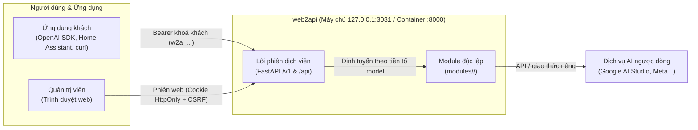
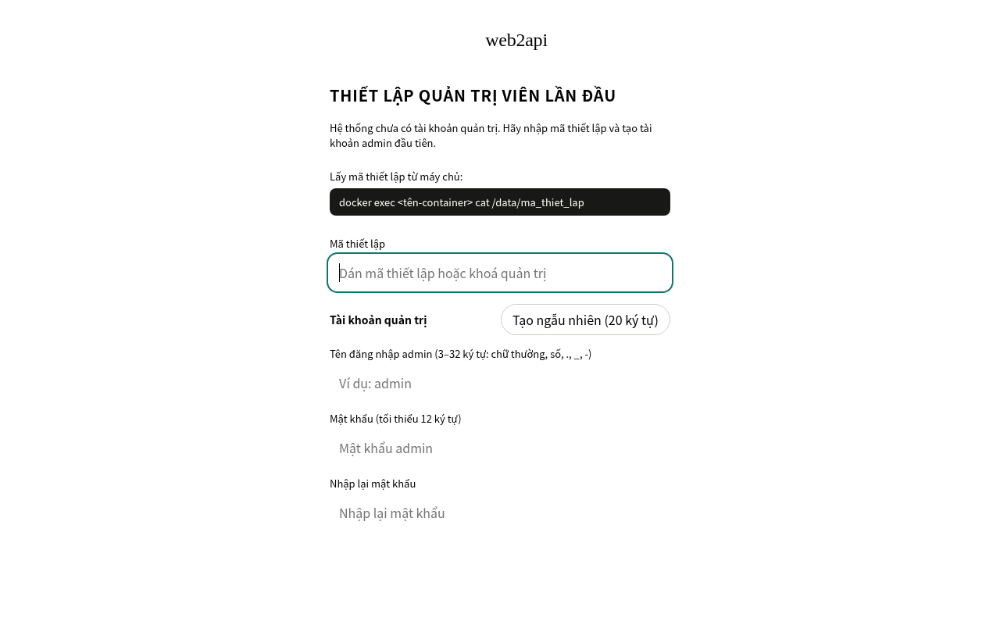
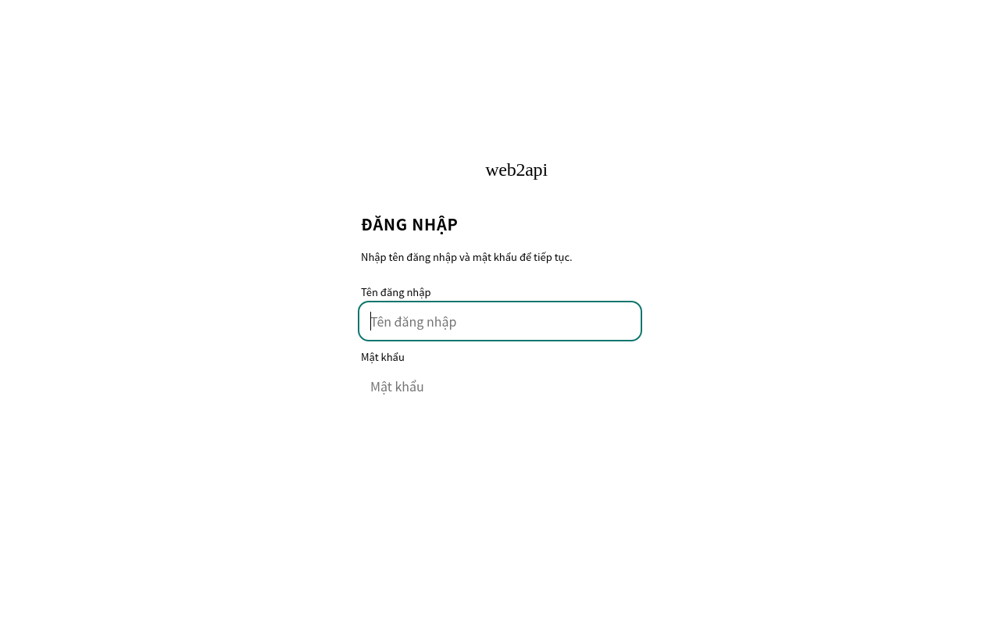
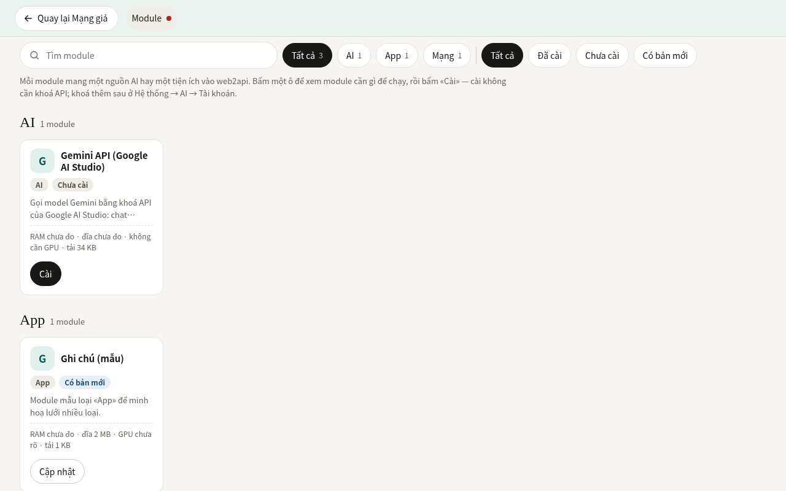
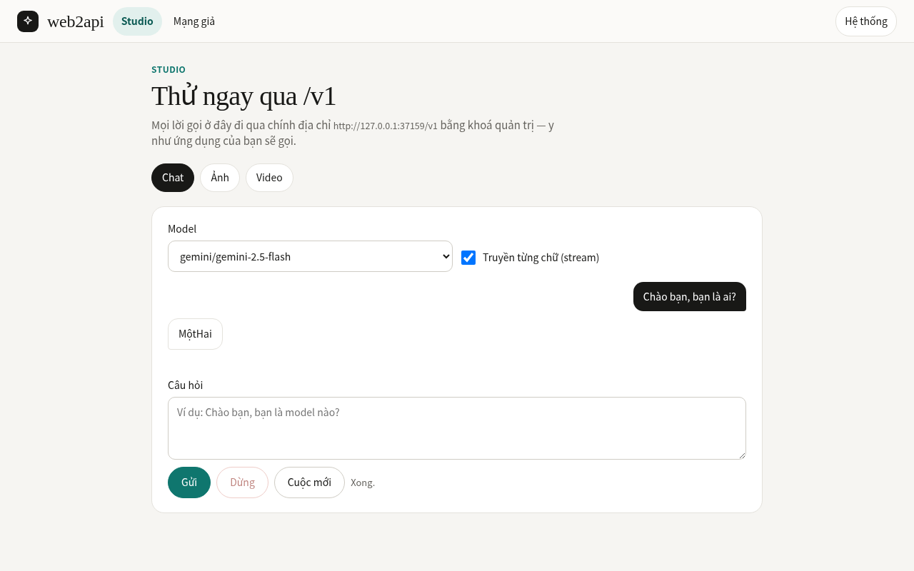
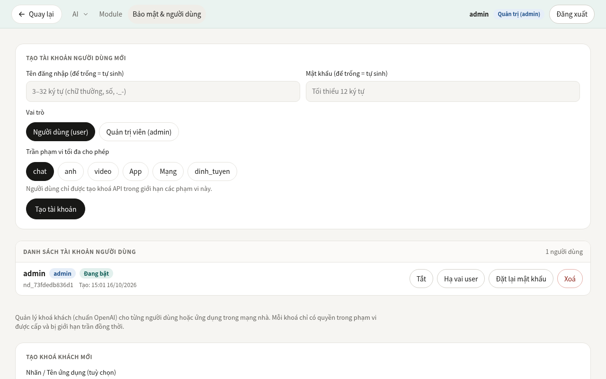

# web2api

<p>
  <a href="https://github.com/TriTue2011/web2api/actions/workflows/docker-build.yml"></a>
  <a href="https://github.com/TriTue2011/web2api/actions/workflows/security.yml"></a>
</p>

Cổng AI chuẩn OpenAI (`/v1/models`, `/v1/chat/completions`, stream, tạo ảnh, video, âm thanh, nhúng...) chạy trong một container Docker nhỏ gọn. Dự án dành cho cá nhân và gia đình muốn hợp nhất các nguồn AI (Google Gemini, Meta Muse...) vào các ứng dụng chuẩn OpenAI (ví dụ OpenAI SDK, curl; chưa kiểm cụ thể với Home Assistant). Điểm khác biệt cốt lõi: lõi đóng vai trò **«phiên dịch viên»** trung lập, không chứa sẵn mã của nhà cung cấp nào; mọi nguồn AI là các **module** độc lập cài thêm lúc chạy từ git, không cần dựng lại ảnh Docker hay khởi động lại dịch vụ.

[English](README.en.md) | [Tiếng Việt](README.md)



## Tính năng

- **Cổng chuẩn OpenAI toàn diện**:
  - Trò chuyện: `POST /v1/chat/completions` (hỗ trợ stream SSE, keep-alive, chuẩn hoá `finish_reason` khi gọi công cụ).
  - Danh mục mô hình: `GET /v1/models` và `GET /v1/models/{model}` (tự động gom mô hình từ các module đã liên kết và combo).
  - Hình ảnh: Tạo ảnh `POST /v1/images/generations`, sửa ảnh `POST /v1/images/edits`, Responses API `POST /v1/responses` với công cụ `image_generation` (hỗ trợ stream SSE).
  - Video: Tạo video bất đồng bộ `POST /v1/videos`, kiểm tra trạng thái `GET /v1/videos/{id}`, tải tệp `GET /v1/videos/{id}/content`.
  - Âm thanh: Đọc văn bản thành giọng nói `POST /v1/audio/speech` (stream nhị phân), nhận dạng giọng nói `POST /v1/audio/transcriptions` (lõi cung cấp đường chuẩn; cần module có khả năng tương ứng, hiện chưa có module đi kèm).
  - Nhúng & xếp hạng: Tạo vector nhúng `POST /v1/embeddings`, xếp hạng tài liệu `POST /v1/rerank` (lõi cung cấp đường chuẩn; cần module có khả năng tương ứng, hiện chưa có module đi kèm).
- **Kiến trúc Module nạp nóng**: Cài đặt, cập nhật hoặc gỡ bỏ module từ git ngay lúc chạy qua giao diện mà không cần dựng lại ảnh Docker hay tắt dịch vụ. Lõi hoàn toàn trung lập, không chứa tên nhà cung cấp cụ thể nào.
- **Giao diện quản trị tích hợp**:
  - **Studio**: Trò chuyện trực tiếp với AI, xem trước định dạng markdown, tạo ảnh, lưu lịch sử cục bộ trong trình duyệt.
  - **Hệ thống → Module**: Bàn cờ quản lý module, cài đặt từ git, kiểm tra quyền và tài nguyên yêu cầu.
  - **Hệ thống → AI**: Quản lý tài khoản, thêm/bớt nhiều khoá API cho từng nhà cung cấp, cấu hình model và provider.
  - **Hệ thống → Bảo mật & người dùng**: Quản lý người dùng, cấp phát khoá khách, kiểm tra chuỗi băm nhật ký hệ thống.
  - **Hệ thống → Thiết bị**: Quản lý thực thể thiết bị, kiểm soát quyền và hàng chờ phê duyệt hành động rủi ro (lõi cung cấp đường chuẩn; tab này tự ẩn khi chưa có module cung cấp thiết bị).
  - **Hệ thống → Phiên tài khoản**: Xem phiên đăng nhập của từng module theo nhóm thu gọn, kiểm tra ngay trạng thái và xoá phiên (xác nhận hai bước); chỉ hiển thị siêu dữ liệu, không bao giờ lộ cookie/token.
  - **Hệ thống → Tích hợp & công cụ**: Xem công cụ AI sinh từ thiết bị, tìm thử tri thức (kết quả hiện như dữ liệu không tin được), lấy mục lục tài liệu, nạp lại module, gửi sự kiện thử và xem cấu hình cổng gửi ra/webhook (chỉ xem, không hiện bí mật).
  - **Hệ thống → Trợ giúp**: Hướng dẫn sử dụng ngay trên trình duyệt cho người không rành lệnh (thiết lập lần đầu, kết nối ứng dụng khách, khoá khách, thêm module, sao lưu, xử lý sự cố); mọi mục thu gọn đóng mặc định, có ô lọc chữ; mục quản trị chỉ hiện cho admin.
- **Đa người dùng & Phân quyền**: Hỗ trợ hai vai trò `admin` và `user`. Mật khẩu băm an toàn bằng scrypt ($N=2^{14}$), khoá đăng nhập hai tầng chống brute-force phân tán, bảo vệ bất biến còn ít nhất một admin. Phiên web qua cookie `HttpOnly`, `SameSite=Strict`, tự động bật `Secure` và tiền tố `__Host-` khi chạy qua HTTPS, chống CSRF.
- **Khoá khách có phạm vi & Xoay khoá**: Cấp khoá khách (tiền tố `w2a_`) theo phạm vi cụ thể (`chat`, `anh`, `anh_sua`, `video`, `noi`, `nghe`, `nhung`, `xep_hang`, `tim_kiem`, `thiet_bi`, `trinh_duyet`, `*`; phạm vi là mã mở như `thiet_bi:ghi`). Xoay khoá không gián đoạn với thời gian ân hạn cho khoá cũ (mặc định 7 ngày). Kiểm soát trần yêu cầu đồng thời cho từng khoá và toàn cục.
- **Chuyển khoá & Dự phòng thông minh**: Tự động xoay vòng danh sách khoá API trong module, tạm nghỉ khoá gặp lỗi 429 hoặc lỗi hạn mức. Tính năng Combo (`/api/combo`) ghép chuỗi nhiều nguồn AI với cơ chế cầu chì và tự động hạ bậc khi gặp lỗi.
- **Sao lưu & Khôi phục mã hoá**: Xuất bản sao lưu cấu hình mã hoá AES-256-GCM với mật khẩu (`POST /api/sao-luu`). Khôi phục kiểm chứng toàn vẹn, bảo vệ quyền chủ sở hữu khoá, tự động hoàn tác nếu lỗi ghi (`POST /api/khoi-phuc`).
- **Nhật ký chống sửa lén (Tamper-evident)**: Từng dòng nhật ký được liên kết bằng chuỗi băm SHA-256 (`truoc` và `bam`), tự động phát hiện can thiệp hoặc đứt chuỗi (`GET /api/nhat-ky/chuoi`). Tự động che giấu khoá và bí mật trong mọi thông báo lỗi và nhật ký.
- **Trình duyệt từ xa noVNC (`vnc-xa`)**: Mở workspace trình duyệt trên máy chủ qua noVNC (cần dịch vụ trình duyệt riêng `dich-vu/trinh-duyet`, cấu hình `dich_vu_url` và `khoa_dich_vu`) để đăng nhập thủ công các dịch vụ có CAPTCHA/OTP, duy trì phiên và tự động đưa cookie sang module khác mà không lộ ra ngoài.
- **Hồ sơ Google & tái dùng (`/api/danh-tinh`, `/api/tai-khoan/tai-dung`)**: Đăng nhập Google MỘT lần trong một hồ sơ trình duyệt bền (`POST /api/danh-tinh/dang-nhap` tạo + tự đăng nhập; xem `GET /api/danh-tinh` và `GET /api/danh-tinh/{id}/trang-thai`; gửi mã 2FA `POST /api/danh-tinh/{id}/ma-2fa`; xoá `DELETE /api/danh-tinh/{id}`). Mỗi provider «tái dùng» hồ sơ qua `POST /api/tai-khoan/tai-dung` để tự «Đăng nhập bằng Google» trong hồ sơ đó và thêm tài khoản của chính nó. Gặp CAPTCHA/Cloudflare/xác minh → «cần người» + noVNC, không tự giải.
- **Tìm kiếm tri thức (`/api/tim-kiem`)**: Lõi cung cấp đường chuẩn kết hợp 5 sơ đồ (công tắc nguồn/sơ đồ, lọc nhiều mặt, cây phân cấp, mục lục tài liệu, phễu nối tầng) và đánh dấu dữ liệu nguồn ngoài không tin cậy (cần module có khả năng tương ứng, hiện chưa có module đi kèm).
- **Công cụ AI từ thiết bị (`/api/cong-cu`)**: Lõi cung cấp đường chuẩn tự động chuyển đổi thiết bị và hành động thành công cụ function-calling chuẩn OpenAI; hàng chờ phê duyệt cho các tác vụ nguy hiểm (`/api/phe-duyet`) (cần module có khả năng tương ứng, hiện chưa có module đi kèm).

## Hình ảnh giao diện


*Màn hình thiết lập tài khoản quản trị viên lần đầu bằng mã thiết lập.*


*Màn hình đăng nhập quản trị viên và người dùng.*


*Giao diện quản lý module dạng lưới ô với trạng thái nạp nóng.*


*Giao diện Studio trò chuyện trực tiếp qua luồng stream chuẩn OpenAI.*


*Quản lý tài khoản người dùng, cấp phát khoá khách có phạm vi và kiểm tra nhật ký.*

## Bắt đầu nhanh

Tệp `docker-compose.yml` chuẩn của dự án:

```yaml
services:
  web2api:
    image: ghcr.io/tritue2011/web2api:latest
    build: .
    container_name: web2api
    restart: unless-stopped
    ports:
      # Mặc định CHỈ nghe trên máy chủ (127.0.0.1): không công bố cổng ra mạng nhà/Internet.
      # Muốn truy cập từ máy khác trong mạng nhà: đặt WEB2API_BIND=<IP LAN của máy chủ> trong .env.
      - "${WEB2API_BIND:-127.0.0.1}:${WEB2API_PORT:-3031}:8000"
    environment:
      WEB2API_DATA: /data
      WEB2API_GIT_REPO: ${WEB2API_GIT_REPO-TriTue2011/web2api}
      WEB2API_GIT_NHANH: ${WEB2API_GIT_NHANH:-main}
      WEB2API_GIT_THU_MUC: ${WEB2API_GIT_THU_MUC:-modules}
    env_file:
      - path: .env
        required: false
    volumes:
      - ${WEB2API_DATA_DIR:-web2api-data}:/data
    user: "1000:1000"
    cap_drop:
      - ALL
    security_opt:
      - no-new-privileges:true
    # Giới hạn tài nguyên (KHÔNG bắt buộc — bỏ đi vẫn chạy; xem mục «Giới hạn tài nguyên»): chặn một module lỗi
    # ăn hết RAM/CPU của máy chủ và kéo các dịch vụ khác chết theo. Dùng thực tế khoảng 100 MB RAM, gần 0% CPU.
    mem_limit: 1g
    cpus: 0.5
    pids_limit: 100
    labels:
      com.centurylinklabs.watchtower.enable: "false"

volumes:
  web2api-data:
    name: web2api-data
```

### Giới hạn tài nguyên (không bắt buộc)

Ba dòng `mem_limit`, `cpus`, `pids_limit` trong compose chỉ là hàng rào bảo vệ, KHÔNG phải điều kiện để web2api chạy: bỏ đi (xoá dòng) dịch vụ vẫn chạy bình thường. Chúng chặn một module lỗi (rò bộ nhớ, vòng lặp, sinh tiến trình vô hạn) ăn hết RAM/CPU của máy chủ và kéo dịch vụ khác trên cùng máy chết theo (vì module cài từ git chạy ngay trong tiến trình lõi). Dùng thực tế khoảng 100 MB RAM, gần 0% CPU. Máy chủ chỉ chạy riêng web2api thì bỏ cũng được; máy dùng chung với dịch vụ khác thì nên giữ.
- `mem_limit`: tăng thoải mái (`2g`, `4g`…) nếu dùng nhiều module hoặc ảnh/video lớn. Đổi nóng không cần khởi động lại bằng lệnh `docker update --memory 2g --memory-swap 2g web2api` (và sửa cả compose để lần tạo lại sau không quay về giá trị cũ).
- `cpus`: dòng nên bỏ trước nhất (chỉ làm việc băm mật khẩu scrypt và đăng nhập chậm hơn khi nhiều người cùng đăng nhập).
- `pids_limit`: nên giữ để ngăn chặn module sinh tiến trình vô hạn.
*(Chi tiết xem tại [docs/THAM-CHIEU.md mục 5](docs/THAM-CHIEU.md#5-cài-đặt-và-vận-hành-qua-docker)).*

### Bước 0 — tạo khoá mã hoá (làm MỘT lần, trước `docker compose up`)

Compose mẫu bật `WEB2API_BAT_BUOC_MA_HOA=1`: mọi bí mật lưu trên đĩa (khoá API, cookie, danh tính, phiên đăng nhập) được **mã hoá AES-256-GCM** bằng một *khoá chính* 32 byte. Thiếu hoặc sai khoá thì web2api **từ chối khởi động**, không lặng lẽ lưu dạng rõ. Khoá do bạn tự sinh (không ai cấp):

```bash
umask 077
openssl rand -base64 32 > khoa-chinh      # khoá chính, tạo cạnh docker-compose.yml
sudo chown 1000:1000 khoa-chinh           # container chạy uid 1000 phải đọc được; quyền vẫn 0600
```

- Tệp `khoa-chinh` nằm **ngoài** thư mục dữ liệu (`/data`) nên chụp ổ dữ liệu không lấy được khoá; đã ghi trong `.gitignore`, **đừng commit**.
- **Chép một bản dự phòng ra nơi an toàn ngoài máy này** (trình quản lý mật khẩu…): mất khoá thì các bí mật đã mã hoá không giải được nữa.
- Chưa tạo tệp thì `docker compose up` báo lỗi rõ ràng (không tự tạo thư mục rỗng).
- Cài mới: không cần gì thêm. Đang chạy bản cũ với dữ liệu dạng rõ: **không bật thẳng** — di trú trước, xem [docs/TRIEN-KHAI.md mục 8.3](docs/TRIEN-KHAI.md).
- Đổi sang khoá khác về sau: [docs/TRIEN-KHAI.md mục 8.2](docs/TRIEN-KHAI.md). Muốn tắt bắt buộc (không khuyến nghị): xoá hai dòng `WEB2API_BAT_BUOC_MA_HOA` và `WEB2API_KHOA_CHINH_TEP` cùng khối `type: bind` trong compose.

### 3 bước khởi chạy

1. **Khởi động dịch vụ:**
   ```bash
   docker compose up -d
   ```

2. **Lấy mã thiết lập ban đầu:**
   Khi khởi động lần đầu (chưa có tài khoản admin), hệ thống tự sinh mã thiết lập ngẫu nhiên lưu tại tệp `/data/ma_thiet_lap` (quyền 0600). Mã không bao giờ được in ra log. Đọc mã bằng lệnh:
   ```bash
   docker exec web2api cat /data/ma_thiet_lap
   ```
   *(Nếu có đặt sẵn biến `WEB2API_ADMIN_KEY`, giá trị khoá đó cũng có thể dùng làm mã thiết lập ban đầu).*

3. **Thiết lập tài khoản, cài module & kiểm tra gọi API:**
   - Mở trình duyệt truy cập `http://127.0.0.1:3031` (hoặc `http://<IP-máy-chủ>:3031` nếu đã đặt `WEB2API_BIND`).
   - Màn hình **Thiết lập** xuất hiện: dán mã thiết lập vừa lấy ở bước 2, đặt Tên đăng nhập và Mật khẩu cho tài khoản admin đầu tiên, bấm **Thiết lập và đăng nhập**. Tệp `ma_thiet_lap` sẽ tự động bị xoá.
   - Hệ thống tự động tạo phiên đăng nhập.
   - **Cài module và thêm khoá API**: Vào tab **Hệ thống → Module**, tìm module `gemini-api` và bấm **Cài đặt**. Sau đó vào **Hệ thống → AI → Tài khoản** (nhóm `gemini-api`) để thêm khoá Google AI Studio của bạn. (Nếu chưa cài module và thêm khoá thì danh sách model sẽ rỗng và chưa thể gọi chat).
   - Vào **Hệ thống → Bảo mật & người dùng** để tạo khoá khách (Client Key) hoặc vào trang cá nhân để tạo khoá API riêng.
   - Thử nghiệm gọi API bằng lệnh `curl`:
     ```bash
     # Liệt kê danh sách model sẵn sàng:
     curl -s -H "Authorization: Bearer <khoá-khách>" http://127.0.0.1:3031/v1/models
     # Gửi thử một yêu cầu trò chuyện:
     curl -s -X POST http://127.0.0.1:3031/v1/chat/completions \
       -H "Authorization: Bearer <khoá-khách>" \
       -H "Content-Type: application/json" \
       -d '{"model": "gemini/gemini-2.5-flash", "messages": [{"role": "user", "content": "Xin chào web2api!"}]}'
     ```
   > [!IMPORTANT]
   > Mọi tuyến API đều bắt buộc phải có xác thực (Bearer khoá khách/khoá quản trị hoặc cookie phiên đăng nhập). Các ngoại lệ mở không cần xác thực duy nhất là: `GET /` (trang khởi đầu), `GET /health` (kiểm tra sức khoẻ), `GET/POST /api/thiet-lap` (kiểm tra và thiết lập admin ban đầu), `POST /api/dang-nhap` (đăng nhập), giao diện tĩnh của module đã cài `GET /m/<id>/...`, và các đường phục vụ phiên noVNC (`GET/POST /novnc/dang-nhap`, `/novnc/s/...`).

## Module có sẵn

| Module | Khả năng | Giao thức | Trạng thái |
|---|---|---|---|
| `gemini-api` | Chat stream, tạo ảnh, video Veo | OpenAI HTTP | Có sẵn (chat đã kiểm với Google thật; ảnh và video Veo chưa kiểm với Google thật, cần khoá trả phí Google AI Studio) |
| `muse` | Trò chuyện | Noise XX WebSocket | Thử nghiệm, chưa kiểm với dịch vụ thật (cần khoá thiết bị X25519) |
| `muse2api` | Trò chuyện miễn phí bằng cookie | WebSocket + Noise XX | Có sẵn (giao thức web trực tiếp muse.ai, không cần API key; tái dùng hồ sơ Google NV93 — NV90-C: có thể không có Google SSO do SSO Meta; chưa kiểm với dịch vụ thật) |
| `chatgpt-web` | Trò chuyện miễn phí bằng token | HTTPS (API web chatgpt.com) | Thử nghiệm (tái dùng hồ sơ Google NV93: «Continue with Google» trong hồ sơ, gói Free/Plus/Pro suy từ cấu trúc, model theo gói; chưa kiểm với dịch vụ thật) |
| `claude-web` | Trò chuyện miễn phí bằng cookie | HTTPS (API web claude.ai) | Có sẵn (cookie/sessionKey do người dùng dán, xoay nhiều tài khoản; đăng nhập lại tự động + khôi phục nhiều tầng NV89; tái dùng hồ sơ Google NV93; chưa kiểm với claude.ai thật) |
| `antigravity` | Trò chuyện đa mô hình qua CLI | HTTP Bridge | Có khung, chưa kiểm với `agy` thật (cần dịch vụ cầu nối ngoài container) |
| `vnc-xa` | Workspace trình duyệt từ xa noVNC | HTTP / WebSocket | Có sẵn (cần dịch vụ trình duyệt riêng `dich-vu/trinh-duyet`, cấu hình `dich_vu_url` và `khoa_dich_vu`; chưa kiểm với Firefox thật; đăng nhập tay, trích xuất cookie sang module khác) |
| `gemini-web` | Trò chuyện miễn phí bằng cookie Google | HTTP (batchexecute nội bộ) | Thử nghiệm, chưa kiểm với dịch vụ thật (giao thức web không chính thức; ảnh/video chưa làm; đăng nhập lại tự động + khôi phục nhiều tầng NV89; tái dùng hồ sơ Google NV93 + model theo tài khoản NV91-P3) |
| `grok-web` | Trò chuyện miễn phí bằng cookie | WebSocket tới grok.com | Thử nghiệm, chưa kiểm với grok.com thật (cần cookie tài khoản thật; đăng nhập lại tự động + khôi phục nhiều tầng NV89; tái dùng hồ sơ Google NV93 — Cloudflare → `can_nguoi`, không tự tích/giải) |
| `grok-api` | Trò chuyện bằng khoá API xAI | OpenAI HTTP | Có sẵn (API chính thức xAI, xoay nhiều khoá, cho khoá nghỉ khi hết hạn mức; chưa kiểm với api.x.ai thật) |
| `ho-so-google` | Đăng nhập Google một lần trong hồ sơ trình duyệt bền, tái dùng cho mọi provider | Điều khiển trình duyệt (Marionette) | Có sẵn (gặp CAPTCHA/xác minh → «cần người» + noVNC, không tự giải; chưa kiểm với Google thật) |
| `zalo-bot` | Kênh Zalo Bot hai chiều: gửi tin nhắn văn bản ra qua Bot API (mỗi đích khai rõ bot; không «bot mặc định») + nhận tin vào qua webhook của lõi (NV117) | HTTPS (bot-api.zaloplatforms.com) | Có sẵn (kiểm với Zalo giả cục bộ; chưa kiểm với Zalo thật) |
| `tuya` | Thiết bị Tuya chuẩn C1: đám mây (Open API ký HMAC, chỉ đúng 6 miền Tuya) + LAN (giao thức 6668 tự viết, chỉ IP riêng khai tường minh); điều khiển mặc định TẮT, khoá/bếp/bình nóng lạnh không bao giờ điều khiển được | Tuya Open API (HTTPS) + TCP/UDP nội bộ | Có sẵn (kiểm với máy chủ Tuya giả + thiết bị LAN giả; CHƯA kiểm với thiết bị Tuya thật) |
| `mikrotik-routeros` | Nguồn máy mạng từ router MikroTik (CHỈ ĐỌC) | RouterOS API nhị phân qua TLS | Có sẵn (đọc DHCP lease + bảng host, gộp theo MAC thành thực thể C1; lệnh ghi bị chặn theo cấu trúc ở client; chưa kiểm với router thật) |
| `telegram-bot` | Gửi thông báo văn bản ra Telegram (chuẩn `kenh_ra`, `POST /api/gui/telegram-bot`) | HTTPS (Bot API api.telegram.org) | Có sẵn (nhiều đích do chủ máy khai, tin dài tự tách, token chặn rò qua log; chưa kiểm với api.telegram.org thật) |
| `facebook` | Đăng bài lên Trang Facebook qua Graph API chính thức (chuẩn C1: mỗi Trang một thực thể rủi ro «nguy_hiem», quản trị xác nhận trước khi đăng; bài chữ/link, ảnh, video) | HTTPS (Graph API graph.facebook.com) | Có sẵn (kiểm với máy chủ Graph giả cục bộ; chưa kiểm với Facebook thật; không đăng nhóm — Meta đã gỡ Groups API) |
| `home-assistant` | Đọc trạng thái + điều khiển có kiểm soát thiết bị Home Assistant (chuẩn C1) | HTTPS (REST API của HA) | Có sẵn (kiểm với máy chủ HA giả; chưa kiểm với Home Assistant thật) |
| `zte-e2633` | Nguồn máy mạng WiFi (chỉ đọc) từ bộ phát ZTE E2633 | HTTPS (trang quản trị bộ phát) | Có sẵn (đăng nhập đúng thứ tự trường + header `check`, dừng khi khoá/lỗi lặp; chưa kiểm với bộ phát thật) |
| `doc-ma-hop-thu` | Đọc mã xác minh gửi về Gmail qua IMAP — CHỈ ĐỌC (chuẩn `ma_xac_minh`; lõi gọi khi tích «Lấy mã từ Gmail») | IMAP SSL tới imap.gmail.com:993 | Có sẵn (kiểm với máy chủ IMAP giả; chưa kiểm với Gmail thật) |
| `doc-viettat` | Chuẩn hoá chữ để đọc tiếng Việt (TTS: số, đơn vị, viết tắt, hoá học, ký hiệu) | Cục bộ (thuần Python, không mạng) | Có sẵn (chuẩn C2 công cụ `chuan_hoa_doc`, 8 lớp lỗi, chống ReDoS, trần 20.000 ký tự) |
| `van-phong` | Văn phòng: công cụ `office_*` qua container phụ OfficeCLI (mặc định tắt) + OCR bằng model thị giác qua điểm chat do quản trị khai + dựng Word/Excel bằng zipfile + `kiem_tai_lieu` chặn zip bomb/zip-slip/XXE | HTTP nội bộ tới dịch vụ van-phong-office + điểm chat do quản trị khai | Có sẵn (kiểm với nhị phân giả + máy chủ chat giả + kiểm tĩnh Dockerfile; chưa kiểm với OfficeCLI/model thật) |
| `rclone` | Cầu nối lưu trữ đám mây qua rclone: liệt kê/đọc/tải về/tải lên/xoá/chuyển tệp trên 150+ backend (Google Drive, S3/R2, OneDrive, WebDAV…); hành động ghi/xoá mặc định TẮT | HTTP nội bộ tới dịch vụ dich-vu/rclone | Có sẵn (NV161; kiểm với nhị phân rclone giả; **chưa kiểm với dịch vụ đám mây thật**) |
| `thuthach` | Nhận diện thử thách chống bot (reCAPTCHA v2/v3, Turnstile, CAPTCHA chữ, mã 2FA, BotGuard) bằng cấu trúc rồi báo «cần người» + hướng dẫn noVNC — KHÔNG giải (chuẩn C2 `thiet_bi`) | Không gọi mạng (thuần phân tích chuỗi trong tiến trình lõi) | Có sẵn (26 test; phần giải của captcha-solver không port — quy tắc kho: không giải CAPTCHA) |
| `thuthach` | Nhận diện thử thách chống bot (reCAPTCHA v2/v3, Turnstile, chọn hình/quiz, CAPTCHA chữ, mã OTP, mã 2FA, BotGuard) bằng cấu trúc rồi báo «cần người» + hướng dẫn noVNC — KHÔNG giải (chuẩn C2 `thiet_bi`) | Không gọi mạng (thuần phân tích chuỗi trong tiến trình lõi) | Có sẵn (33 test; phần giải của captcha-solver không port — quy tắc kho: không giải CAPTCHA) |
| `tro-ly` | Trợ lý: dựng prompt theo ngân sách + chọn công cụ theo tầng + X-quang prompt + sổ lỗi (NV136; vòng lặp gọi mô hình là NV135) | Nội bộ (thuần Python) | Có sẵn (11 test xanh; chưa đo trên nhật ký thật; chưa có vòng lặp gọi mô hình) |
| `youtube-phat` | Máy phát YouTube/Zing qua dịch vụ phụ: giữ địa chỉ + khoá Integration API, hỏi sức khoẻ dịch vụ (NV153 đợt B) | HTTP nội bộ/LAN tới dịch vụ youtube-phat | Có sẵn (kiểm với máy chủ giả; **chưa kiểm với dịch vụ thật**) |
| `lich-ics` | Đọc lịch ICS (Google/Outlook/Nextcloud) qua link bí mật — chỉ đọc, trả sự kiện sắp tới cho trợ lý (chuẩn C2 công cụ) | HTTPS tới máy chủ lịch đã khai | Có sẵn (45 test với máy chủ ICS giả; chưa kiểm với lịch thật) |
| `chitieu` | Sổ chi tiêu theo hũ (JARS): ghi/xem chi tiêu, tự bù hũ vượt, cảnh báo ngưỡng, tạm ứng công ty — mỗi danh tính một sổ riêng | Cục bộ (thuần Python + SQLite, không mạng) | Có sẵn (chuẩn C2 công cụ; port từ c2a; chưa kiểm với dữ liệu thật) |
| `hoa-don` | Công cụ đối chiếu hoá đơn điện tử XML (bản gốc pháp lý NĐ 123/2020 + TT 78/2021) với bảng danh mục Excel: báo dòng khớp/lệch và tự kiểm phép tính trên hoá đơn (NV162) | Cục bộ (thuần Python, không mạng, không khoá) | Có sẵn (kiểm với hoá đơn giả đúng khuôn TT78 + xlsx giả; chưa kiểm với hoá đơn thật của nhà phát hành) |
| `dich` | Dịch văn bản qua model của lõi + từ điển/thuật ngữ người dùng tự thêm lưu cục bộ + chế độ song ngữ (NV163) | Cục bộ (gọi loopback /v1 của chính lõi) | Có sẵn (kiểm với model giả + máy chủ HTTP giả loopback; chưa kiểm với model thật) |
| `tien-ich-doi-song` | Tiện ích đời sống (chuẩn C2 `thiet_bi`, NV165, port c2a): bản tin tóm tắt theo nguồn/mốc giờ, chỉ đường Nominatim+OSRM, vùng khoảng cách tự học, kiểm tra/chia lô dấu câu lời thoại | HTTPS tới nominatim.openstreetmap.org + router.project-osrm.org (tắt được bằng `bat_tim_duong=0`) | Có sẵn (50 test xanh với dịch vụ GIẢ; chưa kiểm Nominatim/OSRM thật; KHÔNG port lớp gửi Zalo/Telegram và `trong_xe`) |

- **Cách cài đặt module**: Vào tab **Hệ thống → Module**, duyệt danh sách module tìm thấy từ nguồn git, bấm **Cài đặt**.
- **Cấu hình nguồn git**: Qua biến `WEB2API_GIT_REPO` (mặc định `TriTue2011/web2api`, nhánh `main`, thư mục `modules`). Tính năng tự cài ngầm mặc định TẮT (`tu_dong: false`) — hệ thống chỉ báo khi có bản mới để quản trị viên duyệt quyền trước khi nạp.
- **Dành cho nhà phát triển viết module mới**: Tham khảo chi tiết tại [docs/CHUAN-MODULE.md](docs/CHUAN-MODULE.md) và [docs/CHUAN-BAO-MAT-MODULE.md](docs/CHUAN-BAO-MAT-MODULE.md).

## Cấu hình

Các biến môi trường thường dùng nhất (cấu hình trong `.env` hoặc Docker Compose):

| Biến môi trường | Mặc định | Tác dụng |
|---|---|---|
| `WEB2API_DATA` | `/data` | Đường dẫn thư mục dữ liệu bên trong container (khoá, cấu hình, phiên, module cài lúc chạy) |
| `WEB2API_BIND` | `127.0.0.1` | Địa chỉ IP máy chủ để container lắng nghe (chỉ trong compose; đặt IP LAN để mở mạng nhà) |
| `WEB2API_PORT` | `3031` | Cổng dịch vụ lắng nghe trên máy chủ (chỉ trong compose) |
| `WEB2API_ADMIN_KEY` | Tự sinh | Khoá quản trị dự phòng (Bearer); để trống tự sinh lưu vào `<WEB2API_DATA>/admin_key` |
| `WEB2API_GIT_REPO` | `TriTue2011/web2api` | Kho GitHub chứa module (`chủ/kho`); đặt rỗng để tắt nguồn git |
| `WEB2API_GIT_NHANH` | `main` | Nhánh git theo dõi module |
| `WEB2API_GIT_THU_MUC` | `modules` | Thư mục chứa module trong kho git |
| `WEB2API_GITHUB_TOKEN` | Không | Token GitHub PAT (quyền `Contents: Read`) cho kho riêng tư hoặc tránh hạn mức 60 req/h (`WEB2API_GIT_TOKEN` là bí danh) |
| `WEB2API_TIN_PROXY` | Không | Đặt `1` để tin `X-Forwarded-Proto` từ proxy ngược, bật cookie `Secure` và tiền tố `__Host-` |
| `WEB2API_TRUST_PROXY` | Không | Danh sách CIDR của proxy ngược/Cloudflare để bóc tách IP khách từ `X-Forwarded-For` |
| `WEB2API_PUBLIC_URL` | Không | Địa chỉ URL công khai chính thức (ví dụ `https://ai.example.com`). Khi đặt, Host là tên miền khác (kể cả tên LAN `nas.local`) bị 421; chỉ IP và localhost luôn qua |
| `WEB2API_QT_IP_CHO_PHEP` | Không | Danh sách CIDR (ví dụ `192.0.2.0/24`) giới hạn mạng được gọi API quản trị và thiết lập |
| `WEB2API_KHACH_DONG_THOI` | `4` | Số yêu cầu đồng thời tối đa cho mỗi khoá khách (`0` = không giới hạn) |
| `WEB2API_V1_DONG_THOI_TOAN_CUC` | `32` | Số yêu cầu đồng thời tối đa toàn cục cho cổng `/v1` (`0` = không giới hạn) |
| `WEB2API_THAN_TOI_DA_MB` | `25` | Trần dung lượng thân yêu cầu JSON (MB) cho `/v1` và `/api/*` |
| `WEB2API_TEP_TOI_DA_MB` | `25` | Trần dung lượng yêu cầu multipart/form-data tải tệp (MB) |
| `WEB2API_RL_LOI_XAC_THUC` | `30` | Ngưỡng sai khoá tối đa trong cửa sổ thời gian trước khi tạm khoá IP trong `WEB2API_RL_KHOA_GIAY` (mặc định 60s) |
| `WEB2API_DANG_NHAP_SAI_TOI_DA` | `5` | Số lần đăng nhập sai mật khẩu liên tiếp tối đa của một tài khoản trước khi tạm khoá 15 phút |
| `TZ` | Không | Múi giờ IANA (ví dụ `Asia/Ho_Chi_Minh`) để hiển thị đúng thời gian trên Studio |

- **Máy chủ container/LXC/Proxmox**: Khi container không tự đọc được tài nguyên vật lý của máy chủ, khai báo `WEB2API_MAY_RAM_MB` (MB RAM) và `WEB2API_MAY_CPU` (số nhân CPU).
- **Hạn phiên web**: Thời hạn nhàn rỗi 8 giờ, thời hạn tuyệt đối 7 ngày, tối đa 5 phiên đồng thời cho mỗi tài khoản.
- Bảng tra cứu đầy đủ tất cả các biến hệ thống có tại [docs/THAM-CHIEU.md mục 8](docs/THAM-CHIEU.md#8-tra-cứu-api-và-biến-môi-trường).

## Bảo mật

- **Mặc định an toàn**:
  - Compose chỉ công bố cổng trên `127.0.0.1` của máy chủ (đổi bằng `WEB2API_BIND`), chạy bằng người dùng không đặc quyền `uid 1000:1000`.
  - Tước bỏ toàn bộ đặc quyền Linux (`cap_drop: [ALL]`) và cấm leo quyền (`no-new-privileges:true`).
  - Nguồn git mặc định tắt tự động cài (`tu_dong: false`), chỉ thông báo cập nhật.
  - Khoá khách mới tạo có phạm vi mặc định thu hẹp `["chat"]`, không cấp toàn quyền `*`.
  - Mật khẩu băm an toàn bằng scrypt; khoá đăng nhập hai tầng chống brute-force phân tán kèm băm giả chống tấn công định thời (timing attack).
  - Cookie phiên mang cờ `HttpOnly`, `SameSite=Strict`, tự bật `Secure` và tiền tố `__Host-` khi có HTTPS, chống CSRF.
  - Chống SSRF và bảo vệ đường dẫn: kiểm duyệt chặt chẽ mọi URL từ xa qua `app/tu_xa.py`, ghim IP lúc kết nối và chuẩn hoá đường dẫn tệp.
  - Tự động che giấu bí mật/khoá trong lỗi và nhật ký; nhật ký hệ thống ghi chuỗi băm SHA-256 chống sửa lén.
- **Khuyến nghị triển khai ra Internet**:
  - Triển khai sau Cloudflare Tunnel (khuyên dùng — không cần mở cổng router) hoặc reverse proxy theo hướng dẫn chi tiết tại [docs/TRIEN-KHAI.md](docs/TRIEN-KHAI.md).
  - Nên khai báo `WEB2API_TRUST_PROXY` và đặt `WEB2API_TIN_PROXY=1` khi chạy sau reverse proxy (nếu không, chỉ khi đã đặt `WEB2API_PUBLIC_URL` https:// và Host khớp mới tự bật `Secure`).
  - Quản trị máy chủ chỉ dùng khoá SSH (SSH Key), tắt đăng nhập bằng mật khẩu, tắt UPnP trên router.
- **Báo cáo lỗ hổng**: Xem hướng dẫn báo cáo riêng tư tại [SECURITY.md](SECURITY.md).
- **Giới hạn đã biết**:
  - Module cài đặt chạy trong cùng tiến trình Python với lõi (in-process), chia sẻ bộ nhớ và đặc quyền của container.
  - Giao diện chính chưa có CSP toàn cục (đang dùng script nội tuyến) và chưa có HSTS; CSP chặt chỉ áp cho trang module `/m/<id>/` và noVNC.
  - Bản sao lưu có mật khẩu chứa khoá API của các module — cần cất giữ cẩn mật như mật khẩu.

## Portainer và NAS

Cổng dịch vụ mặc định là `3031` (ánh xạ `3031:8000`), dữ liệu gắn ngoài container vào `/data`. Để truy cập từ máy khác trong mạng nhà, đặt `WEB2API_BIND=<IP LAN của máy chủ>` trong `.env`.

### Portainer
1. Vào **Stacks** → **Add stack**, đặt tên stack (ví dụ `web2api`).
2. Dán khối compose ở mục [Bắt đầu nhanh](#bắt-đầu-nhanh) vào trình soạn thảo.
3. Thêm biến môi trường cần thiết ở mục **Environment variables** (như `WEB2API_BIND`).
4. Bấm **Deploy the stack**. Để cập nhật bản mới sau này, bấm **Pull and redeploy**. Lấy mã thiết lập bằng `docker exec web2api cat /data/ma_thiet_lap` trong console container để kích hoạt tài khoản admin lần đầu (mã không bao giờ in ra log).

### Synology NAS (Container Manager)
1. Mở **Container Manager** → **Project** → **Create**.
2. Đặt tên dự án, chọn thư mục lưu trữ dữ liệu `/volume1/docker/web2api`. Thư mục gắn từ máy chủ (bind) nếu chưa có thì Docker tạo thuộc `root`, container uid 1000 không ghi được và dừng ngay: hãy chạy `sudo chown -R 1000:1000 /volume1/docker/web2api` qua SSH trước khi khởi chạy.
3. Dán nội dung compose, đổi volume thành `/volume1/docker/web2api:/data`.
4. Hoàn tất khởi chạy dự án, mở Terminal container rồi chạy `cat /data/ma_thiet_lap` để lấy mã thiết lập.

### QNAP NAS (Container Station)
1. Mở **Container Station** → **Applications** → **Create**.
2. Đặt tên ứng dụng và dán nội dung docker-compose.
3. Đảm bảo volume gắn thư mục dữ liệu trên NAS vào `/data` của container, gán quyền `chown -R 1000:1000` cho thư mục lưu trữ trên NAS trước khi chạy, và cấu hình user `1000:1000`.
4. Bấm **Create** để hệ thống khởi chạy, sau đó mở Terminal container và chạy `cat /data/ma_thiet_lap` để lấy mã thiết lập (mã không in ra log).

### Unraid
1. Mở tab **Docker** (hoặc dùng plugin Compose Manager).
2. Dán nội dung compose hoặc cấu hình container từ ảnh `ghcr.io/tritue2011/web2api:latest`.
3. Thư mục `/mnt/user/appdata/web2api` cần được gán quyền `chown -R 1000:1000` trước khi chạy.
4. Ánh xạ cổng `127.0.0.1:3031:8000` (nếu đặt `3031:8000` là đang mở cổng ra toàn mạng LAN), đường dẫn dữ liệu `/mnt/user/appdata/web2api` vào `/data`, user `1000:1000`.

### Chạy trong LXC / Proxmox
Khi chạy web2api trong container LXC hoặc máy ảo Proxmox, cơ chế cgroups có thể khiến container không đọc được số dung lượng RAM và số nhân CPU thực tế của máy chủ vật lý. Khai báo hai biến `WEB2API_MAY_RAM_MB` (ví dụ `8192` cho 8 GB RAM) và `WEB2API_MAY_CPU` (ví dụ `4` cho 4 nhân) trong tệp `.env` để hệ thống hiển thị chính xác tài nguyên trên trang Hệ thống.

## Kho riêng tư (Private Repository)

Có hai loại token cho hai mục đích hoàn toàn khác nhau — không nhầm lẫn:

### 1. Tải ảnh Docker từ ghcr.io khi gói riêng tư
Gói GHCR mặc định riêng tư (chủ kho có thể chuyển sang Public ở trang Packages của GitHub):
- Tạo GitHub Personal Access Token (classic) có quyền `read:packages`.
- Đăng nhập trên máy Docker:
  ```bash
  echo $TOKEN | docker login ghcr.io -u <tên-github> --password-stdin
  ```
  Thông tin lưu vào `~/.docker/config.json`, không đặt token vào compose.
- **Portainer**: Vào **Registries** → **Add registry** → chọn Custom/GitHub với URL `ghcr.io`, điền username + token, chọn registry này khi deploy stack.
- **Synology / QNAP / Unraid**: SSH vào thiết bị và chạy lệnh `docker login ghcr.io` như trên.

### 2. Nguồn module từ kho GitHub riêng tư
Khi lấy module từ kho GitHub riêng tư hoặc tránh hạn mức 60 yêu cầu/giờ/IP của GitHub:
- Tạo GitHub Fine-grained PAT có quyền **Repository permissions → Contents: Read-only** cho đúng kho chứa module.
- Khai báo biến môi trường `WEB2API_GITHUB_TOKEN` (hoặc `WEB2API_GIT_TOKEN`) trong compose hoặc `.env`. Hệ thống sẽ đọc `WEB2API_GITHUB_TOKEN` trước rồi đến `WEB2API_GIT_TOKEN`.

## Cập nhật, sao lưu, gỡ lỗi

### Cập nhật ảnh Docker
```bash
docker compose pull && docker compose up -d
```

### Sao lưu và khôi phục
- **Sao lưu qua API**: Gửi yêu cầu `POST /api/sao-luu` với thân JSON `{"mat_khau": "...", "kem_phien": false}` (mật khẩu ≥ 12 ký tự để mã hoá toàn bộ bí mật bằng AES-256-GCM; nếu không đặt mật khẩu, bản sao lưu sẽ bỏ qua khoá API trong `bi_mat/`). Bản sao lưu API KHÔNG chứa tài khoản người dùng (`nguoi_dung.json`), `admin_key`, nhật ký hay mã module cài từ git (chỉ lưu ID và commit SHA).
- **Khôi phục qua API**: Gửi yêu cầu multipart tới `POST /api/khoi-phuc` (các trường: `tep`, `mat_khau`, `che_do`, `sha256`). Mặc định `che_do=kiem` chỉ xem trước khác biệt và tính hàm băm `sha256` của tệp sao lưu; phải gọi lần hai với `che_do=ap_dung` kèm `sha256` trả về để thực sự áp dụng.
- **Sao lưu volume Docker trực tiếp**: Để sao lưu toàn bộ dữ liệu (bao gồm cả tài khoản người dùng và khoá quản trị):
  ```bash
  docker run --rm -v web2api-data:/data -v $(pwd):/backup alpine tar czf /backup/web2api-data-backup.tar.gz -C /data .
  ```

### Xử lý sự cố thường gặp

1. **Cổng 3031 bị chiếm:** Đổi cổng lắng nghe của máy chủ bằng biến `WEB2API_PORT=3032` trong tệp `.env`.
2. **Lỗi 429 Too Many Requests (bị khoá cả nhà):** Khi chạy sau Cloudflare/proxy ngược, thiếu biến `WEB2API_TRUST_PROXY` khiến hệ thống coi mọi yêu cầu đến từ một IP duy nhất và khoá IP khi có người gửi sai khoá. Khai báo dải IP của proxy vào `WEB2API_TRUST_PROXY` theo hướng dẫn tại [docs/TRIEN-KHAI.md](docs/TRIEN-KHAI.md).
3. **Lỗi 401 Unauthorized / 403 Forbidden khi gọi API:** Kiểm tra header `Authorization: Bearer <khoá>`. Đảm bảo khoá khách đang ở trạng thái bật và có phạm vi quyền phù hợp với tuyến API đang gọi (ví dụ cần quyền `anh` để tạo ảnh).
4. **Đổi mật khẩu và Quên mật khẩu tài khoản admin:**
   - *Đổi mật khẩu thường*: Người dùng đã đăng nhập tự đổi mật khẩu của mình qua `POST /api/toi/mat-khau`.
   - *Quên mật khẩu admin - Cách 1*: Dùng khoá quản trị Bearer (`WEB2API_ADMIN_KEY` hoặc đọc từ `/data/admin_key`) gọi `POST /api/nguoi-dung/{id}/dat-lai-mat-khau` (tra cứu `id` qua `GET /api/nguoi-dung`). API sẽ trả về `mat_khau_moi` ngẫu nhiên.
   - *Quên mật khẩu admin - Cách 2*: Dừng container, xoá tệp `nguoi_dung.json` trong volume `/data` (sao lưu trước) rồi khởi động lại container.
     > [!WARNING]
     > Xoá `nguoi_dung.json` sẽ làm MẤT MỌI người dùng và VÔ HIỆU HÓA MỌI khoá khách có chủ. Hệ thống nhận diện chưa có admin và sinh mã thiết lập mới `/data/ma_thiet_lap` để thiết lập lại từ đầu.
   - *Xoay khoá quản trị*: Dừng container, xoá tệp `/data/admin_key` rồi khởi động lại; hệ thống sẽ tự sinh khoá quản trị mới.
5. **Module không nạp hoặc báo lỗi:** Xem log container bằng `docker compose logs web2api` hoặc mở tab **Hệ thống → Module** để xem lỗi chi tiết. Nếu module đòi hỏi gói ngoài mà container không có, hãy chuyển sang hình thức module từ xa.
6. **Cookie phiên không lưu hoặc mất cờ Secure:** Khi chạy qua HTTPS sau reverse proxy, nên đặt `WEB2API_TIN_PROXY=1` vào `.env` để web2api nhận diện giao thức HTTPS và cấp cookie có cờ `Secure` (`__Host-w2a_phien`) (nếu không, chỉ khi đã đặt `WEB2API_PUBLIC_URL` https:// và Host khớp mới tự bật `Secure`).
7. **GitHub báo hết hạn mức (Rate limit exceeded):** Tạo GitHub PAT chỉ-đọc và thêm vào biến `WEB2API_GITHUB_TOKEN`.
8. **Lỗi 502 Bad Gateway khi gọi model:** Dịch vụ AI phía sau bị ngắt kết nối hoặc nhà cung cấp chặn vùng (ví dụ Gemini tại Việt Nam báo lỗi không hỗ trợ vị trí, cần đặt `base_url` trỏ qua Cloudflare Worker proxy trong `deploy/`).

## Phát triển & đóng góp

Cần môi trường Python 3.13 (xem `.python-version`):
```bash
uv venv && uv pip install -r requirements.txt -r requirements-dev.txt
# hoặc dùng venv chuẩn:
python3 -m venv .venv && .venv/bin/pip install -r requirements.txt -r requirements-dev.txt
```

### Chạy kiểm tra chất lượng
Trước khi mở Pull Request, chạy đủ các lệnh kiểm tra:
```bash
.venv/bin/python -m pytest test -q -p no:cacheprovider    # Kiểm thử tự động (máy chủ giả lập offline)
.venv/bin/python -m bandit -r app modules -lll -q          # Quét bảo mật mã nguồn
docker build -t web2api:latest .                          # Dựng thử ảnh Docker
```
*(Kiểm thử giao diện với Chrome thật và node là tuỳ chọn; tự động bỏ qua nếu môi trường không có Chrome).*

### Bản đồ thư mục

| Thư mục / Tệp | Vai trò |
|---|---|
| `app/` | Lõi FastAPI: `main.py` (khởi động), `tuyen.py` (định tuyến API), `kham_pha.py` (khám phá module), `so_module.py` (quản lý module), `nguoi_dung.py` (tài khoản & scrypt), `khoa_khach.py` (khoá khách), `nhat_ky.py` (nhật ký chuỗi băm), `sao_luu.py` (sao lưu/khôi phục), `chuyen_tiep.py` (chuyển tiếp OpenAI dùng chung) |
| `modules/<id>/` | Các module cài sẵn: `manifest.json`, `module.py` |
| `web/` | Giao diện web tĩnh (DC-Lite): Studio, Module, AI, Bảo mật, Thiết bị, Đăng nhập, Thiết lập |
| `test/` | Bộ kiểm thử tự động pytest với toàn bộ dịch vụ giả lập offline (Google, GitHub, OpenAI) |
| `docs/` | Tài liệu kỹ thuật: `THAM-CHIEU.md`, `TRIEN-KHAI.md`, `CHUAN-MODULE.md`, `CHUAN-BAO-MAT-MODULE.md`, ảnh chụp |
| `deploy/` | Tệp triển khai proxy phụ trợ (Cloudflare Worker) |
| `dich-vu/` | Dịch vụ phụ trợ (cầu nối Antigravity CLI, dịch vụ trình duyệt noVNC) |
| `scripts/` | Tiện ích hỗ trợ: `chup-man-hinh.sh`, `chan-lan-trinh-duyet.sh` |

Quy định đóng góp chi tiết có tại [CONTRIBUTING.md](CONTRIBUTING.md).

### Giấy phép
Bản quyền (c) 2026 `TriTue2011`. **Giữ toàn quyền** (*All rights reserved* / Độc quyền, xem [LICENSE](LICENSE)). Mã nguồn công khai trên GitHub nhằm mục đích minh bạch.

## Đọc tiếp

- [docs/THAM-CHIEU.md](docs/THAM-CHIEU.md): Tài liệu tham chiếu kỹ thuật chi tiết toàn diện.
- [docs/TRIEN-KHAI.md](docs/TRIEN-KHAI.md): Hướng dẫn triển khai an toàn ra Internet (Cloudflare Tunnel, SSH, cổng mạng).
- [docs/CHUAN-MODULE.md](docs/CHUAN-MODULE.md): Chuẩn hợp đồng và thông số kỹ thuật viết module mới.
- [docs/TU-THEM-MODULE.md](docs/TU-THEM-MODULE.md): Tự thêm module từ GitHub của bạn trong 5 bước (cho người không biết lập trình).
- [docs/CHUAN-BAO-MAT-MODULE.md](docs/CHUAN-BAO-MAT-MODULE.md): Quy chuẩn bảo mật khi xây dựng module.
- [SECURITY.md](SECURITY.md): Chính sách bảo mật và kênh báo cáo lỗ hổng riêng tư.
- [CONTRIBUTING.md](CONTRIBUTING.md): Hướng dẫn đóng góp cho dự án.
| `nhaptaikhoan` | Xem trước nhập tài khoản hàng loạt từ 9router (tệp `.json`/`.json.gz`), sub2api và CPA — chỉ xem trước dạng che, chỉ quản trị, chưa nối kho tài khoản (NV164) | HTTP tới máy chủ do quản trị nhập (`sub2api`/`CPA`) + tệp | Có sẵn (kiểm với máy chủ giả + tệp giả; `ap_dung` chưa nối kho nên từ chối rõ ràng; chưa kiểm với dịch vụ thật) |
