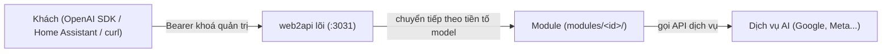

# web2api

Cổng AI nói chuẩn OpenAI (`/v1/models`, `/v1/chat/completions`...), chạy trong một container Docker nhỏ. Lõi đóng vai trò **«phiên dịch viên»**, không chứa sẵn nguồn AI cụ thể nào. Mỗi nguồn là một **module** cài thêm lúc chạy từ git, không cần dựng lại ảnh Docker hay khởi động lại dịch vụ.



## Module có sẵn

| Module | Chức năng | Trạng thái |
|---|---|---|
| `gemini-api` | Gemini API (Google AI Studio): chat stream, tạo ảnh, video Veo | Có sẵn |
| `muse` | Muse (Meta AI VM): giao thức Noise XX; cần khoá thiết bị nên **chưa dùng được** | Thử nghiệm, chưa kiểm với dịch vụ thật |
| `muse2api` | Muse (muse.ai) qua giao thức trực tiếp: chat miễn phí bằng cookie, không cần API key | Có sẵn |
| `antigravity` | Chat qua Antigravity CLI (`agy`) chạy trên máy chủ, cần cầu nối | Có khung, chưa kiểm với `agy` thật |

## Cài nhanh với Docker Compose

Tạo tệp `docker-compose.yml`:

```yaml
services:
  web2api:
    image: ghcr.io/tritue2011/web2api:latest
    container_name: web2api
    restart: unless-stopped
    ports:
      - "3031:8000"
    environment:
      WEB2API_DATA: /data
      WEB2API_GIT_REPO: TriTue2011/web2api
      WEB2API_GIT_NHANH: main
      WEB2API_GIT_THU_MUC: modules
      # WEB2API_ADMIN_KEY: "khoa-tu-dat" # tuỳ chọn; để trống thì tự sinh
    volumes:
      - web2api-data:/data
    user: "1000:1000"
    mem_limit: 256m
    cpus: 0.5
    pids_limit: 100

volumes:
  web2api-data:
    name: web2api-data
```

**3 bước khởi chạy:**
1. Khởi động container:
   ```bash
   docker compose up -d
   ```
2. Lấy khoá quản trị (nếu không tự đặt trong `WEB2API_ADMIN_KEY`):
   ```bash
   docker exec web2api cat /data/admin_key
   ```
3. Mở `http://<IP-máy-chủ>:3031` trên trình duyệt và dán khoá, hoặc thử lệnh:
   ```bash
   curl -s -H "Authorization: Bearer <khoá-quản-trị>" http://localhost:3031/v1/models
   ```

## Portainer và NAS

Cổng dịch vụ là `3031` (ánh xạ `3031:8000`), dữ liệu lưu ngoài container gắn vào `/data`.

### Portainer
1. Vào **Stacks** → **Add stack**, đặt tên stack (ví dụ `web2api`).
2. Dán khối compose ở trên vào trình soạn thảo.
3. Thêm biến môi trường (như `WEB2API_ADMIN_KEY`) ở mục **Environment variables** nếu cần.
4. Bấm **Deploy the stack**. Để cập nhật bản mới sau này, bấm **Pull and redeploy**.

### Synology NAS (Container Manager)
1. Mở **Container Manager** → **Project** → **Create**.
2. Đặt tên dự án, chọn đường dẫn thư mục dữ liệu `/volume1/docker/web2api`.
3. Dán nội dung compose, đổi volume thành `/volume1/docker/web2api:/data`.
4. Hoàn tất các bước và khởi chạy dự án; cổng truy cập là `3031`.

### QNAP NAS (Container Station)
1. Mở **Container Station** → **Applications** → **Create**.
2. Đặt tên ứng dụng và dán nội dung docker-compose.
3. Đảm bảo volume gắn thư mục dữ liệu trên NAS vào `/data` của container.
4. Bấm **Create** để hệ thống tự tải ảnh và khởi chạy trên cổng `3031`.

### Unraid
1. Mở tab **Docker** (hoặc cài qua Compose Manager plugin).
2. Dán nội dung compose hoặc tạo container từ ảnh `ghcr.io/tritue2011/web2api:latest`.
3. Ánh xạ cổng `3031:8000`, đường dẫn dữ liệu `/mnt/user/appdata/web2api` vào `/data`.
4. Đặt user `1000:1000` và khởi chạy container.

## Kho riêng tư (Private Repository)

Có hai loại token cho hai mục đích hoàn toàn khác nhau — không nhầm lẫn:

### 1. Tải ảnh Docker từ ghcr.io khi gói riêng tư
Gói GHCR mặc định riêng tư (chủ kho có thể đặt Public ở trang Packages của repo GitHub). Khi ảnh riêng tư:
- Tạo GitHub Personal Access Token (classic) có quyền `read:packages`.
- Đăng nhập trên máy Docker:
  ```bash
  echo $TOKEN | docker login ghcr.io -u <tên-github> --password-stdin
  ```
  Thông tin lưu vào `~/.docker/config.json`, không đặt token vào compose.
- **Portainer**: Vào **Registries** → **Add registry** → chọn Custom/GitHub với URL `ghcr.io` + tên đăng nhập + token, rồi chọn registry này khi deploy stack.
- **Synology**: **Container Manager** → **Registry** → **Settings** → **Add** (URL `ghcr.io`) hoặc `docker login` qua SSH.
- **QNAP / Unraid**: SSH vào thiết bị và chạy `docker login ghcr.io` như trên.
- **Watchtower (tự cập nhật với ảnh riêng tư)**: Mount file cấu hình vào container watchtower: `-v /root/.docker/config.json:/config.json:ro`.

### 2. Nguồn module từ kho GitHub riêng tư
Khi lấy module từ một kho GitHub riêng tư hoặc tránh hạn mức 60 yêu cầu/giờ/IP của GitHub:
- Tạo GitHub Fine-grained PAT có quyền **Repository permissions → Contents: Read-only** (chỉ cho đúng kho chứa module).
- Đặt biến môi trường `WEB2API_GITHUB_TOKEN` trong compose, Portainer (Environment variables) hoặc NAS.
- Khi không có token, GitHub giới hạn 60 yêu cầu/giờ/IP khiến việc «Cập nhật» báo hết hạn mức; thêm token này là hết lỗi.

## Đọc tiếp

Tài liệu kỹ thuật đầy đủ về kiến trúc, thành phần, chi tiết từng module, vận hành nâng cao, bảo mật và bảng tra cứu API / biến môi trường: xem tại [docs/THAM-CHIEU.md](docs/THAM-CHIEU.md).
