# web2api — tài liệu tham chiếu kỹ thuật

Tài liệu tham chiếu kỹ thuật chi tiết: tổng quan, kiến trúc, thành phần, module có sẵn, triển khai, vận hành, lưu ý bảo mật, tra cứu API / biến môi trường và phát triển. Mọi lệnh và đường dẫn tính từ **gốc kho**.

Kho: **https://github.com/TriTue2011/web2api** (public). Bản quyền thuộc chủ kho (`TriTue2011`), **giữ toàn quyền** (*All rights reserved*, xem [LICENSE](../LICENSE)).

## Mục lục

1. [Tổng quan](#1-tổng-quan)
2. [Kiến trúc](#2-kiến-trúc)
3. [Thành phần](#3-thành-phần)
4. [Module có sẵn](#4-module-có-sẵn)
5. [Triển khai](#5-triển-khai)
6. [Vận hành](#6-vận-hành)
7. [Lưu ý: bảo mật, sự cố, giới hạn](#7-lưu-ý-bảo-mật-sự-cố-giới-hạn)
8. [Tra cứu: API và biến môi trường](#8-tra-cứu-api-và-biến-môi-trường)
9. [Phát triển](#9-phát-triển)

## 1. Tổng quan

web2api là một **cổng AI nói chuẩn OpenAI** chạy trong một container Docker nhỏ trong mạng nhà. Ứng dụng nào
biết gọi OpenAI (thư viện `openai` của Python, Home Assistant, ứng dụng chat…) chỉ cần đổi «địa chỉ gốc» (base
URL) sang web2api và dùng khoá quản trị làm «API key».

**Lõi chỉ là phiên dịch viên.** Lõi không chứa nguồn AI nào và không biết tên nhà cung cấp nào: nó nhận yêu cầu
chuẩn OpenAI, tách **tiền tố** của tên model (`<tiền tố>/<tên>`) để chọn module, rồi chuyển cho module. Mọi thứ
riêng của một nhà cung cấp — địa chỉ máy chủ, cách xác thực, cách đổi tên model, dạng lỗi, gợi ý «hạng miễn phí»,
API gốc khác chuẩn (ví dụ video Veo) — nằm **trong module của nhà cung cấp đó**; module tự có bộ chuyển đổi để nói
chuẩn của lõi. Giao diện cũng vậy: tab và chế độ nào hiện là do **lời khai** của module (`loai`, `cung_cap`,
`muc`), không có tên module nào viết trong giao diện hay lõi. Thêm nguồn AI mới = thả một thư mục module, không
sửa lõi, không dựng lại ảnh, không khởi động lại.

### Trạng thái hiện tại

| Tính năng hoặc module | Trạng thái | Từ phiên bản / ngày |
|---|---|---|
| Lõi: `/health`, thông tin máy `/api/he-thong`, khoá quản trị cho mọi API đổi trạng thái và `/v1` | Có | 0.1.0-khung · 10/10/2026 |
| `/v1/models`, `/v1/chat/completions` chuẩn OpenAI (có stream) | Có | 0.1.0-khung · 10/10/2026 |
| `/v1/images/generations`, `/v1/videos` chuẩn OpenAI (định tuyến theo tiền tố; module không có khả năng đó → `501`) | Có (chỉ đo trên máy chủ Google giả) | 0.1.0-khung · 11/10/2026 |
| Module `gemini-api` (Gemini API, khoá Google AI Studio) | Có — chat đã kiểm với Google thật 10/10/2026; ảnh và video Veo (module 0.2.0, chỉ khoá trả phí) **chưa kiểm với Google thật** | 0.1.0-khung · 10/10/2026 |
| Module `muse` (Muse, Meta AI VM) | Thử nghiệm — giao thức Noise XX WebSocket, kiểm với máy chủ giả; **chưa kiểm với dịch vụ thật** | 0.1.0 · 12/10/2026 |
| Module `claude-web` (Claude Web, claude.ai) | Có — chat stream/không stream, xoay nhiều tài khoản theo mã lỗi, kiểm với máy chủ giả; gắn danh tính chung (NV80, cùng khuôn NV77); **chưa kiểm với claude.ai thật** | 17/10/2026 |
| Module `antigravity` (Antigravity CLI trên máy chủ) | Có — kiểm với agy giả lập; **chưa kiểm với agy thật** (tránh tốn hạn mức) | 0.1.0-khung · 12/10/2026 |
| Module `vnc-xa` (Workspace trình duyệt qua noVNC, cookie sang module) | Có — kiểm với dịch vụ giả + Chrome thật cho tab; **chưa kiểm với dịch vụ/Firefox thật** | 0.2.0 · 13/10/2026 |
| Phụ thuộc module (`can_module` + đếm tham chiếu): cài thì đề nghị cài cái thiếu (không tự cài lén), gỡ cái đang được cần → `409`, gỡ provider cuối thì hỏi giữ hay gỡ cái chung | Có — kiểm bằng test NV73 | 17/10/2026 |
| Nguồn module từ git: báo module mới/bản mới, cài, tự cài module mới có điều kiện, bản mới của module đã cài luôn chờ duyệt | Có (chưa thử với GitHub thật) | 0.1.0-khung · 10–11/10/2026 |
| Module `gemini-web` (Gemini bản web, cookie Google) | Thử nghiệm — chat stream/không stream + xoay vòng nhiều tài khoản, kiểm với máy chủ giả; **chưa kiểm với dịch vụ thật**; ảnh/video chưa làm | 0.1.0 · 17/10/2026 |
| Module `chatgpt-web` (ChatGPT bản web, Bearer token) | Thử nghiệm — chat stream/không stream + xoay vòng nhiều token theo mã lỗi, gắn danh_tinh_id của kho danh tính, kiểm với máy chủ giả; **chưa kiểm với dịch vụ thật**; ảnh/video chưa làm | 0.1.0 · 17/10/2026 |
| Module `grok-web` (Grok Web qua giao thức web grok.com, cookie người dùng) | Thử nghiệm — kiểm với máy chủ WebSocket giả; gắn danh tính chung (NV80, cùng khuôn NV77); **chưa kiểm với grok.com thật** (cần cookie tài khoản thật) | 0.1.0 · 17/10/2026 |
| Nguồn module từ git: báo module mới/bản mới, cài, tự cập nhật có điều kiện, lần đầu thêm nguồn thì cập nhật module đang có | Có (chưa thử với GitHub thật) | 0.1.0-khung · 10–11/10/2026 |
| Cài module KHÔNG cần khoá API; khoá thêm/bớt từng cái trên web | Có | 0.1.0-khung · 11/10/2026 |
| Nạp lại module nóng; module từ xa (dịch vụ OpenAI trong mạng nhà); tab riêng của module ở `/m/<id>/` | Có | 0.1.0-khung · 10/10/2026 |
| «Tính năng đang có» `GET /api/tinh-nang`: tab/chế độ hiện theo `loai` + `cung_cap` + `muc` của module | Có | 0.1.0-khung · 11/10/2026 |
| Giao diện mới (lát A): Hệ thống → Module (lưới ô theo loại, nút Cài / Cập nhật / Thêm khoá ngay trên ô, bảng chi tiết «Cần gì để chạy»), Cài xong vào thẳng Studio (trạng thái rỗng khi chưa có khoá), Hệ thống → AI (Tài khoản — nơi thêm/bớt khoá, Provider), Studio (chat stream, ảnh, video, Tạo mới, Lịch sử trò chuyện lưu trong trình duyệt) | Có — đo bằng Chrome thật trên lõi thật với module/Google/GitHub giả | 0.1.0-khung · 11/10/2026 |
| Combo (xếp thứ tự nhiều nguồn AI, lùi khi lỗi) | Đã có backend API (`/api/combo`) và điều phối ở lõi — tab giao diện giữ ở việc sau | 0.1.0-khung · 13/10/2026 |
| «Địa chỉ truy cập công khai» (`GET`/`PUT /api/dia-chi`, `GET /api/ket-noi`, proxy ngược) | Có | 0.1.0-khung · 12/10/2026 |
| Khoá khách có phạm vi, sổ thao tác quản trị, Bảo mật & người dùng | Có | 0.1.0-khung · 12/10/2026 |
| Sao lưu và khôi phục cấu hình (`POST /api/sao-luu`, `POST /api/khoi-phuc`, mã hoá AES-256-GCM, giữ khoá khách) | Có | 0.2.0 · 13/10/2026 |
| Checklist yêu cầu đầy đủ và tự cài gói Python, bỏ trần dung lượng tải module | Chưa có (giai đoạn sau) | — |
| Tác phẩm, Nhà, Đời sống, giọng nói, MCP, nhật ký trên web | Chưa có (chờ module thật đứng sau) | — |
| Gemini: nhúng (embeddings), video bằng Gemini Omni | Chưa có | — |
| Chữ ký số cho module | Chưa có (chỉ kiểm chữ ký commit của GitHub, tuỳ chọn) | — |
| Kho danh tính + API danh tính (`GET`/`POST /api/danh-tinh`, `GET`/`DELETE /api/danh-tinh/{id}`, `POST …/{id}/gan|go`): một email một lần, gắn nhiều provider, xoá bị chặn khi còn tài khoản trỏ tới, kho mã hoá AES-256-GCM quyền 0600 | Có — kiểm với máy chủ giả (NV67 nhóm 1, việc 1–2); **chưa có giao diện** | 17/10/2026 |
| Sao lưu gồm danh tính: `bi_mat/danh_tinh.json` có bộ kiểm riêng (id đúng khuôn `dt-<16hex>`, email đúng khuôn, không trùng id/email; sai → `400` `sao_luu_khong_hop_le` nêu tên tệp, không ghi đè); bản không mật khẩu không chứa bí mật | Có — kiểm với máy chủ giả (NV67 nhóm 5, việc 11) | 17/10/2026 |
| Công cụ khôi phục quản trị dòng lệnh (`python3 -m app.khoi_phuc_quan_tri dat-lai-mat-khau|tat-2fa`): đặt lại mật khẩu/tắt 2FA trên máy chủ, không đường web tương đương, ghi nhật ký `quan_tri` mỗi lần dùng | Có — kiểm với thư mục dữ liệu tạm (NV67 nhóm 5, việc 13) | 17/10/2026 |
| API dán hàng loạt + tiến độ đăng nhập lần lượt (`POST /api/tai-khoan/dan-hang-loat`, `POST /api/tai-khoan/dang-nhap-hang-loat/bat-dau`, `GET …/trang-thai`, `POST …/dung`): tách dòng không lộ mật khẩu, một lượt chạy một lúc (lượt thứ hai → `409`), module chưa hỗ trợ thì dòng `bo_qua` (không phải lỗi), chạy tiếp bằng `bo_qua_email` | Có — kiểm với module giả (NV67 nhóm 3, việc 7); **chưa có giao diện** | 17/10/2026 |

## 2. Kiến trúc

### Các thành phần và cách liên kết

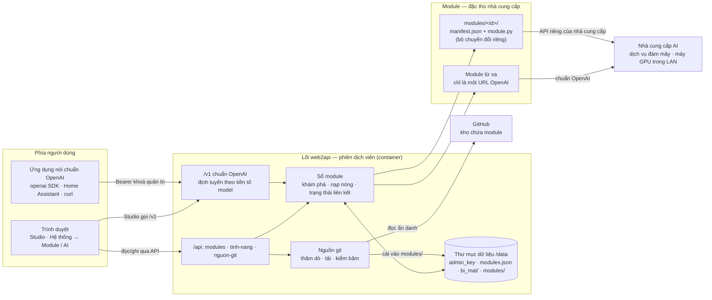

- **Lõi** (`app/`) nói chuẩn OpenAI ở `/v1`, giữ sổ module và lưu cấu hình. Lõi cấp cho module một bộ công cụ dùng
  chung (`app/chuyen_tiep.py`: chuyển tiếp nguyên văn, stream từng dòng, xoay khoá, che khoá trong lỗi) — bộ công
  cụ nhận mọi điểm riêng (tên, gợi ý lỗi, lời giải thích khi khoá bị từ chối) làm **tham số do module truyền vào**.
- **Module** quyết mọi chi tiết của nhà cung cấp và tự khai mình là gì: loại (`loai`), khả năng (`cung_cap`), mục
  con (`muc`), trường cấu hình (`truong_cau_hinh`), tài nguyên cần (`tai_nguyen`).
- **Giao diện** (`web/`) chỉ đọc dữ liệu từ API (`/api/tinh-nang`, `/api/modules`, `/v1/models`…) và dựng màn
  hình theo đó.

### Một yêu cầu `/v1` đi qua các phần thế nào

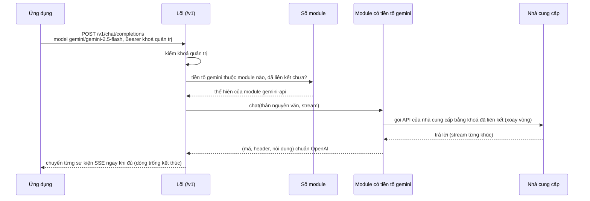

Không thuộc module nào → `404 model_not_found`; module đã cài mà chưa liên kết → `404 module_not_configured`;
module không có khả năng được gọi (ví dụ không có `anh`, hay không có `chat` cho `/v1/chat/completions`) →
`501 capability_not_supported` — lõi xét phương thức CÓ THẬT trên module, không xét lời khai `cung_cap`.

Lõi giữ đúng giao thức cho khách ở `/v1/chat/completions` (không đổi gì khác của phản hồi module):

- **`finish_reason` khi có `tool_calls`**: choice có `tool_calls` mà kết thúc bằng `"stop"` → lõi đổi thành
  `"tool_calls"` (SDK OpenAI, LangChain, n8n bỏ qua lời gọi hàm khi thấy `stop`). Quyết bằng cấu trúc JSON, nhớ
  theo `index` của từng choice. `"length"` và `"content_filter"` **giữ nguyên**: lời gọi hàm bị cắt vì hết token có
  tham số JSON đứt, gắn `tool_calls` là báo sai rằng nó hoàn chỉnh. Thân không stream là trọn một lượt nên
  `finish_reason` thiếu/null cũng được đổi; trong stream null nghĩa là chưa xong nên không đụng. Khúc không phải JSON
  đúng dạng (kể cả `index` không phải số nguyên) đi nguyên văn.
- **Giữ kết nối SSE**: stream im lặng quá `WEB2API_SSE_GIU_GIAY` giây (mặc định 15; giá trị không phải số dương thì
  về mặc định) → lõi gửi dòng chú thích `: keep-alive` (không phải `data:`), để proxy (Cloudflare, Nginx) không cắt
  khi model suy luận lâu. Lõi tự đệm theo **ranh giới sự kiện SSE** (dòng trống), không dựa cách module chia khúc:
  chỉ chuẩn hoá và phát sự kiện trọn vẹn, mỗi sự kiện phát ngay khi đủ; keep-alive chỉ chen giữa hai sự kiện; phần
  dở dang lúc hết luồng phát nguyên văn. Bộ đệm có trần `WEB2API_SSE_DEM_TOI_DA_KB` (mặc định 1024 KiB = 1 MiB):
  nếu vượt trần mà chưa gặp ranh giới sự kiện thì phát nguyên văn để chống cạn bộ nhớ và ghi đúng một cảnh báo.
  Khách ngắt (hoặc luồng bị đóng giữa chừng) → lõi huỷ việc đang chờ và đóng
  (`aclose`) luồng của module, để luồng ngược dòng không chạy tiếp giữ kết nối và token.
- **Trần phản hồi ngược dòng đọc vào RAM**: mọi phản hồi từ dịch vụ xa (nhà cung cấp AI, module từ xa do quản trị
  khai URL, dịch vụ trình duyệt) khi đọc trọn vào RAM (chat không stream, gọi khả năng, kiểm khoá, lấy model, API
  quản trị trình duyệt) đều được đọc từng khúc qua luồng có trần dung lượng `WEB2API_PHAN_HOI_TOI_DA_MB` (mặc định 32 MB)
  và trần thời gian tổng `WEB2API_PHAN_HOI_TOI_DA_GIAY` (mặc định 300 giây). Vượt trần dung lượng ngắt ngay và trả
  `502 upstream_too_large` (chống OOM-kill container bị giới hạn RAM); quá giờ đọc ngắt và trả `504 upstream_timeout`. Các luồng
  phát (`LuongSSE`, `LuongNhiPhan`) dùng lớp có phương thức `aclose()` bảo đảm đóng phản hồi ngược dòng ngay cả khi
  chưa kịp nhận byte đầu.

Đường nhận tệp
(`/v1/audio/transcriptions`, `/v1/images/edits`, `/v1/videos` dạng multipart) đi cùng lối, thêm một bước ở lõi trước
khi hỏi sổ: đọc `multipart/form-data` thành `YeuCauDaPhan` (vượt trần → `413`, không phải multipart → `415`), lấy
`model` từ trường chữ để định tuyến.

### Combo: model ảo chạy nhiều bước, lùi theo mã HTTP

Combo là một tên (`ID_HOP_LE`) gắn với danh sách **bước** có thứ tự; mỗi bước chỉ là một model `<tiền tố>/<tên>` của
module đã cài (`bat: false` để tạm tắt). Lưu ở `<WEB2API_DATA>/combo.json` (0600, ghi nguyên tử), quản trị bằng
`/api/combo` (chỉ khoá quản trị). Trạng thái cầu chì, hạ bậc, dính tài khoản nằm trong bộ nhớ — khởi động lại là sạch.

**Gọi.** `model: "combo/<tên>"` hoặc tên trần `"<tên>"` (không «/») trên `POST /v1/chat/completions` (cả stream) và
`POST /v1/images/generations`; đường khác trả `501`. Thứ tự phân giải `model`: tiền tố thuộc một module (kể cả module
mang tiền tố `combo` — module được ưu tiên, combo khi ấy gọi bằng tên trần) → `combo/<tên>` → tên trần trùng tên combo.
Không tạo được combo trùng tiền tố module đang có, tên `combo`/`trang-thai`, hay lồng combo trong combo. Khoá khách
cần phạm vi của ĐƯỜNG đang gọi (`chat` cho chat, `anh` cho ảnh). Lượt gọi module thường không đọc `combo.json`.

**Chọn bước.** Mỗi bước được phân giải bằng ĐÚNG hàm của đường `/v1` thường (`_module_cho_model`): bước tắt, model đã
tắt ở Hệ thống → AI, module chưa liên kết hay không có phương thức của việc (`chat`/`anh`) bị loại TRƯỚC và không bao
giờ được gọi; không còn bước hợp lệ → `503 no_available_routes` (JSON chuẩn, kèm mã lý do từng bước). Thứ tự thử trên
các bước hợp lệ: bước dính (nếu còn tốt) → bước tốt → bước đang bị hạ bậc → bước có cầu chì đang chặn — mỗi nhóm giữ
thứ tự gốc, nên hết hạn hạ bậc/nghỉ là bước về CHỖ CŨ. «Không bao giờ chặn lựa chọn cuối»: bước bị cầu chì chặn hay hạ
bậc vẫn được thử khi mọi bước khác hỏng; luật này KHÔNG vượt qua bước không hợp lệ.

**Lùi theo mã của bước** (một bộ phân loại `phan_loai` cho chat và ảnh, theo mã — không dò chữ):

| Bước trả | Combo làm |
|---|---|
| 2xx (stream: đã có khúc đầu) | Chốt bước, đóng cầu chì, ghi dính |
| 400 | **Phân xử**: thử bước hợp lệ kế. Bước so sánh trả 2xx → 400 thuộc (module, model) ấy: bước đó bị hạ bậc `WEB2API_COMBO_NGHI_GIAY` giây trong ĐÚNG nhóm việc đó (nhóm việc khác không bị phạt), trả kết quả 2xx. Bước so sánh cũng 400 → lỗi của yêu cầu: trả 400 của bước đầu NGUYÊN VĂN, không thử thêm, không ai bị hạ. Bước so sánh lỗi khác (5xx, 429…) → lùi bình thường; hết bước → trả 400 đầu |
| 404, 413, 501 | Bước không dùng được cho yêu cầu này: sang bước kế, không tính hỏng |
| 429 | Hạ bậc (module, model, việc) tới hết `Retry-After` (1–600 s, thiếu thì 60 s), sang bước kế |
| 401, 403 | Khoá hỏng (module đã tự xoay hết khoá): cầu chì (module, việc) mở NGAY, sang bước kế |
| 5xx, lỗi khi gọi / trước byte đầu | Tính một lỗi cầu chì (module, việc), sang bước kế |
| 4xx khác (422, 409…) | Lỗi của yêu cầu: trả ngay |

Hết bước: trả lỗi 400 đầu tiên nếu có, không thì lỗi của bước thử cuối; thân lỗi JSON giữ nguyên `type`/`code`, chỉ
`error.message` qua bộ che khoá. Mọi lỗi do chính combo sinh (503, 504, 502 của bước lỗi khi gọi) là JSON chuẩn OpenAI.

**Cầu chì** theo (module, nhóm việc): `dong` → `mo` sau `WEB2API_COMBO_NGUONG` lỗi liên tiếp (401/403 mở ngay) → hết
`WEB2API_COMBO_NGHI_GIAY` thì cho đúng MỘT lượt thăm dò (nửa mở; lượt thăm dò treo quá 30 s thì lượt khác được thăm dò
thay). Hỏi trạng thái để xếp thứ tự không chiếm lượt; lượt được chiếm ngay trước khi gọi và luôn được trả (kể cả khi bước
kết thúc bằng 400/404/413/429 hay khách ngắt).

**Stream.** Chỉ đổi bước TRƯỚC byte đầu. Sau byte đầu mà thượng nguồn hỏng: phát một sự kiện SSE
`{"error": {"code": "stream_interrupted", "type": "api_error"}}` rồi kết thúc (không nuốt), ghi một lỗi cầu chì.
Luồng thượng nguồn luôn được `aclose` trong `finally` (hết luồng, lỗi, khách ngắt, bước bị bỏ).

**Trần thời gian tổng** `WEB2API_COMBO_TOI_DA_GIAY`: tính cho các bước tới lúc có kết quả (stream: tới byte đầu); vượt →
`504 combo_timeout`. Bước đầu luôn được thử; luồng đã chảy không bị trần này cắt.

**Dính tài khoản.** Cùng hội thoại đi lại đúng bước đã trả lời trong `WEB2API_COMBO_DINH_GIAY` giây. Khoá dính là
sha256 của `user` (hoặc tiêu đề `x-user`) cắt 256 ký tự, không có thì của tin `user` đầu tiên cắt 2000 ký tự — độ dài
cố định, không giữ chuỗi thô; tối đa 2000 khoá (bỏ cũ nhất). Bước dính bị chặn/hạ bậc/không còn → bỏ dính.

**Tiêu đề phản hồi.** `x-web2api-route: <tiền tố>/<tên>` — model của bước đã thật sự trả lời (dán lại vào `model` là
gọi thẳng đúng bước đó); `x-web2api-combo: <tên>`; `x-web2api-module` mang tiền tố module THẬT. `/api/tinh-nang` có
`co_combo` (true khi có ít nhất một combo hợp lệ). `combo.json` sửa tay sai: mục hỏng bị bỏ và ghi cảnh báo, không
làm hỏng `/v1/models` hay đường gọi.

### Chuẩn tri thức (`tri_thuc`) và quy trình nối tầng

Chuẩn tri thức kết nối linh hoạt nhiều nguồn thông tin qua bốn sơ đồ tìm kiếm:

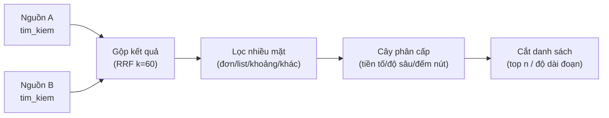

- **Bốn sơ đồ tìm kiếm của lõi**:
  - **Phễu (`pheu`)**: Phễu mặc định gồm 5 tầng nối tiếp: `truy_hoi` (theo nguồn/công tắc) → `gop` (RRF k=60) → `loc` → `cay` → `cat`. Báo cáo `bao_cao` đo lường chi tiết mọi tầng (`ten, vao, ra, ms`, và `bo_qua` nếu có); dừng ngay khi gặp lỗi và báo đúng tầng; trần 8 tầng và trần thời gian `WEB2API_QUY_TRINH_GIAY`. Khách có thể gửi danh sách tầng tuỳ biến trong `pheu`.
    - **Hợp đồng toán tử phễu**: Phễu chỉ chấp nhận các toán tử dữ liệu thuần của lõi (`gop`, `loc`, `cay`, `cat`, `muc_luc`, `chi_muc`, `gop_ngu_canh`) và các khả năng module thuộc tập chuẩn tri thức đã quy định trong `HOP_DONG_KHA_NANG` (`tim_kiem`, `xep_hang`, `nhung`). Module được gọi phải khai báo khả năng đó trong `cung_cap` của manifest và không bị chuẩn lỗi. Mọi khả năng ngoài hợp đồng (như phương thức vòng đời `nap`, `cai`, `dung`, `suc_khoe` hay khả năng ngoài phễu `anh`, `noi`, `video_tao`) bị từ chối với mã 400 `unknown_capability` và không bao giờ được gọi.
    - **Cổng kiểm soát phạm vi từng tầng**: Mỗi tầng trong phễu phải qua cổng kiểm tra phạm vi tương ứng của chính khả năng đó từ danh tính người gọi (`danh_tinh` truyền tường minh qua tham số hàm, không dùng biến toàn cục). Khách thiếu phạm vi bị từ chối 403 `insufficient_scope`. Thiếu danh tính phạm vi bị từ chối (đóng khi lỗi).
    - **Bảo vệ tham số module**: `tham_so` do khách gửi chỉ truyền dữ liệu tìm kiếm/xếp hạng, không bao giờ ghi đè cấu hình đã nạp của module.
  - **Công tắc (`bat_tat`)**:
    - `bat_tat.nguon = {<id module>: bool}`: Lõi loại bỏ nguồn bị tắt (`false`) khỏi tầng truy hồi (kết hợp với danh sách chọn `nguon: [...]` nếu có); nguồn không tồn tại hoặc bị tắt ghi vào `bao_cao` là bỏ qua, không gây lỗi.
    - `bat_tat.so_do = {<mã sơ đồ>: bool}`: Lõi chuyển nguyên vào `yc` của module (mã mở, ví dụ `toan_van`, `ngu_nghia`); module khai báo trong manifest trường `so_do_tim_kiem: [mã...]` để `GET /api/tim-kiem/nguon` liệt kê vẽ công tắc; sơ đồ lạ module bỏ qua, phản hồi ghi `so_do_bo_qua` theo nguồn (không lỗi).
  - **Lọc nhiều mặt (`loc`)**: Hỗ trợ giá trị đơn (bằng), danh sách (thuộc một trong), khoảng `{tu, den}` cho số và chuỗi ISO ngày giờ, loại trừ `{khac: ...}`, và trường lồng bằng đường chấm (`truong.kenh`). Kiểu dữ liệu không khớp thì mục không qua lọc (không lỗi). Hỗ trợ đếm theo mặt: thân `mat: ["truong.kenh", ...]` → phản hồi `mat: {"truong.kenh": {"<giá trị>": số mục}}` tính trên kết quả trước khi cắt `so_luong`.
  - **Cây phân cấp (`cay`)**: Lọc `{truong, goc, do_sau?}` theo tiền tố đường dẫn phân cấp (phân tách «/») và độ sâu tính từ `goc`. Nếu `cay.dem: true` → phản hồi `cay_nut: [{duong, so_muc}]` các nút con trực tiếp dưới `goc` kèm số mục tính trước khi cắt `so_luong`.
- Các khả năng chuẩn: `nhung` (`POST /v1/embeddings`), `xep_hang` (`POST /v1/rerank`), và `tim_kiem` (`GET /api/tim-kiem/nguon`, `POST /api/tim-kiem`).
- Toán tử dữ liệu thuần: `gop` (RRF k=60), `loc` (lọc nhiều mặt), `cay` (tiền tố, độ sâu, duyệt cây), `cat` (top n), `gop_ngu_canh` (trần tổng ký tự đoạn văn bản).
- An toàn nội dung: kết quả luôn đánh dấu `nguon_ngoai: true`, đầu vào không tin cậy, không tự đưa vào chỉ thị hệ thống; kênh nhật ký `tri_thuc` không ghi nội dung tài liệu.
- **Giao diện**: khối «Tìm kiếm» ở trang `He-thong-Tich-hop.dc.html` (Hệ thống → Tích hợp & công cụ) liệt kê nguồn, ô tìm thử (kết quả hiện dạng chữ thuần như dữ liệu không tin được) và lấy cây mục lục (`POST /api/tim-kiem/muc-luc`, xác nhận hai bước).

### Cài → vào Studio → thêm khoá (không tải lại trang)

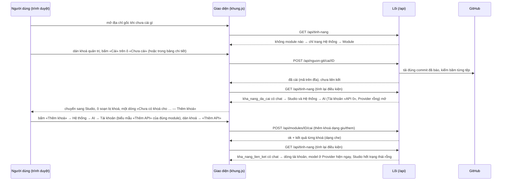

Module không ứng tab chính nào (ví dụ loại «mạng» chỉ khai `dinh_tuyen`) thì cài xong ở lại Hệ thống → Module, bảng
chi tiết mở ở bước kế tiếp.

### Cấu hình nào thuộc phần nào

| Cấu hình | Thuộc phần | Ở đâu | Ai đặt |
|---|---|---|---|
| Cổng, giới hạn RAM/CPU, volume, nhãn Watchtower | Triển khai | `docker-compose.yml`, `.env` | Người vận hành |
| `WEB2API_DATA`, `WEB2API_ADMIN_KEY`, `WEB2API_MAY_*`, `TZ` (múi giờ của nhà) | Lõi | Biến môi trường | Người vận hành |
| Khoá quản trị | Lõi | `/data/admin_key` (0600) hoặc `WEB2API_ADMIN_KEY` | Lõi tự sinh lần đầu |
| Nguồn git (`repo`, `nhanh`, `thu_muc`, `chu_ky_giay`, `tu_dong`, `yeu_cau_chu_ky`, `token`) | Lõi — nguồn git | `/data/nguon_git.json` (token ở `bi_mat/`), hoặc `WEB2API_GIT_*` khi chưa lưu | Quản trị (Hệ thống → Module → «＋ Thêm module» → Từ git) |
| Mã module | Module | `/data/modules/<id>/` | Cài từ git, hoặc chép tay |
| `loai`, `loai_ten`, `loai_thu_tu`, `cung_cap`, `muc`, `tab_web`, `tai_nguyen`, `yeu_cau_goi`, `truong_cau_hinh` | Module (lời khai) | `modules/<id>/manifest.json` | Người viết module |
| Giá trị thường của module (ví dụ `base_url`) | Module — lõi chỉ lưu hộ | `/data/modules.json` (`cau_hinh_cong_khai`) | Quản trị (form dựng từ `truong_cau_hinh`) |
| Bí mật của module (khoá API của nhà cung cấp) | Module — lõi chỉ lưu hộ | `/data/bi_mat/<id>.json` (0600), không API nào trả lại | Quản trị |
| Module từ xa (`id`, `tien_to`, `base_url`, `api_key`) | Lõi — module từ xa | `/data/tu_xa.json` (+ `bi_mat/`) | Quản trị |
| Bảng điều kiện hiện tab của khung (Module, AI, Tài khoản, Provider, Combo, Studio, chế độ Studio) | Giao diện | `DIEU_KIEN` trong `web/khung.js` | Người phát triển giao diện |
| Khoá quản trị để trang gọi API | Trình duyệt | `localStorage` (`web2api_khoa`) của trình duyệt đó | Người dùng dán trên trang |

## 3. Thành phần

### Lõi (`app/`)

| Tệp | Việc |
|---|---|
| `main.py` | Khởi động FastAPI, `GET /` (trang chọn trang đầu), `/health`, `/api/he-thong`, phục vụ `web/` |
| `tuyen.py` | Các đường `/v1`, `/api/modules`, `/api/tinh-nang`, `/api/nguon-git`, `/m/<id>/` |
| `kham_pha.py` | Khám phá module từ cấu trúc thư mục, kiểm mẫu manifest; **hợp đồng lớp `Module` ghi ở đầu tệp** |
| `so_module.py` | Sổ module: nạp nóng, cài/gỡ cấu hình, định tuyến theo tiền tố, tính «tính năng đang có» |
| `nguon_git.py` | Thăm dò GitHub, báo module mới/bản mới (kèm `loai`, `cung_cap`, dung lượng tải đo từ cây git), cài theo commit |
| `tu_xa.py` | Module từ xa (chỉ URL), chặn SSRF lúc đăng ký |
| `chuyen_tiep.py` | Bộ chuyển tiếp OpenAI dùng chung cho module; mọi điểm riêng của nhà cung cấp là tham số |
| `yeu_cau_da_phan.py` | Đọc `multipart/form-data` cho các đường `/v1` nhận tệp: trần tổng thân, đếm byte thật, dọn tệp tạm, dựng `YeuCauDaPhan` cho module |
| `phien.py` | Kho phiên tài khoản (`bi_mat/phien/` 0600), bộ quét kiểm phiên và làm mới định kỳ |
| `combo.py` | Điều phối định tuyến dự phòng nhiều nguồn/model (combo), cầu chì trạng thái đóng/mở/nửa mở, hạ bước cạn hạn mức, dính tài khoản session affinity, phát lại thân yêu cầu |
| `kho.py`, `xac_thuc.py`, `he_thong.py` | Lưu trữ trên đĩa (bí mật 0600), khoá quản trị, đọc tài nguyên máy |
| `tai_url_khong_tin.py` | Bộ tải URL không tin cậy (`attachment_url`, `image_url`): chặn toàn bộ IP riêng/LAN/loopback/CGNAT, ghim IP, chuyển hướng tối đa 3 chặng, cấm hạ scheme, trần byte và thời gian |
| `tep_an_toan.py` | Bộ kiểm tra tệp tải lên: kiểm tra kích thước header ảnh PNG/JPEG/GIF/WebP trước giải mã; kiểm tra archive ZIP chống zip-slip, symlink, bom nén |
| `url_ky.py` | URL ký cho media: HMAC-SHA256 phủ phương thức + đường dẫn chuẩn hoá + hạn dùng, giải đường dẫn an toàn `duong_tep_an_toan` |
| `tieu_de_bao_mat.py` | Tiêu đề bảo mật toàn cục và phục vụ tĩnh: tệp tĩnh luôn no-cache + ETag để nâng cấp không gây lệch phiên bản giao diện |
| `tai_khoan_hang_loat.py` | Tách dòng tài khoản hàng loạt + bộ chạy đăng nhập lần lượt (NV67 việc 5–6): hai khuôn dòng, hợp đồng đăng nhập chung cho module, giãn cách 30s, dừng khi hỏng 2 liên tiếp, xoá bí mật sau dùng |

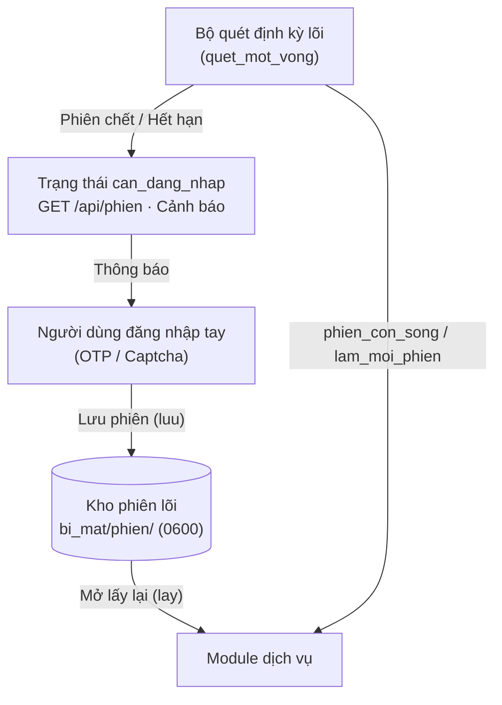

### Dịch vụ an toàn dùng chung cho module

Ba dịch vụ bảo mật lõi dùng chung (chuẩn hoá theo [CHUAN-BAO-MAT-MODULE.md](CHUAN-BAO-MAT-MODULE.md) mục 3.6–3.8), module không tự chế:

#### 1. Bộ tải URL không tin (`app/tai_url_khong_tin.py`)

Tải an toàn các URL do người dùng, mô hình, hoặc bên ngoài cung cấp (`image_url`, `attachment_url`).
- **Hợp đồng**: `async def tai_url(url: str, *, tran_byte: int, tran_giay: float, cho_phep_host: set | list | Callable = None, tieu_de: dict = None) -> tuple[bytes, str]`
- **Bảo vệ**: Chặn toàn bộ loopback, link-local, private LAN, CGNAT, IPv6 ULA, 6to4/Teredo nhúng IP cấm; phân giải và ghim IP kết nối chống DNS rebinding; chuyển hướng tối đa 3 chặng có kiểm tra lại từng chặng; cấm hạ cấp `https` → `http`; không chuyển tiếp `Authorization`/`Cookie`; trần byte và trần thời gian tổng.
- **Ngoại lệ**: `LoiTaiUrl(ma, ly_do)` (không chứa thân phản hồi đích, không lộ nội dung).
- **Ví dụ**:
  ```python
  from app.tai_url_khong_tin import tai_url, LoiTaiUrl

  try:
      du_lieu, mime = await tai_url(
          "https://example.com/anh.png",
          tran_byte=10 * 1024 * 1024,  # trần 10 MB
          tran_giay=15.0,              # trần 15 giây
      )
  except LoiTaiUrl as e:
      log.warning("Tải URL thất bại: [%s] %s", e.ma, e.ly_do)
  ```

#### 2. Bộ kiểm tra tệp tải lên (`app/tep_an_toan.py`)

Kiểm tra an toàn dữ liệu nhị phân ảnh và tệp nén trước khi đưa vào xử lý sâu hoặc lưu trữ.
- **Hợp đồng ảnh**: `kiem_anh(du_lieu: bytes, *, canh_toi_da: int = 8192, diem_anh_toi_da: int = 40_000_000) -> dict`
  - Đọc header PNG/JPEG/GIF/WebP thuần Python; nhận dạng theo nội dung nhị phân (không tin phần mở rộng tệp); từ chối ngay khi kích thước vượt trần trước khi giải mã (chống bom điểm ảnh / OOM).
  - Trả về: `{"loai": str, "mime": str, "rong": int, "cao": int, "diem_anh": int}`.
- **Hợp đồng zip**: `kiem_zip(du_lieu: bytes, *, so_muc_toi_da: int = 2000, tong_giai_nen_toi_da: int = 200 * 1024 * 1024, ti_le_nen_toi_da: float = 150.0) -> dict`
  - Đọc mục lục bằng `zipfile` trong bộ nhớ, **không giải nén ra đĩa**; chặn zip-slip (`..`, đường dẫn tuyệt đối), symlink, bom nén theo tỉ lệ và tổng giải nén.
  - Trả về: `{"so_muc": int, "tong_giai_nen": int, "kich_thuoc_nen": int}`.
- **Ngoại lệ**: `LoiTep(ma, ly_do)`.
- **Ví dụ**:
  ```python
  from app.tep_an_toan import kiem_anh, kiem_zip, LoiTep

  try:
      thong_tin_anh = kiem_anh(raw_bytes, canh_toi_da=4096)
  except LoiTep as e:
      raise ValueError(f"Tệp không an toàn: [{e.ma}] {e.ly_do}")
  ```

#### 3. URL ký cho media (`app/url_ky.py`)

Cung cấp đường dẫn media có chữ ký HMAC-SHA256 chống đoán URL và IDOR.
- **Hợp đồng**:
  - `ky_url(duong: str, *, het_han_giay: int, phuong_thuc: str = "GET") -> str`: ký HMAC-SHA256 phủ phương thức + đường dẫn chuẩn hoá + hạn dùng Unix timestamp. Khoá HMAC 32 byte riêng tại `<DATA>/bi_mat/khoa_url_ky` (0600), không đưa khoá quản trị vào URL.
  - `kiem_chu_ky(phuong_thuc: str, duong: str, tham_so: dict | str = None) -> bool`: kiểm tra chữ ký hằng thời gian (`hmac.compare_digest`). Trả về `False` khi sai/hết hạn/đường dẫn khác mà không phân biệt lý do.
  - `duong_tep_an_toan(goc: Path | str, ten: str) -> Path`: giải quyết đường dẫn bằng `resolve()` rồi kiểm tra `is_relative_to(goc)`.
- **Ví dụ**:
  ```python
  from app.url_ky import ky_url, kiem_chu_ky, duong_tep_an_toan

  # Ký URL cho media tồn tại trong 1 giờ
  link = ky_url("/media/anh_chup.png", het_han_giay=3600)

  # Xác thực yêu cầu đến
  hop_le = kiem_chu_ky("GET", link)

  # Truy cập tệp trên đĩa an toàn
  duong_that = duong_tep_an_toan(thu_muc_media, "anh_chup.png")
  ```

#### 4. Tách dòng tài khoản hàng loạt + bộ chạy đăng nhập lần lượt (`app/tai_khoan_hang_loat.py`)

Thư viện lõi cho «dán hàng loạt» và «đăng nhập lần lượt» (NV67 nhóm 3, việc 5–6). Lõi KHÔNG chứa tên
nhà cung cấp; việc đăng nhập THẬT do từng module thực hiện qua hợp đồng chung. API/bảng tiến độ là việc 7.

- **Tách dòng** `tach_dong(van_ban) -> (danh_sach, loi, bo_trung)`:
  - Hai khuôn: `email|mật khẩu|TOTP` (TOTP có thể trống) và `email|cookie=…`; dòng chỉ có email
    nghĩa là «đăng nhập lại tài khoản đã lưu».
  - Dòng trống hoặc bắt đầu bằng `#` → bỏ qua; dòng sai khuôn → báo đúng số dòng (tính từ 1),
    các dòng đúng vẫn được nhận; email trùng (không phân biệt hoa/thường) → giữ lần đầu.
  - Email kiểm bằng biểu thức hẹp (chặn luôn ký tự HTML `<>&"'` ngay từ đầu vào → chống XSS khi hiển thị).
- **Hợp đồng đăng nhập chung**: module triển khai `async dang_nhap(tai_khoan: DongDaTach) -> KetQuaDangNhap`
  (`thanh_cong` + `cookie` mới, hoặc `ma_loi` + `ma_trang_thai`). `ma_loi` phải là mã ngắn
  `[a-z0-9_]{1,64}` — module đưa mã lạ/câu dài → lõi thay bằng `phan_loai_loi(ma_trang_thai)`
  (401 → `sai_chung_thuc`, 403 → `bi_cam`, 404 → `khong_tim_thay`, 429 → `han_muc`, 5xx → `loi_may_chu`,
  không mạng → `loi_mang`). Phân loại bằng mã trạng thái, không dò chữ.
- **Bộ chạy** `LuotChay(tai_khoan, ham_dang_nhap, *, dong_ho=None, ngu=None)`:
  - Một luồng; giãn cách `WEB2API_DANG_NHAP_GIAN_CACH_GIAY` giây (mặc định 30, đọc mỗi lượt chạy)
    giữa hai tài khoản; chỉ một lượt chạy một lúc trong toàn tiến trình (lượt thứ hai → `DaCoLuotChay`).
  - Dừng cả hàng khi hỏng 2 tài khoản LIÊN TIẾP; `dung()` dừng sau tài khoản đang chạy và giữ
    kết quả đã xong; tài khoản chưa tới lượt → trạng thái `bo_qua`.
  - Bí mật thô (mật khẩu/TOTP/cookie) nằm trong `BiMatTam` (bytearray) và bị ghi đè bằng 0 ngay
    sau khi tài khoản đó đăng nhập xong (kể cả khi lỗi); kết quả chỉ giữ `ma_loi`/`ma_trang_thai`,
    không giữ cookie (cookie mới do module lưu vào kho mã hoá của nó).
- **Ví dụ**:
  ```python
  from app.tai_khoan_hang_loat import tach_dong, LuotChay

  ds, loi, trung = tach_dong(van_ban_dan)
  luot = LuotChay(ds, module.dang_nhap)  # module triển khai hợp đồng KetQuaDangNhap
  tom_tat = await luot.chay()  # TomTatLuotChay(tong, xong, loi, bo_qua, ket_qua)
  ```

- **API việc 7** (`app/tuyen.py`, router `/api/tai-khoan`, chỉ quản trị; `QuanLyLuotChay`
  giữ lượt đang chạy / vừa xong trong `app.state.quan_ly_luot_chay`):
  - `POST /api/tai-khoan/dan-hang-loat` (`module_id`, `van_ban`) → `{tai_khoan:
    [{dong, email, loai}], loi: [{dong, loi}], bo_trung}` — KHÔNG trả mật khẩu/TOTP/cookie;
    bí mật bị xoá khỏi bộ nhớ ngay sau khi tách.
  - `POST /api/tai-khoan/dang-nhap-hang-loat/bat-dau` (`module_id`, `van_ban`,
    `bo_qua_email` tuỳ chọn) → `{luot_id, module_id, tong}`; lượt chạy trong task nền.
    Đang có lượt chạy → `409` `da_co_luot_chay`. Module chưa triển khai `dang_nhap`
    → mọi dòng `bo_qua` với mã `module_chua_ho_tro_dang_nhap_tu_dong` (không phải lỗi).
  - `GET /api/tai-khoan/dang-nhap-hang-loat/trang-thai` → `{luot_id, trang_thai_luot:
    dang_chay|hoan_thanh, ket_qua: [{dong, email, trang_thai, ma_loi, ma_trang_thai}],
    tom_tat}`; chưa có lượt nào → `404` `luot_khong_co`.
  - `POST /api/tai-khoan/dang-nhap-hang-loat/dung` → dừng sau tài khoản đang chạy,
    giữ kết quả đã xong; không có lượt đang chạy → `404` `luot_khong_chay`.
  - «Chạy tiếp sau lỗi/dừng»: gọi `bat-dau` lại với cùng `van_ban` + `bo_qua_email`
    (email đã xong, lấy từ `trang-thai`) — bí mật không lưu giữa các lượt nên văn bản
    dán phải gửi lại.

### Giao diện (`web/`)

Trang `.dc.html` chạy trên **dc-lite** (`web/support.js`, runtime mã nguồn mở đọc nguyên văn các trang của bản
demo thiết kế). Phần dùng chung nằm ở `web/khung.js` (gọi API, khoá quản trị, bảng điều kiện và **một** hàm đánh
giá điều kiện duy nhất) và `web/khung.css`. Mọi đường dẫn là tương đối, nên web2api nằm sau proxy ở thư mục con
vẫn chạy. Phục vụ tĩnh: tệp tĩnh luôn no-cache + ETag để nâng cấp không gây lệch phiên bản giao diện.

| Trang | Hiện khi | Nội dung |
|---|---|---|
| `index.html` (đường `/`) | luôn | Đọc `/api/tinh-nang` rồi chuyển: có module khai `chat` **đã cài** (kể cả chưa có khoá) → Studio; chưa → Hệ thống → Module |
| `He-thong.dc.html` — Hệ thống → Module | luôn (trang đầu khi chưa cài gì) | Lưới ô bàn cờ theo loại, trình bày theo trang Tiện ích của demo: khối «Kết nối với web2api» (chỉ khi chưa có liên kết nào), khoá quản trị (thu thành một hàng khi đã có khoá), ô tìm có kính lúp + chip lọc loại + lọc trạng thái, lưới ô, bảng chi tiết, «＋ Thêm module» (từ git / từ xa) |
| `He-thong-AI.dc.html` — Hệ thống → AI | có ≥ 1 module mang mã `ai` **đã cài** | Chép trang AI (`Bo-nao.dc.html`) của demo, nối dữ liệu thật; chọn «Tài khoản» / «Provider» bằng bảng xổ «AI ▾» như demo. **Tài khoản**: chip nhóm «API n» (n = số khoá đã lưu), nút «＋ Thêm API» mở biểu mẫu (chọn nguồn AI đã cài, ô khoá và ô chuỗi dựng từ `truong_cau_hinh`), mỗi khoá đã lưu là một dòng: thứ tự «#n» trong danh sách đã lưu (xoay vòng), nhãn nổi bật «Đang dùng» ở khoá vừa phục vụ yêu cầu gần nhất, số lượt đã dùng, lần dùng cuối tương đối, nhãn sức khoẻ («Dùng được» / «Hết hạn mức, hồi lúc …» / «Bị từ chối, thử lại lúc …» / «Lỗi»); mở dòng xem chi tiết: địa chỉ gốc (Chép), khoá dạng che …abcd, bộ đếm số lượt thành công và số lần 429 kể từ lần khởi động hoặc lưu khoá gần nhất, trạng thái hạn mức từng việc, thanh hạn mức chỉ khi module báo trần thật (`toi_da`); nút «Thay khoá» và «Xoá tài khoản» (bấm hai lần; khoá cuối của trường bắt buộc không có nút xoá vì lõi cần ít nhất một khoá); neo `#tk-<id>` mở biểu mẫu của đúng module. **Provider**: mọi nguồn AI **đã cài** (cả khi chưa có khoá) trong bảng xổ «● tên  số khoá»; «Model n | Tài khoản n». Model: `/v1/models` theo tiền tố, chia BA nhóm tách bạch «Trò chuyện», «Tạo ảnh», «Video» (suy từ `kha_nang` mà module khai cho từng model; mã lạ hiện nguyên mã; nhóm chưa có model nào thì không hiện); danh sách model luôn thu gọn (ẩn) khi vào trang (bấm tiêu đề nhóm để mở, đổi provider thì thu gọn lại, không nhớ trạng thái mở giữa các lần vào trang); nút «Làm mới danh sách». Tài khoản: tình trạng từng khoá theo thứ tự «#n», nhãn «Đang dùng» cho khoá phục vụ gần nhất, số lượt dùng, lần dùng cuối, độ trễ ms, số model (dòng tài khoản mở ra không liệt kê danh sách model), trạng thái hạn mức từng việc và thanh hạn mức khi có trần thật. Chưa có khoá: khung rỗng của demo kèm «Mở tab Tài khoản». Không có nút «Đặt #1» vì web2api giữ chiến lược xoay vòng khoá (lỗi → khoá kế, không dùng hàng đợi ưu tiên cố định). Phần demo chưa có backend (TOTP, «Xem» khoá, bật/tắt và «Đặt mặc định» model, «Lưu thay đổi», Combo) không được vẽ |
| `Studio.dc.html` — Studio | có ≥ 1 module khai `chat` **đã cài** (không đợi khoá) | Chép bố cục `Main.dc.html` của bản demo (một trang cho máy tính và điện thoại): viên trạng thái góc phải, tiêu đề «Bạn muốn làm gì hôm nay?», ô soạn lớn dính đáy với «Vẽ ảnh» / «Tạo video» (khi có module **đã cài** khai `anh` / `video`), chip model (bảng «Model trả lời» với model thật từ `/v1/models`) và nút gửi tròn; dưới ô soạn «Trò chuyện» · «＋ Tạo mới» · «Lịch sử». Gửi rồi thì các lượt hội thoại hiện bên trên (chat stream, markdown an toàn; ảnh; video kèm thanh tiến độ), có hai nút nhảy lên lượt đầu / xuống lượt mới nhất. «Tạo mới» lưu cuộc đang nói vào Lịch sử rồi về màn đầu; «Lịch sử» mở bảng tìm và chọn một cuộc để nói tiếp — lưu ở localStorage của **trình duyệt này** (khoá `web2api_lich_su_tro_chuyen`, tối đa 50 cuộc và 1 triệu ký tự, chỉ lượt chữ; không có khoá nào hay tin giờ), cuộc đang mở được mở lại khi quay lại trang; trình duyệt chặn lưu trữ thì không có nút này. Chế độ chưa có module **đã liên kết** khoá ô soạn và hiện một dòng «Chưa có khoá cho … — Thêm khoá» tới đúng thẻ ở Hệ thống → AI → Tài khoản — không gọi `/v1`. Phần demo chưa có chức năng thật (đính kèm, loa, micro, Dịch, Vietsub, Lồng tiếng, tab Tác phẩm/Nhà/Đời sống, ô tài khoản) không được vẽ |
| `He-thong-Tro-giup.dc.html` — Hệ thống → Trợ giúp | mọi vai đã đăng nhập | Hướng dẫn sử dụng trên trình duyệt cho người không rành lệnh: 9 mục (thiết lập lần đầu, kết nối ứng dụng khách, khoá khách, thêm module, đổi khoá quản trị, quên mật khẩu, sao lưu, địa chỉ công khai, xử lý sự cố); mọi mục là khối thu gọn ĐÓNG mặc định, ô lọc chữ ở đầu trang; mục quản trị chỉ hiện cho admin; nội dung trong mảng dữ liệu trang, hiện bằng liên kết dữ liệu/textContent, mã mẫu trong `<pre>` có nút «Sao chép» |
| Tab riêng của module (`/m/<id>/…`) | module đã liên kết và khai `tab_web` | Giao diện riêng của module |
| `He-thong-Tich-hop.dc.html` — Hệ thống → Tích hợp & công cụ | luôn (chỉ quản trị viên; trang tự kiểm phiên) | Bốn khối thu gọn đóng mặc định. **Công cụ cho AI**: chỉ xem danh sách `GET /api/cong-cu` (tên, mô tả, mức rủi ro). **Tìm kiếm**: danh sách nguồn `GET /api/tim-kiem/nguon`, ô tìm thử `POST /api/tim-kiem` (kết quả hiện như dữ liệu không tin được — chữ thuần, cắt 500 ký tự/trường), lấy mục lục `POST /api/tim-kiem/muc-luc` (xác nhận hai bước, chống bấm đôi). **Nạp lại module**: `POST /api/modules/nap-lai`. **Webhook & gửi ra**: chỉ xem — bảng cổng gửi ra suy từ `GET /api/modules/catalog` (module nào khai `kenh_ra` trong `cung_cap`); khai báo webhook không có đường đọc nào trả về nên không liệt kê (xem báo cáo NV39); không bao giờ hiện bí mật. **Gửi sự kiện thử**: `POST /api/thiet-bi/su-kien` (thực thể phải tồn tại, `loai` theo mẫu `^[A-Za-z0-9_.:-]{1,64}$`). |

Tab/mục không đạt điều kiện **không có trong DOM**; gõ tay đường dẫn tới đó thì trang chuyển về Hệ thống → Module
kèm một dòng «… chưa mở được: cần …». Thanh trên của trang chính chép từ demo (logo, tab đang có, «Hệ thống» bên phải);
viên trạng thái trong trang suy từ `/api/tinh-nang`: xanh «Mọi dịch vụ ổn» khi mọi module của trang đã liên kết, vàng
«Chờ khoá» (bấm tới chỗ thêm khoá) khi có module chờ khoá, đỏ khi không đọc được. Trên điện thoại (≤ 1023 px, mốc
của demo) các tab chuyển xuống thanh dưới đáy. Thanh Hệ thống theo demo: «Quay lại» (về trang chính đầu tiên đang có;
chưa có trang chính nào thì là logo), rồi «AI ▾» (bảng xổ các tab con đang có: Tài khoản, Provider) và «Module» ở chỗ
ô «Tiện ích» của demo; trên điện thoại «AI» mở tờ nhỏ phía trên thanh dưới. Combo đủ điều kiện (≥ 2 nguồn AI đã liên kết) vẫn không hiện: backend đã có
(`/api/combo`, mục 2 «Combo»), giao diện là việc sau.

**Ô module** (lưới đều nhau như bàn cờ, chia khu theo `loai` có trong dữ liệu, xếp theo `loai_thu_tu`; khu đầu được
chọn sẵn; thẻ trắng viền mảnh bo góc như dòng Tiện ích của demo, ô đang chọn viền xanh 2px): ô biểu tượng, tên, viên
loại, viên trạng thái — **Chưa cài** · **Đã cài — chờ khoá** (hoặc «chờ liên kết» nếu không có trường bắt buộc) ·
**Đang chạy** · **Có bản mới** · **Lỗi** —, mô tả cắt gọn và dải tài nguyên (RAM thêm · đĩa · GPU · dung lượng tải;
số chưa khai ghi «chưa đo»). Chân ô dùng nút biểu tượng của demo: **tải về** nền đen = «Cài» (chưa có mã), trong
suốt = «Cập nhật» (có bản mới); nút chữ **«Thêm khoá»** (đã cài, cần khoá, chưa liên kết — tới Hệ thống → AI →
Tài khoản nếu module thuộc tab đó, ngược lại mở bảng chi tiết ngay ở bước thêm khoá); biểu tượng **xoá** = gỡ, bấm
hai lần (lần đầu nền đỏ nhạt và dải báo «bấm lần nữa»). Các nút là anh em của nút chọn ô, không lồng trong nó: một
cú bấm chỉ làm một việc, và bấm liền hai lần chỉ cài một lần. Công tắc bật/tắt của demo không vẽ (chưa có backend).
**Bảng chi tiết** (cột phải; trên điện thoại nằm dưới lưới như demo ở 390px): ô biểu tượng, tên chữ có chân,
«phiên bản · loại», trạng thái, mô tả, «Cho AI dùng được» (mã `cung_cap`), «Cần gì để chạy» (tài nguyên, gói Python,
mạng ra, hướng dẫn bằng chữ từ `tai_nguyen.ghi_chu`, một dòng «Máy này đủ chạy / có thể thiếu» khi đọc được
`/api/he-thong` và module có khai số), mục của module, nút **«Cài»** / **«Cập nhật»**, «Cấu hình» (form khoá) và «Gỡ».

**Form khoá** dựng từ `truong_cau_hinh`: khoá đã lưu chỉ hiện dạng che, nút «Bớt» cho từng khoá, ô thêm khoá mới
(mỗi dòng một khoá); ô chuỗi để trống hay không sửa thì **không gửi** — giá trị đã lưu (ví dụ `base_url` qua proxy)
được giữ. Gửi đi là xoá bí mật khỏi trang.

### Module

Mỗi module có **id** (ví dụ `gemini-api`) và **tiền tố model** (ví dụ `gemini`); model gọi dạng
`<tiền tố>/<tên model>`. Ba trạng thái, lõi suy từ đĩa chứ không từ danh sách gõ tay:

- **có trên git** — chưa có mã trên máy; việc làm với nó là **«Cài»**.
- **đã cài** — mã nằm trong `/data/modules/<id>/` (hoặc đi kèm ảnh): có trong `GET /api/modules`, gỡ được. Mọi
  thay đổi bản từ đây là **«Cập nhật»**.
- **đã liên kết** — có cấu hình hợp lệ (khoá…) và đang phục vụ `/v1` (`"da_cau_hinh": true`). Module khai trường
  `bat_buoc` mà chưa có khoá thì không được nạp, không có trong `/v1/models`, và `/v1/chat/completions` trả `404`
  nêu rõ «chưa có khoá». Module không có trường bắt buộc thì cài từ git xong là liên kết luôn.

**«Tính năng đang có»** — `GET /api/tinh-nang` (đòi hỏi khoá quản trị hoặc phiên web quản trị viên): mỗi module đã cài góp mã `loai` và các mã
`cung_cap` của nó; lõi đếm số module theo từng mã, tách **đã cài** (`kha_nang_da_cai`) và **đã liên kết**
(`kha_nang_lien_ket`), kèm thống kê theo loại (`loai`: `ma`, `ten`, `thu_tu`, `so_da_cai`, `so_da_lien_ket`), tab
riêng của module đã liên kết (`tab`, đường tương đối) và mục con module khai (`muc`, kèm `can`). Module từ xa được
tính là `loai: "ai"`, `cung_cap: ["chat"]` — đó chính là hợp đồng của nó (dịch vụ chat chuẩn OpenAI). Kèm
`mui_gio`: múi giờ khai bằng biến `TZ` (tên IANA đã kiểm, hoặc `null`) để Studio báo giờ hiện tại theo giờ nhà.

```bash
curl -s $W/api/tinh-nang
# {"modules": [{"id": "gemini-api", "loai": "ai", "cung_cap": ["chat", "anh", "video"], "da_lien_ket": true, ...}],
#  "loai": [{"ma": "ai", "ten": "AI", "thu_tu": 10, "so_da_cai": 1, "so_da_lien_ket": 1}],
#  "kha_nang_da_cai": {"ai": 1, "chat": 1, "anh": 1, "video": 1}, "kha_nang_lien_ket": {...}, "tab": [], "muc": [],
#  "mui_gio": "Asia/Ho_Chi_Minh"}
```

**Một hàm đánh giá cho cả khung lẫn module.** Mỗi dòng điều kiện có dạng `{can: [mã…], pham_vi: "lien_ket" |
"da_cai", toi_thieu: n}`. Bảng của khung (`DIEU_KIEN` trong `web/khung.js`):

| Tab / mục | Điều kiện hiện |
|---|---|
| Hệ thống → Module | luôn; trang đầu khi chưa cài gì |
| Hệ thống → AI, AI → Tài khoản | `can: ["ai"]`, `da_cai` |
| AI → Provider | `can: ["ai"]`, `da_cai` (chưa khoá thì tab rỗng chỉ chỗ thêm khoá) |
| AI → Combo | `can: ["ai"]`, `toi_thieu: 2`, chưa có giao diện (`chua_co`) → không hiện; backend ở `/api/combo` |
| Studio (trang chính) và chế độ Chat | `can: ["chat"]`, `da_cai` |
| Chế độ Ảnh / Video | `can: ["anh"]` / `["video"]`, `da_cai` |
| Hệ thống → Tích hợp & công cụ | luôn (chỉ quản trị viên; cần thêm dòng `tich_hop` vào `navHeThong` trong `web/khung.js` — xem báo cáo NV39) |

Tab «chính» và chế độ của nó hiện khi module **đã cài**; **gọi được `/v1`** hay chưa là đúng dòng đó xét lại ở phạm
vi đã liên kết (`dungDuoc` trong `khung.js`, cùng hàm `thieu`) — chưa đủ thì trang hiện trạng thái rỗng chỉ chỗ thêm
khoá thay vì ẩn. Mục `muc` của module dùng đúng hàm đó (thêm điều kiện chính module phải đã liên kết). Thêm tính
năng mới của khung = thêm một dòng; thêm module mới = thả thư mục, không sửa khung.

#### Viết một module

Thư mục `modules/<id>/` gồm:

- `manifest.json`:
  - bắt buộc: `id` (chữ thường, số, `-`, `_`; 2–41 ký tự), `ten`, `mo_ta`, `loai`, `giao_thuc` (`openai`),
    `tien_to`, `truong_cau_hinh` (danh sách `{khoa, nhan, kieu, bat_buoc, mac_dinh, mo_ta}`; `kieu` là `chuoi`,
    `bi_mat` hoặc `danh_sach_bi_mat` — trường bí mật tự được lưu riêng và che), `tai_nguyen` (`ram_them_mb`,
    `dia_mb`, `gpu`, `mang_ra`, `ghi_chu` — `ghi_chu` hiện thành «Hướng dẫn» ở bảng chi tiết;
    số chưa đo để `null`);
  - `loai`: mã loại, **tập mở** (chữ thường, số, `_`; ví dụ `ai`, `app`, `nha`, `mang`). Lõi chỉ kiểm dạng mã,
    không giữ danh sách loại hợp lệ: thêm Home Assistant hay MikroTik là một thư mục module với `loai` riêng;
  - tuỳ chọn cho giao diện: `loai_ten` (tên hiển thị của loại, ví dụ `"AI"`; thiếu thì hiện chính mã),
    `loai_thu_tu` (số nguyên, nhỏ đứng trước — khu đầu tiên được chọn sẵn ở trang Module);
  - tuỳ chọn `cung_cap`: danh sách mã khả năng, **tập mở** (ví dụ `["chat", "anh", "video"]`). Giao diện dùng lời
    khai này để quyết tab/chế độ; định tuyến `/v1` vẫn dựa vào phương thức có thật trên lớp `Module`;
  - tuỳ chọn `muc`: tab con/mục của module, mỗi mục `{"id", "nhan", "can": [mã…]}` — mục hiện khi module đã liên
    kết **và** mọi mã trong `can` có ở ít nhất một module đã liên kết (`[]` = luôn hiện khi đã liên kết); trang
    Module nói rõ mục nào chưa mở và «cần thêm» gì. Ví dụ module nhà thông minh: `{"id": "hoc-hoi", "nhan": "Học
    hỏi", "can": []}` và `{"id": "dieu-khien", "nhan": "Điều khiển", "can": ["ai"]}`;
  - tuỳ chọn `phien_ban`, `yeu_cau_goi` (gói Python module cần import), `tab_web`
    (`{"nhan": "...", "trang": "web/<tệp>"}`).
- `module.py`: lớp `Module` với `__init__(manifest)`, `nap(cau_hinh)`, `async cai(cau_hinh)`, `async suc_khoe()`,
  `async dung()` (bắt buộc với mọi module). `async chat(body, stream)` bắt buộc khi `cung_cap` có `chat` (mở
  `/v1/chat/completions`; thiếu → `501`); `async models()` bắt buộc khi `cung_cap` có khả năng định tuyến theo
  `model` (`chat`, `anh`, `anh_sua`, `video`, `noi`, `nghe`, `nhung`, `xep_hang`) — module chỉ làm thiết bị/tri
  thức không phải khai hàm giả. Tuỳ chọn: `async anh(body)`
  (mở `/v1/images/generations`) và bộ ba `async video_tao(body)`, `async video_trang_thai(ma)`,
  `async video_noi_dung(ma)` (mở `/v1/videos`); `async noi(body)` (mở `/v1/audio/speech`, trả âm thanh nhị phân
  hoặc iterator để stream), `async nghe(yc)` (mở `/v1/audio/transcriptions`) và `async anh_sua(yc)` (mở
  `/v1/images/edits`); không có thì lõi trả `501`. Mã khả năng quy ước cho ba phương thức này trong `cung_cap`:
  `noi`, `nghe`, `anh_sua`. Hai đường nhận tệp đi bằng `multipart/form-data`: **lõi** đọc thân (trần
  `WEB2API_TEP_TOI_DA_MB`, dọn tệp tạm) và đưa module một `YeuCauDaPhan` — `.truong` (trường chữ; gửi một lần là
  chuỗi, có `[]` hoặc lặp là danh sách — đúng hình thân JSON), `.tep` (danh sách `TepTai(ten_truong, ten_tep,
  content_type, noi_dung)`, `image[]` thành `image`), `.tep_ten(ten)`; lõi đã kiểm phần bắt buộc của chuẩn
  (`file`; `image` và `prompt`). Tên tệp và kiểu khách khai là đầu vào không tin được. Model nào chỉ dùng cho một khả năng
  thì module gắn `"kha_nang": [mã]` vào mục của nó trong `models()` (Studio lọc model theo đó). Hợp đồng chi tiết ở
  đầu tệp `app/kham_pha.py` (trong đó `suc_khoe()` trả `{ok, base_url?, khoa: [...]}` theo thứ tự đã lưu; mỗi khoá gồm
  `khoa` dạng che, `ok`, `do_tre_ms`, `so_model`, `loi`, `dang_nghi_den` và các trường tuỳ chọn: thứ tự `thu_tu` từ 1,
  `dang_dung` là khoá phục vụ yêu cầu gần nhất, lần dùng cuối `dung_cuoi`, số lần 429 `so_429`, `lan_429_cuoi`, và
  `han_muc`: danh sách `[{"ten", "da_dung", "toi_da", "hoi_luc", "trang_thai", "ma"}]`; `toi_da` chỉ điền khi nhà cung
  cấp báo trần thật, và khi ấy `da_dung` là mức đã dùng cùng kỳ với trần đó — giao diện vẽ thanh «còn lại / trần», không
  có trần thì chỉ hiện chữ «đã dùng N lượt» + trạng thái; trạng thái phân loại bằng mã HTTP: `dung_duoc`, `het_han_muc`,
  `bi_tu_choi`, `chua_ro`);
  module mẫu thật: `modules/gemini-api/`. Module ghi kênh nhật ký riêng bằng `from app import nhat_ky; nhat_ky.ghi(kenh, muc, tom_tat, ms=None, **them)` (kênh là mã mở dạng `[a-z][a-z0-9_]*`, không cần khai trước; hàm không bao giờ ném lỗi, tự che chuỗi dạng khoá). Module cần địa chỉ gọi lại (OAuth/webhook) gọi `app.dia_chi.dia_chi_hien_tai(request)`: trả về URL gốc công khai (ưu tiên giá trị đã đặt, biến `WEB2API_PUBLIC_URL`, hoặc suy ra từ Host). Địa chỉ suy ra là do KHÁCH gửi (Host): module gửi địa chỉ gọi lại cho bên thứ ba (OAuth) thì dùng `app.dia_chi.lay_thong_tin_dia_chi(request)` và từ chối khi `dang_doan` là `true`. **Bộ chuyển đổi của module**: module tự đổi
  yêu cầu/trả lời giữa chuẩn OpenAI của lõi và API của nhà cung cấp; dùng lại `app.chuyen_tiep.ChuyenTiepOpenAI`
  khi nhà cung cấp đã nói chuẩn OpenAI, truyền các điểm riêng làm tham số (`ten`, `tien_to`, `base_url`, `khoa`, `doi_id_model`,
  `phan_loai_loi`, `kha_nang`) — bộ chuyển tiếp tự điền các trường bộ đếm trên từ bộ đếm trong bộ nhớ (kể từ
  lần khởi động hoặc lưu cấu hình gần nhất), `toi_da` luôn `null` vì API kiểu OpenAI không cho hỏi hạn mức còn lại.

  **Chuẩn phân loại lỗi của lõi (LÕI ĐẶT CHUẨN, MODULE ĐỔI THEO)**: module có thể cài hook tuỳ chọn
  `phan_loai_loi(ma: int, loi: dict, boi_canh: dict) -> str | None`. `loi` là từ điển lỗi đã che khoá
  `{"error": {"message", "type", "code"}}` (module có thể bổ sung gợi ý vào thông điệp); `boi_canh` chứa
  `{"viec", "khoa", "model"?, "kha_nang"?, "su_kien"?}`. Nếu hook trả `None` hoặc module không cài hook, lõi tự
  phân loại mặc định theo mã HTTP (429 → `het_han_muc`, 401/403 → `khoa_hong`, 5xx → `may_chu_loi`, còn lại →
  `khong_ro`). Mã lạ hoặc hook ném ngoại lệ đều được coi là `khong_ro` (không vỡ tiến trình).

  | Loại lỗi chuẩn | Ý nghĩa | Hành vi của lõi |
  |---|---|---|
  | `khoa_hong` | Khoá sai, hết hạn, bị thu hồi (401/403) | Cho khoá nghỉ 1 giờ (3600s), xoay sang khoá kế tiếp. Nếu là khả năng tốn tiền (ảnh/video): nghỉ 24 giờ cho riêng việc đó. |
  | `het_han_muc` | Hết hạn mức / rate limit (429) | Nghỉ theo `Retry-After` (mặc định 60s, trần 10 phút), xoay khoá kế. Khả năng tốn tiền chưa từng thành công: nghỉ 24 giờ. |
  | `khong_co_o_khoa` | Model hoặc tính năng không được cấp cho khoá | Chat: ghi sổ cặp (khoá, model) nghỉ 6 giờ, xoay khoá kế (khoá vẫn phục vụ model khác). Khả năng: nghỉ 24 giờ. |
  | `yeu_cau_sai` | Yêu cầu của khách không hợp lệ | Trả ngay lỗi cho khách, không đổi khoá, không phạt khoá. |
  | `may_chu_loi` | Máy chủ nhà cung cấp lỗi (5xx) hoặc đứt mạng | Thử thêm đúng một khoá dự phòng. |
  | `chan_vung` | Máy chủ bị chặn vùng địa lý | Lỗi hạ tầng máy chủ: trả ngay cho khách, không đổi khoá, không phạt khoá. |
  | `khong_ro` | Chưa rõ do khoá hay do yêu cầu | Lõi dùng thuật toán so sánh giữa các khoá để phân xử (400 và 404). |
- Tuỳ chọn `web/`: giao diện riêng, phục vụ ở `/m/<id>/` khi module đã cài (kể cả lúc chưa liên kết); thanh trên
  có tab của nó khi module đã liên kết.

#### Chuẩn thiết bị và ứng dụng (`thiet_bi`)

Chuẩn `thiet_bi` hợp nhất việc điều khiển thực thể (đèn, công tắc, cảm biến, camera, máy chủ, cổng mạng…) từ nhiều module khác nhau vào một giao thức duy nhất. Lõi không chứa tên phần cứng hay dịch vụ cụ thể nào; quy chuẩn chi tiết cho người viết module được quy định tại [CHUAN-MODULE.md](CHUAN-MODULE.md).

Mỗi thực thể mang định danh `<tien_to>.<tên>`, danh sách tính năng hỗ trợ (`tinh_nang`), và mức rủi ro hiệu lực (`doc`, `ghi`, hoặc `nguy_hiem`). Theo nguyên tắc đóng khi lỗi: nếu module không khai báo hoặc khai báo mức rủi ro không hợp lệ, lõi mặc định coi là `nguy_hiem` (module chủ động khai `doc`/`ghi` để hạ). Các hành động có mức độ nguy hiểm được kiểm soát chặt chẽ: quản trị gọi cần xác nhận (`xac_nhan: true`), trong khi ứng dụng khách (khoá khách có phạm vi `thiet_bi:ghi`) sẽ được đưa vào hàng chờ phê duyệt (`/api/phe-duyet`) để quản trị duyệt trước khi thực thi.

**Cách ly thực thể mới và thay đổi tính năng (SEC-004):** Khi một thực thể mới xuất hiện, thực thể cũ chưa có trong `da_xac_nhan`, hoặc thay đổi danh sách/cấu trúc `tinh_nang` (so sánh qua chuỗi băm SHA-256 `bam_tinh_nang`), lõi tự động nâng mức rủi ro hiệu lực lên `nguy_hiem` cho tới khi quản trị viên xác nhận thực thể qua `POST /api/thiet-bi/{id}/xac-nhan` hoặc đặt lại rủi ro qua `PUT /api/thiet-bi/{id}/rui-ro`. Danh sách thực thể đã xác nhận cùng mã băm được lưu bền vững tại `<WEB2API_DATA>/thiet_bi.json`.

**Kiểm soát tham số và bảo mật thông tin (SEC-004):**
- **Lược đồ tham số:** Lõi kiểm tra nghiêm ngặt `tham_so` của hành động trước khi gọi module (`kiem_tra_tham_so`): kiểm tra kiểu, trường bắt buộc, giá trị `minimum`/`maximum`, `enum`, và từ chối trường lạ nếu lược đồ đặt `additionalProperties: false` (trả `400 invalid_request` nếu sai lệch); hàm `_than_json` toàn cục từ chối mọi số NaN và Infinity.
- **Làm sạch tham số bí mật:** Không dùng danh sách từ khoá đoán; tuân theo nguyên tắc khai báo: tham số được khai `bi_mat: true` trong lược đồ (kể cả thuộc tính lồng nhau hoặc phần tử mảng `items`) sẽ được che dạng `…che` khi ghi nhật ký kiểm toán. Mọi tham số không khai báo trong lược đồ sẽ chỉ được ghi tên trường và độ dài ký tự (`…che(độ dài N)`), không bao giờ ghi giá trị thô ra nhật ký.

**Chống nghẽn hàng chờ và giới hạn tần suất (SEC-004):**
- **Hàng chờ phê duyệt:** Trần số lượng mục đang chờ được giới hạn bởi `WEB2API_PHE_DUYET_TRAN_SO_MUC` (toàn cục, mặc định 100 mục) và `WEB2API_PHE_DUYET_TOI_DA_MOI_KHOA` (theo từng khoá/danh tính đề xuất, mặc định 10 mục; vượt trần trả `429`). Hàng chờ tự động loại trùng theo bộ `(khoá, thực thể, hành động)`: nếu cùng khoá đề xuất hành động trên cùng thực thể đang chờ duyệt: nếu nội dung (tham số, lý do, băm) y hệt thì trả lại mục cũ kèm mã 202; nếu nội dung thay đổi thì huỷ mục cũ và cấp ID mới nhằm chống tấn công TOCTOU / ghi đè tham số sau khi quản trị đã xem; tuyệt đối không trả ID mục duyệt của khoá A cho khoá B. Kích thước tham số có trần 8 KB.
- **Phê duyệt an toàn:** Tại thời điểm quản trị gọi `POST /api/phe-duyet/{id}/duyet`, lõi kiểm tra lại thực thể, tính năng, hành động, lược đồ tham số và băm trạng thái lưu lúc tạo (`bam_trang_thai` gồm thực thể, tính năng, hành động, tham số): nếu thực thể bị gỡ hoặc thay đổi bất kỳ thành phần nào trong băm trạng thái, hành động bị từ chối với mã `409 conflict` và huỷ mục duyệt mà không gọi module.
- **Trần tần suất thao tác:** Giới hạn tối đa `WEB2API_THIET_BI_TRAN_LUOT` hành động trong cửa sổ trượt 5 giây cho mỗi khoá (burst limit, mặc định 8 lệnh/5 giây) và `WEB2API_THIET_BI_TRAN_PHUT` hành động mỗi phút cho mỗi cặp (khoá/danh tính, thực thể) (mặc định 30, vượt trần trả `429`).

**Ngữ cảnh gọi và MỘT cổng gọi khả năng duy nhất (SEC-002):**
Mọi lời gọi khả năng module từ các luồng nghiệp vụ chuẩn của lõi đều đi qua cổng thống nhất: `app.goi_kha_nang.goi(module, kha_nang, *args, ngu_canh=None, **kw)`. Cổng này đảm bảo:
1. Khả năng được gọi phải nằm trong `cung_cap` của module và thuộc tập hợp đồng `HOP_DONG_KHA_NANG` (`app/kham_pha.py`).
2. Kiểm tra phạm vi truy cập theo ngữ cảnh (`ContextVar NGU_CANH` từ `app/ngu_canh.py`). Thiếu ngữ cảnh hoặc thiếu danh tính trong lời gọi nội bộ lập tức bị từ chối với mã `403 missing_context` (đóng khi lỗi).
3. Mọi hành động thiết bị đi qua cổng đều dùng chung bộ kiểm soát rủi ro, giới hạn tần suất và hàng chờ phê duyệt (`thuc_hien_hanh_dong_loi`).
4. Ghi sổ kiểm toán kênh `quan_tri`/`thiet_bi` với danh tính và `nguon` (`"nguoi"`, `"ai"`, `"tu_dong"`, `"kenh"`) do lõi đóng dấu độc quyền (các lời gọi qua API/giao diện HTTP luôn được lõi gán cứng `nguon="nguoi"`, người gọi không thể giả mạo `nguon`). Riêng kênh `goi_kha_nang` ghi nhận cảnh báo khi bị từ chối phạm vi (403) hoặc thao tác ghi/nguy hiểm (`anh_sua`, `video_tao`), không ghi từng lần gọi đọc/chat thông thường để tránh làm tràn nhật ký.
5. **Ngoại lệ kỹ thuật được kiểm soát riêng:** Một số đường gọi đặc thù của lõi gọi trực tiếp module không qua `goi` do yêu cầu kiến trúc (đều có cơ chế xác thực/cô lập riêng): `thiet_bi.py` (~682 khi quản trị duyệt yêu cầu trong hàng chờ, gọi trực tiếp `m.thuc_hien` sau khi đã kiểm tra xác thực QT, rủi ro, băm trạng thái và lược đồ tham số); `tuyen.py` xử lý ảnh trong `/v1/responses` (`m.anh`/`m.anh_sua` sau khi đã xác thực V1_AUTH và kiểm tra phạm vi); `quy_trinh.py` fan-out tìm kiếm đa nguồn song song (`m.tim_kiem(...)` qua `asyncio.gather`) với việc kiểm tra chuẩn lỗi và đóng cờ `nguon_ngoai`; `tri_thuc.py` gọi `m.muc_luc(...)` phục vụ phân tầng tri thức; `novnc.py` gọi `m.trinh_duyet_*` gắn với tiến trình noVNC; và `combo.py` điều phối gọi module con.
6. **Quy tắc đóng khi thiếu ngữ cảnh:** Mọi lời gọi quy trình phễu tri thức (`app/quy_trinh.py`) hay lời gọi khả năng qua cổng `goi` khi chạy thiếu ngữ cảnh thực thi (`NGU_CANH` là None) đều lập tức bị từ chối với mã `403 missing_context` (lõi không tự ý bịa ngữ cảnh nội bộ ngoài HTTP).

**Bus sự kiện SSE** (`GET /api/thiet-bi/su-kien` nghe, `POST /api/thiet-bi/su-kien` gửi) được bảo vệ theo SEC-003: phạm vi đã TÁCH — `thiet_bi:su_kien` là quyền GỬI, `thiet_bi:su_kien_doc` là quyền NGHE (tương thích: khoá có `*` hoặc `thiet_bi:su_kien` vẫn nghe được). Lõi đóng dấu trường `nguon` (danh tính người gửi) vào mọi sự kiện; sự kiện phải nhắm thực thể đang tồn tại trong danh mục lõi; `gia_tri` ≤ 4 KB sau serialize và độ sâu ≤ 4; sự kiện phê duyệt (`phe_duyet*`) chỉ phát tới quản trị. Vòng phát kiểm lại khoá mỗi 15 giây (`WEB2API_SSE_KIEM_LAI_KHOA_GIAY`); trần người nghe theo danh tính 8 (`WEB2API_SSE_NGHE_TOI_DA_MOI_DANH_TINH`) và toàn cục 256 (`WEB2API_SSE_NGHE_TOI_DA_TOAN_CUC`) — vượt trả `429` kèm `Retry-After`.

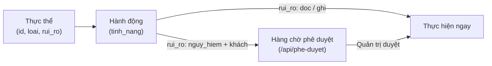
 
##### Công cụ cho AI (`GET /api/cong-cu`)
 
Biến các thực thể và hành động của chuẩn `thiet_bi` thành danh sách công cụ (tools) chuẩn OpenAI function-calling để các mô hình AI hoặc ứng dụng bên ngoài sử dụng:
 
- **Mỗi cặp (loại thực thể × hành động) là MỘT tool** (không tạo tool theo từng thực thể để tránh làm quá tải ngữ cảnh).
- **Phân quyền và bảo mật**:
  - Yêu cầu xác thực `V1_AUTH` và phạm vi `thiet_bi:doc` hoặc `thiet_bi:ghi` (khoá khách thiếu phạm vi trả `403`, không có khoá trả `401`).
  - Khoá chỉ có quyền đọc (`thiet_bi:doc`) chỉ thấy các công cụ có mức rủi ro `doc`. Khoá có quyền ghi (`thiet_bi:ghi`) hoặc quản trị thấy thêm các công cụ `ghi` và `nguy_hiem`.
  - Mô tả công cụ (`description`) chỉ ghép từ các trường có cấu trúc (`loai`, `hanh_dong`, `rui_ro`), không chèn văn bản tự do hay tên thực thể từ nguồn ngoài để ngăn ngừa triệt để tấn công prompt injection.
  - Công cụ có mức rủi ro `nguy_hiem` ghi rõ yêu cầu phê duyệt trong `description`, và lược đồ tham số (`parameters`) **không bao giờ** chứa trường `xac_nhan` (mô hình AI không được phép tự xác nhận).
- **Định dạng phản hồi**:
  ```json
  {
    "object": "list",
    "nguon_ngoai": true,
    "data": [
      {
        "type": "function",
        "function": {
          "name": "den_bat",
          "description": "Thực hiện hành động «bat» cho thực thể loại «den» (mức rủi ro: ghi).",
          "parameters": {
            "type": "object",
            "required": ["thuc_the"],
            "properties": {
              "thuc_the": {"type": "string", "description": "id thực thể, lấy từ GET /api/thiet-bi"},
              "tham_so": {"type": "object"},
              "ly_do": {"type": "string"}
            },
            "additionalProperties": false
          }
        },
        "x_web2api": {
          "loai": "den",
          "hanh_dong": "bat",
          "rui_ro": "ghi"
        }
      }
    ],
    "tong": 1,
    "bi_cat": false
  }
  ```
- **Trần số lượng**: Tối đa 128 công cụ; nếu vượt trần, danh sách sẽ được cắt còn 128 và phản hồi trả về `bi_cat: true`. Hỗ trợ tham số truy vấn `?loai=` để lọc công cụ theo loại thực thể cụ thể.
- **Giao diện**: khối «Công cụ cho AI» ở trang `He-thong-Tich-hop.dc.html` (Hệ thống → Tích hợp & công cụ) liệt kê chỉ xem theo module (tên, mô tả, mức rủi ro).


Module cần gói Python mà ảnh lõi không có thì bị **từ chối nạp** với thông báo nêu tên gói — lõi không tự cài gói
lúc chạy; khi đó làm **module từ xa**. Một module hỏng chỉ báo lỗi của riêng nó; cài đè một bản mới hỏng thì
web2api **hoàn về bản cũ**. Sửa tay tệp trong `/data/modules/` thì nạp lại không cần khởi động:

```bash
curl -s -X POST -H "Authorization: Bearer $K" $W/api/modules/nap-lai    # {"them": [], "doi": [], "go": [], "loi": []}
```

Module đã cài nhưng chưa có cấu hình thì liên kết bằng `POST /api/modules/<id>/cai` với thân
`{"cau_hinh": {...}}` (module không cần cấu hình: `{"cau_hinh": {}}`). Cấu hình đã lưu mà thiếu trường `bat_buoc`
(ví dụ tệp bí mật bị mất) thì lõi không nạp module — coi như chưa liên kết.

### Nguồn module từ git

1. Người viết module đặt module vào kho git của dự án, thư mục `modules/<id>/`, đẩy lên nhánh `main`.
2. web2api thăm dò git (mặc định mỗi 300 giây; mỗi lần bình thường là **1 yêu cầu** có điều kiện, trả 304 khi không
   đổi) và báo **«có module mới»** / **«có bản mới»**: `GET /api/modules/thong-bao` (quản trị) trả danh sách kèm
   `loai`, `cung_cap`, `tai_nguyen`, `yeu_cau_goi` và `dung_luong` (byte, cộng từ cây git); `GET /api/modules` (mở)
   có số `thong_bao_so` để mục «Module» hiện chấm đỏ.
3. Quản trị bấm «Cài» ở ô của module (hoặc `POST /api/nguon-git/cai/<id>`) — **không cần khoá API**. web2api tải
   đúng phiên bản đã báo, kiểm toàn vẹn từng tệp, đặt vào `/data/modules/<id>/` và nạp nóng.

**Lần đầu thêm nguồn git thì soạn sẵn yêu cầu duyệt cho module đang có**: ở lần đồng bộ thành công đầu tiên của
một nguồn, web2api tải về một lần mọi module đã có mã trên máy mà git có bản khác — dù `tu_dong` tắt — nhưng
**không chạy** bản đó: giữ lại chờ quản trị duyệt (xem «Cập nhật module và duyệt quyền») và ghi lý do vào `ghi_chu`.
Module **mới** trên git không tự cài. Giữ mọi chốt: commit chưa ký khi bật `yeu_cau_chu_ky` thì không tải; bản vừa
gỡ không cài lại. Dấu «đã đồng bộ» là commit lưu trong `nguon_git_trang_thai.json`.

Kho `TriTue2011/web2api` đang **public** nên web2api đọc **ẩn danh**. `docker-compose.yml` đặt sẵn kho này; các
biến môi trường chỉ được dùng khi **chưa** lưu cấu hình qua trang hoặc API. Sửa ở Hệ thống → Module → «＋ Thêm
module» → «Từ git», hoặc:

```bash
curl -s -X PUT -H "Authorization: Bearer $K" -H "Content-Type: application/json" \
  -d '{"repo": "TriTue2011/web2api", "nhanh": "main", "thu_muc": "modules", "chu_ky_giay": 300, "tu_dong": false, "yeu_cau_chu_ky": false}' \
  $W/api/nguon-git
curl -s -H "Authorization: Bearer $K" $W/api/nguon-git      # cấu hình + trạng thái đồng bộ
```

| Trường | Mặc định | Ý nghĩa |
|---|---|---|
| `repo` | — | Kho dạng `chủ/kho`. Chỉ đọc qua `https://api.github.com`. |
| `nhanh` | `main` | Nhánh theo dõi. |
| `thu_muc` | `modules` | Thư mục chứa module trong kho. |
| `chu_ky_giay` | `300` | Khoảng thăm dò. 300 giây/lần chỉ tốn 12 yêu cầu/giờ. |
| `token` | không có | Chỉ cho kho riêng tư hoặc nâng hạn mức; lưu 0600, không trả lại; gửi `""` để xoá. |
| `tu_dong` | `false` | Bật thì web2api tự cài module **mới**; bản mới của module đã cài chỉ được tải về giữ chờ duyệt. |
| `yeu_cau_chu_ky` | `false` | Bật thì chỉ **tự** cài khi commit được GitHub xác minh chữ ký. |

Gửi lại `PUT /api/nguon-git` (thân `{}`) để thăm dò **ngay**. Hạn mức GitHub ẩn danh là 60 yêu cầu/giờ/IP;
web2api đọc số còn lại sau mỗi phản hồi, còn dưới 10 thì giãn nhịp tới giờ đặt lại (`han_muc_con`, `reset_luc`).
**Tự cài** (`tu_dong: true`) không chạy khi commit chưa ký (nếu bật `yeu_cau_chu_ky`), và không bao giờ thay mã
module **đã cài**: bản mới (xin thêm quyền hay chỉ đổi mã) được giữ chờ duyệt — các trường hợp này hiện trong
`ghi_chu` để quản trị xem và cài tay (xem «Cập nhật module và duyệt quyền»).

### Nhiều nguồn git

Ngoài nguồn chính (cấu hình một-repo ở `PUT /api/nguon-git`, luôn có id `"chinh"`), web2api cho phép thêm
nhiều nguồn git phụ — ví dụ giữ nguồn của chủ kho và thêm kho riêng của mình cùng lúc. Cấu hình cũ một-repo
vẫn đọc được và tự thành danh sách một phần tử (không bắt cấu hình lại).

- Mỗi nguồn có `id` ngắn (chữ thường, số, `-`, `_`; `"chinh"` dành riêng cho nguồn cấu hình cũ), `repo`,
  `nhanh`, `thu_muc`, `chu_ky_giay`, `tu_dong`, `yeu_cau_chu_ky` — cùng bộ kiểm `kiem_repo`/`_duong_an_toan`/SSRF
  như nguồn chính. `tu_dong` mặc định **tắt** cho nguồn mới.
- Mỗi nguồn thăm dò **riêng**; lỗi hoặc hết hạn mức của nguồn này không chặn nguồn kia. `tu_dong` và
  `yeu_cau_chu_ky` tính theo từng nguồn.
- Module cài từ git ghi `nguon_id` vào `.nguon.json`. Hai nguồn có module trùng id → **không tự đè nhau**:
  cài từ nguồn thứ hai bị từ chối `409`; cập nhật từ đúng nguồn cũ vẫn được.
- Xoá nguồn không gỡ module đã cài: module vẫn chạy, không còn cập nhật từ nguồn ấy; `GET /api/modules`
  hiện `nguon_trang_thai` là «nguồn đã gỡ».
- Token theo nguồn: nguồn `"chinh"` dùng `WEB2API_GITHUB_TOKEN`/`WEB2API_GIT_TOKEN` hoặc bí mật đã lưu;
  nguồn phụ dùng biến `WEB2API_GITHUB_TOKEN_<ID>` / `WEB2API_GIT_TOKEN_<ID>` (ID viết hoa) hoặc bí mật riêng
  `_nguon_git_<id>` (lưu 0600, thu hồi độc lập).

| Đường | Ý nghĩa |
|---|---|
| `GET /api/nguon-git/nguon` | Danh sách nguồn: `{"nguon": [{id, repo, nhanh, thu_muc, chu_ky_giay, tu_dong, yeu_cau_chu_ky, token (che), so_module, commit, loi}]}`. |
| `POST /api/nguon-git/nguon` | Thêm nguồn: thân `{id, repo, nhanh, thu_muc, chu_ky_giay, tu_dong, yeu_cau_chu_ky[, token]}`; trùng id → 409. |
| `PUT /api/nguon-git/nguon/{id}` | Sửa nguồn phụ (trừ id); không có → 404. |
| `DELETE /api/nguon-git/nguon/{id}` | Xoá nguồn phụ (giữ module đã cài); không có → 404. |

Cả bốn đường đều là đường quản trị (không khoá → 401, khoá khách → 403).

### Cập nhật module và duyệt quyền (chống «rug-pull»)

Kho module bị chiếm (hoặc người viết đổi ý) có thể đẩy một commit mới cho module đã được tin, lén thêm quyền
nhạy cảm — đặc biệt `nhan_cookie` (nhận cookie đăng nhập của người dùng theo tên miền), `cung_cap` (khả năng mới),
`yeu_cau_goi` (gói Python cần cài). Cổng chữ ký (`yeu_cau_chu_ky`) chỉ xác thực *ai* ký; đây là tầng khác: xác thực
nội dung *đòi quyền gì*.

Khi cài/cập nhật một module **đã cài**, web2api so sánh QUYỀN giữa manifest đang cài và bản mới
(`app/quyen_module.py:diff_quyen`, hàm thuần): từng mã `cung_cap`, từng tên miền `nhan_cookie`, từng gói
`yeu_cau_goi`, từng mục `tai_nguyen.mang_ra` — và mọi **trường lạ chưa biết đều được coi là quyền** (mặc định
đóng, không danh sách trắng tên). Riêng `tai_nguyen` (trừ `mang_ra`) phân ba loại theo cấu trúc giá trị để
bớt báo động giả: (1) `ghi_chu` là chữ mô tả cho người đọc — không phải quyền, không so sánh; (2) số tài nguyên
không âm (`dia_mb`, `ram_them_mb`…) — chỉ **tăng** so với bản cũ mới là quyền thêm (mục diff nêu
`{"loai": "tai_nguyen", "ten": ..., "tang_tu": <số cũ>, "tang_len": <số mới>}`; giảm/bằng thì qua tự do);
(3) mọi khoá khác chưa biết (kể cả kiểu bất thường: chuỗi thay số, số âm, bool, số quá lớn) — vẫn là quyền.
Chỉ phần **thêm** mới cần duyệt; bớt quyền được qua tự do.

- Bản mới xin thêm quyền → **không kích hoạt**, bản cũ tiếp tục chạy nguyên trạng; `POST /api/nguon-git/cai/<id>`
  trả `409` với `{"ma": "can_duyet_quyen", "diff": {"them": [...], "bot": [...]}, "sha_commit": ...}` và ghi một
  dòng cảnh báo ở kênh nhật ký `he_thong`. Yêu cầu chờ duyệt được lưu (nguyên tử, quyền 0600) gắn với đúng SHA
  commit và băm của diff.
- Quản trị duyệt bằng **chính đường cài**, thân JSON `{"chap_nhan_quyen_them": [<đúng danh sách «them» đã xem>],
  "sha_commit": "<đúng SHA đã xem>"}`. Duyệt phải **khớp chính xác**: SHA đổi (kho đẩy tiếp commit mới sau khi bạn
  xem diff) hoặc diff đổi → duyệt cũ mất hiệu lực, trả 409, không áp dụng gì (chống TOCTOU).
- Đường `tu_dong` (và lần đồng bộ đầu): mọi bản mới của module **đã cài** đều **giữ lại chờ duyệt**, kể cả bản
  chỉ đổi mã, không xin thêm quyền — mã chạy trong tiến trình lõi, nên đổi mã là đổi điều module làm được. Duyệt bằng
  nút «Cập nhật» (cài thường) hoặc thân `{"chap_nhan_quyen_them": [], "sha_commit": "<SHA>"}`; kích hoạt xong thì
  yêu cầu chờ duyệt cũ được dọn. Tự cài chỉ áp cho module **mới**.
- `GET /api/modules` nêu cờ boolean `cho_duyet_quyen` cho mỗi module — chi tiết diff chỉ có ở phản
  hồi 409 của đường quản trị.
- Cài mới (chưa có bản cũ) không bị chặn; phản hồi nêu rõ module xin những quyền gì (`diff_quyen.them`).

```bash
curl -s -X POST -H "Authorization: Bearer $K" $W/api/nguon-git/cai/echo   # 409 + diff nếu xin thêm quyền
curl -s -X POST -H "Authorization: Bearer $K" -H "Content-Type: application/json" \
  -d '{"chap_nhan_quyen_them": [{"loai": "cung_cap", "ten": "chat"}], "sha_commit": "<sha>"}' \
  $W/api/nguon-git/cai/echo
```

### Phụ thuộc giữa các module (`can_module`)

Một module có thể cần module khác mới chạy đầy đủ — ví dụ các module provider web đều cần Trình duyệt từ xa
(noVNC) để đăng nhập tay và lấy cookie. Người viết module khai trong `manifest.json`:

```json
"can_module": ["vnc-xa"]
```

Luật kiểm manifest: danh sách id không trùng, mỗi id đúng mẫu id module, không được chứa chính id của mình —
sai thì module bị từ chối lúc nạp (lý do ghi ở trường `loi` của `GET /api/modules/catalog`). Trường này là
**quyền**: bản cập nhật thêm id vào `can_module` phải qua cổng duyệt quyền như thêm `cung_cap` (diff hiện
`{"loai": "can_module", "ten": "<id>"}`); bớt đi thì qua tự do.

Lõi **không nhắc tên module cụ thể nào** — `can_module` là dữ liệu khai báo mở, id lạ hiện nguyên mã.
Đếm tham chiếu được suy từ manifest các module đã cài (không có kho đếm riêng nên không bao giờ lệch):

- **Cài** (`POST /api/nguon-git/cai/<id>`): module mới cài mà cái cần chưa có → cài vẫn thành công, phản
  hồi thêm `can_module_thieu: ["<id>"]` để **đề nghị** cài — không tự cài lén, vẫn qua xác nhận của quản trị.
  `GET /api/modules` và `GET /api/modules/catalog` nêu `can_module` của từng module để giao diện hiện.
- **Gỡ cái đang được cần** (`DELETE /api/modules/<id>`): còn module đã cài nào khai cần nó → `409`
  `{"ma": "module_dang_duoc_can", "dang_duoc_can_boi": ["<id>"]}` — chưa gỡ gì cả, phải gỡ các module
  đang cần nó trước.
- **Gỡ provider cuối cùng**: module chung mà nó cần nay không còn ai cần → phản hồi gỡ có
  `hoi_giu_phu_thuoc: ["<id>"]` để giao diện **hỏi** quản trị giữ hay gỡ theo — lõi không tự quyết
  (biết đâu quản trị còn muốn dùng module chung vào việc khác). Chọn gỡ theo thì gọi
  `DELETE /api/modules/<id>` như thường — lúc này không còn ai cần nên được gỡ.

### Module từ xa

Dịch vụ đã nói chuẩn OpenAI (ví dụ máy GPU trong mạng nhà) đăng ký bằng URL; web2api không nạp mã nào, chỉ chuyển
tiếp `/v1`. Trên giao diện: «＋ Thêm module» → «Từ xa». Bằng `curl`:

```bash
curl -s -X POST -H "Authorization: Bearer $K" -H "Content-Type: application/json" \
  -d '{"id": "gpu-lan", "ten": "Model trên máy GPU", "tien_to": "lan", "base_url": "http://192.168.1.220:8000/v1", "api_key": "tuỳ chọn"}' \
  $W/api/modules/tu-xa
```

`base_url` được phép là địa chỉ mạng nhà (192.168.x.x, 10.x.x.x, 172.16–31.x.x) và `http://`. Bị chặn: địa chỉ của
chính container (127.0.0.1, localhost), dải 169.254.0.0/16 (metadata đám mây), địa chỉ không định tuyến.

Module từ xa hỗ trợ đầy đủ các đường chuẩn OpenAI:
- **Trò chuyện**: `POST /v1/chat/completions` (JSON, stream SSE từng dòng).
- **Giọng nói (TTS)**: `POST /v1/audio/speech` (JSON, stream nhị phân từng khúc bằng `aiter_bytes`, bảo toàn từng byte không hỏng `\n`/`\r`, tự giải nén gzip từ dịch vụ xa).
- **Nhận dạng giọng nói (STT)**: `POST /v1/audio/transcriptions` (multipart/form-data, làm sạch tên tệp và MIME type, giữ nguyên trường lạ, đổi model bỏ tiền tố).
- **Sửa ảnh**: `POST /v1/images/edits` (multipart/form-data, hỗ trợ tệp ảnh và mặt nạ).
- Đường gọi luôn là `{base_url}/<endpoint>` như chat (`base_url` đã gồm tiền tố phiên bản, vd `/v1` hay `/openai`).
- Giọng nói, nhận dạng, sửa ảnh xoay khoá theo (khoá, việc) như ảnh/video: khoá bị từ chối một việc không làm chat nghỉ, và ngược lại; trạng thái từng việc hiện trong `han_muc` của sức khoẻ.
- Header của dịch vụ xa: mặc định từ chối, chỉ `content-type` tới khách (Set-Cookie, CORS, Server, WWW-Authenticate… bị bỏ).
- Chống SSRF: không theo chuyển hướng 3xx của dịch vụ xa, ghim IP lúc kết nối (đích bị chặn → 502 `ssrf_blocked`); chuỗi khoá giả/lỗi thượng nguồn được che trước khi trả về khách. Khách ngắt kết nối giữa chừng (kể cả trước byte đầu) thì kết nối tới dịch vụ xa được đóng; luồng của dịch vụ xa đứt giữa chừng thì kết nối tới khách bị cắt (không kết thúc êm), nhật ký cuộc gọi ghi `dut`.


## 4. Module có sẵn

Mỗi module có một tiểu mục dưới đây (mẫu: `MAU-TIEU-MUC-MODULE.md`) và một dòng ở bảng «Trạng thái hiện tại»
(mục 1).

### Module gemini-api — Gemini API (Google AI Studio)

**Mô tả.** Gọi các model Gemini của Google bằng khoá API của Google AI Studio. Module chuyển tiếp
thẳng tới endpoint tương thích OpenAI chính thức của Google
(`https://generativelanguage.googleapis.com/v1beta/openai`), giữ nguyên mọi trường của yêu cầu — kể cả
chữ ký suy nghĩ của Gemini 3 khi gọi công cụ nhiều bước. Module thêm vào: xoay vòng nhiều khoá, cho khoá
nghỉ khi hết hạn mức, đổi địa chỉ gốc để vượt chặn vùng, chuẩn hoá lỗi, danh sách model, kiểm sức khoẻ.
Mã nguồn: `modules/gemini-api/`. Tiền tố model: `gemini`. Mọi đặc thù của Google (địa chỉ, header `x-goog-api-key`
và API gốc Veo cho video, nhận diện chặn vùng, lời giải thích «hạng miễn phí không có ảnh/video») nằm trong module;
lõi chỉ cấp bộ chuyển tiếp dùng chung.

**Cần gì.**
- Một hoặc nhiều khoá API lấy ở https://aistudio.google.com/apikey (đăng nhập tài khoản Google,
  bấm «Create API key»). Khoá có dạng bắt đầu bằng `AIza`.
- Container ra được Internet tới `generativelanguage.googleapis.com`.
- Nguồn git đã cấu hình (mục 3, «Nguồn module từ git») để tải module về.

**Cách cài.** Trên giao diện: mục 6, «Cài nguồn AI đầu tiên». Bằng `curl`:

1. Xem thông báo module mới (vòng thăm dò chạy ngay lúc khởi động, sau đó mỗi 300 giây):

   ```bash
   curl -s -H "Authorization: Bearer $K" $W/api/modules/thong-bao
   ```

   Trong `danh_sach` phải có `"id": "gemini-api"` với `"trang_thai": "moi"`.
2. Cài module — **không cần khoá API** (tải về và nạp, không khởi động lại). Xong bước này module đã cài
   nhưng chưa liên kết (`"da_cau_hinh": false` trong `GET /api/modules`):

   ```bash
   curl -s -X POST -H "Authorization: Bearer $K" $W/api/nguon-git/cai/gemini-api
   ```

3. Nhập khoá và kiểm tra. web2api gọi thử `GET /models` với **từng** khoá (không tốn token), chỉ lưu
   những khoá dùng được, và báo kết quả từng khoá ở dạng che (chỉ 4 ký tự cuối):

   ```bash
   curl -s -X POST -H "Authorization: Bearer $K" -H "Content-Type: application/json" \
     -d '{"cau_hinh": {"api_keys": ["AIza...khoá-1", "AIza...khoá-2"]}}' \
     $W/api/modules/gemini-api/cai
   ```

   Thành công thì trả `{"ok": true, "ket_qua_tung_khoa": [...]}`. Không khoá nào dùng được thì trả mã
   400 với `"ok": false` và lý do — cấu hình **không** được lưu.

4. Thêm hoặc bớt **từng khoá** sau này, không phải dán lại cả danh sách và không ai được xem lại khoá thật.
   Xem khoá đã lưu (chỉ dạng che, theo thứ tự — thứ tự đó là **chỉ số** dùng ở dưới):

   ```bash
   curl -s -H "Authorization: Bearer $K" $W/api/modules/gemini-api/cau-hinh
   # {"gia_tri": {"api_keys": ["…abcd", "…wxyz"], "base_url": "..."}, "da_cau_hinh": true, ...}
   curl -s -X POST -H "Authorization: Bearer $K" -H "Content-Type: application/json" \
     -d '{"cau_hinh": {"api_keys": {"them": ["AIza...khoá-mới"]}}}' \
     $W/api/modules/gemini-api/cai                                  # thêm một khoá, giữ hết khoá cũ
   curl -s -X POST -H "Authorization: Bearer $K" -H "Content-Type: application/json" \
     -d '{"cau_hinh": {"api_keys": {"giu": [1]}}}' \
     $W/api/modules/gemini-api/cai                                  # chỉ giữ khoá chỉ số 1 (bớt khoá 0)
   ```

   Quy tắc của `POST /api/modules/{id}/cai`: trường **vắng mặt** trong `cau_hinh` thì giữ giá trị đã lưu
   (thêm khoá không làm mất `base_url` đã đặt); trường có mặt thì thay — một **danh sách** thường vẫn là
   thay cả danh sách; trường kiểu `danh_sach_bi_mat` còn nhận dạng sửa `{"giu": [chỉ số], "them": [khoá]}`
   (vắng `giu` là giữ hết). Mỗi lần lưu, web2api kiểm lại mọi khoá và chỉ giữ khoá dùng được.

**Cấu hình.**

| Trường | Bắt buộc | Ý nghĩa |
|---|---|---|
| `api_keys` | Có | Danh sách khoá (hoặc một chuỗi, các khoá cách nhau bằng dấu phẩy/xuống dòng). Lưu ở `/data/bi_mat/gemini-api.json` quyền 0600; không API nào trả lại khoá. |
| `base_url` | Không | Mặc định gọi thẳng Google. Bị chặn vùng thì đặt địa chỉ proxy, ví dụ `https://<tên>.workers.dev`; thiếu `/v1beta/openai` thì web2api tự thêm. |
| `proxy_token` | Không | Bí mật xác thực gửi qua header `X-Proxy-Token` tới proxy (Cloudflare Worker). Lưu ở thư mục bí mật quyền 0600, che khi trả qua API. |

Nếu Google chặn vùng (lỗi chứa «User location is not supported»), dựng một Cloudflare Worker từ tệp
`deploy/cloudflare-gemini-proxy.js` trong kho (bắt buộc đặt bí mật `PROXY_TOKEN` trên Worker) rồi cài lại với
`base_url` và `proxy_token`:

```bash
curl -s -X POST -H "Authorization: Bearer $K" -H "Content-Type: application/json" \
  -d '{"cau_hinh": {"api_keys": ["AIza..."], "base_url": "https://<tên>.workers.dev", "proxy_token": "token-bi-mat"}}' \
  $W/api/modules/gemini-api/cai
```

**Ví dụ dùng.**

```bash
curl -s -H "Authorization: Bearer $K" -H "Content-Type: application/json" \
  -d '{"model": "gemini/gemini-2.5-flash", "messages": [{"role": "user", "content": "Chào bạn"}]}' \
  $W/v1/chat/completions
curl -s -H "Authorization: Bearer $K" $W/api/modules/gemini-api/suc-khoe   # sức khoẻ từng khoá
```

**Tạo ảnh và video — chỉ khoá TRẢ PHÍ (module 0.2.0).** Theo **trang giá Google ngày 11/10/2026**
(https://ai.google.dev/gemini-api/docs/pricing, trang ghi cập nhật 09/10/2026), mọi model tạo ảnh và tạo video
đều ghi **«Not available»** ở hạng miễn phí. Khoá miễn phí vẫn chat được nhưng **không** tạo được ảnh/video; cần
khoá thuộc dự án Google Cloud đã bật thanh toán. **Mỗi lần tạo là tốn tiền thật** (giá dưới đây, chưa tính thuế):

| Loại | Model (mã gọi qua web2api: `gemini/<mã>`) | Giá hạng trả phí (bản thường) |
|---|---|---|
| Ảnh | `gemini-3.1-flash-image` (Nano Banana 2) | khoảng 0,067 USD/ảnh 1K; 0,151 USD/ảnh 4K |
| Ảnh | `gemini-3.1-flash-lite-image` (Nano Banana 2 Lite) | khoảng 0,034 USD/ảnh 1K |
| Ảnh | `gemini-3-pro-image` (Nano Banana Pro) | khoảng 0,134 USD/ảnh 1K–2K; 0,24 USD/ảnh 4K |
| Ảnh | `gemini-nano-banana-2.1` | khoảng 0,034 USD/ảnh 1K; 0,113 USD/ảnh 4K |
| Ảnh | `gemini-2.5-flash-image` | 0,039 USD/ảnh — Google ghi **tắt ngày 02/10/2026**, đừng dùng |
| Video | `veo-3.1-generate-preview` | 0,40 USD/giây (720p, 1080p); 0,60 USD/giây (4K) — video 8 giây 720p ≈ 3,2 USD |
| Video | `veo-3.1-fast-generate-preview` | 0,10 USD/giây (720p); 0,12 (1080p); 0,30 (4K) |
| Video | `veo-3.1-lite-generate-preview` | 0,05 USD/giây (720p); 0,08 (1080p); không có 4K |

Imagen không còn trên trang giá; Veo 3.0 đã lỗi thời. Gemini Omni (`gemini-omni-1.1-flash`, trang video của
Google khuyên làm mặc định) dùng API khác (Interactions) nên **chưa** hỗ trợ ở bản này. Tên model đổi theo Google:
web2api không giữ bảng tên model, bạn gọi đúng mã Google đang có (xem `GET /v1/models`; model video được đánh
dấu `"kha_nang": ["video"]` theo trường `supportedGenerationMethods` của Google (có `predictLongRunning`).

**Nhóm «Tạo ảnh»** (`"kha_nang": ["anh"]`, Studio «Vẽ ảnh» chỉ liệt kê các model này, «Trò chuyện» không lẫn chúng):
model có `predict` (Imagen) theo cấu trúc; model ảnh dạng Gemini thì Google ghi `generateContent` **giống hệt** model
chat và không có trường nào nêu kiểu đầu ra, nên module dùng quy ước đặt tên của Google — id có một **đoạn** (tách
theo `-` `_` `.` `/`) đúng bằng `image` (`gemini-3.1-flash-image`, `gemini-3-pro-image-preview`…; `imagery` không
tính), **hoặc** có hai đoạn liền nhau `nano` `banana` — tên thương hiệu Google đặt cho dòng model ảnh Gemini, cần vì
trang tạo ảnh của Google ghi mọi model ảnh mang hậu tố `image` trừ `gemini-nano-banana-2.1` (model Google khuyên cho
dự án mới; cùng quy tắc bắt `nano-banana-pro-preview`). Đây là hai chỗ duy nhất module phân loại theo chữ, và chúng
nằm trong module chứ không ở lõi. Đo trên 46 id model thật (12/10/2026): bắt đúng 8 model ảnh dạng Gemini, không
dương tính giả. Không đọc `displayName`/`description` vì mô tả model chat cũng nhắc «image» (đầu vào đa phương
thức). Giới hạn đã biết: model ảnh mới mang tên khác cả hai quy ước sẽ **không** vào nhóm «Tạo ảnh» (web2api vẫn
chuyển yêu cầu theo tên). Trang tương thích OpenAI của Google (đọc 12/10/2026) ghi `images.generate` dùng chính
`gemini-2.5-flash-image` / `gemini-3-pro-image-preview` (tham số `prompt`, `model`, `n`, `size`, `response_format`;
tỉ lệ khung, an toàn, grounding qua `extra_body`), nên đường `/images/generations` dựa vào tài liệu — **chưa thử**
với khoá trả phí. Imagen không còn được nhắc ở đó nên Imagen qua đường này chưa có trong tài liệu và chưa đo.

Tạo ảnh — đi endpoint tương thích OpenAI của Google (`…/v1beta/openai/images/generations`), thân đi nguyên văn
(chỉ bỏ tiền tố `gemini/`), nên dùng được cả trường riêng của Google như `aspect_ratio`, `generation_config`:

```bash
curl -s -H "Authorization: Bearer $K" -H "Content-Type: application/json" \
  -d '{"model": "gemini/gemini-3.1-flash-image", "prompt": "Con mèo đội nón lá", "response_format": "b64_json", "n": 1, "aspect_ratio": "16:9"}' \
  $W/v1/images/generations | jq -r '.data[0].b64_json' | base64 -d > anh.png
```

Responses API (`POST /v1/responses`) — chuẩn OpenAI Responses API cho công cụ `image_generation` (dùng cho Home Assistant và các ứng dụng gọi Responses để tạo/sửa ảnh):

```bash
curl -s -H "Authorization: Bearer $K" -H "Content-Type: application/json" \
  -d '{"model": "gemini/gemini-3.1-flash-image", "input": "Con mèo đội nón lá", "tools": [{"type": "image_generation", "size": "1024x1024"}]}' \
  $W/v1/responses
```

- **Giới hạn**: Hiện tại đường này chỉ hỗ trợ công cụ `image_generation` (chưa hỗ trợ Responses cho hội thoại thuần chữ hay công cụ khác; thiếu công cụ hoặc khai công cụ khác bị trả `400` `unsupported_tool`).
- **Phạm vi khoá khách** theo chức năng thật, cùng luật với đường chuẩn: có `input_image` là sửa ảnh → cần `anh_sua` (như `/v1/images/edits`); không có là tạo ảnh → cần `anh` (như `/v1/images/generations`). Khoá thiếu phạm vi nhận `403` trước khi lõi tra model.
- **Thân yêu cầu**: `model` (`<tiền tố>/<tên>` hoặc `combo/<tên>`), `input` (chuỗi, hoặc danh sách mục `{role, content}`), `instructions` tuỳ chọn, `tools` (bắt buộc đúng một phần tử `{"type": "image_generation", ...}`), `stream` tuỳ chọn. Tham số của công cụ chuyển sang module đúng tên trường của `/v1/images/*`: `size`, `quality`, `background`, `output_format` (phải là chuỗi, sai kiểu → `400`) và `n` (số nguyên 1–10, cùng một luật với `/v1/images/generations` và `/v1/images/edits`; thiếu/`null` → module dùng mặc định). Model chuyển **đầy đủ** như đường chuẩn (module tự bỏ tiền tố). Trường khác của công cụ (vd `moderation`, `output_compression`, `partial_images`) hiện **không** được chuyển và bị bỏ qua.
- **Ghép prompt**: phần chỉ dẫn trước — `instructions`, rồi nội dung các mục vai `developer`/`system` theo thứ tự gặp (cùng nghĩa «chỉ dẫn» với `instructions`) — rồi phần yêu cầu: mục vai `user` và mục không có vai; các phần nối bằng dòng trống. Mục vai `assistant` (lượt trả lời cũ) bị bỏ vì Images không có hội thoại. Vai ngoài bốn vai của chuẩn → `400`.
- **Ảnh đầu vào**: Khi có `input_image` (dưới dạng data URL base64 `image/png`, `image/jpeg`, `image/webp`), lõi giải mã và chuyển thành `YeuCauDaPhan` gọi phương thức `anh_sua` của module (trần dung lượng tính theo `WEB2API_TEP_TOI_DA_MB`). URL ngoài (`http://`, `https://`) bị từ chối `400` `unsupported_image_url` để chống SSRF.
- **Khuôn phản hồi không stream**:
  ```json
  {
    "id": "resp_<hex>",
    "object": "response",
    "created_at": 1728860000,
    "status": "completed",
    "model": "<model khách gửi>",
    "output": [
      {
        "id": "ig_<hex>",
        "type": "image_generation_call",
        "status": "completed",
        "result": "<base64 thuần>",
        "revised_prompt": "...",
        "output_format": "png"
      }
    ],
    "usage": {"input_tokens": 0, "output_tokens": 0, "total_tokens": 0}
  }
  ```
- **Stream SSE (`stream: true`)**: Phát chuỗi sự kiện SSE với `sequence_number` tăng dần: `response.created` → `response.in_progress` → `response.output_item.added` (trạng thái `in_progress`) → `response.image_generation_call.in_progress` → `response.image_generation_call.generating` → `response.output_item.done` (kèm `result`) → `response.completed`. Không gửi `[DONE]`. Lỗi trước byte đầu luôn trả mã trạng thái HTTP thật thay vì stream 200 rỗng; lỗi giữa chừng (sau khi đã gửi 200) phát một sự kiện `error` khuôn Responses (`type`, `sequence_number`, `code: stream_error`, `message`, `param`) rồi dừng.
- **Thuộc tính ảnh trong mục output** (`size`, `quality`, `background`, `output_format`) chỉ nêu khi biết từ **kết quả**: trường cùng tên ở cấp đầu phản hồi của module, hoặc — riêng `output_format` — chữ ký byte ảnh (PNG/JPEG/WebP). Lõi không lặp tham số khách gửi như thể là kết quả.
- **Lỗi của module** (mã khác 2xx) chuyển nguyên mã, thân và tiêu đề (kể cả `Retry-After`) như `/v1/images/*`; tiêu đề của module ở lượt thành công (vd `x-web2api-route`/`x-web2api-combo` của combo) cũng được giữ.

Tạo video — không đồng bộ, như `/v1/videos` của OpenAI: tạo → hỏi trạng thái tới `completed` → tải. Module đi
API gốc Veo (`:predictLongRunning`) vì trang tương thích OpenAI của Google không ghi cách tải tệp video. Thân là
**JSON**, hoặc `multipart/form-data` chỉ có trường chữ (như SDK `openai` gửi `videos.create`; `seconds` dạng chuỗi
module tự đổi số). Ảnh đầu vào đi trong trường `image` (base64 hoặc data URL) của thân JSON — phần tệp
`input_reference` bị trả `415`:

```bash
ID=$(curl -s -H "Authorization: Bearer $K" -H "Content-Type: application/json" \
  -d '{"model": "gemini/veo-3.1-fast-generate-preview", "prompt": "Flycam bay qua ruộng bậc thang", "seconds": 8, "aspect_ratio": "16:9", "resolution": "720p"}' \
  $W/v1/videos | jq -r .id)                                           # vd "gemini:bW9kZWxz….1a2b3c4d", status "queued"
curl -s -H "Authorization: Bearer $K" $W/v1/videos/$ID             # hỏi mỗi ~10 giây: in_progress → completed | failed
curl -s -H "Authorization: Bearer $K" -o video.mp4 $W/v1/videos/$ID/content   # tải (stream, không nạp cả tệp vào RAM)
```

- Tham số video: `prompt` (bắt buộc), `seconds` hoặc `duration_seconds` (4, 6, 8), `aspect_ratio` (`16:9`,
  `9:16`) hoặc `size` kiểu OpenAI (`1280x720` → 16:9), `resolution` (`720p`, `1080p`, `4k` — 1080p/4k chỉ với 8
  giây), `image` (ảnh đầu: base64 hoặc data URL), `last_frame`, và các tham số khác của Veo viết kiểu
  `snake_case` (vd `negative_prompt`, `person_generation`, `seed`) — web2api đổi sang `camelCase` của Veo.
- Mã video có dạng `gemini:<mã>`: phần trước dấu `:` là tiền tố module. Video thuộc dự án của **khoá đã tạo nó**:
  bớt khoá đó thì không hỏi/tải được nữa. Google giữ video **2 ngày**.
- Khoá chỉ đi bằng header (không bao giờ vào URL hay nhật ký) và chỉ gửi tới máy của `base_url`: Google
  chuyển hướng tải tệp sang máy khác thì web2api bỏ khoá ở bước đó.

Khoá bị từ chối khi tạo ảnh/video (nhớ riêng cho từng khoá **và** từng việc — khoá bị từ chối tạo ảnh vẫn chat
và vẫn được thử tạo video bình thường):

| Google trả | web2api làm |
|---|---|
| `401` / `403` (không phải chặn vùng) | Khoá bị từ chối việc đó **24 giờ** (hết hạn thì thử lại — khoá được nâng lên trả phí sẽ tự dùng được), thử khoá kế |
| `429` | Khoá **từng** làm được việc đó → hết hạn mức thật, nghỉ theo `Retry-After` (mặc định 60 giây). Khoá **chưa từng** làm được → coi như bị từ chối, nghỉ 24 giờ (Google hay báo «hạn mức = 0» của hạng miễn phí bằng `429` — chưa đo). Cái giá: khoá trả phí **mới** gặp `429` ngay lần đầu cũng nghỉ việc đó 24 giờ; khoá khác vẫn phục vụ, lưu lại cấu hình là xoá. Cả hai trường hợp đều thử khoá kế |
| `400` | Khoá từng làm được việc đó → lỗi của yêu cầu, trả ngay. Chưa rõ → thử khoá kế; khoá sau làm được thì khoá trước bị từ chối 24 giờ; **mọi** khoá đều `400` → trả `400` của Google kèm gợi ý «có thể mọi khoá là hạng miễn phí», không đánh dấu khoá nào (một yêu cầu sai không được khoá cả nhà khỏi ảnh/video) |
| Mọi khoá đang bị từ chối | `403` mã `no_key_permitted`, nêu từng khoá (dạng che), mã Google đã gặp, giờ thử lại, và câu «hạng miễn phí không dùng được — cần khoá trả phí». Chỉ khi mọi khoá đều từng làm được và chỉ đang hết hạn mức (`429`) thì trả `429` kèm `Retry-After` |

`GET /api/modules/gemini-api/suc-khoe` báo thêm cho từng khoá: thứ tự `thu_tu` (#n trong danh sách đã lưu), nhãn
`dang_dung` (`true` ở khoá vừa phục vụ yêu cầu gần nhất), lần dùng cuối `dung_cuoi`, số lần 429 `so_429`, lần 429 cuối
`lan_429_cuoi`, danh sách hạn mức `han_muc` (với `toi_da: null` vì Google không cho truy vấn trần còn lại), và
`"kha_nang": {"anh": {...}, "video": {...}}` với `trang_thai` là `chua_ro` (chưa dùng thật lần nào — web2api **không** thử
bằng lời gọi tốn tiền), `dung_duoc`, hoặc `bi_tu_choi` (kèm `ma` — mã HTTP Google trả — và `thu_lai_luc`). Trạng thái
và bộ đếm này nằm trong bộ nhớ của thể hiện: lưu lại cấu hình module hay khởi động lại thì về ban đầu (`chua_ro`, 0 lượt).

**Chưa đo với Google thật** (chưa có khoá trả phí để thử): dạng lỗi Google trả cho khoá miễn phí (giả định
400/403/429 — đọc mã thật trong `ma` ở sức khoẻ hoặc trong thông báo lỗi), đường tạo/hỏi/tải Veo, tên
model nào còn sống, `base_url` qua proxy Cloudflare cho ảnh/video, máy đích khi Google chuyển hướng tải video.
Qua proxy `deploy/cloudflare-gemini-proxy.js`: Worker chuyển mọi đường `/v1beta/...` và mọi header (kể cả
`x-goog-api-key`) nên về nguyên tắc video đi được, nhưng Worker gọi `fetch(..., redirect: "follow")` — nếu Google
chuyển hướng lúc tải video thì chính Worker đi theo và có thể mang khoá sang máy đích (web2api không chặn được
bước đó; chưa đo, Worker chưa sửa).
Tự đo bằng khoá của bạn: gọi lệnh tạo ảnh ở trên **một lần** với model Lite (rẻ nhất), rồi xem
`GET /api/modules/gemini-api/suc-khoe`.

**Phân loại lỗi và sự cố thường gặp (hook `phan_loai_loi` của module).** Module `gemini-api` cài đặt hook `phan_loai_loi` để gom toàn bộ đặc thù của Google về chuẩn trung lập của lõi:
- Chặn vùng: Google trả `400` hoặc `403` kèm chữ `location` («User location is not supported»). Hook trả về `chan_vung` kèm gợi ý đặt proxy. Lỗi chặn vùng là lỗi hạ tầng máy chủ, lõi trả ngay cho khách, không phạt khoá (mọi khoá đều sẽ bị như nhau).
- Gợi ý hạng miễn phí: khi hết khoá dùng được cho ảnh/video (`het_khoa`) hoặc mọi khoá đều trả 400 (`moi_khoa_400`), hook tự động gắn thêm gợi ý «Hạng miễn phí của Google không dùng được tính năng này...» vào thông điệp lỗi.
- `400` khi chat: Google trả `400` cả cho khoá sai/bị thu hồi. Hook trả `None` (`khong_ro`) để lõi so sánh giữa các khoá: khoá chưa từng chat thành công mà trả `400` → thử khoá kế; khoá kế trả lời được thì khoá trước bị đánh dấu hỏng (`khoa_hong`), nghỉ 1 giờ. **Mọi** khoá đều `400` → trả `400` của Google nguyên văn (đã che khoá), không đánh dấu khoá nào — đó là lỗi của yêu cầu. Khoá đã từng chat được mà gặp `400` → trả ngay, không đổi khoá.
- `404` «model … is no longer available to new users» khi chat: khoá thuộc dự án mới không được dùng model cũ trong khi khoá khác vẫn được. Hook trả `None` (`khong_ro`) để lõi so sánh: khoá chưa từng chat thành công model đó mà trả `404` → thử khoá kế; khoá kế trả lời được thì khoá trước bị bỏ qua riêng cho model đó trong 6 giờ (`khong_co_o_khoa`). **Mọi** khoá đều `404` → trả `404` của Google nguyên văn (đã che khoá), không ghi nhớ gì — model không có thật.
- `403` `no_key_permitted` khi tạo ảnh/video: không khoá nào được Google cho việc đó — thường là khoá hạng miễn phí. Thêm khoá thuộc dự án đã bật thanh toán (bước 4).
- `429` «Mọi khoá… đang nghỉ»: mọi khoá hết hạn mức (`het_han_muc`). Khoá gặp 429 nghỉ theo `Retry-After` của Google (mặc định 60 giây, tối đa 10 phút) rồi tự dùng lại. Thêm khoá để chịu tải tốt hơn.
- `401`/`403` ở một khoá: khoá đó bị đánh dấu hỏng (`khoa_hong`) và nghỉ 1 giờ, web2api tự chuyển sang khoá kế.
- `504`: Google không trả lời trong 120 giây (stream: 60 giây giữa hai khúc) — lỗi máy chủ thượng nguồn (`may_chu_loi`).

**Đã kiểm với dịch vụ thật ngày 10/10/2026** (lõi mới + Google thật, khoá của c2a):

| Việc | Kết quả |
|---|---|
| Nạp lại nóng nhận module | Đạt |
| Cài 6 khoá | 6/6 khoá hợp lệ, 62 model |
| `/v1/models`; gọi không có khoá quản trị | Đạt; trả 401 |
| Chat thường | Đạt, khoảng 1,3 giây |
| Chat stream | Đạt — với câu trả lời ngắn Google gửi cả câu trong **một** khúc; đó không phải lỗi gom bộ đệm |
| Gọi công cụ 2 bước với Gemini 3 (chữ ký suy nghĩ trong `extra_content`) | Đạt — đúng ca từng hỏng ngày 06/10/2026 |
| Sức khoẻ module; danh sách mở không lộ khoá; gỡ module xoá bí mật | Đạt |

Chưa kiểm với dịch vụ thật: `base_url` qua proxy Cloudflare, khoá bị thu hồi sau khi cài, hết hạn mức
(429) thật của Google.

**Giới hạn.**
- Chưa có nhúng (embeddings) và video bằng Gemini Omni. Tạo ảnh/video trên web: Studio (chế độ «Ảnh», «Video»).
- Tạo ảnh/video cần khoá trả phí và chưa đo với Google thật (xem trên).
- Khoá bị thu hồi SAU khi đã chat được: lượt đầu tiên nó trả `400` vẫn rơi lỗi tới khách (chưa phân biệt được
  với yêu cầu sai); từ lượt `400` kế của khoá đó web2api mới so với khoá khác và đánh dấu hỏng. Danh sách model
  (`/v1/models`) lấy bằng một khoá: khoá đầu tiên đang dùng được mà hỏng thì danh sách rỗng hoặc là bản đệm cũ
  cho tới khi chat đánh dấu khoá đó. Bớt khoá hỏng (dạng `{"giu": [...]}` ở bước 4) để dứt hẳn.
- Không bớt được khoá cuối cùng: `api_keys` là trường bắt buộc nên module từ chối cấu hình rỗng — muốn bỏ
  hẳn thì gỡ module.
- Chưa đo RAM/đĩa thật của module (trường `ram_them_mb`, `dia_mb` trong manifest đang để trống).
- Proxy Cloudflare có đặt `PROXY_TOKEN` (header `X-Proxy-Token`) chưa dùng được: `base_url` không mang
  thêm header.

### Module muse — Muse (Meta)

**Mô tả.** Trợ lý Muse qua giao thức WebSocket mã hoá Noise XX (`Noise_XX_25519_AESGCM_SHA256`) bọc khung Protobuf HTTP gửi tới dịch vụ `daemon` trên máy ảo Meta AI VM. Mã nguồn: `modules/muse/`. Tiền tố model: `muse`. Mọi đặc thù của Meta AI VM (bắt tay Noise XX, phân mảnh khung `NoiseTransportFrame`, đóng gói `ServiceRequest`/`ServiceFrame`, chuyển đổi SSE) nằm trong module; lõi chỉ định tuyến.

**Cần gì.**
- Khoá khôi phục thiết bị (`device_key`, 32 bytes) và token uỷ quyền (`delegation_token`) sau khi đăng ký OTP với Meta.
- Mạng ra tới `hatch.metaaivm.com` và `*.metaaivm.com`.
- RAM/đĩa thêm: chưa đo.

**Cách cài.**

1. Xem thông báo: `curl -s -H "Authorization: Bearer $K" $W/api/modules/thong-bao` — có `"id": "muse"`.
2. Tải về: `curl -s -X POST -H "Authorization: Bearer $K" $W/api/nguon-git/cai/muse`
3. Cài đặt cấu hình:

   ```bash
   curl -s -X POST -H "Authorization: Bearer $K" -H "Content-Type: application/json" \
     -d '{"cau_hinh": {"device_key": "00112233445566778899aabbccddeeff00112233445566778899aabbccddeeff"}}' \
     $W/api/modules/muse/cai
   ```

**Cấu hình.**

| Trường | Bắt buộc | Ý nghĩa |
|---|---|---|
| `device_key` | Có | Khoá khôi phục thiết bị 32 bytes (hex hoặc base64), lưu riêng trong kho bí mật |
| `delegation_token` | Không | Token uỷ quyền đã ký cho phiên kết nối |
| `ws_url` | Không | Địa chỉ máy ảo WebSocket (để trống dùng mặc định hoặc trỏ máy chủ giả) |

**Ví dụ dùng.**

```bash
curl -s -H "Authorization: Bearer $K" -H "Content-Type: application/json" \
  -d '{"model": "muse/meta-llama/Llama-3.3-70B-Instruct", "messages": [{"role": "user", "content": "Xin chào"}]}' \
  $W/v1/chat/completions
```

**Sự cố thường gặp.**
- `400` / `404` «Chưa có khoá thiết bị»: Muse chưa hỗ trợ đăng ký OTP tự động từ Meta — cần nhập `device_key` đã có.
- `502` «Lỗi kết nối tới Muse»: máy ảo không phản hồi hoặc bắt tay Noise XX thất bại.

**Giới hạn.**
- Thử nghiệm — chưa kiểm với dịch vụ thật: chưa có luồng đăng ký thiết bị bằng OTP từ Meta.
- Chưa hỗ trợ tạo ảnh/video độc lập do dịch vụ daemon của máy ảo chỉ hỗ trợ luồng chat.

---

### Module muse2api — Muse Web (muse.ai, direct protocol)

**Mô tả.** Trò chuyện với Muse qua **giao thức trực tiếp** của web app muse.ai
(WebSocket + Noise XX tới máy ảo), xác thực bằng cookie — **miễn phí, không cần
API key, không browser**. Khác với module `muse` (cần `device_key` đăng ký OTP,
chưa dùng được). Mã nguồn: `modules/muse2api/`. Tiền tố model: `muse2api`
(model duy nhất `muse2api/muse`). Luồng: cookie → `POST /api/auth/check` →
`POST /api/hatch/token` → handshake Noise XX → `POST /chat/stream` + poll
`/chat/history`. Mọi đặc thù protocol nằm trong module; lõi chỉ định tuyến.

**Cần gì.**
- Gói Python `curl_cffi`, `noiseprotocol`, `protobuf` phải có trong ảnh (đã nằm trong `requirements.txt`).
- Một hoặc nhiều bộ cookie từ tab muse.ai đã đăng nhập (DevTools F12 →
  Application → Cookies), dạng `k1=v1; k2=v2`.
- Mạng ra tới `muse.ai` và `hatch.metaaivm.com`.
- RAM/đĩa thêm: chưa đo (nhẹ hơn browser automation hàng chục lần).

**Cách cài.**

1. Xem thông báo: `curl -s -H "Authorization: Bearer $K" $W/api/modules/thong-bao` — có `"id": "muse2api"`.
2. Tải về: `curl -s -X POST -H "Authorization: Bearer $K" $W/api/nguon-git/cai/muse2api`
3. Cài đặt cấu hình:

   ```bash
   curl -s -X POST -H "Authorization: Bearer $K" -H "Content-Type: application/json" \
     -d '{"cau_hinh": {"cookies": ["hatch_sess=...; hatch_gw=...; datr=..."]}}' \
     $W/api/modules/muse2api/cai
   ```

   Lúc cài, module kiểm từng bộ cookie bằng HTTPS bootstrap (không tốn tiền).

**Cấu hình.**

| Trường | Bắt buộc | Ý nghĩa |
|---|---|---|
| `cookies` | Có | Danh sách bộ cookie (xoay vòng), lưu riêng trong kho bí mật |

**Ví dụ dùng.**

```bash
curl -s -H "Authorization: Bearer $K" -H "Content-Type: application/json" \
  -d '{"model": "muse2api/muse", "messages": [{"role": "user", "content": "Xin chào"}]}' \
  $W/v1/chat/completions
```

**Sự cố thường gặp.**
- `401` «Cookie không hợp lệ/hết hạn»: đăng nhập lại muse.ai trên trình duyệt rồi export lại cookie. Có nhiều bộ cookie thì module tự chuyển sang bộ kế khi lời nhắn chưa gửi; bộ bị từ chối vẫn được thử lại ở lượt sau và khoẻ lại ngay khi trả lời được.
- `502` «Lỗi máy chủ hoặc kết nối: …»: máy ảo chưa sẵn sàng hoặc WebSocket hỏng — đợi chút rồi thử lại. Thông báo chỉ nêu kiểu lỗi và mã trạng thái; nội dung phản hồi của muse.ai chỉ ghi vào log máy chủ. Kết nối cũ chết TRƯỚC khi gửi lời nhắn thì module tự nối lại một lần; chết SAU khi đã gửi thì trả `502`, không nối lại để khỏi hỏi Muse hai lần.
- `504` «Hết hạn chờ muse.ai»: bắt tay Noise quá 20 giây, cổng im quá 30 giây lúc đọc mốc lịch sử (trước khi gửi), hoặc không có câu trả lời trong 300 giây (`wait_s`) — trợ lý có thể vẫn đang làm, xem lại lịch sử chat sau.

**Giới hạn.**
- Giao thức nội bộ đã reverse-engineer, không chính thức — Meta đổi web app có thể làm module ngừng hoạt động.
- Độ trễ tối thiểu ≈ 12 giây mỗi lượt (2 giây poll + 10 giây im lặng để chắc đã hết), tin cách quãng quá 10 giây có thể bị cắt.
- Lỗi giữa stream kết thúc bằng sự kiện `error` không có `[DONE]`.
- Các request trên cùng một bộ cookie xếp hàng tuần tự, dùng chung main chat.
- Điều khoản của Muse cấm reverse engineering — dùng cá nhân, tự chịu rủi ro.
- Cookie chính là tài khoản của bạn: không commit, không chia sẻ.

---

### Module antigravity — Antigravity (Google AGY CLI)

**Mô tả.** Dùng chính ứng dụng chính thức `agy` (Antigravity CLI) ở chế độ không tương tác qua cầu nối nhỏ chạy trên máy chủ (`dich-vu/antigravity-cau-noi/`). Không gọi API Google trực tiếp, không giả danh ứng dụng, không đọc hay in token. Module chuyển tiếp tới cầu nối qua chuẩn OpenAI, tận dụng bể nhiều tài khoản xoay vòng theo hạn mức còn lại. Mã nguồn: `modules/antigravity/`. Tiền tố model: `antigravity`.

**Cần gì.**
- Tiến trình cầu nối `dich-vu/antigravity-cau-noi/` chạy trên máy chủ (chạy ngoài container web2api do dung lượng `agy` khoảng 214 MB). Cách chạy, biến môi trường và rủi ro: `dich-vu/antigravity-cau-noi/README.md`.
- Một hoặc nhiều thư mục HOME đã đăng nhập `agy`, cấu hình `toolPermission: "proceed-in-sandbox"` và `enableTerminalSandbox: true`.
- Mạng ra: chỉ tới cầu nối. web2api chạy trong Docker thì `127.0.0.1` là chính container — cho cầu nối nghe ở IP cổng nối Docker của máy chủ (`AGY_CAU_NOI_HOST`) và điền địa chỉ đó (chưa kiểm trên máy chủ thật).
- RAM/đĩa/GPU thêm: chưa đo.

**Cách cài.**

1. Xem thông báo: `curl -s -H "Authorization: Bearer $K" $W/api/modules/thong-bao` — có `"id": "antigravity"`.
2. Tải về: `curl -s -X POST -H "Authorization: Bearer $K" $W/api/nguon-git/cai/antigravity`
3. Cài cấu hình liên kết:

   ```bash
   curl -s -X POST -H "Authorization: Bearer $K" -H "Content-Type: application/json" \
     -d '{"cau_hinh": {"dia_chi_cau_noi": "http://<IP cổng nối>:8300", "khoa_cau_noi": "khoa-bi-mat"}}' \
     $W/api/modules/antigravity/cai
   ```

**Cấu hình.**

| Trường | Bắt buộc | Ý nghĩa |
|---|---|---|
| `dia_chi_cau_noi` | Có | Địa chỉ URL của cầu nối trên máy chủ (mặc định `http://127.0.0.1:8300` — chỉ đúng khi web2api không chạy trong container). Liên kết thì web2api gọi `/health` và `/v1/models` của cầu nối. |
| `khoa_cau_noi` | Có | Khoá bí mật khớp với `AGY_CAU_NOI_KHOA` của cầu nối. Lưu riêng tại `<thư mục dữ liệu>/bi_mat/antigravity.json` quyền 0600, không bao giờ trả lại. |

**Ví dụ dùng.**

```bash
curl -s -H "Authorization: Bearer $K" -H "Content-Type: application/json" \
  -d '{"model": "antigravity/gemini-3.8-flash-high", "messages": [{"role": "user", "content": "Xin chào"}]}' \
  $W/v1/chat/completions
```

**Sự cố thường gặp.**
- Liên kết báo «Không kết nối được cầu nối» — cầu nối chưa chạy, hoặc web2api trong container đang gọi `127.0.0.1` của chính nó (xem «Cần gì»).
- `502 upstream_error` — `agy` thoát với mã khác 0, trả JSON hỏng hoặc `status` khác `SUCCESS` — xem nhật ký cầu nối (chỉ ghi số thứ tự tài khoản `accN`).
- `502 agent_wanted_tool` — `agy` dừng lượt vì muốn dùng công cụ bị từ chối — kiểm `toolPermission: "proceed-in-sandbox"` trong HOME của tài khoản; hỏi lại theo hướng chỉ cần trả lời bằng chữ.
- `504 timeout` — một lượt `agy` quá `AGY_HAN_GIO_S` (mặc định 90 s); cầu nối đã giết cả nhóm tiến trình.
- `503 accounts_busy` — mọi tài khoản còn hạn mức đều đang chạy một lượt khác (mỗi tài khoản một lượt cùng lúc) — thử lại sau `Retry-After`.
- `429 rate_limit_exceeded` — mọi tài khoản đã cạn hạn mức cho họ model này; `Retry-After` là mốc reset của cửa sổ đang cạn (web2api nghỉ khoá cầu nối tối đa 10 phút rồi thử lại).
- `400 context_length_exceeded` — hội thoại ghép vượt 120 KiB (giới hạn một tham số dòng lệnh của Linux).

**Giới hạn.**
- Chỉ hỗ trợ chat văn bản (chưa hỗ trợ ảnh, âm thanh, video hay gọi công cụ).
- Tiêu tốn hạn mức token cao (tối thiểu ≈12.500 token/lượt) do khung agent của `agy` nạp ngữ cảnh hệ thống.
- Chưa đo trên `agy` thật để tránh tiêu tốn hạn mức tài khoản của chủ máy.

---

### Module vnc-xa — Trình duyệt từ xa (noVNC)

**Mô tả.** Cầu nối HTTP điều khiển dịch vụ trình duyệt riêng để đăng nhập tay (OTP/captcha) và lưu giữ hồ sơ phiên bền vững. Lõi web2api đóng vai trò cấp vé, xác thực phiên ngắn hạn và proxy giao diện noVNC cùng kết nối WebSocket. Mã nguồn: `modules/vnc-xa/`. Tiền tố: `vncxa`.

**Cần gì.**
- Địa chỉ gốc HTTP của dịch vụ trình duyệt riêng (`dich_vu_url`) và khoá xác thực Bearer (`khoa_dich_vu`).
- Mạng ra: dịch vụ trình duyệt chạy ở container độc lập hoặc máy chủ LAN.
- RAM/đĩa: chưa đo (dịch vụ trình duyệt nặng chạy container riêng).

**Cách cài.**

1. Xem thông báo: `curl -s -H "Authorization: Bearer $K" $W/api/modules/thong-bao` — có `"id": "vnc-xa"`.
2. Tải về: `curl -s -X POST -H "Authorization: Bearer $K" $W/api/nguon-git/cai/vnc-xa`
3. Cài và kiểm cấu hình:
   ```bash
   curl -s -X POST -H "Authorization: Bearer $K" -H "Content-Type: application/json" \
     -d '{"cau_hinh": {"dich_vu_url": "http://192.168.1.50:6080", "khoa_dich_vu": "sk-khoa-tu-xa-RIENG-7777"}}' \
     $W/api/modules/vnc-xa/cai
   ```

**Cấu hình.**

| Trường | Bắt buộc | Ý nghĩa |
|---|---|---|
| `dich_vu_url` | Có | Địa chỉ gốc HTTP của dịch vụ trình duyệt riêng (được kiểm tra chống SSRF). |
| `khoa_dich_vu` | Có | Khoá bí mật xác thực với dịch vụ trình duyệt (lưu tại kho bí mật, không trả lại). |

**Giao diện: tab «Trình duyệt» (`/m/vnc-xa/index.html`).** Bám thẻ «Workspace trình duyệt» của c2a: ô «Tên workspace»
+ «Tạo workspace» + «Làm mới»; «Trang cần mở (tùy chọn)» kèm nút chọn nhanh dịch vụ; danh sách workspace (tên, «Đang mở
thủ công» / «Đã đóng · giữ phiên», nút «Mở» → liên kết «Vào trình duyệt» mở tab mới, «Đóng · giữ phiên»); mục «Tái dùng
workspace → thêm vào module»: chọn workspace ĐÃ ĐÓNG + module nhận — trường (lấy từ `truong_cau_hinh` kiểu bí mật của
module, chỉ trường khai `nhan_cookie`; tên miền tự điền theo khai báo) → «Lấy cookie sang module» → kết quả đã che. Dùng được trên điện thoại.

**Đăng nhập trên server rồi đưa cookie sang module (không chép cookie bằng tay).**
1. Tab «Trình duyệt» → tạo workspace (ví dụ «Muse cá nhân») → chọn dịch vụ → «Mở» → bấm «Vào trình duyệt» → đăng nhập
   trong Firefox chạy trên server (noVNC).
2. «Đóng · giữ phiên» (dịch vụ chỉ đọc cookie của workspace ĐÃ ĐÓNG, đang mở → `409`). Chưa kiểm với Firefox thật: nếu
   cookie đăng nhập là cookie phiên (không hạn) thì có thể không nằm trong `cookies.sqlite` — tính năng không thấy nó,
   khi đó dán cookie tay vào cấu hình module.
3. «Tái dùng»: chọn workspace vừa đóng, module nhận (ví dụ `muse2api` — Cookie muse.ai; tên miền tự điền theo khai báo) →
   «Lấy cookie sang module». Module đích tự kiểm cookie bằng `cai()` rồi lõi mới lưu.

**Ví dụ dùng.**

```bash
# Tạo workspace (tên hiển thị; ID thư mục do dịch vụ sinh ngẫu nhiên)
curl -s -X POST -H "Authorization: Bearer $K" -H "Content-Type: application/json" \
  -d '{"ten": "Muse cá nhân"}' $W/api/trinh-duyet/vnc-xa
# Mở Firefox của workspace với trang bắt đầu, nhận URL vé noVNC
curl -s -X POST -H "Authorization: Bearer $K" -H "Content-Type: application/json" \
  -d '{"loai": "firefox", "ho_so": "<id>", "url": "https://muse.ai/"}' $W/api/trinh-duyet/vnc-xa/mo
# Sau khi đăng nhập và đóng: lấy cookie sang trường «cookies» của muse2api (muse2api khai nhan_cookie: muse.ai)
curl -s -X POST -H "Authorization: Bearer $K" -H "Content-Type: application/json" \
  -d '{"module_dich": "muse2api", "truong": "cookies"}' \
  $W/api/trinh-duyet/vnc-xa/<id>/cookie-sang-module
```

**Sự cố thường gặp.**
- `401` khi bấm «Mở trình duyệt» — vé sai, đã dùng hoặc quá 60 giây — xin vé mới qua `POST /api/trinh-duyet/{module}/{ho_so}/ve`.
- `429` khi bấm «Mở trình duyệt» — đã đủ 4 phiên cho hồ sơ (hoặc chạm `WEB2API_NOVNC_PHIEN_TOI_DA`) — đóng hồ sơ hoặc `DELETE /api/trinh-duyet/phien` rồi bấm lại trong hạn vé.
- `502` khi mở hồ sơ — địa chỉ dịch vụ bị chặn SSRF hoặc không kết nối được tới dịch vụ trình duyệt.
- `401` khi tải trang noVNC — phiên trong đường dẫn sai, đã thu hồi hoặc quá 8 giờ.
- `502` khi tải trang noVNC — đích không kết nối được hoặc từ chối Basic auth của lõi (bí mật hồ sơ lệch: mở lại hồ sơ).
- `501` khi lấy cookie — workspace là Chromium (cookie mã hoá, cố ý không hỗ trợ); tạo workspace mới (mặc định Firefox).
- `404` khi lấy cookie — workspace chưa từng mở/chưa có cookie của tên miền đó: đăng nhập rồi «Đóng · giữ phiên» trước;
  cookie phiên (không hạn) có thể không được ghi ra đĩa — khi đó dán cookie tay.
- `409` khi lấy cookie — workspace đang mở: «Đóng · giữ phiên» rồi thử lại.
- «Chưa thêm cookie mới» (`200`, `da_them: 0`) — cookie đã có y hệt, hoặc module đích không nhận cookie mới nhưng vẫn còn
  khoá cũ dùng được (`ok: true`). Module đích có thể tự bỏ khoá bị từ chối khỏi danh sách đã lưu trong cùng lượt kiểm
  (muse2api làm vậy); giao diện chỉ cảnh báo điều này khi `ket_qua_tung_khoa` thật sự có khoá `ok: false`.
- Liên kết «Vào trình duyệt» tự ẩn sau ~55 giây (vé 60 giây, dùng một lần) và thay bằng nút «Mở lại» xin vé mới. «Mở»
  workspace đang mở kèm URL: trang báo ngay «URL chỉ áp dụng khi mở mới» và không gửi URL. Dịch vụ không có mở tự
  động nên mọi workspace đang mở hiện «Đang mở thủ công» (`thu_cong` luôn bằng `dang_mo`).
- `400` khi lấy cookie, kèm `ket_qua_tung_khoa` — module đích kiểm cookie thất bại (phiên hết hạn): đăng nhập lại.

**Bảo mật của đường noVNC.**
- Liên kết vé (`/novnc/dang-nhap?ve=…`) chỉ mở trang có nút; vé đổi bằng `POST` khi bấm, nên bot xem trước liên kết
  của Zalo/Telegram (chỉ GET) không giành được vé. Vé dùng một lần trong 60 giây.
- Không cookie: phiên (256 bit) nằm trong đường dẫn `/novnc/s/<phien>/…`; hồ sơ suy ra từ phiên, khách không chọn được.
  Đường dẫn có phiên không vào log (bộ lọc che `/novnc/s/…` trong log uvicorn, kể cả dòng «WebSocket …»).
- Nội dung noVNC đến từ dịch vụ trình duyệt (không hoàn toàn tin): mọi phản hồi dưới `/novnc/s/` mang
  `Content-Security-Policy: sandbox allow-scripts allow-forms allow-pointer-lock` (không `allow-same-origin` → trang
  chạy ở origin mờ, không đọc được khoá quản trị trong localStorage của web2api, không gọi `/api` bằng quyền quản trị),
  `Access-Control-Allow-Origin: *`, `X-Content-Type-Options: nosniff`, `Referrer-Policy: no-referrer`,
  `Cache-Control: no-store`, `X-Frame-Options: DENY`. Đã kiểm noVNC 1.6.0 (bản Debian của dịch vụ) chạy được trong đó.
- Header hai chiều theo danh sách cho phép; chỉ GET/HEAD; `dich` (có thể mang `http://w2a:<bí-mật>@máy:cổng`) được
  ghim lúc mở: phân giải một lần, mọi địa chỉ qua kiểm SSRF, kết nối thẳng tới IP đã kiểm; bí mật thành Basic auth,
  chỉ trong RAM. Mở lại cùng hồ sơ mà đích đổi sang máy khác → `502`.
- `POST …/dong` thu hồi vé, phiên, WebSocket TRƯỚC rồi mới gọi dịch vụ; dịch vụ lỗi vẫn trả `502` kèm `"da_thu_hoi": true`.
  Không gửi thân thì mặc định `giu_phien: true` (giữ hồ sơ đã đăng nhập).
- Gỡ, tắt, cài lại hay nạp lại module đã mở hồ sơ: mỗi yêu cầu proxy và vòng kiểm định kỳ của WebSocket thấy module
  không còn là đối tượng đang chạy → thu hồi cả hồ sơ (`401`, socket đóng mã `1008` trong tối đa 30 giây).
- Đích trả chuyển hướng (3xx trừ `304`) → `502`; proxy không theo và không chuyển `Location`. Kiểm SSRF áp cả cho IPv4
  nhúng trong địa chỉ 6to4 (`2002::/16`) và Teredo.
- **Log của reverse proxy phía trước**: phiên nằm trong đường dẫn, nên access log của Caddy/nginx/Traefik/Cloudflare
  sẽ ghi `/novnc/s/<phiên>/…` và `/novnc/dang-nhap?ve=…`. Lõi chỉ che được log của chính nó — hãy tắt hoặc che access
  log cho tiền tố `/novnc` ở proxy phía trước.
- Phiên KHÔNG gắn với IP hay User-Agent: ai có đường dẫn phiên đều dùng được tới khi hết 8 giờ hoặc bị thu hồi.
- Thu hồi chỉ theo cả hồ sơ (`POST /api/trinh-duyet/{module}/{ho_so}/dong`) hoặc tất cả
  (`DELETE /api/trinh-duyet/phien`); chưa thu hồi được từng phiên riêng.

**Bảo mật của đường cookie sang module.**
- Chỉ quản trị (`401` không khoá, `403` khoá khách). Cookie chỉ đi dịch vụ trình duyệt → lõi → module đích, trong RAM
  của một lời gọi: không vào phản hồi, giao diện, log hay nhật ký (kênh `trinh_duyet` chỉ ghi module, hồ sơ, module
  đích, trường, tên miền, kết quả). Lõi KHÔNG chuyển tiếp chuỗi tự do nào do `cai()` của module đích trả (`loi`
  tổng và từng khoá): phản hồi chỉ có `ok`, `khoa` đúng dạng che `…abcd` (sai dạng → `…`), `da_them` và câu lỗi của
  LÕI — chuỗi của module có thể chứa cookie (mới hay cũ, ở dạng mã hoá bất kỳ) nên không lọc theo nội dung được.
- Trường đích phải là trường mà CHÍNH module đích khai `"nhan_cookie": {"mien": "…"}` trong `truong_cau_hinh` (chỉ trên
  trường bí mật: `bi_mat` thay, `danh_sach_bi_mat` thêm vào cuối + khử trùng) — trường bí mật khác (khoá API của module
  khác) bị từ chối `400`, giá trị cũ không đổi. Tên miền lấy từ bản khai (thân gửi `mien` khác → `400`). Lõi không biết
  tên module/trường nào. Lưu qua đúng đường cài có sẵn (kho 0600).
- Dịch vụ chỉ đọc cookie của hồ sơ FIREFOX từ BẢN SAO `cookies.sqlite` (+ `-wal`) trong thư mục tạm 0700, mở không
  theo symlink (chặn đọc chéo hồ sơ), chỉ cookie còn hạn của đúng tên miền và tên miền con, xoá bản sao ngay.
- Trang tab module (`/m/<id>/…`) mang CSP `default-src 'self'; script-src 'self'; …; frame-ancestors 'self'`,
  `nosniff`, `X-Frame-Options: SAMEORIGIN`, `Referrer-Policy: no-referrer`; trang chỉ dựng DOM bằng `textContent`.
  Tab riêng của module hiện TRONG Hệ thống: thanh Hệ thống giữ nguyên, trang module nằm trong khung (iframe) của
  `He-thong-Module.dc.html?m=<id>`; mã module chỉ được tra trong danh sách tab máy chủ khai, khung `sandbox` không có
  `allow-top-navigation`, và chỉ trang cùng gốc được nhúng (gốc khác vẫn bị chặn).

**Giới hạn.**
- Chưa kiểm tra với dịch vụ trình duyệt thật (chỉ máy chủ ASGI giả lập; noVNC 1.6.0 thật đã chạy qua proxy với backend giả).
- Chưa kiểm với Firefox thật và muse.ai thật: cookie đăng nhập chỉ đọc được nếu Firefox đã ghi nó ra `cookies.sqlite`
  (cookie phiên không có hạn có thể chỉ nằm trong RAM của Firefox — khi đó «Lấy cookie» trả `404`).
- noVNC phải dựng đường WebSocket tương đối theo trang (noVNC ≥ 1.5 mặc định vậy); bản cũ dựng theo gốc máy sẽ không nối được.
- Trang bắt đầu (`url`) chỉ áp dụng khi trình duyệt mở MỚI; workspace đang mở thì gõ địa chỉ trong noVNC (không có cổng
  điều khiển trình duyệt).

### Module gemini-web — Gemini Web (gemini.google.com, cookie)

**Mô tả.** Trò chuyện với Gemini bản web qua giao thức nội bộ của web app (`batchexecute`), xác thực bằng cookie Google —
miễn phí, không cần API key, không browser. Luồng giao tiếp học từ kho tham khảo `chatgpt2api` (`api/gemini_web.py`,
dùng gói `gemini_webapi`): cookie → GET trang chủ lấy mã phiên `SNlM0e` → POST `/_/BardChatUi/data/batchexecute`
(`f.req` + `at`) → bóc khung `["wrb.fr", …]` lấy văn bản; stream tính delta giữa các khung. Gói `gemini_webapi`
không có trong ảnh web2api nên module tự cài đặt luồng đó bằng `httpx` (`modules/gemini-web/client.py`). Mã nguồn:
`modules/gemini-web/`. Tiền tố model: `gemini-web`.

**Cần gì.**
- Một hoặc nhiều bộ cookie từ tab gemini.google.com đã đăng nhập (DevTools F12 → Application → Cookies), dạng
  `k1=v1; k2=v2`. Cần ít nhất `__Secure-1PSID`; `__Secure-1PSIDTS` giúp phiên bền hơn. Cookie hết hạn thì export lại.
- Mạng ra tới `gemini.google.com` (khớp `tai_nguyen.mang_ra` trong manifest).
- RAM/đĩa: chưa đo.

**Gắn danh tính chung (NV77).** Mỗi tài khoản có thể gắn một danh tính trong sổ danh tính của lõi bằng khoá phụ
`danh_tinh` gửi kèm khi cài — danh sách cùng thứ tự với `cookies`, mỗi phần tử là id danh tính (`dt-…`) hoặc
`null` (không gắn). Tài khoản chưa gắn chạy y như trước. Gắn rồi thì tên hiển thị theo danh tính (nhãn, không thì
email che dạng `b***@gmail.com`) và module đăng ký tham chiếu với lõi: xoá danh tính còn tài khoản trỏ tới bị
chặn `409 con_tai_khoan`. Liên kết được nhớ trong kho riêng của module theo hash cookie nên bền qua khởi động mà
không cần gửi lại; gửi `danh_tinh` kèm `null` để gỡ gắn. Module khai `can_module: ["vnc-xa"]` (dùng chung trình
duyệt từ xa khi cần đăng nhập tay qua noVNC).

**Cách cài.**

1. Xem thông báo: `curl -s -H "Authorization: Bearer $K" $W/api/modules/thong-bao` — có `"id": "gemini-web"`.
2. Tải về: `curl -s -X POST -H "Authorization: Bearer $K" $W/api/nguon-git/cai/gemini-web`
3. Cài và kiểm cấu hình:
   ```bash
   curl -s -X POST -H "Authorization: Bearer $K" -H "Content-Type: application/json" \
     -d '{"cau_hinh": {"cookies": ["__Secure-1PSID=<dán cookie>; __Secure-1PSIDTS=<dán cookie>"]}}' \
     $W/api/modules/gemini-web/cai
   ```

---

### Module chatgpt-web — ChatGPT Web (chatgpt.com, Bearer token)

**Mô tả.** Trò chuyện với ChatGPT bản web qua API web nội bộ của chatgpt.com
(`POST /backend-api/f/conversation`, SSE), xác thực bằng Bearer access token do
người dùng dán — **miễn phí, không cần API key, không browser, không tự đăng
nhập**. Luồng giao tiếp học từ kho tham khảo `chatgpt2api`
(`services/openai_backend_api.py`, tự cài đặt bằng `httpx`): kiểm token bằng
`GET /backend-api/me` → POST hội thoại với payload `{action: "next", messages,
model, parent_message_id, …}` → bóc SSE lấy `message.content.parts` của
assistant; stream tính delta giữa các sự kiện. Mã nguồn: `modules/chatgpt-web/`.
Tiền tố model: `chatgpt-web` (`chatgpt-web/4o`, `chatgpt-web/4o-mini`,
`chatgpt-web/4.1`, `chatgpt-web/4.1-mini`, `chatgpt-web/o3`, `chatgpt-web/o4-mini`).

**KHÁC các module web trước:** mỗi cấu hình có thể gắn `danh_tinh_id` (id `dt-…`
trong kho danh tính lõi) — một Gmail nhập một lần ở lõi, module chỉ giữ token
của mình trỏ về danh tính đó. Lúc cài, module kiểm danh tính tồn tại (không có
→ lỗi rõ ràng) và tự ghi mình vào sổ `gan` của danh tính (lũy đẳng) để lõi chặn
xoá danh tính còn tài khoản trỏ tới; hiển thị theo danh tính với email đã che.
Tài khoản cũ chưa gắn danh tính vẫn chạy y như trước.

**Cần gì.**
- Một hoặc nhiều Bearer access token của tab chatgpt.com đã đăng nhập (DevTools
  F12 → Application → Local Storage/cookie phiên). Token hết hạn thì dán lại
  (module chưa tự làm mới token).
- (Tuỳ chọn) một danh tính trong kho danh tính lõi (`/api/danh-tinh`).
- Mạng ra tới `chatgpt.com` (khớp `tai_nguyen.mang_ra` trong manifest).
- RAM/đĩa thêm: chưa đo.

**Cách cài.**

1. Xem thông báo: `curl -s -H "Authorization: Bearer $K" $W/api/modules/thong-bao` — có `"id": "chatgpt-web"`.
2. Tải về: `curl -s -X POST -H "Authorization: Bearer $K" $W/api/nguon-git/cai/chatgpt-web`
3. Cài đặt cấu hình:

   ```bash
   curl -s -X POST -H "Authorization: Bearer $K" -H "Content-Type: application/json" \
     -d '{"cau_hinh": {"tai_khoan": ["<dán token>"], "danh_tinh_id": "dt-<id nếu có>"}}' \
     $W/api/modules/chatgpt-web/cai
   ```

   Token lưu riêng trong kho bí mật (quyền 0600), chỉ hiện dạng che `…abcd`,
   không bao giờ hiện lại hay vào log. Lúc cài, module kiểm từng token bằng
   `GET /backend-api/me` (rẻ, không tốn lượt chat); token bị 401/403 bị đánh dấu
   hỏng, token lỗi tạm (5xx/mạng) vẫn được thử lại ở lượt sau.

**Cấu hình.**

| Trường | Bắt buộc | Ý nghĩa |
|---|---|---|
| `tai_khoan` | Có | Danh sách Bearer token — mỗi phần tử là một tài khoản (tự xoay vòng khi lỗi); lưu riêng trong kho bí mật, chỉ hiện dạng che |
| `danh_tinh_id` | Không | ID danh tính (`dt-…`) trong kho danh tính lõi; gắn để hiển thị theo danh tính (email che) và để lõi chặn xoá danh tính còn tài khoản trỏ tới |
| `co_so_url` | Không | Địa chỉ gốc thay cho `https://chatgpt.com` — CHỈ dùng cho kiểm thử với máy chủ giả; bị kiểm chống SSRF |

**Ví dụ dùng.**

```bash
curl -s -H "Authorization: Bearer $K" -H "Content-Type: application/json" \
  -d '{"model": "chatgpt-web/4o", "messages": [{"role": "user", "content": "Xin chào"}]}' \
  $W/v1/chat/completions
```

Model: `chatgpt-web/4o` (mặc định), `chatgpt-web/4o-mini`, `chatgpt-web/4.1`,
`chatgpt-web/4.1-mini`, `chatgpt-web/o3`, `chatgpt-web/o4-mini`. Tên `auto`
(hoặc bỏ trống) dùng model mặc định; tên lạ bị chỉ đích danh → `400` (không âm
thầm chạy model khác).

**Sự cố thường gặp.**
- `401` «Mọi tài khoản chatgpt-web đều bị từ chối» — token hết hạn hoặc không
  hợp lệ: dán lại token mới. Có nhiều token thì module tự chuyển sang token kế
  khi tài khoản hiện tại bị 401/403/429/5xx; tài khoản từng lỗi vẫn được thử lại
  ở lượt sau (không bao giờ chặn lựa chọn cuối) và khoẻ lại ngay khi trả lời được.
- `429` «bị giới hạn lượt» — đợi một lúc rồi thử lại.
- `502`/`504` — phía chatgpt.com lỗi hoặc chậm: thử lại sau. Thông báo chỉ nêu
  mã và kiểu lỗi; nội dung đáp án thô của OpenAI và token không bao giờ lộ.

---

### Module grok-web — Grok Web (grok.com, giao thức web)

**Mô tả.** Trò chuyện với Grok qua **giao thức WebSocket của web app grok.com** — **miễn phí, không cần
API key**, xác thực bằng cookie của người dùng đã đăng nhập. Mã nguồn: `modules/grok-web/`. Tiền tố model:
`grok` (bốn chế độ của web app: `grok/fast`, `grok/auto`, `grok/expert`, `grok/heavy`; `fast` là chế độ miễn
phí). Luồng một lượt chat: mở WebSocket `wss://grok.com/ws/mgw/?uid=<uid>` (cookie, `Origin:
https://grok.com`) → `session.create` (phiên tạm, không lưu lịch sử) → đợi `session.created` +
`conversation.attached` → `conversation.item.create` → `response.create` → đọc `response.chunk` /
`response.output_text.delta` tới `response.done`. Mọi đặc thù protocol nằm trong module; lõi chỉ định tuyến.

**Cần gì.**
- Gói Python `websockets`, `httpx` phải có trong ảnh (đã nằm trong `requirements.txt`).
- Một hoặc nhiều chuỗi cookie từ tab grok.com đã đăng nhập (DevTools F12 → Application → Cookies),
  dạng `k1=v1; k2=v2`; bắt buộc có cookie `sso`, nên kèm `x-userid` (thiếu thì module hỏi
  `https://grok.com/api/auth/session` để lấy uid).
- Mạng ra tới `grok.com`.

**Gắn danh tính chung (NV80, cùng khuôn NV77 của gemini-web).** Mỗi tài khoản có thể gắn một danh tính trong sổ
danh tính của lõi bằng khoá phụ `danh_tinh` gửi kèm khi cài — danh sách cùng thứ tự với `tai_khoan`, mỗi phần tử
là id danh tính (`dt-…`) hoặc `null` (không gắn). Tài khoản chưa gắn chạy y như trước. Gắn rồi thì tên hiển thị theo
danh tính (nhãn, không thì email che dạng `b***@gmail.com`) và module đăng ký tham chiếu với lõi: xoá danh tính còn
tài khoản trỏ tới bị chặn `409 con_tai_khoan`. Liên kết được nhớ trong kho riêng của module theo hash cookie nên
bền qua khởi động mà không cần gửi lại; gửi `danh_tinh` kèm `null` để gỡ gắn. Module khai
`can_module: ["vnc-xa"]` (dùng chung trình duyệt từ xa khi cần đăng nhập tay qua noVNC).

### Module claude-web — Claude Web (claude.ai)

**Mô tả.** Trò chuyện với Claude qua API web nội bộ của claude.ai, xác thực bằng
cookie/sessionKey do người dùng dán — **miễn phí, không cần API key, không
browser, không tự đăng nhập**. Mã nguồn: `modules/claude-web/`. Tiền tố model:
`clw` (vd `clw/sonnet`, `clw/opus`, `clw/haiku`, `clw/auto`). Luồng mỗi lượt:
`GET /api/organizations` → chọn tổ chức có khả năng «chat» → tạo hội thoại mới
→ `POST …/chat_conversations/{id}/completion` đọc SSE. Mọi đặc thù giao thức nằm
trong module; lõi chỉ định tuyến.

**Cần gì.**
- Một hoặc nhiều bộ cookie từ tab claude.ai đã đăng nhập (DevTools F12 →
  Application → Cookies), dạng `k1=v1; k2=v2`, hoặc chỉ giá trị `sessionKey`.
- Mạng ra tới `claude.ai`.
- RAM/đĩa thêm: chưa đo.

**Cách cài.**

1. Xem thông báo: `curl -s -H "Authorization: Bearer $K" $W/api/modules/thong-bao` — có `"id": "grok-web"`.
2. Tải về: `curl -s -X POST -H "Authorization: Bearer $K" $W/api/nguon-git/cai/grok-web`
1. Xem thông báo: `curl -s -H "Authorization: Bearer $K" $W/api/modules/thong-bao` — có `"id": "claude-web"`.
2. Tải về: `curl -s -X POST -H "Authorization: Bearer $K" $W/api/nguon-git/cai/claude-web`
3. Cài đặt cấu hình:

   ```bash
   curl -s -X POST -H "Authorization: Bearer $K" -H "Content-Type: application/json" \
     -d '{"cau_hinh": {"tai_khoan": ["sso=...; x-userid=..."]}}' \
     $W/api/modules/grok-web/cai
   ```

   Cookie được lưu riêng trong kho bí mật (quyền 0600), chỉ hiện dạng che `…abcd`, không bao giờ hiện
   lại hay vào log. Trường `tai_khoan` khai `nhan_cookie` cho `grok.com` nên cũng nhận cookie trích từ
   trình duyệt của module `vnc-xa` (thêm vào cuối danh sách, khử trùng).
     -d '{"cau_hinh": {"cookies": ["sessionKey=..."]}}' \
     $W/api/modules/claude-web/cai
   ```

   Lúc cài, module kiểm từng bộ cookie bằng một lượt `GET /api/organizations`
   (không tốn tiền). Cookie bị từ chối (401/403) bị loại; cookie lỗi tạm
   (5xx/mạng) được giữ lại để thử sau.

**Cấu hình.**

| Trường | Bắt buộc | Ý nghĩa |
|---|---|---|
| `cookies` | Có | Một hoặc nhiều bộ cookie Google, dạng `k1=v1; k2=v2`. Trường bí mật: lưu tại kho bí mật (0600), chỉ hiện dạng che `…abcd`, không vào log hay phản hồi. Nhiều bộ thì xoay vòng khi lỗi. |
| `co_so_url` | Không | Địa chỉ gốc thay cho `https://gemini.google.com` — CHỈ dùng cho kiểm thử với máy chủ giả; bị kiểm chống SSRF. |

Manifest khai `"nhan_cookie": {"mien": "gemini.google.com"}` trên trường `cookies` nên dùng được đường «Lấy cookie
sang module» của module `vnc-xa` (đăng nhập tay trên server rồi đưa cookie sang, không chép bằng tay).

Lúc **Cài đặt**, module kiểm từng bộ cookie bằng `init()` (GET trang chủ lấy mã phiên `SNlM0e`) — rẻ, không tốn lượt
chat. Bộ nào bị 401/403 thì đánh dấu hỏng (`khoa_hong`), bộ lỗi tạm thời vẫn được thử lại ở lượt sau.
| `tai_khoan` | Có | Danh sách chuỗi cookie — mỗi phần tử là một tài khoản (tự xoay vòng khi lỗi); lưu riêng trong kho bí mật |
| `ws_url` | Không | Ghi đè địa chỉ WebSocket (mặc định `wss://grok.com/ws/mgw/`); chỉ dùng cho kiểm thử hoặc qua proxy |
| `cookies` | Có | Danh sách bộ cookie (xoay vòng), lưu riêng trong kho bí mật. Cookie hết hạn thì đăng nhập lại claude.ai và dán lại. |
| `base_url` | Không | Mặc định `https://claude.ai`; chỉ đổi khi trỏ máy chủ giả để kiểm thử. |

**Ví dụ dùng.**

```bash
curl -s -H "Authorization: Bearer $K" -H "Content-Type: application/json" \
  -d '{"model": "gemini-web/3.5-flash", "messages": [{"role": "user", "content": "Xin chào"}]}' \
  $W/v1/chat/completions
```

Model: `gemini-web/3.5-flash` (mặc định), `gemini-web/3.1-pro`, `gemini-web/3.5-flash-lite`. Tên `auto` (hoặc bỏ trống)
dùng model mặc định; bí danh `flash`/`pro`/`flash-lite` cũng dùng được; tên lạ bị chỉ đích danh → `400`
(không âm thầm chạy model khác).

**Sự cố thường gặp.**
- `401` «Mọi tài khoản gemini-web đều bị từ chối» — cookie hết hạn hoặc không hợp lệ: đăng nhập lại
  gemini.google.com trên trình duyệt rồi export lại cookie. Có nhiều bộ cookie thì module tự chuyển sang bộ kế khi
  tài khoản hiện tại bị 401/403/429/5xx; tài khoản từng lỗi vẫn được thử lại ở lượt sau (không bao giờ chặn lựa
  chọn cuối) và khoẻ lại ngay khi trả lời được.
- `429` «bị giới hạn lượt» — đợi một lúc rồi thử lại.
- `502`/`504` — phía Google lỗi hoặc chậm: thử lại sau. Thông báo chỉ nêu mã và kiểu lỗi; nội dung đáp án thô của
  Google và cookie **không bao giờ** xuất hiện trong phản hồi hay nhật ký.
- `400` «model … không có» — chọn trong danh sách `GET /v1/models`.

**Giới hạn.**
- **Chưa kiểm với dịch vụ thật** — chỉ kiểm với máy chủ giả trong `test/test_web2api_gemini-web.py` (38 test).
  Giao thức web của Google không chính thức và có thể đổi bất cứ lúc nào; Google đổi web có thể làm module ngừng
  hoạt động — dùng cá nhân, tự chịu rủi ro.
- Ảnh/video chưa làm ở giai đoạn này: phần ảnh trong `messages` bị bỏ qua, chỉ gửi văn bản.
- Không tự xoay `__Secure-1PSIDTS` bền vững qua restart (kho tham khảo xoay ~600s và ghi cache ra đĩa): cookie mới
  do Google đặt qua `Set-Cookie` chỉ sống trong RAM của phiên client hiện tại; cookie trong kho cấu hình không tự
  làm mới — hết hạn thì export lại bằng tay.
  -d '{"model": "grok/fast", "messages": [{"role": "user", "content": "Xin chào"}]}' \
  -d '{"model": "clw/sonnet", "messages": [{"role": "user", "content": "Xin chào"}]}' \
  $W/v1/chat/completions
```

**Sự cố thường gặp.**
- `401` «Phiên Grok hết hạn hoặc cookie bị từ chối»: đăng nhập lại grok.com trên trình duyệt rồi cập nhật
  cookie. Có nhiều tài khoản thì module tự chuyển sang tài khoản kế khi lỗi xảy ra trước khi có chữ nào;
  tài khoản bị từ chối vẫn được thử lại ở lượt sau.
- `429` «hết lượt»: tài khoản đã hết lượt cho chế độ này — module cho tài khoản đó nghỉ một lúc rồi chuyển
  sang tài khoản kế (kèm `Retry-After`).
- `502`: grok.com lỗi giữa chừng hoặc kết thúc phiên với trạng thái lỗi.
- Lỗi giữa stream kết thúc không có `[DONE]`: đã có chữ thì module không xoay tài khoản để khỏi hỏi Grok
  hai lần.

**Giới hạn.**
- Giao thức nội bộ đã reverse-engineer, không chính thức — grok.com đổi web app có thể làm module ngừng
  hoạt động.
- Chưa kiểm với grok.com thật (cần cookie tài khoản thật); mới kiểm với máy chủ giả lập WebSocket.
- Ảnh/video chưa hỗ trợ (phần media trong tin nhắn bị bỏ qua ở giai đoạn này).
- Chế độ trong tên model (`grok/fast`…) được giữ nguyên theo lựa chọn của người gọi — hết lượt thì module
  chuyển tài khoản, không tự hạ chế độ.
- Điều khoản của Grok cấm reverse engineering — dùng cá nhân, tự chịu rủi ro.
- `401` «Cookie claude.ai không hợp lệ hoặc hết hạn»: đăng nhập lại claude.ai trên trình duyệt rồi dán lại cookie ở Hệ thống → AI.
- `429` «hết hạn mức»: mọi tài khoản đều bị claude.ai giới hạn — đợi hạn mức hồi rồi thử lại.
- `502` «Dịch vụ claude.ai lỗi»: lỗi tạm thời phía claude.ai — thử lại sau.
- Lỗi giữa stream kết thúc bằng sự kiện `error`, không có `[DONE]`.

**Giới hạn.**
- Giao thức nội bộ đã reverse-engineer, không chính thức — Anthropic đổi web app có thể làm module ngừng hoạt động.
- Chưa kiểm với claude.ai thật (chỉ máy chủ giả lập).
- Chưa hỗ trợ ảnh/video (yêu cầu có ảnh → `400`).
- Không tự đăng nhập lại khi cookie hết hạn, không đọc Gmail.
- Cookie chính là tài khoản của bạn: không commit, không chia sẻ.

**Gắn danh tính chung (NV80, cùng khuôn NV77 của gemini-web).** Mỗi tài khoản có thể gắn một danh tính trong sổ
danh tính của lõi bằng khoá phụ `danh_tinh` gửi kèm khi cài — danh sách cùng thứ tự với `cookies`, mỗi phần tử
là id danh tính (`dt-…`) hoặc `null` (không gắn). Tài khoản chưa gắn chạy y như trước. Gắn rồi thì tên hiển thị theo
danh tính (nhãn, không thì email che dạng `b***@gmail.com`) và module đăng ký tham chiếu với lõi: xoá danh tính còn
tài khoản trỏ tới bị chặn `409 con_tai_khoan`. Liên kết được nhớ trong kho riêng của module theo hash cookie nên
bền qua khởi động mà không cần gửi lại; gửi `danh_tinh` kèm `null` để gỡ gắn. Module khai
`can_module: ["vnc-xa"]` (dùng chung trình duyệt từ xa khi cần đăng nhập tay qua noVNC).

---

### Kho danh tính và API danh tính (lõi)

**Mô tả.** Sổ danh bạ tập trung của lõi (NV67): mỗi email chỉ nhập **một lần** thành một «danh tính»;
các module provider (gemini-web, grok-web…) gắn tài khoản của mình vào danh tính đó thay vì mỗi module
giữ một bản email riêng. Lõi **không chứa tên nhà cung cấp nào**: bản ghi chỉ có `id`, `email`, `nhan`
và danh sách id module đã gắn (`gan`).

- Kho: `app/danh_tinh.py`; lưu ở `<WEB2API_DATA>/bi_mat/danh_tinh.json` qua `kho.doc_bi_mat`/`ghi_bi_mat` —
  mã hoá AES-256-GCM khi nghỉ (khi đã cấu hình `WEB2API_KHOA_CHINH`), tệp quyền 0600, thư mục cha 0700.
- Email chuẩn hoá `strip` + `casefold` (hoa/thường coi như một); trùng → `400` `email_ton_tai`.
- `id` ổn định sinh từ email đã chuẩn hoá (`dt-` + 16 ký tự hex của SHA-256): xoá rồi tạo lại vẫn id cũ.
- Gắn (`POST /api/danh-tinh/{id}/gan`) đòi module **đã cài** (chưa cài → `404` `module_chua_cai`),
  lũy đẳng (gắn lại không trùng); gỡ (`…/go`) khi chưa gắn → `404` `khong_gan`.
- Xoá danh tính còn tài khoản provider trỏ tới → `409` `con_tai_khoan` kèm danh sách module (tránh mồ côi).
- Mọi đường chỉ quản trị; id lạ → `404` đồng nhất (không lộ tồn tại).
- Mọi thao tác đổi trạng thái ghi vào sổ thao tác quản trị (`quan_tri`).

Ví dụ:

```bash
DT=$(curl -s -H "Authorization: Bearer $KHOA" -H 'Content-Type: application/json' \
  -d '{"email": "ban@gmail.com", "nhan": "Gmail cá nhân"}' $W/api/danh-tinh | python3 -c 'import sys,json; print(json.load(sys.stdin)["danh_tinh"]["id"])')
curl -s -H "Authorization: Bearer $KHOA" -H 'Content-Type: application/json' \
  -d '{"module_id": "gemini-web"}' $W/api/danh-tinh/$DT/gan
curl -s -H "Authorization: Bearer $KHOA" $W/api/danh-tinh | python3 -m json.tool
```

**Giới hạn.**
- Chưa có giao diện (việc của agy sau); cookie/phiên của từng tài khoản vẫn nằm trong kho riêng
  của module sở hữu — di chuyển sang danh tính chung ở nhóm 4.
- Email chỉ kiểm khuôn (có `@`), không xác minh sở hữu — việc đó của luồng đăng nhập (nhóm 3).

### Công cụ khôi phục quản trị dòng lệnh (lõi)

**Mô tả.** Tầng khôi phục cuối cùng khi mất mật khẩu quản trị hoặc mất 2FA (NV67 nhóm 5, việc 13):
công cụ dòng lệnh chạy **trực tiếp trên máy chủ** — ai chạm được vào máy mới đặt lại được. Cố ý
**không có đường web tương đương** (đó sẽ là cửa hậu).

- Mã: `app/khoi_phuc_quan_tri.py`; yêu cầu quyền đọc thư mục dữ liệu (`WEB2API_DATA`) — không đọc
  được → `500` `khong_doc_du_lieu`, không chạm gì.
- `python3 -m app.khoi_phuc_quan_tri dat-lai-mat-khau [--ten <ten>] [--mat-khau <mk>]`: đặt lại mật khẩu
  admin — đồng thời bật lại tài khoản, tắt 2FA (xoá mọi trường `totp_*`), xoá khoá đăng nhập sai theo tên.
  Không truyền `--mat-khau` → sinh ngẫu nhiên, in ra stdout **một lần** (không bao giờ vào log/nhật ký).
- `python3 -m app.khoi_phuc_quan_tri tat-2fa [--ten <ten>]`: chỉ tắt 2FA, không đổi mật khẩu.
- Nhiều admin mà không chỉ `--ten` → `400` `nhieu_admin`; không có admin → `404`.
- Mỗi lần dùng ghi một dòng nhật ký kênh `quan_tri` (mật khẩu mới không xuất hiện ở bất kỳ tệp log nào).

**Giới hạn.**
- Mất 2FA theo thiết kế chỉ khôi phục bằng công cụ này (không có đường web) — xem thêm
  `docs/TRIEN-KHAI.md` mục vận hành.
- Mật khẩu sinh ngẫu nhiên hiện trên stdout của phiên SSH; người vận hành tự bảo quản.

---

## 5. Triển khai

### Cần gì để chạy

- **Docker** có `docker compose` 2.24 trở lên. Không cần Python trên máy chủ.
- **RAM**: lõi rỗng chạy ổn định khoảng **32 MB**, gần như không tốn CPU lúc rảnh (đo thật 0,14% ngày
  10/10/2026). Dùng thực tế khoảng 100 MB với vài module (đo 16/10/2026); `docker-compose.yml` đặt giới hạn **1 GB** cho dư địa khi nhiều module hoặc ảnh/video lớn — giới hạn này KHÔNG bắt buộc (xem «Giới hạn tài nguyên» bên dưới).
- **Đĩa**: ảnh lõi **198 MB** (đo 10/10/2026, trước khi thêm gói `httpx` — khoảng 1,8 MB nữa; ảnh mới chưa đo
  lại), cộng vài MB dữ liệu.
- **Mạng ra Internet** tới nhà cung cấp mà module gọi (ví dụ `generativelanguage.googleapis.com`) và tới
  `api.github.com` nếu nhận module từ git.

### Cài bằng docker compose

Ảnh lõi `ghcr.io/tritue2011/web2api:latest` chỉ chứa lõi (`app/` và `web/`) — module **không** nằm trong ảnh mà
được cài lúc chạy từ thư mục `modules/` của kho git, vào thư mục dữ liệu ngoài ảnh.

```bash
curl -fsSL https://get.docker.com | sudo sh    # Debian/Ubuntu; hoặc theo https://docs.docker.com/engine/install/
docker compose version                         # phải in ra phiên bản v2.x
git clone https://github.com/TriTue2011/web2api.git
cd web2api                                     # mọi lệnh sau chạy ở gốc kho
docker compose up -d                           # kéo ảnh từ GHCR rồi chạy nền
```

Chưa có ảnh trên GHCR, hoặc muốn chạy đúng mã đang có trên máy, thì dựng tại chỗ: `docker compose up -d --build`.
Dữ liệu (khoá quản trị, cấu hình, module đã cài) nằm trong **volume có tên `web2api-data`**: Docker tự cho volume
mới quyền của người dùng trong ảnh (uid 1000), không phải tạo thư mục hay đổi quyền. Mở `http://<IP-máy-chủ>:3031/`
rồi làm tiếp mục 6.

**Giới hạn tài nguyên (không bắt buộc).** Ba dòng `mem_limit`, `cpus`, `pids_limit` trong `docker-compose.yml` chỉ là hàng rào, không phải điều kiện để web2api chạy: bỏ đi (xoá dòng) vẫn chạy bình thường. Chúng chặn một module lỗi (rò bộ nhớ, vòng lặp, sinh tiến trình vô hạn) ăn hết RAM/CPU của máy chủ và kéo các dịch vụ khác trên cùng máy chết theo — vì module cài từ git chạy ngay trong tiến trình lõi nên đây là lớp bảo vệ cuối. Gợi ý: máy chỉ chạy web2api thì bỏ cũng được; máy dùng chung với dịch vụ khác thì nên giữ. `mem_limit` tăng thoải mái (`2g`, `4g`…) nếu dùng nhiều module hoặc ảnh/video lớn; muốn đổi ngay không khởi động lại: `docker update --memory 2g --memory-swap 2g web2api` (và sửa cả tệp compose để lần tạo lại sau không quay về giá trị cũ). `cpus: 0.5` chỉ làm băm mật khẩu và đăng nhập chậm hơn khi nhiều người cùng đăng nhập; `pids_limit: 100` là rào chống sinh tiến trình vô hạn — nên giữ.

`docker-compose.yml` đặt sẵn: tên container `web2api`; cổng `3031 → 8000`; giới hạn 1 GB RAM, 0,5 nhân CPU, 100
tiến trình (ba giới hạn này không bắt buộc, xem ngay dưới); chạy bằng uid 1000; tự khởi động lại trừ khi bạn dừng; kiểm sức khoẻ `/health` mỗi 30 giây; nguồn
module git của dự án (`WEB2API_GIT_REPO=TriTue2011/web2api`, `WEB2API_GIT_NHANH=main`, `WEB2API_GIT_THU_MUC=modules`
— đọc ẩn danh, chỉ báo, không tự cài); nhãn không cho Watchtower tự cập nhật.

### Tuỳ chỉnh bằng `.env`

Tạo `.env` cạnh `docker-compose.yml` (nằm trong `.gitignore`), rồi chạy lại `docker compose up -d`:

```
WEB2API_PORT=3031
WEB2API_MAY_RAM_MB=12288
WEB2API_MAY_CPU=8
```

- `WEB2API_PORT`: cổng trên máy chủ (mặc định 3031).
- `WEB2API_DATA_DIR`: giữ dữ liệu ở thư mục cụ thể thay cho volume, ví dụ `./data` — phải tạo và trao quyền
  **trước**: `mkdir -p data && sudo chown 1000:1000 data`.
- `WEB2API_MAY_RAM_MB`, `WEB2API_MAY_CPU`: số của **máy** (xem «LXC/Proxmox» dưới đây).
- `TZ=Asia/Ho_Chi_Minh` (biến chuẩn, tên múi giờ IANA): múi giờ của nhà — Studio báo giờ hiện tại cho model theo
  múi giờ này thay vì múi giờ của trình duyệt đang mở (mục 8).
- Đổi nguồn git: ghi biến cùng tên vào `.env`; tắt hẳn: `WEB2API_GIT_REPO=` (rỗng). Các biến khác: mục 8.

### Không dùng compose

```bash
docker build -t web2api:latest .
docker run -d --name web2api \
  --memory 1g \
  -p 3031:8000 \
  -v web2api-data:/data \
  -e WEB2API_GIT_REPO=TriTue2011/web2api \
  -e WEB2API_MAY_RAM_MB=$(awk '/MemTotal/{print int($2/1024)}' /proc/meminfo) \
  -e WEB2API_MAY_CPU=$(nproc) \
  --label com.centurylinklabs.watchtower.enable=false \
  --restart unless-stopped \
  web2api:latest
```

### Chạy trong LXC/Proxmox: số RAM và CPU của máy

Từ trong container bị giới hạn **không có cách đáng tin nào đọc RAM/CPU của cả máy**: đo 10/10/2026 trên máy chủ
LXC, `/proc/meminfo` do lxcfs cung cấp tính theo giới hạn của chính tiến trình đọc (container `--memory 256m` thấy
«máy» khoảng 0,2 GB; gắn `-v /proc/meminfo:/proc/meminfo:ro` không sửa được). Hãy **khai** `WEB2API_MAY_RAM_MB`,
`WEB2API_MAY_CPU`. RAM container được cấp (giới hạn `--memory`) luôn đúng vì đọc từ cgroup. Các số này dùng cho
dòng «Máy này đủ chạy / có thể thiếu» ở bảng chi tiết module.

## 6. Vận hành

### Lần đầu mở trang

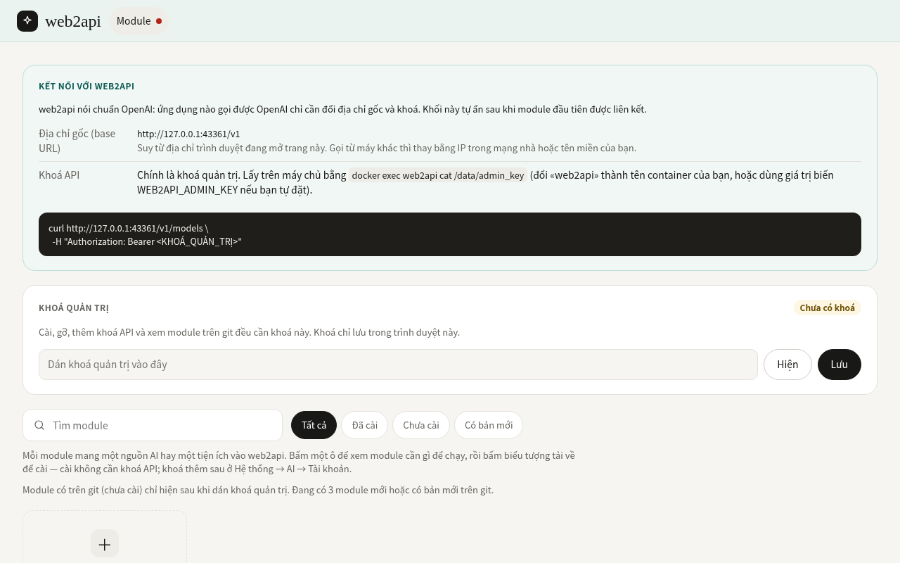

*Ảnh 1 — Địa chỉ gốc mở thẳng Hệ thống → Module khi chưa cài gì (máy tính, 1280×800): khối «Kết nối với web2api»
(địa chỉ gốc suy từ trình duyệt, cách lấy khoá quản trị, lệnh mẫu) và ô khoá quản trị. Chưa có Studio, chưa có AI.
Ảnh chụp bằng `scripts/chup-man-hinh.sh` trên lõi tạm không có khoá thật.*

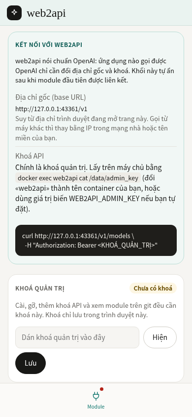

*Ảnh 2 — Cùng trang trên điện thoại (390×844).*

**Lấy khoá quản trị.** Lần chạy đầu web2api tự sinh khoá ngẫu nhiên, lưu ở `/data/admin_key` (chỉ chủ tệp đọc
được, không in ra nhật ký):

```bash
docker exec web2api cat /data/admin_key
```

Muốn tự đặt khoá thì truyền `WEB2API_ADMIN_KEY`. Dán khoá vào ô «Khoá quản trị» rồi bấm «Lưu» — khoá chỉ lưu trong
trình duyệt đó (`localStorage`). Khoá sai thì trang báo «Khoá sai hoặc thiếu (HTTP 401)» ngay tại đó.

### Cài nguồn AI đầu tiên


*Ảnh 3 — Đã dán khoá, chip «Tất cả»: ô xếp theo loại (khu «AI», «App», «Mạng»), mỗi ô có trạng thái và dải tài
nguyên, chân ô có nút hành động theo trạng thái («Cài» ở gemini-api, «Cập nhật» ở «Ghi chú (mẫu)»). «Ghi chú (mẫu)»
và «Mạng giả» là module mẫu chỉ để minh hoạ nhiều loại; gemini-api là module thật của kho (đang «Chưa cài», trên
git).*

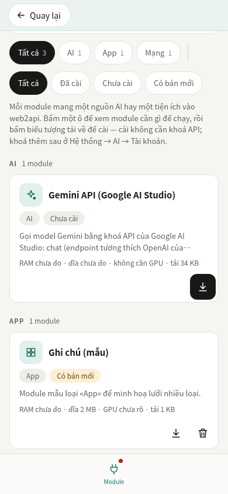

*Ảnh 4 — Lưới module trên điện thoại (một cột).*

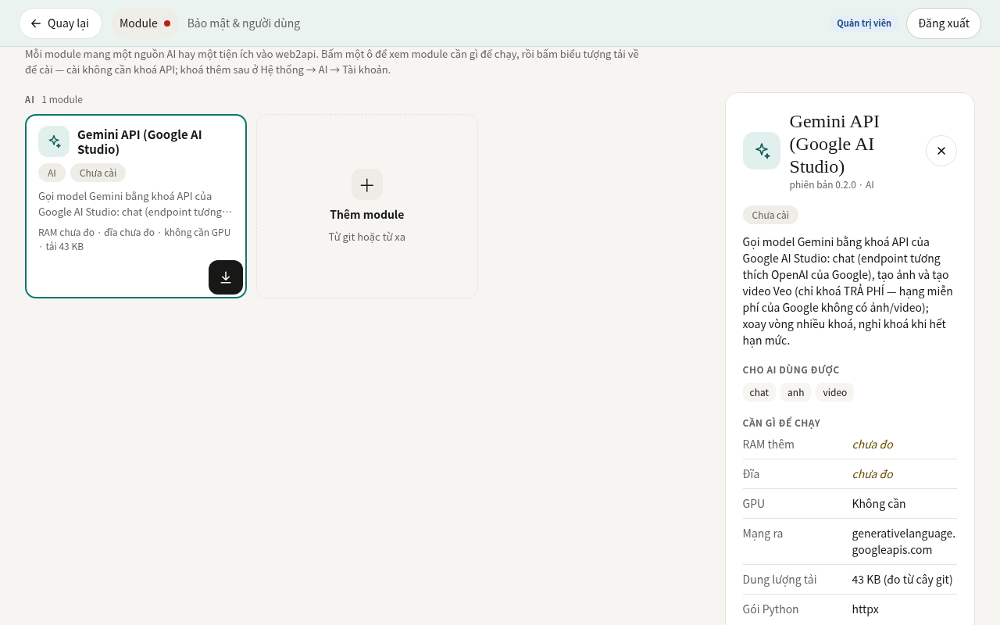

*Ảnh 5 — Bấm ô gemini-api: bảng chi tiết ở cột phải với «Cần gì để chạy» (RAM/đĩa «chưa đo», không cần GPU, mạng
ra, dung lượng tải đo từ cây git, gói Python, hướng dẫn từ manifest, dòng «Máy này») và nút «Cài».*

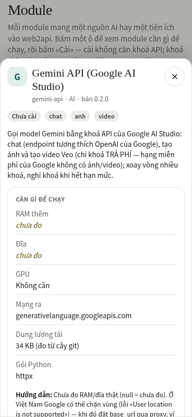

*Ảnh 6 — Trên điện thoại bảng chi tiết nằm dưới lưới (như trang Tiện ích của demo ở 390px); chọn ô thì trang cuộn tới.*

1. **Chọn ô** module (khu đầu tiên — thường là «AI» — được chọn sẵn; chip loại và chip trạng thái để lọc, ô tìm
   kiếm không phân biệt dấu). Module trên git chỉ hiện sau khi dán khoá quản trị.
2. Đọc **«Cần gì để chạy»**, bấm **«Cài»** (trong bảng chi tiết, hoặc biểu tượng tải về nền đen ngay trên ô) — không cần khoá API.
   Module khai `chat` thì vài giây sau trang **tự chuyển sang Studio** kèm dải «Đã cài … Thêm khoá ở Hệ thống → AI →
   Tài khoản để dùng.» Studio hiện đủ các chế độ module khai, ở **trạng thái rỗng** «Chưa có khoá cho …» với nút tới
   đúng thẻ của module; ô soạn bị khoá tới khi có khoá, không gọi `/v1`.
3. Bấm **«Thêm khoá»** → Hệ thống → AI → **Tài khoản** với biểu mẫu «Thêm API» của đúng module đã mở sẵn (nhóm
   «API 0», khung «Chưa có tài khoản API nào»). Dán một khoá API; ô «Địa chỉ gốc» để trống trừ khi cần proxy. Bấm
   **«Thêm API»**: web2api thử mọi khoá của nguồn đó (không tốn token), dải báo nói kết quả từng khoá ở dạng che, chỉ
   lưu khoá dùng được.
4. Lưu xong, khung **tính lại ngay, không tải lại trang**: khoá thành một dòng tài khoản («khoá …abcd», nhãn «Dùng
   được»), nhóm thành «API 1»; tab «Provider» (có từ lúc cài, khi ấy rỗng kèm «Mở tab Tài khoản») hiện model thật và
   sức khoẻ từng khoá; về Studio thì hết trạng thái rỗng và chat được. Khối «Kết nối với web2api» ở trang Module ẩn
   sau liên kết đầu tiên. Về sau thêm khoá bằng «＋ Thêm API», thay hay xoá từng khoá trong dòng tài khoản (hoặc ở
   bảng chi tiết của ô); khoá đã lưu chỉ thấy dạng che. Module không ứng tab chính nào (ví dụ loại «mạng») thì cài
   xong ở lại trang Module, bảng chi tiết mở ở mục «Cấu hình».

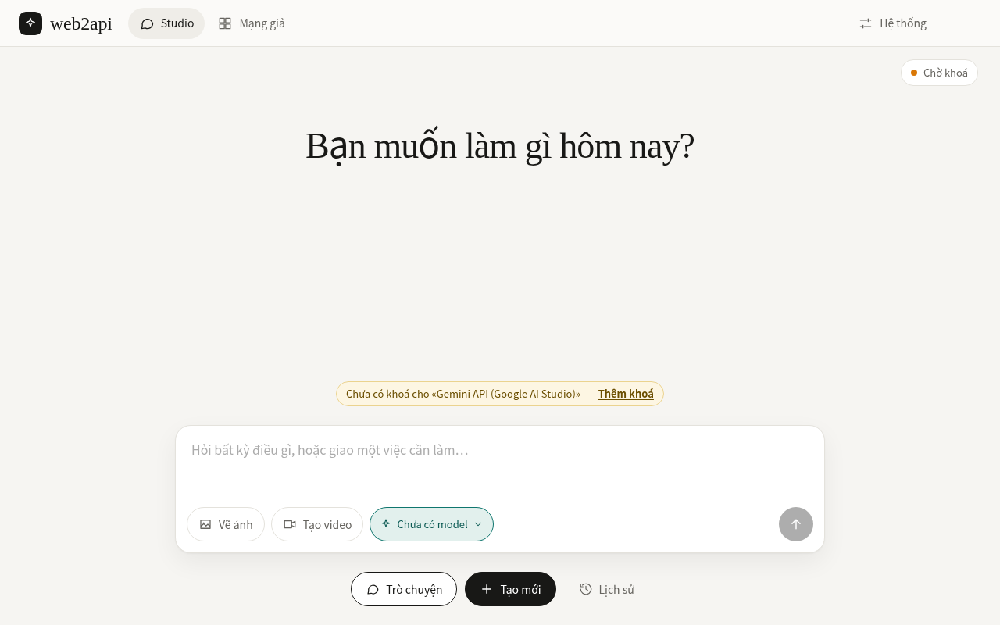

*Ảnh 7 — Cài gemini-api xong (chưa khoá): trang tự sang Studio, dòng «Đã cài …» ở trên, dải «Chưa có khoá cho
«Gemini API (Google AI Studio)». Thêm khoá ở Hệ thống → AI → Tài khoản» ngay trên ô soạn kèm nút tới đúng thẻ; ô soạn
bị khoá, chip model ghi «Chưa có model» (bảng chọn model nói rõ vì sao còn trống).*

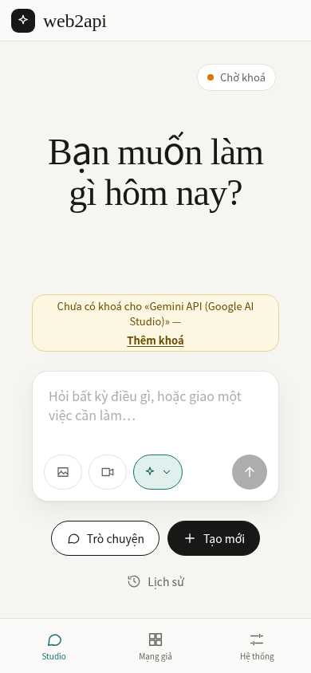

*Ảnh 8 — Cùng trạng thái trên điện thoại.*

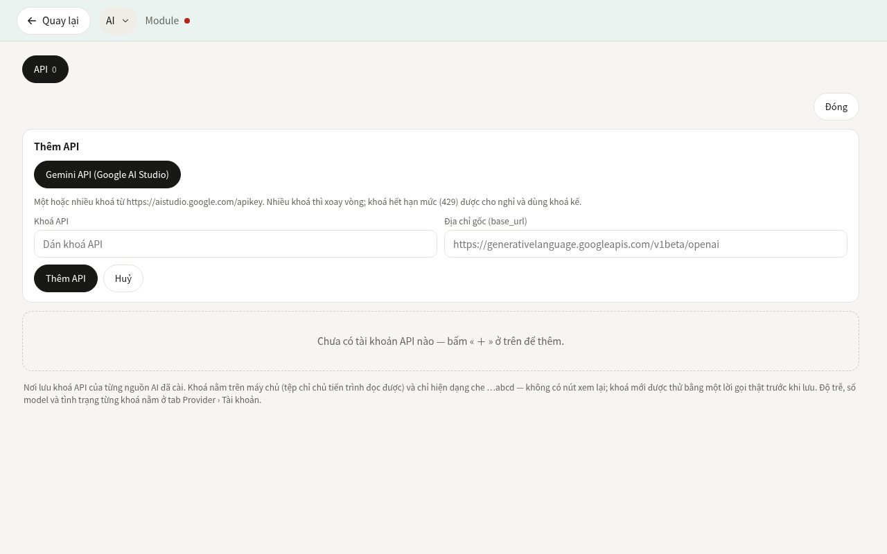

*Ảnh 9 — Bấm «Thêm khoá» từ Studio: Hệ thống → AI → Tài khoản (chép trang AI của demo) với nhóm «API 0», nút «Đóng»
thay «＋ Thêm API» vì biểu mẫu «Thêm API» của gemini-api đang mở (ô «Khoá API» và «Địa chỉ gốc» dựng từ manifest),
khung «Chưa có tài khoản API nào» và ghi chú khoá lưu ở đâu.*

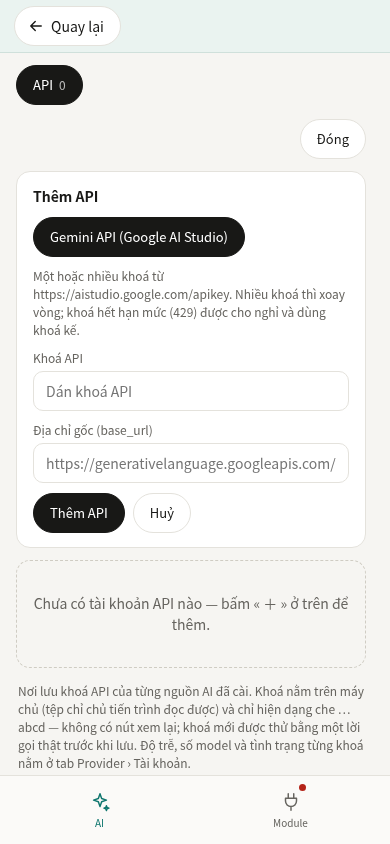

*Ảnh 10 — Cùng trạng thái trên điện thoại.*

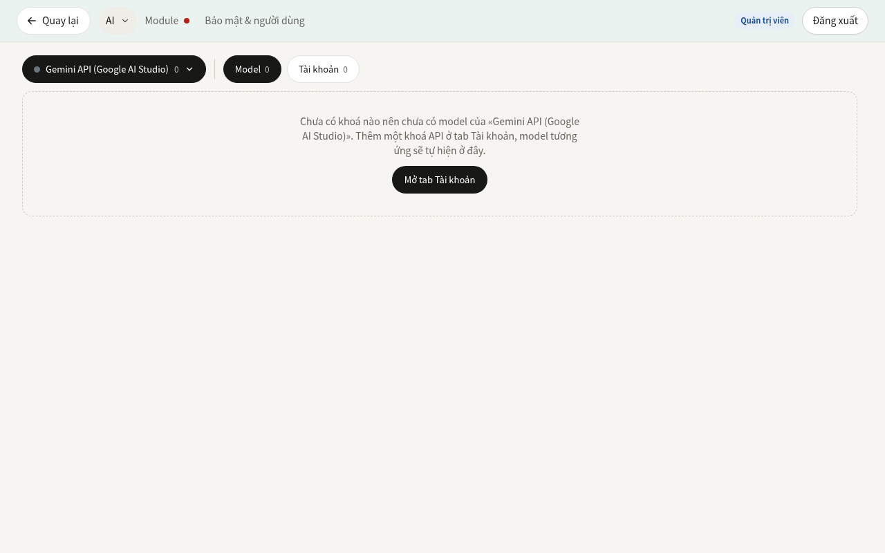

*Ảnh 11 — Provider có ngay từ lúc cài: bảng xổ «● Gemini API (Google AI Studio) 0», «Model 0 | Tài khoản 0» và khung
rỗng của demo kèm nút «Mở tab Tài khoản».*

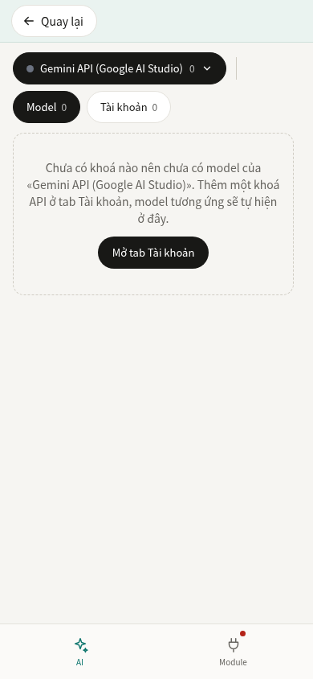

*Ảnh 12 — Cùng trạng thái trên điện thoại.*

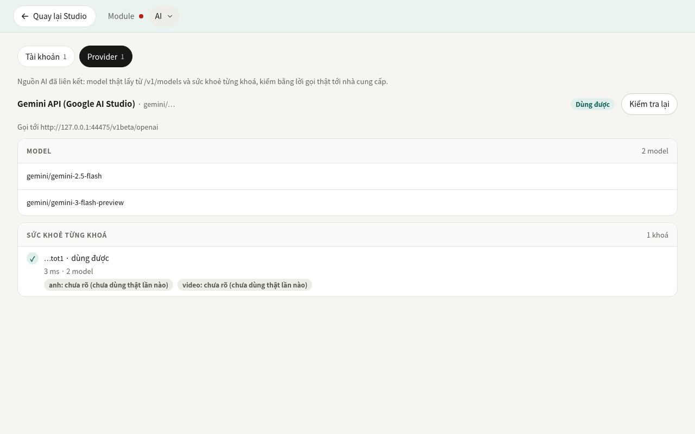

*Ảnh 13 — Sau khi liên kết nguồn AI đầu tiên (khoá giả, Google giả): Provider › Model với model thật từ `/v1/models`
chia nhóm theo khả năng module khai, nhóm thu gọn sẵn (bấm tiêu đề nhóm để xem model), nút «Làm mới danh sách»; sức khoẻ từng khoá ở «Tài khoản». Không có «Combo»,
bật/tắt hay «Đặt mặc định» model (chưa có backend).*

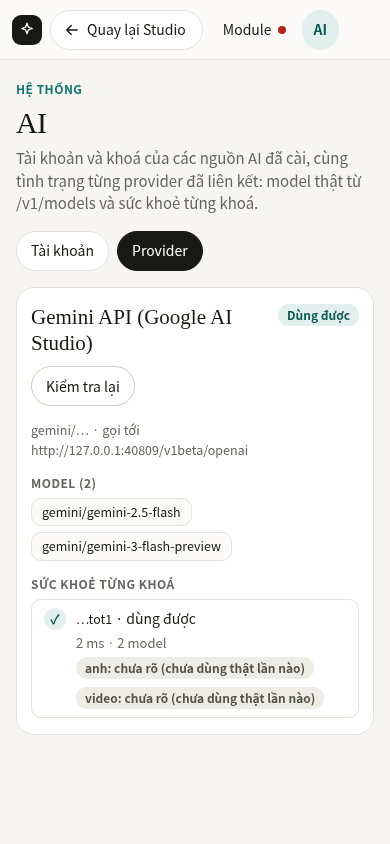

*Ảnh 14 — Provider trên điện thoại.*

### Studio


*Ảnh 15 — Studio sau một lượt chat: bong bóng câu hỏi bên phải, câu trả lời hiện dần theo stream và hiển thị dạng
markdown (Google giả trả một câu có in đậm, danh sách, mã), ô soạn dính đáy. «Vẽ ảnh», «Tạo video» nằm trong ô soạn, «Trò chuyện» / «Tạo mới» bên dưới — hiện vì module
đã cài khai `chat`, `anh`, `video`; chip model là model thật từ `/v1/models` theo tiền tố của module đó.*

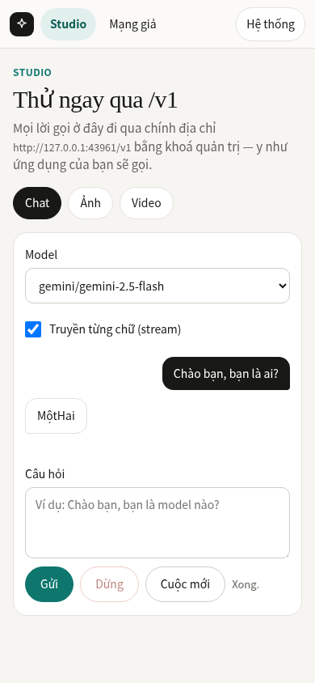

*Ảnh 16 — Studio trên điện thoại: chip chế độ dưới ô soạn, thanh điều hướng dưới đáy (chỉ các mục đang có).*

- Studio có ngay khi cài module khai `chat`. Chế độ nào chưa có module **đã liên kết** thì hiện dải
  «Chưa có khoá cho … Thêm khoá ở Hệ thống → AI → Tài khoản» kèm nút tới đúng module (nhiều module thì mỗi module
  một nút) và khoá ô soạn, thay vì để `/v1` trả `404 module_not_configured`.
- Màn đầu có vài câu gợi ý theo chế độ (bấm để điền vào ô soạn). Enter gửi, Shift+Enter xuống dòng (điện thoại:
  Enter xuống dòng, bấm nút gửi); Ctrl/⌘+Enter luôn gửi. Hội thoại chỉ sống trong trang — «Tạo mới» xoá.
- **Trò chuyện**: hội thoại nhiều lượt qua `POST /v1/chat/completions`, có stream, nút «Dừng» giữ phần đã nhận.
  Câu trả lời hiển thị dạng markdown an toàn (in đậm, nghiêng, tiêu đề, danh sách, trích dẫn, mã, liên kết
  http/https, bảng cuộn ngang trong bong bóng; HTML thô hiện thành chữ). Mỗi lượt gửi, Studio tự gắn giờ hiện tại
  vào lời gọi (một tin `system` ngay trước tin người dùng cuối, không hiện và không lưu vào hội thoại) — model không
  có đồng hồ nên không được cho biết thì đoán ngày sai. Múi giờ là biến `TZ` của máy chủ (vd `Asia/Ho_Chi_Minh`,
  mục 5), nên mở trang ở đâu giờ cũng là giờ nhà; chưa đặt `TZ` thì dùng múi giờ của trình duyệt. Lõi không tự chèn
  giờ vào lời gọi `/v1` của ứng dụng khác.
- **Vẽ ảnh** (khi có module khai `anh`): `POST /v1/images/generations`, ảnh hiện ngay trong lượt và tải về được.
- **Tạo video** (khi có module khai `video`): `POST /v1/videos` → hỏi `GET /v1/videos/{id}` mỗi 3 giây (thanh tiến
  độ trong lượt) → tải `…/content` thành tệp, xem tại chỗ và tải về.
- Chưa có bảng chọn tỉ lệ/thời lượng: `/v1/models` chưa khai model nào nhận tỉ lệ/thời lượng nào, nên trang chỉ gửi
  `model` + `prompt`.
- Ảnh/video thường tính tiền theo lượt và khoá hạng miễn phí của nhiều nhà cung cấp không dùng được; lỗi
  `403 no_key_permitted` hiện lời giải thích kèm nguyên văn lời nhắn của máy chủ.

### Dùng từ ứng dụng khác

Ba thông tin: **Base URL** `http://<IP-máy-chủ>:3031/v1`; **API key** là khoá quản trị; **Model**
`<tiền tố>/<tên>` (lấy bằng `/v1/models`). Đặt sẵn hai biến cho các lệnh `curl` trong tài liệu này:

```bash
W=http://<IP-máy-chủ>:3031
K=$(docker exec web2api cat /data/admin_key)
curl -s $W/health                                      # {"ok": true, ...}
curl -s -H "Authorization: Bearer $K" $W/v1/models     # danh sách model
curl -s -H "Authorization: Bearer $K" -H "Content-Type: application/json" \
  -d '{"model": "gemini/gemini-2.5-flash", "messages": [{"role": "user", "content": "Kể một câu chuyện ngắn"}]}' \
  $W/v1/chat/completions
curl -sN -H "Authorization: Bearer $K" -H "Content-Type: application/json" \
  -d '{"model": "gemini/gemini-2.5-flash", "stream": true, "messages": [{"role": "user", "content": "Đếm từ 1 đến 5"}]}' \
  $W/v1/chat/completions                               # stream: từng dòng "data: {...}", hết bằng "data: [DONE]"
```

```python
from openai import OpenAI

client = OpenAI(base_url="http://<IP-máy-chủ>:3031/v1", api_key="<khoá quản trị>")
tra_loi = client.chat.completions.create(model="gemini/gemini-2.5-flash",
                                         messages=[{"role": "user", "content": "Xin chào"}])
print(tra_loi.choices[0].message.content)
```

Giọng nói và sửa ảnh dùng đúng các hàm của SDK (`audio.speech.create`, `audio.transcriptions.create`,
`images.edit`, cả `videos.create` — SDK gửi nó bằng multipart). Lõi đã mở các đường này (kiểm bằng SDK openai 3.28
với module giả trong `test/test_web2api_da_phuong_thuc.py`); chúng trả lời thật khi có module khai `noi`/`nghe`/
`anh_sua` — module có sẵn hiện chưa có, gọi là nhận `501`:

```python
with open("ghi-am.wav", "rb") as f:
    van_ban = client.audio.transcriptions.create(model="<tiền tố>/<model nghe>", file=f, language="vi").text
client.audio.speech.create(model="<tiền tố>/<model đọc>", voice="<giọng>", input=van_ban).write_to_file("doc.mp3")
```

Home Assistant: dùng tích hợp **cho nhập base URL** kiểu OpenAI (tích hợp «OpenAI Conversation» gốc không cho đổi
địa chỉ; các tích hợp «OpenAI tương thích» trên HACS thì có). Chưa thử cụ thể trên Home Assistant của nhà.

### Truy cập từ máy khác và từ Internet

Mặc định khi chạy Docker, web2api lắng nghe cổng 3031 trên máy chủ. Để ứng dụng khác (máy tính khác, điện thoại,
Home Assistant) hoặc người dùng bên ngoài Internet gọi được cổng AI, cần xác định phương thức kết nối phù hợp:

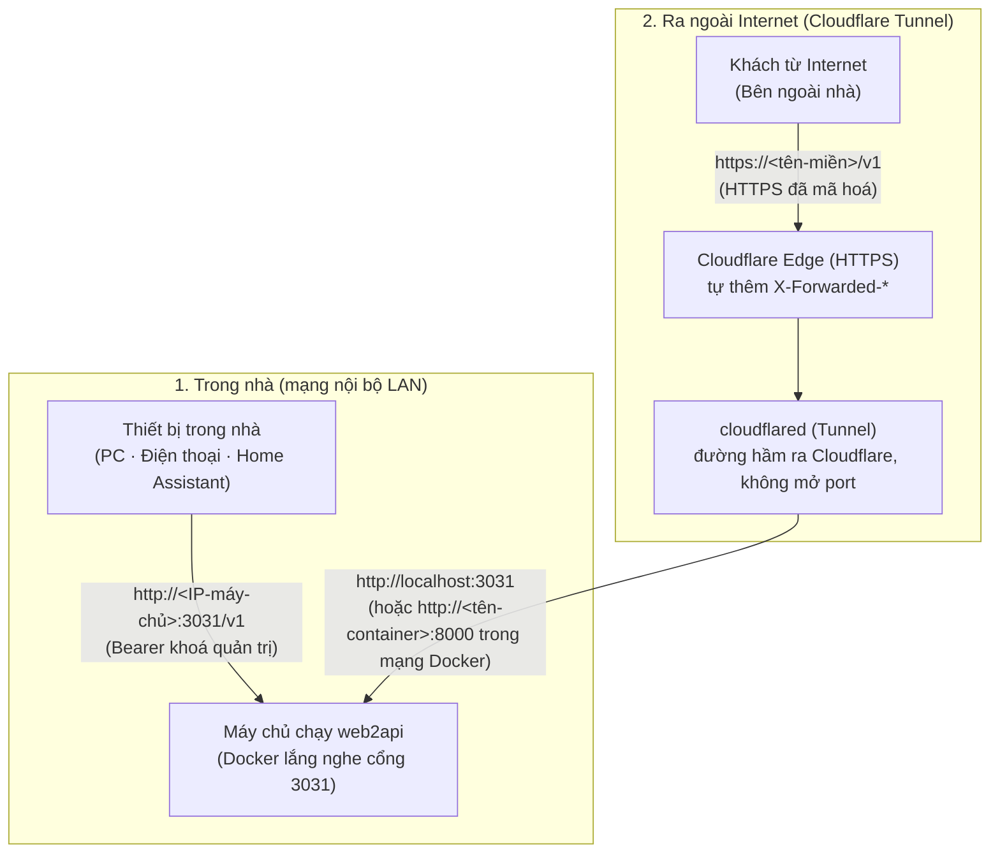

#### a. Chỉ dùng trong nhà (mạng LAN)

Khi chỉ dùng cho các thiết bị trong gia đình hoặc cùng mạng Wi-Fi:
- **Địa chỉ kết nối:** `http://<IP-máy-chủ>:3031` (Base URL cho các ứng dụng OpenAI là `http://<IP-máy-chủ>:3031/v1`).
- Thay `<IP-máy-chủ>` bằng địa chỉ IP nội bộ của máy chủ (ví dụ trong dải `192.168.x.x` hoặc `10.x.x.x`).
- Kết nối trực tiếp qua giao thức HTTP không mã hoá trong mạng riêng, an toàn trước sự dòm ngó từ Internet bên ngoài.

#### b. Ra ngoài bằng Cloudflare Tunnel (`cloudflared`)

Muốn gọi web2api khi ra khỏi nhà hoặc tích hợp dịch vụ bên ngoài, giải pháp an toàn nhất là dùng **Cloudflare Tunnel**:
1. **Cài đặt `cloudflared`:** cài `cloudflared` trên máy chủ hoặc chạy container `cloudflare/cloudflared`.
2. **Tạo đường hầm:** đăng nhập tài khoản Cloudflare và tạo tunnel:
   ```bash
   cloudflared tunnel login
   cloudflared tunnel create <tên-tunnel>
   ```
3. **Trỏ dịch vụ:** trong tệp cấu hình của tunnel (`~/.cloudflared/config.yml`), trỏ tên miền tới web2api:
   ```yaml
   tunnel: <tên-tunnel>
   credentials-file: /root/.cloudflared/<mã-tunnel>.json
   ingress:
     - hostname: <tên-miền>
       service: http://localhost:3031        # cloudflared chạy trên máy chủ: cổng đã mở của Docker
       # service: http://<tên-container>:8000  # cloudflared chạy trong cùng mạng Docker: cổng TRONG container là 8000
     - service: http_status:404
   ```
4. **Gắn tên miền và bật HTTPS:** `cloudflared tunnel route dns <tên-tunnel> <tên-miền>` (tạo bản ghi DNS trỏ vào
   tunnel), rồi `cloudflared tunnel run <tên-tunnel>` (hoặc cài thành dịch vụ: `cloudflared service install`).
   Cloudflare tự cấp chứng chỉ và phục vụ HTTPS ở `https://<tên-miền>`; đoạn từ cloudflared tới web2api là HTTP trong
   máy/mạng Docker, không đi qua Internet.
5. **Cho web2api biết địa chỉ công khai:** cách chắc nhất là **đặt cố định** — biến `WEB2API_PUBLIC_URL=https://<tên-miền>`
   hoặc `PUT /api/dia-chi` (giá trị đặt qua API được ưu tiên hơn biến). Khi chưa đặt, web2api **đoán** từ yêu cầu đang
   tới: cloudflared chuyển nguyên `Host` là tên miền công khai (trừ khi đặt `httpHostHeader` trong cấu hình) và
   Cloudflare gắn `X-Forwarded-Proto: https`; web2api chỉ đọc `X-Forwarded-Proto` / `X-Forwarded-Host` khi đặt
   **`WEB2API_TIN_PROXY=1`** — chỉ bật khi MỌI đường vào web2api đều qua proxy, vì ai gọi thẳng cổng 3031 cũng tự gửi
   được hai header này. Header có nhiều giá trị khác nhau, ký tự lạ hay quá dài bị bỏ. Riêng uvicorn (máy chủ web bên
   trong ảnh) mặc định tự tin `X-Forwarded-Proto` từ kết nối đến từ chính `127.0.0.1` của container, kể cả khi
   `WEB2API_TIN_PROXY` tắt — không ảnh hưởng khách đi qua cổng Docker (đến từ địa chỉ khác).

#### c. Khuyến nghị Cloudflare Access cho trang quản trị (tuỳ chọn)

Trang giao diện web (`/`) và các API quản trị (`/api/*`) nên được bảo vệ thêm bằng lớp xác thực **Cloudflare Zero Trust / Access**:
- Thiết lập quy tắc Access chỉ cho phép email của bạn đăng nhập bằng mã OTP một lần hoặc tài khoản Google/GitHub.
- Có thể tạo chính sách Bypass (bỏ qua Access) riêng cho đường dẫn `/v1/*` để các ứng dụng OpenAI khách bên ngoài vẫn gọi được API trực tiếp thông qua Bearer token, hoặc dùng Service Tokens của Cloudflare Access.

#### d. Vì sao KHÔNG mở thẳng cổng ra Internet

Tuyệt đối **không mở cổng 3031 (Port Forwarding / NAT)** trên router mạng nhà ra Internet:
- **Nguy cơ nghe lén:** web2api chạy HTTP thuần. Mở cổng thẳng khiến mọi dữ liệu, bao gồm cả khoá quản trị và nội dung hội thoại, truyền dạng văn bản rõ (clear text) trên Internet, dễ bị kẻ xấu bắt gói tin và đánh cắp.
- **Nguy cơ bị tấn công trực diện:** mở cổng để lộ địa chỉ IP thật của nhà, thu hút các botnet quét cổng, tấn công dò mật khẩu và tấn công từ chối dịch vụ (DDoS).
- **Lợi ích của Cloudflare Tunnel:** không cần mở cổng router (cloudflared tự gọi RA Cloudflare), giấu địa chỉ IP nhà, khách ngoài chỉ nói HTTPS với Cloudflare; đoạn Cloudflare ↔ cloudflared cũng mã hoá.

#### e. Kiểm bằng `curl` đạt / không đạt

Kiểm tra kết nối trong mạng LAN:
```bash
curl -s http://<IP-máy-chủ>:3031/health
```
- **Đạt:** trả về `{"ok": true, "phien_ban": "..."}`.
- **Không đạt:** `Connection refused` (container chưa chạy hoặc sai cổng) hoặc `No route to host` (sai IP máy chủ, bị tường lửa chặn).

Kiểm tra kết nối qua Cloudflare Tunnel:
```bash
curl -s https://<tên-miền>/health
```
- **Đạt:** trả về `{"ok": true, "phien_ban": "..."}`.
- **Không đạt:** lỗi SSL hoặc mã HTTP `502 Bad Gateway` / `530` từ Cloudflare (tunnel chưa kết nối được tới cổng 3031 của web2api).

Kiểm tra gọi API bằng khoá quản trị:
```bash
curl -s -H "Authorization: Bearer <KHOÁ>" https://<tên-miền>/v1/models
```
- **Đạt:** trả về danh sách model `{"object": "list", "data": [...]}`.
- **Không đạt:** mã HTTP `401` nếu thiếu hoặc sai khoá quản trị.

#### f. Người dùng và bảo mật: khoá quản trị và khoá khách

- **Khoá quản trị** (`WEB2API_ADMIN_KEY` hoặc `/data/admin_key`): có **toàn quyền trên hệ thống** (gọi mọi API `/v1/*`, cài đặt, gỡ bỏ, xem cấu hình module và quản lý khoá khách). Chỉ dành riêng cho chủ máy quản trị; không chia sẻ cho người ngoài.
- **Khoá khách (Client API Key)**: cấp quyền cho ứng dụng khách hoặc người dùng khác trong nhà để gọi các dịch vụ AI chuẩn OpenAI (`/v1/*`), tách biệt hoàn toàn với quyền quản trị:
  - Khách gọi đường quản trị (`/api/*`, trang cấu hình) sẽ nhận mã `403` (không để lộ sự tồn tại của dữ liệu quản trị).
  - Khoá khách có **phạm vi quyền hạn (scope)** cụ thể theo nguyên tắc đặc quyền tối thiểu:
    - **Cú pháp mở rộng theo module:** hỗ trợ cả dạng chung `<kha_nang>` (áp dụng cho mọi module) và dạng giới hạn đích danh `<kha_nang>@<module>` (ví dụ `chat@module-a`). Lõi kiểm tra sự tồn tại của module khi tạo/sửa khoá (`POST /api/khoa-khach`, `POST /api/toi/khoa`, `PATCH /api/khoa-khach`) — module lạ trả `400 module_not_found`. Nếu module bị gỡ sau đó, quyền trên module đó tự động bị đóng (`403 insufficient_scope`).
    - **Khoá `*` KHÔNG còn bao gồm các khả năng nguy hiểm:** Khoá `*` chỉ bao gồm các khả năng đọc và suy luận an toàn (`chat`, `anh`, `anh_sua`, `video`, `noi`, `nghe`, `nhung`, `xep_hang`, `tim_kiem`, `thiet_bi:doc`, `thiet_bi:su_kien_doc`).
    - **Nhóm khả năng NGUY HIỂM cần cấp đích danh:** Mọi khả năng làm thay đổi thế giới ngoài, chạy mã, điều khiển thiết bị/trình duyệt, hoặc gửi dữ liệu ra ngoài (`thiet_bi:ghi`, `thiet_bi`, `thiet_bi:su_kien`, `trinh_duyet`, `trinh_duyet_mo`, `trinh_duyet_dong`, `trinh_duyet_ds`, `trinh_duyet_tao`, `trinh_duyet_cookie`, `gui_ra`, `gui_tin`, `kenh_ra`, `webhook`, các mã kết thúc bằng `:ghi`, bắt đầu bằng `gui:`, hoặc do module tự khai ở trường mở `nguy_hiem` trong manifest) BẮT BUỘC phải được cấp đích danh (ví dụ `thiet_bi:ghi`, `trinh_duyet`, `gui_ra@mod_id`). Gọi qua khoá `*` mà không được cấp đích danh sẽ nhận `403 insufficient_scope`.
    - **Chuyển tiếp an toàn cho khoá `*` hiện có:** Khoá `*` cũ vẫn chạy bình thường với các khả năng an toàn; các khả năng nguy hiểm hết hiệu lực ngay lập tức qua `*` và quản trị viên cần cấp lại quyền đích danh cho khách cần dùng. Kết quả kiểm tra khôi phục sao lưu (`khac_biet`) hiển thị cảnh báo rõ ràng khi khoá có `*`.
    - Gọi vượt quá phạm vi được cấp sẽ nhận lỗi `403 insufficient_scope` theo chuẩn OpenAI.
  - Danh mục `GET /v1/models` tự động lọc, chỉ hiển thị các model thuộc phạm vi mà khoá khách được phép dùng (bao gồm kiểm tra module).
  - Khách chỉ được **thu hẹp phạm vi** cho từng lượt gọi thông qua tiêu đề `X-Web2api-Scope` (hoặc `X-Scope`), không thể mở rộng và không thể sửa đổi phạm vi đã lưu hay tạo khoá khác.
  - **Lưu trữ an toàn:** Khoá thô (tiền tố `w2a_`) chỉ hiển thị **đúng một lần** khi tạo qua giao diện hoặc `POST /api/khoa-khach` (và khi xoay khoá). Tệp cấu hình `<WEB2API_DATA>/khoa_khach.json` (quyền 0600) chỉ lưu bản băm SHA-256; so khớp bằng so sánh thời gian hằng (`hmac.compare_digest`). Khoá không bao giờ được ghi vào nhật ký hay phản hồi sau khi tạo.
  - **Xoay khoá không gián đoạn (cửa sổ hai khoá):** Quản trị xoay khoá qua `POST /api/khoa-khach/{id}/xoay` (thân tuỳ chọn `{"cu_giay": <số nguyên>}`, mặc định 604800 / 7 ngày, tối đa 2592000 / 30 ngày, `0` = khoá cũ hết hạn ngay). Khoá mới được sinh và trả về một lần duy nhất; băm khoá hiện tại được lưu thành `bam_cu` kèm thời điểm hết hạn `cu_het_han` (ISO UTC). Trong cửa sổ hiệu lực, khoá cũ vẫn dùng được bình thường qua đường xác thực và chịu chung chính sách trần/trạng thái của chủ; hết cửa sổ hoặc bị xoay lần kế tiếp thì khoá cũ bị vô hiệu hoá (`401`). Khoá cũ hết hạn được dọn dẹp khỏi đĩa theo cách lười ở lần ghi kế tiếp.
  - **Vân tay khoá cho nhật ký:** Nhằm hỗ trợ đối chiếu dấu vết khi điều tra rò rỉ mà không làm lộ khoá thô hay bản băm SHA-256 có thể đoán ngược, hệ thống gán nhãn `khoa_van_tay` (16 ký tự hex đầu của HMAC-SHA256 băm khoá với khoá bí mật nội bộ 32 byte quyền 0600 tại `<WEB2API_DATA>/bi_mat/khoa_van_tay`). `khoa_van_tay` được ghi vào sổ nhật ký `quan_tri` ở các thao tác tạo/xoay/sửa/thu hồi khoá và các lần từ chối `403` trên đường quản trị. Danh sách khoá `GET /api/khoa-khach` hiển thị `van_tay`, `cu_het_han` và `co_khoa_cu` (tuyệt đối không trả `bam` hay `bam_cu`).
  - Khi khoá bị tắt (`bat: false`) hoặc thu hồi (xoá), mọi yêu cầu tiếp theo lập tức bị từ chối với mã `401`.
  - `khoa_khach.json` tồn tại mà đọc lỗi/hỏng/sai cấu trúc (mỗi bản ghi nạp qua CÙNG bộ kiểm của khôi phục `kiem_tep`: `id`, `bam` 64 hex thường, `bat` bool, `pham_vi`, `chu_id`, kiểu các trường còn lại; riêng trần độ dài nhãn không áp lúc nạp) → **đóng khi lỗi**: Bearer có dạng khoá khách (`w2a_` + 43 ký tự) trả `503 guest_key_store_unreadable` và KHÔNG bị đếm vào giới hạn sai khoá (lỗi hạ tầng, không phải đoán sai — khoá quản trị cùng IP không bị `429` lây); chuỗi dạng khác vẫn `401` và vẫn bị đếm; không bao giờ `500`, các đường tạo/sửa/thu hồi/liệt kê khoá trả `503 guest_key_store_unreadable` và tệp KHÔNG bao giờ bị ghi đè (kể cả nhịp đồng bộ đếm lượt). Khoá quản trị, `/health` và `POST /api/khoi-phuc` vẫn chạy — khôi phục tệp từ bản sao lưu là đường cứu.
  - Nhãn khoá (`nhan`) tối đa 200 ký tự khi tạo/sửa (`400 invalid_value`) — mọi khoá ứng dụng ghi ra đều khôi phục lại được.
  - `GET /api/khoa-khach` và `GET /api/toi/khoa` trả `pham_vi` (phạm vi gốc đã lưu) và `pham_vi_hieu_luc` (đúng thứ xác thực cấp: giao với trần hiện tại của chủ; khoá tắt, hết hạn hoặc chủ tắt/không còn → `[]`).
  - **Kiểm soát đồng thời:** Biến `WEB2API_KHACH_DONG_THOI` đặt trần số yêu cầu đồng thời tối đa cho mỗi khoá khách (mặc định 4; `0` = tắt tường minh). Biến `WEB2API_V1_DONG_THOI_TOAN_CUC` đặt trần đồng thời toàn cục cho `/v1` (mặc định 32; `0` = tắt; đầy ⇒ `429` + `Retry-After: 1`, không xếp hàng vô hạn, dùng acquire không chặn). Khoá quản trị cũng chịu trần toàn cục nhưng không chịu trần theo khoá. Mọi luồng stream nhả ô khi kết thúc hoặc ngắt giữa chừng.
  - **Hạn dùng và tự tắt khoá:** Khoá khách có trường tuỳ chọn `het_han` (ISO UTC); quá hạn ⇒ `401` như khoá bị tắt. Biến `WEB2API_KHACH_TU_TAT_NGAY` (mặc định 0 = tắt; >0 ⇒ khoá khách không dùng quá N ngày bị coi như tắt khi tra cứu, dựa trường `dung_cuoi` hoặc `tao_luc`). Tra cứu thời gian đóng khi lỗi (trường hỏng ⇒ coi như hết hạn).
  - **Sổ thao tác quản trị:** Kênh nhật ký `quan_tri` ghi nhận mọi thao tác tạo, sửa, thu hồi khoá khách và các lần yêu cầu bị từ chối `401`/`403` ở các đường quản trị (tuyệt đối không ghi nội dung khoá).
  - **Giao diện:** tab «Bảo mật & người dùng» (`He-thong-Bao-mat.dc.html`) cho phép xem danh sách khoá khách (nhãn, chip phạm vi, lần dùng cuối, số lượt), bật/tắt, thu hồi và tạo khoá mới.

#### g. Tài khoản người dùng, phiên web và thiết lập admin ban đầu

Nhằm bảo vệ hệ thống khi triển khai qua tên miền công khai hoặc trong mạng nội bộ nhiều người dùng, web2api hỗ trợ hệ thống tài khoản người dùng và phiên đăng nhập web:

- **Mô hình tài khoản:**
  - Hai vai trò: `admin` (toàn quyền như khoá quản trị, quản lý người dùng, cấu hình module) và `user` (chỉ đăng nhập giao diện web, đổi mật khẩu của mình, tự quản lý tạo/thu hồi tối đa 10 khoá API cá nhân; không gọi được API quản trị `/api/*` và không dùng cookie phiên để gọi `/v1/*`).
  - Lưu trữ: `<WEB2API_DATA>/nguoi_dung.json` (quyền 0600, ghi nguyên tử qua tệp tạm). Tệp tồn tại mà đọc lỗi/hỏng/sai cấu trúc → **đóng khi lỗi**: các đường người dùng trả `503 user_store_unreadable`, đăng nhập trả `401` đồng nhất (một cảnh báo kênh `he_thong`), khoá API có chủ trả `401`, thiết lập lần đầu KHÔNG mở lại và tệp không bao giờ bị ghi đè — khôi phục tệp từ bản sao lưu. Chỉ khi tệp không tồn tại mới coi là chưa có tài khoản.
  - Tên đăng nhập: 3–32 ký tự `[a-z0-9._-]`, so sánh chữ thường không phân biệt hoa thường. Có thể tự sinh ngẫu nhiên dạng `nd-` + 6 ký tự base32.
  - Mật khẩu: băm bằng thuật toán an toàn `hashlib.scrypt` ($N=2^{14}, r=8, p=1$, muối ngẫu nhiên 16 byte), định dạng tự mô tả `scrypt$14$8$1$<muối b64>$<băm b64>`, so khớp bằng `hmac.compare_digest`. Quá trình băm chạy trong luồng riêng (`asyncio.to_thread`) với cờ semaphore giới hạn tối đa 2 phép tính song song để bảo vệ bộ nhớ RAM container (256 MB). Có thể tự sinh mật khẩu ngẫu nhiên 20 ký tự (bảng chữ loại trừ các ký tự dễ nhầm lẫn như `0`, `O`, `1`, `l`, `I`). Mật khẩu bản rõ chỉ trả về duy nhất một lần khi tạo hoặc đặt lại mật khẩu.
  - Bất biến admin cuối cùng: hệ thống bảo vệ nghiêm ngặt tài khoản admin duy nhất đang hoạt động (không thể hạ vai, tắt hoặc xoá tài khoản admin ĐANG BẬT cuối cùng; vi phạm trả mã `409`; xoá một admin đã tắt thì được).
  - Thân `PATCH`/`POST` kiểm kiểu ở biên: `bat` phải là `true`/`false`, `vai` là `"admin"`/`"user"`, `pham_vi_toi_da` là danh sách mã phạm vi (rỗng được = không quyền nào), trường chuỗi phải là chuỗi — sai → `400 invalid_value`. Hạ vai admin → user mà không kèm `pham_vi_toi_da` thì trần về mặc định của user (`["chat"]`).

- **Thiết lập admin lần đầu (chống chiếm quyền):**
  - Khi chưa có tài khoản admin nào trong hệ thống, lúc khởi động web2api tự sinh tệp mã thiết lập `<WEB2API_DATA>/ma_thiet_lap` (quyền 0600, chứa 20 ký tự ngẫu nhiên) và ghi một dòng nhật ký duy nhất chứa đường dẫn tệp (không ghi nội dung mã).
  - Khách truy cập web lần đầu kiểm tra qua `GET /api/thiet-lap` (`{"can_thiet_lap": true}`).
  - Thiết lập admin ban đầu thực hiện qua `POST /api/thiet-lap` với trường `ma_thiet_lap` = mã đọc từ tệp trên máy chủ hoặc khoá quản trị, cùng `ten_dang_nhap` và `mat_khau` BẮT BUỘC (thiếu → `400`, không sinh admin ngẫu nhiên). Chỉ chạy khi chưa có admin (`409` nếu đã có, kiểm lại trong cùng lần khoá ghi nên hai yêu cầu đồng thời chỉ tạo một admin) và qua cùng cổng IP `WEB2API_QT_IP_CHO_PHEP` với đường quản trị. Sau khi thiết lập thành công, tệp `ma_thiet_lap` tự động bị xoá bỏ hoàn toàn.
  - Quên mật khẩu admin: dùng khoá quản trị (Bearer) gọi `POST /api/nguoi-dung/{id}/dat-lai-mat-khau`.

- **Đăng nhập và phiên làm việc web:**
  - `POST /api/dang-nhap`: Đăng nhập bằng `ten_dang_nhap` và `mat_khau`. Tên không thể là tài khoản (sai mẫu, quá dài, sai kiểu) → cùng `401` đồng nhất kèm băm giả và KHÔNG được ghi vào bộ đếm sai (bộ đếm chỉ giữ tên đúng mẫu, ≤ 32 ký tự). Tên sai mẫu để lại MỘT dòng nhật ký `quan_tri` (tên cắt gọn), tối đa một dòng mỗi IP mỗi phút. Đường này không chịu cổng IP quản trị trước khi kiểm mật khẩu (người dùng thường đăng nhập từ ngoài); tài khoản `admin` mật khẩu đúng mà IP ngoài `WEB2API_QT_IP_CHO_PHEP` → `403 ip_not_allowed`, không tạo phiên (sai mật khẩu vẫn `401` đồng nhất). Phiên vai `admin` dùng từ IP ngoài `WEB2API_QT_IP_CHO_PHEP` bị `403 ip_not_allowed` ở MỌI chỗ (`/api/toi/*`, `/api/dang-xuat`, `/v1/*`, đường quản trị), loopback trực tiếp vẫn qua.
  - Phản hồi mang bí mật một lần (`csrf`, `mat_khau`, `mat_khau_moi`, khoá thô) kèm `Cache-Control: no-store`: `POST /api/thiet-lap`, `POST /api/dang-nhap`, `GET /api/toi`, `POST /api/toi/khoa`, `POST /api/khoa-khach`, `POST /api/nguoi-dung`, `POST /api/nguoi-dung/{id}/dat-lai-mat-khau`.
  - Chống tấn công thời gian (timing attack): khi tên đăng nhập không tồn tại, hệ thống tự động băm một chuỗi giả để giữ độ trễ phản hồi tương đương với tài khoản thật.
  - Chống dò quét mật khẩu (khoá hai tầng): kết hợp bộ đếm IP (`gioi_han.py`) và bộ khoá hai tầng an toàn, loại bỏ nguy cơ kẻ lạ khoá admin từ xa:
    - **Tầng 1 (theo cặp IP, tên):** 5 lần sai liên tiếp (`WEB2API_DANG_NHAP_SAI_TOI_DA`) trong 15 phút (`WEB2API_DANG_NHAP_KHOA_PHUT`) → tạm khoá cặp `(IP, tên)` đó trong 15 phút. Kẻ lạ từ IP khác thử sai chỉ tự khoá chính mình; người dùng thật ở IP khác vẫn đăng nhập bình thường.
    - **Tầng 2 (theo tên toàn cục ở ngưỡng cao):** 50 lần sai liên tiếp (`WEB2API_DANG_NHAP_TOAN_CUC_SAI_TOI_DA`, mặc định 50) trong cùng cửa sổ 15 phút → tạm khoá tên tài khoản đối với mọi IP để chống tấn công phân tán (distributed brute-force từ nhiều IP botnet). Người dùng thật không bao giờ chạm tới ngưỡng này.
    - Đóng khi lỗi: kiểm tra khoá cặp và khoá tên TRƯỚC khi kiểm mật khẩu; đăng nhập thành công xoá bộ đếm của cặp và chỉ trừ đi số lần sai do chính cặp đó đóng góp ở tầng 2, không xoá trắng bộ đếm toàn cục. Thử mật khẩu cũ sai ở `POST /api/toi/mat-khau` đếm chung bộ khoá này; mật khẩu bị đổi/đặt lại ở nơi khác trong lúc đang đổi → `409 password_changed_concurrently` (không ghi đè lần đặt lại của admin). Mật khẩu dài hơn 128 ký tự (trần của chính sách đặt mật khẩu) bị coi là sai mà không băm chuỗi dài (vẫn chạy một lượt băm giả).
  - Bảng ngưỡng giới hạn và bảo vệ mặc định của từng đường:
    | Đường / Cơ chế | Ngưỡng sai / Cửa sổ | Thời gian khoá / Hành vi khi vượt | Biến môi trường cấu hình |
    |---|---|---|---|
    | **Bearer API** (`/v1/*`, `/api/*`) | 30 lỗi 401 / 60 giây | Khoá IP 60 giây (trả về `429 Too Many Requests` kèm `Retry-After`) | `WEB2API_RL_LOI_XAC_THUC=30`, `WEB2API_RL_CUA_SO_GIAY=60`, `WEB2API_RL_KHOA_GIAY=60` |
    | **Đăng nhập web** (`POST /api/dang-nhap`) | **Tầng 1:** 5 sai / 15 phút theo `(IP, tên)`<br>**Tầng 2:** 50 sai / 15 phút theo tên toàn cục | **Tầng 1:** Khoá cặp `(IP, tên)` 15 phút (trả `401`)<br>**Tầng 2:** Khoá tên toàn cục 15 phút (trả `401`)<br>Chịu thêm trần IP chung 30 lỗi/60s → khoá IP 60s (`429`) | `WEB2API_DANG_NHAP_SAI_TOI_DA=5`, `WEB2API_DANG_NHAP_TOAN_CUC_SAI_TOI_DA=50`, `WEB2API_DANG_NHAP_KHOA_PHUT=15` |
    | **Thiết lập admin** (`POST /api/thiet-lap`) | Cùng cổng IP `WEB2API_QT_IP_CHO_PHEP` | Chỉ thiết lập được khi chưa có admin (`409` khi đã có); chịu thêm trần IP chung 30 lỗi/60s → `429` | `WEB2API_QT_IP_CHO_PHEP`, `WEB2API_RL_LOI_XAC_THUC=30` |
    | **noVNC đổi vé** (`POST /novnc/dang-nhap`) | 30 lỗi đổi vé 401 / 60 giây | Đổi vé sai trả 401 đếm vào lỗi xác thực IP: vượt 30 lỗi/60s → khoá IP 60s (`429`); trần kho vé 10.000 vé | `WEB2API_RL_LOI_XAC_THUC=30`, trần `TOI_DA_VE=10000` |
  - Phiên đăng nhập: sinh token ngẫu nhiên 256-bit an toàn mật mã học, lưu trong `<WEB2API_DATA>/phien_web.json` (quyền 0600, chỉ lưu bản băm SHA-256). Giới hạn tối đa 5 phiên hoạt động đồng thời cho mỗi người dùng (phiên cũ nhất tự động bị đẩy ra khi tạo phiên thứ 6).
  - Cookie phiên: tên cookie là `__Host-w2a_phien` (khi kết nối qua HTTPS an toàn) hoặc `w2a_phien` (khi kết nối HTTP nội bộ), kèm cờ `HttpOnly`, `SameSite=Strict`, `Path=/`.
  - Hạn phiên: hết hạn do nhàn rỗi sau `WEB2API_PHIEN_WEB_RANH_GIO` (mặc định 8 giờ không hoạt động) và hết hạn tuyệt đối sau `WEB2API_PHIEN_WEB_TOI_DA_NGAY` (mặc định 7 ngày kể từ lúc tạo).
  - Token phiên trong cookie phải đúng dạng (43 ký tự `[A-Za-z0-9_-]`); sai dạng coi như không có phiên (`401`).
  - Thu hồi phiên: đổi mật khẩu hoặc xoá/tắt tài khoản lập tức thu hồi toàn bộ các phiên đang hoạt động của người dùng đó (bật lại không làm sống lại phiên cũ). Đăng xuất `POST /api/dang-xuat` thu hồi phiên hiện tại và xoá cookie với cùng thuộc tính lúc đặt (`__Host-` kèm `Secure`).

- **Bảo vệ chống giả mạo yêu cầu chéo trang (CSRF):**
  - Mọi phiên web được cấp một mã `csrf_token` ngẫu nhiên khi đăng nhập hoặc kiểm tra thông tin.
  - Mọi yêu cầu thay đổi dữ liệu (`POST`, `PUT`, `PATCH`, `DELETE`) xác thực bằng cookie phiên web BẮT BUỘC phải gửi kèm tiêu đề HTTP `X-CSRF-Token` khớp với CSRF token của phiên (thiếu, sai hoặc sai dạng trả về mã `403 csrf_token_invalid`).
  - Các yêu cầu xác thực bằng Bearer token (khoá quản trị hoặc khoá API khách) được miễn trừ kiểm tra CSRF token.

- **Khoá API cá nhân của người dùng:**
  - Khoá khách tạo bởi người dùng được gắn định danh `chu_id` trỏ về tài khoản sở hữu.
  - Người dùng vai `user` chỉ có thể xem danh sách và thu hồi các khoá API do chính mình tạo qua `GET /api/toi/khoa` và `DELETE /api/toi/khoa/{id}`.
  - Khi tài khoản người dùng bị tắt (`bat: false`) hoặc bị xoá, toàn bộ khoá API thuộc sở hữu của người dùng đó lập tức bị vô hiệu hoá khi gọi `/v1/*` (trả về `401`).
  - Phạm vi khoá do người dùng tạo (`POST /api/toi/khoa`): không nêu `pham_vi` = đúng trần `pham_vi_toi_da`; đã nêu thì phải là danh sách KHÔNG rỗng gồm `*` hoặc mã khả năng (`[a-z][a-z0-9_]`, có thể kèm `:<mã>`) nằm trong trần (`400`/`403` nếu không). Danh sách rỗng KHÔNG BAO GIỜ nghĩa là «tất cả».
  - Phạm vi HIỆU LỰC của khoá có chủ ở mỗi lượt `/v1/*` = giao của phạm vi khoá với trần HIỆN TẠI của chủ (admin → `*`): hạ trần hoặc hạ vai thu hẹp ngay mọi khoá đã cấp, nâng lại thì rộng lại.

### Vận hành hằng ngày

```bash
docker compose logs -f web2api      # nhật ký (Ctrl+C để thoát)
docker compose ps                   # trạng thái, cột sức khoẻ (healthy)
docker compose restart              # khởi động lại
docker compose down                 # dừng và xoá container — dữ liệu trong volume VẪN CÒN
docker volume rm web2api-data       # xoá HẲN dữ liệu — không lấy lại được
```

**Cập nhật lõi**: `git pull`, `docker compose pull`, `docker compose up -d` (dựng tại chỗ: `docker compose up -d
--build`). Dữ liệu và module nằm trong volume nên giữ nguyên. Module **không** cập nhật theo ảnh: bản mới được báo
ở ô module («Có bản mới») và cập nhật bằng nút «Cập nhật». Muốn lõi tự cập nhật theo ảnh GHCR bằng Watchtower thì
đổi nhãn `com.centurylinklabs.watchtower.enable` trong `docker-compose.yml` thành `"true"`.

**Sao lưu / khôi phục qua API (`POST /api/sao-luu`, `POST /api/khoi-phuc`):**

Web2api cung cấp API xuất và nhập toàn bộ cấu hình hệ thống trong một tệp duy nhất (.w2a):

1. **Xuất bản sao lưu (`POST /api/sao-luu`)**:
   - Xác thực: chỉ khoá quản trị (`QT`); khách `403`; không khoá `401`.
   - Thân JSON: `{"mat_khau": "<≥ 12 ký tự> | null", "kem_phien": false}` — `kem_phien` chỉ nhận `true`/`false` thật (chuỗi `"false"` → `400`).
   - Định dạng: tar KHÔNG nén chứa `manifest.json` (phiên bản, ngày tạo, danh sách tệp kèm sha256 và kích thước, danh sách module git id + sha_commit) rồi các tệp.
   - Có `mat_khau`: toàn bộ tệp tar được mã hoá bằng AES-256-GCM với khoá dẫn xuất từ mật khẩu bằng scrypt (N=2^15, r=8, p=1; muối 16 byte, nonce 12 byte, tham số scrypt ở đầu tệp, AEAD dùng đầu tệp làm Associated Data).
   - Không có `mat_khau`: bản sao lưu KHÔNG chứa thư mục `bi_mat/` lẫn phiên tài khoản (manifest nêu rõ «đã bỏ bí mật vì không có mật khẩu»).
   - Phiên tài khoản (`bi_mat/phien/`): mặc định tắt; chỉ đưa vào khi quản trị đặt rõ `kem_phien=true` và có mật khẩu.
   - Giới hạn (CÙNG trần với khôi phục — ứng dụng không tạo bản mà chính nó sẽ từ chối): mỗi tệp ≤ 1 MiB, tổng ≤ 2 MiB, ≤ 256 tệp; vượt → `400 sao_luu_qua_lon`.
   - **Lưu ý bảo mật quan trọng:** Bản sao lưu có mật khẩu chứa khoá API của các module — **cất như mật khẩu**, không chia sẻ công khai. **Khoá quản trị không nằm trong bản sao lưu** (đặt lại bằng biến môi trường hoặc tệp riêng).

2. **Khôi phục cấu hình (`POST /api/khoi-phuc`)** — tệp tải lên là dữ liệu NGƯỜI KHÁC có thể đã soạn, nên không tệp nào được ghi thẳng:
   - Xác thực: chỉ quản trị viên. Đọc thân multipart/form-data qua `app/yeu_cau_da_phan.py` tuân trần `WEB2API_TEP_TOI_DA_MB`. Một lượt khôi phục tại một thời điểm (lượt thứ hai → `429 khoi_phuc_dang_chay`).
   - Trường: `tep` (đúng 1 tệp .w2a), `mat_khau` (nếu bản sao lưu mã hoá), `che_do` (`"kiem"` mặc định hoặc `"ap_dung"`; giá trị khác → `400`), `sha256` (bắt buộc với `"ap_dung"`: đúng sha256 mà `"kiem"` trả cho CHÍNH tệp đó; thiếu/lệch → `409 chua_kiem_dung_tep`).
   - Định dạng + toàn vẹn (`400 sao_luu_khong_hop_le`): nhận dạng và phiên bản đầu tệp, phiên bản manifest; tham số scrypt phải đúng bộ ứng dụng dùng — lạ thì từ chối TRƯỚC khi băm (header giả không được bắt máy chủ cấp 1 GiB RAM); giải mã AEAD (sai mật khẩu hoặc bị sửa byte → lỗi chung, không để lộ lý do); chỉ tar không nén (gzip/bz2/xz là đường bom nén); trần kiểm theo header ngay khi thấy, trước khi đọc nội dung (chọn theo RAM sau khi đọc JSON — JSON đối kháng nở ~26 lần): mỗi tệp ≤ 1 MiB, tổng ≤ 2 MiB, ≤ 256 tệp; từ chối symlink, hardlink, thiết bị, đường dẫn `../`, tuyệt đối, tên trùng; sha256 và kích thước khớp manifest. KDF, giải mã, đọc tar và ghi đĩa chạy ở luồng phụ.
   - **Mỗi tệp qua bộ kiểm của CHÍNH module sở hữu** (`_BO_KIEM` trong `app/sao_luu.py`; tệp không có bộ kiểm thì không khôi phục được): `nguon_git.json` → `nguon_git.kiem_cau_hinh` (cùng bộ kiểm của `PUT /api/nguon-git` và của lượt đọc tệp); `tu_xa.json` → `so_module.kiem_ban_ghi_tu_xa` (cùng bộ kiểm của đăng ký, base_url qua `kiem_url_lan`); `modules.json` → `kho.kiem_tep_modules` + `kho.kiem_cau_hinh_cong_khai` theo manifest module; `khoa_khach.json` → `khoa_khach.kiem_tep` (`bam` 64 hex, `bat`, `pham_vi` bắt buộc đúng kiểu); `combo.json` → `combo.kiem_hinh_dang`; `dia_chi.json` → `dia_chi.kiem_tra_va_chuan_hoa_url`; `model.json` → `kho.kiem_cai_dat_model`; `bi_mat/*` phải là đối tượng JSON (`bi_mat/danh_tinh.json` có bộ kiểm riêng: id đúng khuôn, email đúng khuôn, không trùng — NV79). Sai → `400` nêu tệp và quy tắc. Thứ được ghi là bản ĐÃ KIỂM (chuẩn hoá), không phải bytes thô.
   - Bản KHÔNG mật khẩu: không chứa `bi_mat/` (kể cả danh tính) — chỉ cấu trúc công khai; bản có mật khẩu chứa `bi_mat/` gồm `danh_tinh.json`.
   - **Đối chiếu với trạng thái đang có** — không nới an toàn, không đổi hướng khoá:
     * `nguon_git.json`: `tu_dong` và `yeu_cau_chu_ky` GIỮ giá trị đang có (chưa cấu hình = tắt) — khôi phục không bật tự cài, không tắt bắt chữ ký. Đổi `repo`/`nhanh`/`thu_muc` so với nguồn đang có (hoặc đặt nguồn mới khi `<DATA>/modules/` đã có module) thì GIỮ NGUYÊN cả tệp (lần đồng bộ đầu của nguồn mới tải bản của nguồn đó cho module đã cài, chờ quản trị duyệt) — đổi nguồn làm tay ở Hệ thống → Module.
     * `khoa_khach.json`: khoá ĐANG có chủ (`chu_id`; khớp theo id HOẶC theo băm — đổi id/hoán đổi băm không lách được) mà bản sao lưu bỏ hoặc đổi chủ → TỪ CHỐI (`409 khoi_phuc_xung_dot`) — khoá sẽ thoát trần của chủ và không còn tắt theo chủ. Gán chủ cho khoá chưa có chủ (thu hẹp) chỉ được đánh dấu `doi_chu`. `nguoi_dung.json` KHÔNG nằm trong bản sao lưu (chứa băm mật khẩu): khoá có chủ mà chủ không tồn tại/đang tắt trên máy đích vẫn khôi phục được nhưng bị đóng (`401`) — `kiem` nêu `canh_bao` «sẽ bị đóng sau khôi phục» ở khoá đó.
     * `tu_xa.json` / `modules.json`: id mà khoá `bi_mat/<id>.json` đang có trên máy và bản sao lưu KHÔNG mang khoá thay thế, nếu `base_url` (module từ xa) hoặc cấu hình công khai (module có mã) khác hiện tại → TỪ CHỐI (`409 khoi_phuc_xung_dot`): khoá cũ sẽ bị gửi tới địa chỉ mới. Gỡ module đó rồi khôi phục, hoặc dùng bản sao lưu có mật khẩu (mang khoá của chính nó). Module từ xa trùng id/tiền tố module có mã, combo trùng tiền tố module → từ chối.
   - Chế độ `"kiem"`: không ghi gì; trả `sha256`, `se_ap_dung`, `se_bo`, `giu_lai`, `tu_choi`, `co_the_ap_dung` và `khac_biet` — nguồn git (hiện tại / bản sao lưu / sẽ ghi), từng module từ xa (`base_url` đã bỏ userinfo, so với hiện tại), từng module (trường công khai đổi), khoá khách (số khoá, phạm vi và `chu_id` từng khoá, `trang_thai` `moi`/`doi_bam`/`doi_chu`/`doi`/`giu_nguyen`, cờ `mo_rong_pham_vi` khi khoá mới có `*` hoặc phạm vi rộng hơn bản đang có, cờ `bat_lai` khi khoá thô đang tắt sẽ được bật lại, `canh_bao` cho khoá mới/đổi có `*`, khoá bật lại và khoá có chủ không dùng được, khoá sẽ mất, `kho_hien_tai_hong` — không trả băm), tệp bí mật. Giao diện Hệ thống → Bảo mật chỉ bật «Áp dụng» sau khi kiểm tra đạt với chính tệp đó và hỏi xác nhận.
   - Chế độ `"ap_dung"` (cùng kế hoạch với `"kiem"`; còn mục bị từ chối → `409`, không ghi):
     * Lưu trạng thái hiện có sang `<DATA>/.truoc-khoi-phuc-<thời điểm>-<ngẫu nhiên>/` (thư mục 0700, giữ tối đa 3 bản, xoá bản cũ nhất); phản hồi nêu `ban_truoc.thu_muc` và `ban_truoc.so_ban_giu`.
     * Ghi nguyên tử từng tệp (tệp tạm cùng thư mục → fsync → `os.replace`; 0600 cho bí mật, khoá khách và combo, 0644 cho tệp công khai). Thư mục `bi_mat/`, `bi_mat/phien/…` chưa có thì tạo với quyền 0700; thư mục gốc dữ liệu không bị đổi quyền.
     * Lỗi giữa chừng, hoặc kiểm chứng sau ghi không đạt (đọc lại TỪNG khoá khách của bản sao lưu đúng như đã ghi — id, bật, phạm vi, chủ — và thấy được qua đường tra của xác thực; phạm vi/bật HIỆU LỰC theo trần chủ không bị so với tệp; từng module từ xa phải đang chạy) → phục hồi mọi tệp đã ghi từ bản `.truoc-khoi-phuc-*` vừa tạo, xoá tệp chưa có trước đó, báo `500 khoi_phuc_da_hoan_tac` (hoàn tác không trọn → `500 khoi_phuc_hoan_tac_loi` kèm tên thư mục bản trước).
     * **Giữ nguyên khoá khách:** bản ghi khoá khách (đã băm) từ bản sao lưu thay kho khoá khách — khoá cũ của ứng dụng khách vẫn dùng được ngay.
     * Khoá quản trị hiện tại KHÔNG bị thay đổi.
     * Nạp lại sổ module (`nap_lai_tu_kho`): module từ xa theo `tu_xa.json` mới phục vụ ngay; module có mã đang chạy mà cấu hình/bí mật đổi được dựng lại từ kho.
     * Nhật ký kênh `quan_tri` ghi nhận mọi lần sao lưu/khôi phục thành công và thất bại (tuyệt đối không ghi mật khẩu hay khoá).
   - **Bản `.truoc-khoi-phuc-*` CHỨA KHOÁ THẬT dạng rõ** (chép cả `bi_mat/`, kể cả phiên tài khoản): chỉ chủ tiến trình đọc được (0700), nhưng nằm trong volume và trong mọi bản sao lưu thủ công toàn bộ `/data`. Không cần nữa thì xoá tay: `docker compose exec web2api sh -c 'rm -r /data/.truoc-khoi-phuc-*'`.

Cách sao lưu thủ công bằng lệnh shell (dành cho người vận hành trực tiếp trên máy chủ):

```bash
docker compose exec -T web2api tar czf - -C /data . > sao-luu-web2api.tgz     # sao lưu toàn bộ /data
docker compose exec -T web2api tar xzf - -C /data < sao-luu-web2api.tgz       # khôi phục, rồi: docker compose restart
```

**Gỡ module**: nút «Gỡ» ở bảng chi tiết, hoặc:

```bash
curl -s -X DELETE -H "Authorization: Bearer $K" $W/api/modules/gemini-api
```

Lệnh dừng module, xoá cấu hình và khoá của nó và xoá `/data/modules/<id>/` (module chưa liên kết cũng gỡ được);
mọi tab chỉ do nó mang lại biến mất. Module còn trên git lại thành «Chưa cài». Khi bật `tu_dong`, web2api nhớ bản
vừa gỡ và không tự cài lại đúng bản đó. Module từ xa gỡ cùng cách; module đi kèm ảnh chỉ gỡ được cấu hình.

## 7. Lưu ý: bảo mật, sự cố, giới hạn

### Bảo mật

- **Khoá quản trị** mở được mọi thứ (gọi model, cài/gỡ module). Đổi khoá: `docker exec web2api rm /data/admin_key`
  — lần gọi kế tiếp web2api tự sinh khoá mới; hoặc đặt `WEB2API_ADMIN_KEY`.
- **Đừng mở cổng web2api ra Internet** khi chưa có HTTPS và proxy ngược đứng trước: khoá đi trong header, không mã
  hoá trên `http://`.
- **Module chạy trong tiến trình lõi**, quyền như lõi: ai đẩy được lên nhánh git được theo dõi thì chạy được mã
  trong web2api. Chỉ theo dõi kho tin cậy; để `tu_dong` tắt (mặc định) hoặc bật kèm `yeu_cau_chu_ky`; token GitHub
  nếu dùng thì **chỉ đọc**.
- **Kho public**: mọi người đọc được mã module và toàn bộ lịch sử commit — không đưa khoá, mật khẩu, địa chỉ nội
  bộ vào module; bí mật nhập lúc liên kết (trường `bi_mat`), lưu ở `/data/bi_mat/` quyền 0600.
- Khoá API, token không xuất hiện trong phản hồi API, nhật ký hay thông báo lỗi; chỉ hiện dạng che `…abcd`. Các tuyến
  API quản trị (`/api/he-thong`, `/api/modules`, `/api/modules/catalog`, `/api/tinh-nang`) đòi hỏi khoá quản trị hoặc phiên quản trị viên và không lộ tên kho git hay bí mật.
- Giao diện web sử dụng phiên cookie HttpOnly `w2a_phien` và header `X-CSRF-Token` lưu trong bộ nhớ; không còn lưu khoá quản trị trên trình duyệt. Khoá API dán vào form bị xoá khỏi trang ngay khi gửi.

#### Nhật ký chống sửa lén (chuỗi băm)

Mỗi bản ghi nhật ký mới mang `truoc` (băm SHA-256 của bản ghi liền trước, hoặc `"GOC"`) và `bam`
(SHA-256 của `truoc` + bản ghi đã chuẩn hoá sau khi che bí mật). Sửa/xoá/đổi chỗ/chèn một dòng ở giữa
làm đứt chuỗi và bị phát hiện bằng `GET /api/nhat-ky/chuoi` (chỉ quản trị): `ok`, `so_ban_ghi`,
`neo_dau`, `dau_cuoi`, `loi` (`bam_sai` — nội dung bị sửa; `dut_chuoi` — mất liên kết; `thieu_bam_giua_chuoi`
— dòng chèn tay). Khi khởi động, chuỗi hỏng thì lõi ghi một dòng cảnh báo kênh `he_thong`.

Cách neo ngoài: định kỳ gọi `GET /api/nhat-ky/chuoi`, chép `dau_cuoi` ra sổ ngoài web2api (giấy, tệp riêng).
Khi cần đối chứng, so `dau_cuoi` hiện tại với sổ: khớp mà `ok` là `true` thì chuỗi từ lần neo đến nay nguyên vẹn.

Giới hạn đã biết: kẻ xoá trọn ĐẦU hoặc ĐUÔI chuỗi **và** sửa được cả sổ neo ngoài thì không phát hiện được —
chuỗi băm chỉ phát hiện sửa/xoá/chèn ở GIỮA. `xoa_cu` / xoay vòng làm mất đầu chuỗi là hợp lệ (bản ghi đầu
còn lại thành điểm bắt đầu mới, `neo_dau` đổi). Tắt khẩn cấp bằng `WEB2API_NHAT_KY_CHUOI_BAM=0` (mặc định `1`).

### Xử lý sự cố thường gặp

| Hiện tượng | Nguyên nhân và cách xử lý |
|---|---|
| `401` «Thiếu hoặc sai khoá quản trị» / trang báo «Khoá sai hoặc thiếu» | Thiếu header `Authorization: Bearer <khoá>` hoặc khoá sai; trên trang bấm «Đổi khoá» và dán lại. Lấy lại: `docker exec web2api cat /data/admin_key`. |
| Gõ địa chỉ Studio / Hệ thống → AI mà bị đưa về trang Module kèm «… chưa mở được» | Tab đó chưa đủ điều kiện (ví dụ chưa cài module chat nào). Dòng thông báo nói rõ cần cài/liên kết gì. |
| Studio hiện «Chưa có khoá cho …» và không gửi được | Module đã cài nhưng chưa liên kết. Bấm nút trong khung đó (tới Hệ thống → AI → Tài khoản) để thêm khoá. |
| `404` «không thuộc module nào» | Tên model thiếu tiền tố hoặc tiền tố chưa liên kết. Xem `/v1/models`. |
| `404` «đã cài nhưng chưa có khoá» | Module đã cài, chưa liên kết: thêm khoá ở Hệ thống → AI → Tài khoản (hoặc bảng chi tiết của ô module), hoặc `POST /api/modules/<id>/cai`. |
| Gemini báo «chặn vùng» / «User location is not supported» | Đặt `base_url` qua proxy (mục 4, gemini-api). |
| `429` từ nhà cung cấp | Hết hạn mức; khoá tự nghỉ rồi dùng lại. Thêm khoá nếu hay gặp. |
| `403` `no_key_permitted` khi tạo ảnh/video | Không khoá nào được nhà cung cấp cho việc đó — với Gemini thường là khoá hạng miễn phí. Xem tiểu mục module. |
| `501` `capability_not_supported` | Module của tiền tố đó không có khả năng được gọi — trò chuyện, tạo ảnh/video, sửa ảnh, đọc hay nghe giọng nói (ví dụ module từ xa, module chỉ làm giọng nói). |
| `415` khi gửi tệp | `/v1/audio/transcriptions` và `/v1/images/edits` chỉ nhận `multipart/form-data`. `POST /v1/videos` nhận JSON hoặc multipart **chỉ có trường chữ**; tệp tham chiếu (`input_reference`) chưa hỗ trợ — gửi ảnh đầu vào theo tài liệu của module. |
| `413` `request_too_large` | Thân vượt trần: multipart (mặc định 25 MB; `WEB2API_TEP_TOI_DA_MB`) hoặc JSON (mặc định 25 MB; `WEB2API_THAN_TOI_DA_MB`). Đếm byte thật, không tin `Content-Length`; nhớ container mặc định chỉ có 256 MB RAM. |
| Ô module ở trạng thái «Lỗi» / có khối «Có module không nạp được» | Lý do ghi ngay đó (và ở trường `loi` của `GET /api/modules/catalog`): manifest sai, trùng id/tiền tố, thiếu gói… Sửa xong gọi `POST /api/modules/nap-lai`. |
| Không thấy module trên git | Chưa dán khoá quản trị, hoặc nguồn git lỗi: xem «＋ Thêm module» → «Từ git» (hoặc `GET /api/nguon-git`, `trang_thai.loi`). Gửi `PUT /api/nguon-git` thân `{}` để thăm dò ngay. |
| Trạng thái báo hết hạn mức GitHub | Ẩn danh 60 yêu cầu/giờ/IP; web2api tự chờ tới `reset_luc`. Muốn nâng: thêm `token` chỉ đọc. |
| Gỡ module rồi mà nó tự quay lại | Đang bật `tu_dong` và trên git có bản mới hơn bản vừa gỡ. Tắt `tu_dong` hoặc xoá module khỏi git. |
| Container dừng ngay lần đầu, nhật ký báo không ghi được `/data/...` | `WEB2API_DATA_DIR` trỏ thư mục chưa thuộc uid 1000: `sudo chown 1000:1000 <thư mục>`. |
| `docker compose up -d` không kéo được ảnh | Ảnh chưa phát hành hoặc không ra được GHCR: `docker compose up -d --build`. |
| Cài/cập nhật module báo «hoàn về bản cũ» | Bản mới trên git lỗi khi nạp; bản cũ vẫn chạy. Sửa module trên git rồi cập nhật lại. |
| Dòng «Máy này» sai hoặc không có | Khai `WEB2API_MAY_RAM_MB`, `WEB2API_MAY_CPU`; dòng chỉ hiện khi module có khai `ram_them_mb`/`dia_mb` hoặc có dung lượng tải. |

### Giới hạn và việc chưa làm

- **Combo**: Đã có backend API (`/api/combo`) và điều phối định tuyến dự phòng đa nguồn/model ở lõi; tab giao diện giữ ở việc kế tiếp.
- «Cần gì để chạy» mới là **hướng dẫn bằng chữ** từ manifest: chưa có checklist ✔/✖ từng yêu cầu, chưa tự cài gói
  Python; trần dung lượng tải module (50 MB tổng, 5 MB/tệp, 200 tệp) vẫn còn.
- Chưa có màn Tác phẩm, Nhà, Đời sống, giọng nói, MCP, sao lưu, nhật ký — sẽ vào khi có module thật đứng sau.
- Tab riêng của module do lõi phục vụ ở `/m/<id>/`; trường `tab_web.duong` của `GET /api/modules` vẫn là đường
  tuyệt đối (`/m/…`) — giao diện mới dùng đường tương đối từ `GET /api/tinh-nang`.
- Kho phiên tài khoản lưu ở `<WEB2API_DATA>/bi_mat/phien/` quyền tệp 0600, thư mục 0700; **chưa mã hoá khi nghỉ**.

## 8. Tra cứu: API và biến môi trường

Cột «Khoá» cho biết có cần `Authorization: Bearer <khoá quản trị>` không.

| Phương thức và đường | Khoá | Việc |
|---|---|---|
| `GET /` | Không | Trang nhỏ chọn trang đầu (Studio hoặc Hệ thống → Module) theo `/api/tinh-nang` |
| `GET /health` | Không | `{"ok": true, "phien_ban": ...}` |
| `GET /api/he-thong` | Có | RAM, CPU, đĩa, GPU của máy và container |
| `GET /api/tinh-nang` | Có | «Tính năng đang có»: module đã cài (`loai`, `cung_cap`, `da_lien_ket`, `tu_xa`), thống kê theo loại, số module theo mã khả năng (đã cài / đã liên kết), `tab`, `muc` |
| `GET /api/modules` | Có | Module đã cài (`nguon`, `can_cau_hinh`, `da_cau_hinh`, `tab_web`, `can_module`, cấu hình công khai với bí mật đã che), module từ xa, `thong_bao_so`, cờ `cho_duyet_quyen` (true khi có bản mới đang chờ duyệt quyền — chi tiết chỉ ở đường quản trị) |
| `GET /api/modules/catalog` | Có | Mọi module khám phá được (kèm `loai_ten`, `loai_thu_tu`, `cung_cap`, `can_module`, `muc`, `truong_cau_hinh`, `tai_nguyen`) và `loi` của từng thư mục hỏng |
| `GET /api/modules/thong-bao` | Có | Module mới / bản mới trên git, kèm tóm tắt manifest và `dung_luong`; `moi_nhat` = id các module đã cài đúng bản trên git («Đã là bản mới nhất») |
| `POST /api/modules/nap-lai` | Có | Quét lại thư mục module, nạp nóng |
| `POST /api/modules/tu-xa` | Có | Đăng ký module từ xa |
| `POST /api/modules/{id}/cai` | Có | Kiểm và lưu cấu hình module (thân `{"cau_hinh": {...}}`; trường vắng mặt giữ giá trị đã lưu; `danh_sach_bi_mat` nhận `{"giu": [...], "them": [...]}`) |
| `GET /api/modules/{id}/cau-hinh` | Có | Trường cấu hình của manifest + giá trị đã lưu, bí mật chỉ dạng che theo thứ tự chỉ số |
| `DELETE /api/modules/{id}` | Có | Gỡ module. Còn module đã cài khai `can_module` cần nó → `409` `{"ma": "module_dang_duoc_can", "dang_duoc_can_boi": [...]}`. Gỡ module cuối cùng còn cần một module chung → phản hồi có `hoi_giu_phu_thuoc: [...]` để hỏi giữ hay gỡ theo (xem «Phụ thuộc giữa các module») |
| `GET /api/modules/{id}/suc-khoe` | Có | Sức khoẻ module (không tốn token, không lộ khoá; có `kha_nang` theo khoá nếu module báo) |
| `GET /api/modules/{id}/model` | Có | Danh mục model của module (id, nhóm, bật/tắt, mặc định, số đếm) |
| `PUT /api/modules/{id}/model` | Có | Bật/tắt và đặt mặc định model của module (thân `{"tat": [...], "mac_dinh": {...}}`) |
| `GET /api/nguon-git` | Có | Cấu hình nguồn git (token đã che) và trạng thái đồng bộ |
| `PUT /api/nguon-git` | Có | Đặt cấu hình nguồn git, thăm dò ngay |
| `POST /api/nguon-git/cai/{id}` | Có | Cài (chưa có mã) hoặc cập nhật (đã cài) module từ git theo đúng commit đã báo.
| `GET /api/nguon-git/nguon` | Có | Danh sách nguồn git: `{"nguon": [...]}` (nguồn `"chinh"` = cấu hình cũ một-repo) |
| `POST /api/nguon-git/nguon` | Có | Thêm nguồn git phụ `{id, repo, nhanh, thu_muc, chu_ky_giay, tu_dong, yeu_cau_chu_ky[, token]}`; trùng id → 409 |
| `PUT /api/nguon-git/nguon/{id}` | Có | Sửa nguồn git phụ (trừ id); không có → 404 |
| `DELETE /api/nguon-git/nguon/{id}` | Có | Xoá nguồn git phụ (giữ module đã cài); không có → 404 | Bản mới xin thêm quyền → `409 can_duyet_quyen` kèm diff (không kích hoạt); duyệt bằng thân JSON `{"chap_nhan_quyen_them": [...], "sha_commit": "..."}` khớp chính xác. Xem «Cập nhật module và duyệt quyền». Phản hồi cài luôn có `can_module_thieu` — id các module được khai cần mà chưa cài (để đề nghị, không tự cài lén; xem «Phụ thuộc giữa các module») |
| `GET /api/dia-chi` | Có | Thông tin địa chỉ truy cập công khai (`url`, `nguon`, `dang_doan`, `tin_proxy`, `canh_bao`) |
| `PUT /api/dia-chi` | Có | Đặt địa chỉ công khai (`{"url": "..."}`) hoặc xoá (`{"url": null}`) |
| `GET /api/ket-noi` | Có | Hướng dẫn kết nối soạn sẵn (`base_url`, ví dụ `curl`, SDK Python, ứng dụng) cho trong nhà và qua domain |
| `GET /api/nhat-ky` | Có | Xem nhật ký hệ thống (mới nhất trước; lọc theo `kenh`, `muc`, `q`, phân trang `truoc` = `luc` của dòng cuối trang trước, `gioi_han` ≤ 500). Kênh của lõi: `cuoc_goi` — mỗi lượt `/v1` đúng một dòng (người gọi, đường, model, module, mã HTTP, ms, `usage` nếu có, `request_id` và `ma_yeu_cau` (cùng giá trị: `x-request-id` của khách nếu hợp lệ — ≤ 128 ký tự `[A-Za-z0-9._-]` — không thì lõi sinh `req.<16 hex>`; giá trị khách gửi không hợp lệ không được ghi); `dut: true` khi luồng đứt giữa chừng; KHÔNG nội dung lời nhắn/trả lời hay khoá), phản hồi `/v1` mang tiêu đề `x-request-id` (khớp `request_id` trong dòng) và `X-Web2api-Module` (tiền tố module đã phục vụ); `he_thong` — khởi động, nạp/đổi/gỡ module, cấu hình hỏng |
| `GET /api/nhat-ky/kenh` | Có | Danh sách kênh nhật ký đang có bản ghi (`kenh`, `so_dong`, `lan_cuoi`) |
| `DELETE /api/nhat-ky` | Có | Xoá bản ghi nhật ký cũ hơn N ngày (`truoc_ngay=N`, 0 ≤ N ≤ 36500; thiếu → `400`, không xoá gì) |
| `GET /api/nhat-ky/chuoi` | Có | Kiểm tra chuỗi băm chống sửa lén của nhật ký: `ok`, `so_ban_ghi`, `so_ban_ghi_cu`, `neo_dau` (băm neo đầu chuỗi còn lại), `dau_cuoi` (băm bản ghi cuối — chép ra ngoài làm neo), `loi` (tối đa 20 mục `vi_tri`/`tep`/`ly_do`: `bam_sai`, `dut_chuoi`, `thieu_bam_giua_chuoi`). Không trả nội dung bản ghi. Xem «Nhật ký chống sửa lén» |
| `GET /api/khoa-khach` | Có | Danh sách khoá khách (không băm, không khoá thô) |
| `POST /api/khoa-khach` | Có | Tạo khoá khách mới (nhãn, phạm vi, hạn dùng `het_han`; không nêu phạm vi = `["chat"]`, `["*"]` phải nêu tường minh, danh sách rỗng hoặc mã sai → `400`; trả về khoá thô một lần duy nhất) |
| `POST /api/khoa-khach/{id}/xoay` | Có | Xoay khoá khách (thân tuỳ chọn `{"cu_giay": <0..2592000>}`, mặc định 604800 / 7 ngày; sinh khoá mới trả về một lần, giữ khoá cũ trong cửa sổ) |
| `PATCH /api/khoa-khach/{id}` | Có | Cập nhật khoá khách (bật/tắt — `bat` phải là `true`/`false`, nhãn, phạm vi — rỗng → `400`) |
| `DELETE /api/khoa-khach/{id}` | Có | Thu hồi khoá khách (xoá ngay, các lượt gọi sau bị `401`) |
| `GET /api/thiet-lap` | Không | Kiểm tra trạng thái cần thiết lập tài khoản admin ban đầu (`{"can_thiet_lap": bool}`) |
| `POST /api/thiet-lap` | Không | Thiết lập admin ban đầu (`{"ma_thiet_lap": "<mã hoặc khoá quản trị>", "ten_dang_nhap": "...", "mat_khau": "..."}`, cả ba bắt buộc); chỉ khi chưa có admin (`409`), qua cổng `WEB2API_QT_IP_CHO_PHEP`, kho người dùng hỏng → `503` |
| `POST /api/dang-nhap` | Không | Đăng nhập web bằng tên đăng nhập và mật khẩu, trả cookie phiên `w2a_phien` (hoặc `__Host-w2a_phien`) và `csrf_token` |
| `POST /api/webhook/{module}/{ma}` | Không (bí mật webhook trong đường dẫn) | Cửa webhook chung của lõi cho nhà cung cấp ngoài (NV31). Xác thực bằng bí mật webhook của module so `hmac.compare_digest` (+ chữ ký HMAC trên thân nếu module khai `chu_ky: "header:TÊN"` và `thuat_toan: "hmac-sha256"`). MỌI lý do sai (module không có/không bật/không khai webhook, mã sai, bí mật sai, chữ ký sai, thân không phải JSON) → cùng một `404` trống (thời gian tương đương nhờ so với bí mật giả khi module không tồn tại). Khai webhook nhưng chưa cấu hình bí mật → `503` (đóng khi lỗi, không có nhánh «chỉ một bot thì cho qua»). Thân vượt trần → `413` (module không bị gọi); module xử lý quá lâu → `504`; vượt hạn dòng/đồng thời hoặc IP bị khoá → `429` + `Retry-After`. Chống phát lại theo `(module, id_su_kien)` (id do module trích qua `su_kien_id`, mặc định 10 phút/10000 id): trùng → `200` trống, không gọi module. Nội dung tới module đóng dấu `nguon_ngoai: true` (lõi ghi đè, không là chỉ thị). Nhật ký kênh `webhook` chỉ ghi module, mã kết quả, độ dài, id băm — KHÔNG nội dung hay bí mật |
| `POST /api/dang-xuat` | Phiên web | Đăng xuất phiên web hiện tại, vô hiệu hoá cookie phiên |
| `GET /api/toi` | Phiên web | Thông tin người dùng hiện tại (`id`, `ten_dang_nhap`, `vai`, `pham_vi_toi_da`) |
| `POST /api/toi/mat-khau` | Phiên web | Tự đổi mật khẩu người dùng hiện tại (thu hồi mọi phiên khác) |
| `GET /api/toi/khoa` | Phiên web | Danh sách khoá API của chính người dùng hiện tại |
| `POST /api/toi/khoa` | Phiên web | Tự tạo khoá API mới cho chính mình (phạm vi: danh sách không rỗng trong `pham_vi_toi_da`, không nêu = bằng trần; tối đa 10 khoá; trả về khoá thô một lần duy nhất) |
| `DELETE /api/toi/khoa/{id}` | Phiên web | Thu hồi khoá API của chính mình (`404` đồng nhất nếu không tìm thấy hoặc không thuộc về mình) |
| `POST /api/toi/xac-nhan-lai` | Phiên web (admin) | Xác nhận lại quyền quản trị (step-up) cho phiên web để thực hiện thao tác nguy hiểm (cửa sổ `WEB2API_STEPUP_GIAY`, mặc định 15 phút) |
| `GET /api/nguoi-dung` | Có | Danh sách tài khoản người dùng (`id`, `ten_dang_nhap`, `vai`, `bat`, `pham_vi_toi_da`, `tao_luc`) |
| `POST /api/nguoi-dung` | Có | Tạo tài khoản người dùng mới (tuỳ chọn sinh ngẫu nhiên tên/mật khẩu nếu để trống; mật khẩu chỉ trả về một lần duy nhất) |
| `PATCH /api/nguoi-dung/{id}` | Có | Cập nhật tài khoản người dùng (bật/tắt, vai, phạm vi; bảo vệ admin cuối cùng) |
| `POST /api/nguoi-dung/{id}/dat-lai-mat-khau` | Có | Đặt lại mật khẩu tài khoản người dùng (tuỳ chọn sinh ngẫu nhiên; mật khẩu chỉ trả về một lần duy nhất, thu hồi mọi phiên cũ) |
| `DELETE /api/nguoi-dung/{id}` | Có | Xoá tài khoản người dùng và thu hồi mọi phiên/khoá API của tài khoản đó (bảo vệ admin cuối cùng) |
| `GET /api/danh-tinh` | Có | Danh sách danh tính (`id`, `email`, `nhan`, `ngay_tao`, `gan`) — sổ email nhập một lần của lõi (NV67) |
| `POST /api/danh-tinh` | Có | Tạo danh tính (`email` bắt buộc, chuẩn hoá hoa/thường; `nhan` tuỳ chọn; trùng → `400` `email_ton_tai`) |
| `GET /api/danh-tinh/{id}` | Có | Chi tiết một danh tính (`404` đồng nhất nếu id lạ) |
| `DELETE /api/danh-tinh/{id}` | Có | Xoá danh tính; còn tài khoản provider trỏ tới → `409` `con_tai_khoan` |
| `POST /api/danh-tinh/{id}/gan` | Có | Gắn danh tính vào một module provider đã cài (`module_id`); lũy đẳng |
| `POST /api/danh-tinh/{id}/go` | Có | Gỡ danh tính khỏi một module provider (chưa gắn → `404` `khong_gan`) |
| `POST /api/tai-khoan/dan-hang-loat` | Có | Tách văn bản dán hàng loạt theo provider (`module_id`, `van_ban`) → dòng đúng/sai kèm số dòng; KHÔNG trả mật khẩu/TOTP/cookie (NV67 nhóm 3, việc 7) |
| `POST /api/tai-khoan/dang-nhap-hang-loat/bat-dau` | Có | Khởi động lượt đăng nhập lần lượt (`module_id`, `van_ban`, `bo_qua_email` tuỳ chọn); đang có lượt chạy → `409` `da_co_luot_chay`; module chưa hỗ trợ → dòng `bo_qua` |
| `GET /api/tai-khoan/dang-nhap-hang-loat/trang-thai` | Có | Tiến độ từng dòng (`trang_thai_luot`, `ket_qua`, `tom_tat`); chưa có lượt nào → `404` `luot_khong_co` |
| `POST /api/tai-khoan/dang-nhap-hang-loat/dung` | Có | Dừng lượt đang chạy (giữ kết quả đã xong); không có lượt đang chạy → `404` `luot_khong_chay` |
| `GET /api/bao-mat/trang-thai` | Có | Trạng thái bảo mật cho trang quản trị: cờ cổng IP quản trị bật/tắt (`cong_ip_quan_tri_trong`), chuỗi băng rôn tĩnh (`bang_ron`) và số mạng cấu hình (`so_mang`); không lộ IP nội bộ |
| `GET /api/phien` | Có | Danh sách phiên tài khoản dạng che (`module`, `tai_khoan`, `luc_luu`, `luc_kiem`, `het_han`, `trang_thai`, `so_lan_loi`), `tong`, `can_dang_nhap_tong` (không lộ dữ liệu phiên). Giao diện: trang «Phiên tài khoản» (`web/He-thong-Phien.dc.html`) — nhóm theo module (khối thu gọn, đóng mặc định), lưới thẻ (tài khoản, trạng thái, hạn, lần kiểm cuối), nút «Kiểm ngay» và «Xoá phiên» (xác nhận hai bước) |
| `DELETE /api/phien/{module}/{tai_khoan}` | Có | Xoá một phiên tài khoản đã lưu |
| `POST /api/phien/{module}/{tai_khoan}/kiem` | Có | Kiểm tra ngay trạng thái một phiên tài khoản qua module |
| `GET /api/thiet-bi` | Có | Danh sách thực thể thiết bị/ứng dụng từ các module, kèm trạng thái và rủi ro hiệu lực (hỗ trợ lọc `q`, `loai`, `khu`, `module`, `rui_ro`) |
| `GET /api/cong-cu` | Có | Danh sách công cụ (tools) chuẩn OpenAI function-calling sinh từ cặp (loại thực thể × hành động), hỗ trợ lọc `loai` |
| `GET /api/thiet-bi/su-kien` | Có | Nhận luồng sự kiện thiết bị theo thời gian thực (SSE) |
| `POST /api/thiet-bi/su-kien` | Có | Phát sự kiện thiết bị mới |
| `GET /api/thiet-bi/{id}` | Có | Chi tiết và trạng thái của một thực thể thiết bị |
| `PUT /api/thiet-bi/{id}/rui-ro` | Có | Quản trị đặt ghi đè mức rủi ro hiệu lực (`doc`, `ghi`, `nguy_hiem`) cho thực thể (đồng thời xác nhận băm tính năng) |
| `POST /api/thiet-bi/{id}/xac-nhan` | Có (quản trị) | Quản trị xác nhận băm tính năng của thực thể mới hoặc vừa đổi tính năng, đưa rủi ro về mức tự nhiên |
| `POST /api/thiet-bi/{id}/hanh-dong` | Có | Thực hiện hành động trên thực thể (rủi ro nguy hiểm yêu cầu xác nhận hoặc đưa vào hàng chờ) |
| `GET /api/phe-duyet` | Có | Danh sách yêu cầu hành động đang chờ phê duyệt |
| `POST /api/phe-duyet/{id}/duyet` | Có | Quản trị phê duyệt và thực thi yêu cầu trong hàng chờ |
| `POST /api/phe-duyet/{id}/tu-choi` | Có | Quản trị từ chối và huỷ bỏ yêu cầu trong hàng chờ |
| `GET /api/tim-kiem/nguon` | Có | Liệt kê các module nguồn tri thức khai khả năng tìm kiếm, trạng thái và danh mục sơ đồ hỗ trợ (`so_do_tim_kiem`) |
| `POST /api/tim-kiem` | Có | Tìm kiếm tri thức kết hợp 5 sơ đồ: công tắc (nguồn/sơ đồ), lọc nhiều mặt (+ đếm mặt), cây phân cấp (+ duyệt nút con), mục lục (nhảy tới đề mục, chỉ mục A–Z) và phễu nối tầng |
| `POST /api/tim-kiem/muc-luc` | Có | Lấy cây mục lục phân cấp của tài liệu (chương → mục → tiểu mục); trần độ sâu 6, trần số nút 2000 |
| `GET /api/combo` | Có | Mọi combo hợp lệ đã lưu (`combos`) và `so_muc_hong` — số mục hỏng trong `combo.json` bị bỏ qua |
| `GET /api/combo/trang-thai` | Có | Từng (combo, bước): module phân giải được (`dung_duoc`, `ly_do`), cầu chì theo nhóm việc (`cau_chi`), hạ bậc (`ha_bac`), số phiên dính |
| `GET /api/combo/{ten}` | Có | Một combo theo tên; tên sai mẫu → `400`, không có → `404` |
| `PUT /api/combo/{ten}` | Có | Tạo/ghi đè combo. Thân `{"buoc": [{"model": "<tiền tố>/<tên>", "bat": true}], "kha_nang": ["chat"], "mo_ta": ""}`. Sai kiểu → `400`, không lưu; bước trỏ module/model chưa dùng được vẫn lưu, nêu ở `bo_qua: [{"buoc": n, "ly_do": mã}]` |
| `DELETE /api/combo/{ten}` | Có | Xoá một combo |
| `GET /v1/models` | Có | Model của mọi module đã liên kết, cộng mỗi combo hợp lệ một mục `combo/<tên>` (`owned_by: "combo"`) |
| `GET /v1/models/{model}` | Có | Chi tiết model, kể cả `combo/<tên>` (tôn trọng model tắt, phạm vi khoá khách; `404` `model_not_found` nếu không có) |
| `POST /v1/chat/completions` | Có | Chat chuẩn OpenAI, có stream (chuẩn hoá `finish_reason` khi có `tool_calls`, `: keep-alive` khi im lặng — mục 2); `501` nếu module không có `chat` |
| `POST /v1/embeddings` | Có | Tạo vector nhúng chuẩn OpenAI (thân `{"model": "...", "input": "..."}`); `501` nếu module không có |
| `POST /v1/rerank` | Có | Xếp hạng lại danh sách tài liệu (`model`, `query`, `documents`, `top_n`); `501` nếu module không có |
| `POST /v1/images/generations` | Có | Tạo ảnh chuẩn OpenAI; `n` (nếu có) phải là số nguyên 1–10 như đặc tả OpenAI, sai → `400`; `501` nếu module không có |
| `POST /v1/images/edits` | Có | Sửa ảnh chuẩn OpenAI (`multipart/form-data`: `image` hoặc `image[]`, `mask`, `prompt`…); `n` (nếu có) là chữ số 1–10, sai → `400`; `501` nếu module không có |
| `POST /v1/responses` | Có | Responses API chuẩn OpenAI cho công cụ `image_generation` (tạo/sửa ảnh qua `anh`/`anh_sua`, có stream SSE); khoá khách cần `anh` (tạo) hoặc `anh_sua` (có ảnh đầu vào); `400` nếu công cụ khác, URL ảnh ngoài (chống SSRF) hoặc tham số sai kiểu, `501` nếu module không có |
| `POST /v1/audio/speech` | Có | Đọc văn bản thành giọng nói (thân JSON chuẩn OpenAI) → âm thanh nhị phân, có thể stream; `501` nếu module không có |
| `POST /v1/audio/transcriptions` | Có | Nhận dạng giọng nói (`multipart/form-data`: `file`, `model`, `language`…); `501` nếu module không có |
| `POST /v1/videos` | Có | Tạo video (không đồng bộ; thân JSON, hoặc multipart chỉ có trường chữ như SDK openai gửi) → `id` dạng `<tiền tố>:<mã>` |
| `GET /v1/videos/{id}` | Có | Trạng thái video: `queued`, `in_progress`, `completed`, `failed` |
| `GET /v1/videos/{id}/content` | Có | Tải tệp video (stream); `409` nếu chưa xong |
| `GET /m/{id}/<tệp>` | Không | Giao diện riêng của module đã cài (kể cả chưa liên kết) |
| `POST /api/trinh-duyet/{module}/mo` | Có | Mở/khôi phục hồ sơ trình duyệt từ xa (tuỳ chọn `url` trang bắt đầu) và cấp vé dùng một lần (60s) |
| `POST /api/trinh-duyet/{module}/{ho_so}/ve` | Có | Cấp thêm vé ngắn hạn cho hồ sơ đang mở |
| `GET /api/trinh-duyet/{module}` | Có | Liệt kê workspace (hồ sơ) của module: `ho_so`, `ten`, `loai`, `trang_thai`, `dang_mo`, `thu_cong`, `luc_mo` |
| `POST /api/trinh-duyet/{module}` | Có | Tạo workspace `{"ten"}` → `{"ho_so", "ten"}` (ID ngẫu nhiên, không mở trình duyệt) |
| `POST /api/trinh-duyet/{module}/{ho_so}/cookie-sang-module` | Có | Lấy cookie của `mien` từ hồ sơ, cài vào trường bí mật `truong` của `module_dich` (phản hồi không chứa cookie) |
| `POST /api/trinh-duyet/{module}/{ho_so}/dong` | Có | Đóng hồ sơ trình duyệt, thu hồi vé/phiên và đóng WebSocket |
| `DELETE /api/trinh-duyet/phien` | Có | Thu hồi mọi phiên noVNC và đóng các WebSocket đang mở |
| `GET /novnc/dang-nhap` | Không | Trang nhỏ có nút «Mở trình duyệt» (không script); KHÔNG tiêu thụ vé — bot xem trước liên kết chỉ GET |
| `POST /novnc/dang-nhap` | Không (vé trong thân form) | Đổi vé (một lần, 60 giây) lấy phiên 8 giờ, 303 sang `/novnc/s/<phien>/vnc.html`; chỉ nhận `application/x-www-form-urlencoded` (khác → `415`, trước khi đọc thân), thân ≤ 4 KiB (quá → `413`, kể cả chunked); `401` vé sai/hết hạn, `429` chạm trần phiên (vé không bị đốt). Không cookie |
| `GET /novnc/s/{phien}/{duong:path}` | Không (phiên trong đường dẫn) | Proxy ngược HTTP (chỉ GET/HEAD, khác → `405`) tới đích đã ghim của hồ sơ suy ra từ phiên; mọi phản hồi mang CSP `sandbox` (origin mờ) |
| `GET /novnc/s/{phien}/websockify` | Không (phiên trong đường dẫn) | Proxy WebSocket hai chiều tới đích; bị đóng khi thu hồi/đóng hồ sơ/phiên hết hạn |
| `* /v1/{duong:path}` | Có | Bắt mọi đường `/v1` chưa có: `404` `unknown_endpoint` đúng khuôn OpenAI; sai phương thức thì `405` kèm `Allow` suy từ router; thừa `/` cuối mà bỏ đi thì khớp một đường có thật (cả phương thức) thì `307` sang đường đó, giữ query |
| `POST /api/gui/{module}` | Có (khoá quản trị/khách + phạm vi `gui:<module>`) | Cổng gửi ra đích danh của lõi: module khai `cung_cap: ["kenh_ra"]`, liệt kê đích qua `kenh_ra()` (`[{id, ten}]`), gửi qua `gui_tin(dich, noi_dung)`. `kenh_id` BẮT BUỘC khi module có > 1 đích (`400` `kenh_required`, không đoán đích đầu); đích lạ → `404`. Trần 20 tin/phút theo (khoá, module) và 8 lượt đồng thời toàn cục (vượt → `429` + `Retry-After`); nội dung ≤ 16 KiB (`413`). Kết quả module phải là dict có `ok` là bool thật (sai → `502`); lỗi thô nhà cung cấp không lộ ra phản hồi. Phản hồi `{"ok": true, "kenh": "<id>"}`; nhật ký kênh `gui_ra` chỉ ghi module, `kenh_id` đã băm, mã kết quả, độ dài — không nội dung, không token |

| Biến môi trường | Mặc định | Ý nghĩa |
|---|---|---|
| `WEB2API_DATA` | `/data` | Thư mục dữ liệu (khoá, cấu hình, module cài thêm) |
| `WEB2API_KHOA_CHINH` | không | Khoá chính 32 byte (dạng hex 64 ký tự hoặc base64) dùng mã hoá AES-256-GCM bí mật và phiên khi nghỉ trên đĩa |
| `WEB2API_KHOA_CHINH_TEP` | không | Đường dẫn tệp chứa khoá chính 32 byte (quyền 0600, bắt buộc NGOÀI volume dữ liệu; khuyến nghị Docker secret hoặc bind-mount riêng) |
| `WEB2API_BAT_BUOC_MA_HOA` | không | Đặt `1` để bắt buộc mã hoá khi nghỉ: thiếu hoặc sai khoá chính thì lõi dừng ngay lúc khởi động (đóng khi lỗi) |
| `WEB2API_CHO_DOC_RO` | không | Đặt `1` để cho phép đọc tệp bí mật bản rõ khi đã có khoá chính (chỉ dùng cho di trú; bị cấm khi `WEB2API_BAT_BUOC_MA_HOA=1`) |
| `WEB2API_GIU_TRUOC_KHOI_PHUC_NGAY` | không | Số ngày lưu giữ các bản sao lưu `.truoc-khoi-phuc-*` trước khi xoá theo tuổi (mặc định không đặt = không xoá theo tuổi; luôn giữ tối đa 3 bản gần nhất) |
| `WEB2API_ADMIN_KEY` | tự sinh | Khoá quản trị; không đặt thì sinh và lưu `<WEB2API_DATA>/admin_key` |
| `WEB2API_PUBLIC_URL` | không | Địa chỉ URL công khai chính thức (ví dụ `https://<tên-miền>`), ưu tiên sau giá trị đã đặt qua API |
| `WEB2API_TIN_PROXY` | không | Đặt `1` để tin header `X-Forwarded-Proto` / `X-Forwarded-Host` từ proxy ngược (Cloudflare Tunnel, Nginx) khi đoán địa chỉ công khai và kích hoạt cờ `Secure` / tiền tố `__Host-` cho cookie phiên qua HTTPS; chỉ bật khi mọi đường vào đều qua proxy |
| `WEB2API_NOVNC_PHIEN_TOI_DA` | `16` | Trần TOÀN CỤC số phiên noVNC đồng thời (RAM); vượt trần thì phiên MỚI bị từ chối `429`, phiên đang dùng không bị đẩy ra. Riêng mỗi (module, hồ sơ) tối đa 4 phiên |
| `WEB2API_GUI_TIN_PHUT` | `20` | Trần tin/phút của cổng gửi ra (`POST /api/gui/{module}`) tính theo từng (khoá, module); vượt → `429` kèm `Retry-After` |
| `WEB2API_GUI_DONG_THOI` | `8` | Trần số lượt gửi ra đang xử lý đồng thời (toàn cục); vượt → `429` kèm `Retry-After` |
| `WEB2API_GUI_NOI_DUNG_TOI_DA_BYTE` | `16384` | Trần nội dung gửi ra (byte) cho thân JSON; vượt → `413` |
| `WEB2API_GUI_TEP_TOI_DA_MB` | `25` | Trần tổng byte tệp đính kèm gửi ra (MB, theo cơ chế `app/than_co_tran.py`); vượt → `413` |
| `WEB2API_GUI_THOI_GIAN_GIAY` | `60` | Trần thời gian (giây) một lượt gọi `gui_tin` của module; vượt → `504` |
| `WEB2API_MAY_RAM_MB` | không | Tổng RAM của máy (MB) do người vận hành khai |
| `WEB2API_MAY_CPU` | không | Số nhân CPU của máy do người vận hành khai |
| `TZ` | không | Biến chuẩn của hệ điều hành: múi giờ của nhà, tên IANA (vd `Asia/Ho_Chi_Minh`). Studio báo giờ hiện tại cho model theo múi giờ này (trường `mui_gio` của `GET /api/tinh-nang`), không theo trình duyệt; chưa đặt hoặc sai → `null`, Studio dùng múi giờ trình duyệt, nhật ký có một cảnh báo |
| `WEB2API_TEP_TOI_DA_MB` | `25` | Trần tổng thân `multipart/form-data` (MB, mọi tệp + trường) cho các đường `/v1` nhận tệp; vượt là `413` |
| `WEB2API_THAN_TOI_DA_MB` | `25` | Trần thân JSON (MB) cho mọi đường nhận thân JSON: các đường `/v1` (chat, tạo ảnh, đọc giọng nói, video…) và các đường `POST`/`PUT` của `/api/*` (cấu hình module, module từ xa, nguồn git); vượt là `413`. Đọc mỗi lượt (đổi không cần khởi động lại); đếm byte thật, không tin `Content-Length` |
| `WEB2API_KHACH_DONG_THOI` | `4` | Trần số yêu cầu đồng thời tối đa cho mỗi khoá khách (mặc định 4; `0` = tắt tường minh); vượt trần trả `429` kèm tiêu đề `Retry-After` (không làm hỏng trạng thái module) |
| `WEB2API_V1_DONG_THOI_TOAN_CUC` | `32` | Trần số yêu cầu đồng thời tối đa TOÀN CỤC cho `/v1` (mặc định 32; `0` = tắt; áp dụng cho cả quản trị và khách; đầy trả `429` kèm `Retry-After`, acquire không chặn bỏ tải) |
| `WEB2API_KHACH_TU_TAT_NGAY` | `0` | Số ngày không dùng để tự động coi khoá khách như tắt khi tra cứu (dựa vào `dung_cuoi` hoặc `tao_luc`; `0` = tắt tính năng; >0 đặt số ngày; đóng khi lỗi) |
| `WEB2API_RL_LOI_XAC_THUC` | `30` | Chống đoán khoá: số lần sai khoá xác thực (401) tối đa mỗi IP trong một cửa sổ; vượt thì khoá IP tạm thời, mọi yêu cầu từ IP đó (kể cả có khoá đúng) nhận `429` kèm `Retry-After`; `0` = tắt. IP loopback trực tiếp được miễn |
| `WEB2API_RL_CUA_SO_GIAY` | `60` | Cửa sổ trượt (giây) đếm lần sai khoá xác thực |
| `WEB2API_RL_KHOA_GIAY` | `60` | Thời gian khoá IP (giây) khi vượt ngưỡng sai khoá xác thực |
| `WEB2API_DANG_NHAP_SAI_TOI_DA` | `5` | Số lần đăng nhập sai mật khẩu liên tiếp tối đa cho một cặp (IP, tên đăng nhập) trước khi tạm khoá cặp đó |
| `WEB2API_DANG_NHAP_TOAN_CUC_SAI_TOI_DA` | `50` | Ngưỡng sai mật khẩu toàn cục tối đa cho một tên đăng nhập (chống tấn công phân tán nhiều IP) trước khi tạm khoá tài khoản đối với mọi IP |
| `WEB2API_DANG_NHAP_KHOA_PHUT` | `15` | Thời gian tạm khoá tài khoản (phút) khi vượt quá số lần đăng nhập sai mật khẩu liên tiếp |
| `WEB2API_DANG_NHAP_HANG_CHO_TOI_DA` | `16` | Trần số lượt yêu cầu đăng nhập đang chờ và đang băm scrypt đồng thời; vượt trần trả `429` kèm `Retry-After` ngay lập tức để bỏ tải |
| `WEB2API_SCRYPT_HANG_CHO_TOI_DA` | `16` | Bí danh của `WEB2API_DANG_NHAP_HANG_CHO_TOI_DA` cấu hình trần hàng chờ băm mật khẩu scrypt |
| `WEB2API_DANG_NHAP_GIAN_CACH_GIAY` | `30` | Giãn cách (giây) giữa hai lần đăng nhập tự động liên tiếp trong lượt đăng nhập hàng loạt (`app/tai_khoan_hang_loat.py`); số thực, kẹp trong `[0, 3600]`, sai → `30`. Đọc mỗi lượt chạy (đổi không cần khởi động lại) |
| `WEB2API_PHIEN_WEB_RANH_GIO` | `8` | Thời gian hết hạn do nhàn rỗi (giờ) của một phiên web kể từ lần hoạt động gần nhất |
| `WEB2API_STEPUP_GIAY` | `900` | Thời gian hiệu lực (giây) của xác nhận lại (step-up) cho thao tác nguy hiểm của quản trị; mặc định 15 phút |
| `WEB2API_WEBHOOK_THAN_TOI_DA_MB` | `1.0` | Trần thân (MB) cho cửa webhook `POST /api/webhook/{module}/{ma}` (lấy `min` với `webhook.tran_byte` của module); vượt là `413`. Đọc mỗi lượt; đếm byte thật, không tin `Content-Length` |
| `WEB2API_WEBHOOK_TIN_PHUT` | `60` | Hạn dòng webhook: số tin tối đa mỗi module mỗi phút; vượt trả `429` kèm `Retry-After` |
| `WEB2API_WEBHOOK_DONG_THOI` | `4` | Số webhook đang xử lý đồng thời tối đa mỗi module; vượt trả `429` kèm `Retry-After`, không chờ |
| `WEB2API_WEBHOOK_THOI_GIAN_GIAY` | `30` | Trần thời gian (giây) một lượt module xử lý webhook; quá trả `504` |
| `WEB2API_PHIEN_WEB_TOI_DA_NGAY` | `7` | Thời gian sống tuyệt đối tối đa (ngày) của một phiên web kể từ lúc tạo |
| `WEB2API_QT_IP_CHO_PHEP` | không | Danh sách CIDR (cách nhau bằng dấu phẩy, vd `192.0.2.0/24`) được phép gọi đường QUẢN TRỊ (`can_quan_tri`) và `POST /api/thiet-lap` (đường tạo admin lần đầu). Trống/không đặt = tắt, không hạn chế. Có giá trị: IP hiệu lực (tính như `WEB2API_TRUST_PROXY`) ngoài danh sách → `403 ip_not_allowed`, ghi cảnh báo kênh `quan_tri` (tối đa một dòng mỗi IP mỗi phút), không đếm vào giới hạn sai khoá. Loopback trực tiếp không kèm `X-Forwarded-For` luôn được phép (healthcheck/khôi phục); peer không phải IP bị từ chối. Đọc mỗi lượt — đổi không cần khởi động lại. Mục CIDR hỏng bị bỏ qua; tất cả đều hỏng → chặn hết trừ loopback. Xem `docs/TRIEN-KHAI.md` mục «Chỉ cho mạng nhà gọi đường quản trị» |
| `WEB2API_TRUST_PROXY` | không | Danh sách CIDR (cách nhau bằng dấu phẩy) của proxy ngược được tin để xác định IP khách cho giới hạn sai khoá. Lõi duyệt `X-Forwarded-For` từ PHẢI sang TRÁI, bỏ qua proxy tin cậy, lấy địa chỉ đầu tiên không tin cậy (proxy nối IP kết nối vào cuối nên phần trái do khách gõ, không tin). Peer loopback kèm `X-Forwarded-For` được coi là proxy — nhưng qua cổng công bố của Docker, nguồn mà container thấy là **địa chỉ cổng (gateway) của mạng Docker**, KHÔNG phải loopback, nên phải khai nó (hoặc dải của mạng compose) vào biến này. Nếu proxy nối vào qua địa chỉ LAN của máy chủ thì nguồn là IP LAN của máy chạy proxy: khai đúng IP đó dạng `/32`, đừng khai cả dải LAN (mọi thiết bị trong nhà sẽ được coi là proxy và giả được `X-Forwarded-For`). **Sau Cloudflare:** khai dải IP của Cloudflare (cloudflare.com/ips) nếu proxy ngược công bố cổng, hoặc địa chỉ cổng mạng Docker nếu dùng tunnel; xem `docs/TRIEN-KHAI.md`. Để trống = chỉ loopback là proxy, mọi khách ngoài bị tính theo IP của peer trực tiếp |
| `WEB2API_PHIEN_CHU_KY_PHUT` | `180` | Chu kỳ quét kiểm phiên tài khoản định kỳ (phút, thêm nhiễu ±10%) |
| `WEB2API_PHIEN_TOI_DA_MOI_VONG` | `2` | Số phiên tối đa được kiểm tra trong mỗi vòng quét nền |
| `WEB2API_PHE_DUYET_PHUT` | `10` | Thời gian hết hạn của yêu cầu trong hàng chờ phê duyệt (phút), quá hạn tự huỷ khi đọc |
| `WEB2API_PHE_DUYET_TRAN_SO_MUC` | `100` | Trần số mục tối đa trong hàng chờ phê duyệt thiết bị (vượt trần trả `429`) |
| `WEB2API_PHE_DUYET_TOI_DA_MOI_KHOA` | `10` | Trần số mục tối đa trong hàng chờ phê duyệt thiết bị cho mỗi khoá/danh tính đề xuất (vượt trần trả `429`) |
| `WEB2API_THIET_BI_TRAN_LUOT` | `8` | Trần tần suất dồn tối đa theo khoá (lệnh / 5 giây, mặc định 8; vượt trần trả `429`) |
| `WEB2API_THIET_BI_TRAN_PHUT` | `30` | Trần tần suất hành động thiết bị (lần/phút) cho mỗi cặp (khoá/danh tính, thực thể) (vượt trần trả `429`) |
| `WEB2API_QUY_TRINH_GIAY` | `60` | Trần thời gian tối đa cho một quy trình nối tầng (giây), vượt trần trả `504` |
| `WEB2API_SSE_GIU_GIAY` | `15` | Số giây im lặng tối đa trước khi stream SSE gửi dòng chú thích `: keep-alive` (chỉ chen giữa hai sự kiện) chống proxy ngắt kết nối; không phải số dương hữu hạn → `15` |
| `WEB2API_SSE_DEM_TOI_DA_KB` | `1024` | Trần bộ đệm tối đa của luồng stream SSE chat (KiB, mặc định 1024 = 1 MiB) trước khi phát nguyên văn chống cạn bộ nhớ; giá trị không phải số dương hữu hạn → `1024` |
| `WEB2API_SSE_NGHE_TOI_DA_MOI_DANH_TINH` | `8` | Số nguyên (>0): trần người nghe luồng sự kiện thiết bị SSE (`GET /api/thiet-bi/su-kien`) đồng thời cho một danh tính (quản trị hoặc từng khoá khách); vượt trần trả `429` kèm `Retry-After: 30`. Không phải số nguyên > 0 → `8`. Đọc mỗi lượt gọi |
| `WEB2API_SSE_NGHE_TOI_DA_TOAN_CUC` | `256` | Số nguyên (>0): trần người nghe luồng sự kiện thiết bị SSE (`GET /api/thiet-bi/su-kien`) đồng thời TOÀN CỤC; vượt trần trả `429` kèm `Retry-After: 30`. Không phải số nguyên > 0 → `256`. Đọc mỗi lượt gọi |
| `WEB2API_SSE_KIEM_LAI_KHOA_GIAY` | `15` | Số thực: chu kỳ kiểm tra lại hiệu lực khoá xác thực trong vòng phát SSE thiết bị (giây, kẹp trong `[1.0, 300.0]`); khoá bị thu hồi/tắt giữa chừng thì ngắt luồng; sai/NaN → `15.0`. Đọc mỗi lượt gọi trong vòng phát |
| `WEB2API_PHAN_HOI_TOI_DA_MB` | `32` | Trần dung lượng phản hồi tối đa (MB) từ dịch vụ ngược dòng khi đọc trọn vào RAM; vượt trần ngắt ngay và trả `502 upstream_too_large` chống OOM; chữ/≤0/nan/inf → `32` (không tắt được) |
| `WEB2API_PHAN_HOI_TOI_DA_GIAY` | `300` | Trần thời gian tổng tối đa (giây) cho việc đọc toàn bộ phản hồi từ dịch vụ ngược dòng; vượt quá ngắt và trả `504 upstream_timeout`; chữ/≤0/nan/inf → `300` (không tắt được) |
| `WEB2API_MUC_LUC_TRAN_DO_SAU` | `6` | Trần độ sâu tối đa của cây mục lục tài liệu (chương → mục → tiểu mục) |
| `WEB2API_MUC_LUC_TRAN_SO_NUT` | `2000` | Trần tổng số nút tối đa của cây mục lục tài liệu |
| `WEB2API_NHAT_KY_TOI_DA_MB` | `20` | Trần dung lượng lưu trữ nhật ký hệ thống (MB), xoay vòng khi chạm trần |
| `WEB2API_NHAT_KY_CHUOI_BAM` | `1` | Bật chuỗi băm chống sửa lén cho bản ghi nhật ký mới (`1` bật; `0` tắt để quay lại hành vi cũ khi sự cố; giá trị lạ → bật) |
| `WEB2API_NHAT_KY_XOA_TOI_THIEU_NGAY` | `1.0` | Ngưỡng thời gian tối thiểu (ngày) khi gọi `DELETE /api/nhat-ky?truoc_ngay=N`; nhỏ hơn ngưỡng bị từ chối `400` chống xoá lén dấu vết gần |
| `WEB2API_COMBO_NGUONG` | `3` | Số lỗi máy chủ liên tiếp (5xx, lỗi gọi) để mở cầu chì (module, nhóm việc) của combo; 401/403 mở ngay |
| `WEB2API_COMBO_NGHI_GIAY` | `60` | Giây cầu chì mở trước khi cho MỘT lượt thăm dò (nửa mở); cũng là thời gian hạ bậc bước bị phân xử 400 |
| `WEB2API_COMBO_DINH_GIAY` | `900` | Giây giữ dính tài khoản (cùng hội thoại → cùng bước); `0` tắt dính |
| `WEB2API_COMBO_TOI_DA_GIAY` | `300` | Trần thời gian TỔNG của một lượt gọi combo qua các bước tới byte đầu; vượt → `504 combo_timeout` |
| `WEB2API_GIT_REPO` | không | Kho git chứa module (`chủ/kho`), dùng khi chưa đặt qua API |
| `WEB2API_GIT_NHANH` | `main` | Nhánh git |
| `WEB2API_GIT_THU_MUC` | `modules` | Thư mục module trong kho |
| `WEB2API_GIT_TOKEN` | không | Token GitHub (kho riêng tư hoặc nâng hạn mức) |
| `WEB2API_GITHUB_TOKEN` | không | Token GitHub (cần cho kho private: token có quyền Contents: Read; đặt trong docker-compose/Portainer/NAS; ưu tiên hơn token lưu qua API) |
| `WEB2API_GITHUB_API` | `https://api.github.com` | **Chỉ cho kiểm thử** (trỏ GitHub giả); khác mặc định thì nhật ký có cảnh báo |
| `WEB2API_TEST_CHO_PHEP_LOOPBACK` | không | **Chỉ cho kiểm thử**: cho module từ xa trỏ 127.0.0.1 |
| `WEB2API_DEMO_DIR` | không | Chỉ cho test dc-lite: thư mục các trang demo thiết kế (nằm ngoài kho) |
| `WEB2API_CHROME` | `/usr/bin/google-chrome` | Chỉ cho test giao diện và `scripts/chup-man-hinh.sh`: đường tới Chrome |
| `WEB2API_PORT`, `WEB2API_DATA_DIR`, `WEB2API_BIND` | `3031`, volume, `127.0.0.1` | Chỉ đọc bởi `docker-compose.yml` (mục 5; địa chỉ IP máy chủ để container lắng nghe) |

## 9. Phát triển

Môi trường Python 3.13 của kho (một lần), rồi chạy kiểm thử — từ gốc kho:

```bash
uv venv && uv pip install -r requirements.txt -r requirements-dev.txt
# hoặc không có uv:  python3 -m venv .venv && .venv/bin/pip install -r requirements.txt -r requirements-dev.txt
.venv/bin/python -m pytest test -q -p no:cacheprovider
.venv/bin/python -m bandit -r app modules -lll          # quét bảo mật mã lõi và module
```

- Mọi kiểm thử dùng máy chủ **giả** cục bộ (Google, GitHub, dịch vụ OpenAI); `test/conftest.py` chặn mọi đường ra
  Internet.
- `test/test_web2api_tinh_nang.py`: `/api/tinh-nang` theo từng ca (0 module · AI đã cài chưa khoá · đã liên kết ·
  loại/khả năng lạ · module từ xa · gỡ), bảng điều kiện của khung (`web/khung.js` chạy bằng `node` trên dữ liệu
  `/api/tinh-nang` thật: Studio khi đã cài, gọi được khi đã liên kết, trang chính và nơi thêm khoá của từng module),
  kiểm mẫu manifest, tóm tắt module trên git, và **lưới chặn đặc thù nhà
  cung cấp**: chuỗi và định danh trong mã `app/` cùng mọi tệp `web/` không được chứa tên suy từ manifest của các
  module trong kho (tiền tố, id, tên máy trong `mang_ra`; chú thích và docstring không tính; CDN phông chữ được
  trừ).
- `test/test_web2api_giao_dien.py`: giao diện bằng **Chrome thật** trên **lõi thật** với module giả
  (`test/ui_mau.py`) — DOM đúng từng ca điều kiện, gõ tay đường dẫn bị chuyển, Cài → tự sang Studio rỗng (chặn gửi,
  không gọi `/v1`) → thêm khoá ở Hệ thống → AI → Provider hiện không tải lại, nút trên ô chỉ kích hoạt một lần,
  module loại lạ cài xong ở lại trang Module, `base_url` đã đặt không bị ghi đè, thêm/bớt từng khoá, Provider không Combo, Studio stream/dừng/80 khúc,
  ảnh, video, `403 no_key_permitted`, không chèn HTML thô, ô cao bằng nhau, không tràn ngang ở 390 px; câu trả lời
  markdown (phần tử thật, HTML/URL độc thành chữ, stream dở không văng lỗi, bảng rộng cuộn trong bong bóng) và tin
  giờ ngay trước tin người dùng cuối (đo ở thân yêu cầu Google giả nhận: lõi đặt `TZ=Asia/Ho_Chi_Minh` mà trình
  duyệt giả lập New York → giờ Việt Nam; chưa đặt `TZ`, hoặc tên Intl không nhận → giờ của trình duyệt, không lỗi JS).
  `test/test_web2api_markdown.py` kiểm bộ phân tích markdown của `web/khung.js` bằng node (lồng, bảng, dấu chưa đóng,
  chuỗi bệnh lý).
  `test/test_web2api_ui_loi_that.py` đi trọn luồng với module gemini-api thật (Google, GitHub giả).
  Hạ tầng Chrome dùng chung: `test/ui_chung.py`.
- `test/test_web2api_kiem_nghiem.py` chạy lõi bằng tiến trình uvicorn thật, thêm/đổi/gỡ module qua git giả.
- Test giao diện cần `/usr/bin/google-chrome` (đổi bằng `WEB2API_CHROME`) và `node`; thiếu thì bỏ qua. Phần so
  các trang demo thiết kế chỉ chạy khi đặt `WEB2API_DEMO_DIR`.
- Chụp lại ảnh README: `scripts/chup-man-hinh.sh` (lõi tạm + GitHub/Google giả, Chrome qua DevTools, khổ 1280×800
  và 390×844, lưu `docs/anh/`, mỗi ảnh ≤ 250 KB).
- `test/test_web2api_readme.py` kiểm README không lệch mã: ảnh nhúng có thật và có chú thích, mọi module có tiểu
  mục và dòng trạng thái, mọi đường API và biến `WEB2API_*` trong mã có trong README, đường dẫn trong lệnh mẫu tồn
  tại.

### Công cụ cho tác giả module

`python3 -m scripts.kiem_module modules/<id>` (`--json` cho dữ kiện có cấu trúc) — kiểm module **trước khi
chia sẻ**, không chạy mã module:

| Kiểm tra | Nguồn chuẩn | Vi phạm khi |
|---|---|---|
| Manifest | đúng `kiem_manifest` của lõi (`app/kham_pha.py`) | thiếu/sai trường, `hang`/`can_module`/`nguy_hiem`/`mang_ra` sai |
| Gọi mạng | quét tĩnh `ast` tên miền/URL cố định | miền chưa khai trong `tai_nguyen.mang_ra` |
| Gói import | quét tĩnh `ast` | gói ngoài stdlib, ngoài `requirements.txt` của kho mà `yeu_cau_goi` không khai |
| Nguy hiểm | `subprocess`, `os.system`, `exec`/`eval`/`pickle`, `verify=False` | có mà không khai `nguy_hiem` |
| Rò bí mật | chuỗi giống khoá/token, IP nội bộ (cảnh báo) | — |

Mã thoát: `0` = đạt; `1` = lỗi manifest hoặc vi phạm; `2` = không đọc được. Dạng `--json` là «bản rút gọn do
mã trích» để đưa cho AI đọc ở bước sau — mọi chuỗi lấy từ mã đều bị cắt ngắn và làm sạch.

### Cách bổ sung README khi thêm module

1. Chép `MAU-TIEU-MUC-MODULE.md` thành tiểu mục mới trong mục 4 «Module có sẵn», tiêu đề có id module.
2. Thêm một dòng vào bảng «Trạng thái hiện tại» (mục 1), ghi id module.
3. Thêm đường API hay biến `WEB2API_*` mới thì ghi vào mục 8; giao diện đổi thì chụp lại ảnh bằng
   `scripts/chup-man-hinh.sh`.
4. Chạy test README: `.venv/bin/python -m pytest test/test_web2api_readme.py -q -p no:cacheprovider` — đỏ là còn
   thiếu tài liệu.
