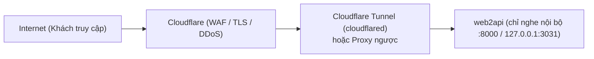

# Triển khai web2api an toàn sau Cloudflare, cổng mạng và SSH

Tài liệu hướng dẫn từng bước triển khai web2api ra Internet an toàn. Dành cho người vận hành và người dùng phổ thông làm theo được.

## 1. Sơ đồ kiến trúc tổng quan

Mặc định, web2api chỉ lắng nghe nội bộ trên máy chủ hoặc trong mạng Docker. Mọi truy cập từ Internet đi qua lớp bảo vệ của Cloudflare trước khi vào web2api.



---

## 2. Hai kiểu đặt sau Cloudflare

Có hai mô hình triển khai phổ biến khi đưa web2api ra Internet qua Cloudflare.

### Kiểu A: Cloudflare Tunnel (khuyên dùng — không cần mở cổng router)

Cloudflare Tunnel sử dụng dịch vụ `cloudflared` chạy trên cùng máy chủ hoặc trong cùng mạng Docker với web2api.

1. **Nguyên lý hoạt động:**
   - Tiến trình `cloudflared` chủ động tạo kết nối ra ngoài (outbound) tới mạng Cloudflare.
   - Bạn **không cần mở cổng** nào trên router gia đình hay tường lửa máy chủ (không cần mở cổng 80, 443 hay 3031).
   - web2api được cấu hình chỉ nghe trên địa chỉ loopback `127.0.0.1` của máy chủ hoặc chỉ nằm trong mạng nội bộ Docker.

2. **Cổng lắng nghe an toàn:**
   - Trong `docker-compose.yml`, không dùng `ports: - "3031:8000"` (vì Docker sẽ mở cổng ra mọi giao diện mạng `0.0.0.0:3031`).
   - Đổi thành chỉ lắng nghe loopback trên máy chủ:
     ```yaml
     ports:
       - "127.0.0.1:3031:8000"
     ```
   - Hoặc nếu chạy `cloudflared` chung một tệp compose với web2api trong cùng mạng Docker riêng, bạn có thể bỏ hoàn toàn mục `ports:`. `cloudflared` kết nối trực tiếp tới `http://web2api:8000`.

3. **Tác động tới giới hạn sai khoá (`WEB2API_TRUST_PROXY`) — đọc kỹ, đây là chỗ dễ sai nhất:** web2api biết khách là ai nhờ địa chỉ **nguồn** của kết nối, mà địa chỉ này phụ thuộc `cloudflared` nối vào bằng đường nào. Đã đo trên một máy chạy thật (kết nối từ máy chủ vào cổng công bố của Docker, rồi đọc bảng kết nối trong container):

   | `cloudflared` nối vào web2api qua | Container thấy nguồn là |
   |---|---|
   | `127.0.0.1:<cổng>` | địa chỉ **cổng (gateway) của mạng Docker**, KHÔNG phải loopback |
   | địa chỉ **LAN** của máy chủ (`<IP-LAN-máy-chủ>:<cổng>`) | địa chỉ LAN của máy chạy `cloudflared` (nếu nó cùng máy chủ thì chính là LAN của máy chủ; từ máy LAN khác thì là IP máy đó — chưa đo từ máy LAN khác) |

   - **Cách bạn đang dùng (cloudflared nối qua địa chỉ LAN):** khai đúng **địa chỉ LAN của máy chạy `cloudflared`, dạng `/32`**, ví dụ (địa chỉ MINH HOẠ thuộc dải tài liệu, thay bằng IP LAN thật của bạn) `WEB2API_TRUST_PROXY=192.0.2.10/32`. **Không khai cả dải `/24`**: khi đó mọi thiết bị trong nhà (TV, camera, điện thoại…) đều được coi là proxy và có thể tự gõ `X-Forwarded-For` giả để né giới hạn của chính nó hoặc vu cho người khác bị khoá.
   - Nếu `cloudflared` nối qua `127.0.0.1` (cổng công bố ở loopback): khai **địa chỉ cổng mạng Docker** (lấy bằng lệnh dưới), cũng dạng `/32`. Nếu `cloudflared` là container trong cùng mạng compose: khai dải mạng của compose (đổi `.Gateway` thành `.Subnet`).
     ```bash
     docker network inspect <tên-mạng> --format '{{range .IPAM.Config}}{{.Gateway}}{{end}}'
     ```
     (`<tên-mạng>` xem bằng `docker network ls`).
   - **Không khai** → web2api coi nguồn là không tin cậy, bỏ qua `X-Forwarded-For`, dồn mọi khách Internet vào MỘT IP; một người gõ sai khoá 30 lần sẽ chặn tất cả (mục 3).
   - Nguồn là loopback THẬT chỉ xảy ra khi tiến trình `cloudflared` nằm **trong cùng container** với web2api (ít gặp); khi đó web2api tự nhận proxy nếu có `X-Forwarded-For`.
   - Sau khi khai xong, **kiểm tra bằng mục 3** trước khi mở cho người ngoài.

### Kiểu B: Proxy ngược công bố cổng ra Internet

Áp dụng khi bạn sử dụng Nginx, Caddy, Traefik hoặc mở cổng trực tiếp cho Cloudflare trỏ về IP công khai của máy chủ.

1. **Nguyên lý hoạt động:**
   - Bạn mở cổng máy chủ ra Internet (thường là 443 cho HTTPS).
   - Tên miền được bật đám mây màu cam (Proxied) trên Cloudflare DNS.
   - Cloudflare nhận yêu cầu từ khách rồi chuyển tiếp về máy chủ của bạn.

2. **Khai báo dải IP của Cloudflare:**
   - Kết nối tới máy chủ sẽ có địa chỉ nguồn (peer IP) là các địa chỉ của Cloudflare.
   - Bạn **bắt buộc phải khai dải IP của Cloudflare** vào biến môi trường `WEB2API_TRUST_PROXY`.
   - **Lưu ý quan trọng:** Không chép danh sách cố định vào tài liệu vì Cloudflare có thể cập nhật dải IP. Hãy lấy danh sách dải IP chính thức mới nhất tại trang IP của Cloudflare: `https://www.cloudflare.com/ips/`.
   - Cấu hình trong tệp `.env`:
     ```bash
     # Ví dụ MINH HOẠ (dải tài liệu RFC 5737, KHÔNG dùng thật): thay bằng các dải IPv4 và IPv6 chính thức của Cloudflare, cách nhau bằng dấu phẩy
     WEB2API_TRUST_PROXY=192.0.2.0/24,198.51.100.0/24
     ```
   - Ngoài ra, cấu hình tường lửa máy chủ (như ufw hoặc iptables) để **chỉ cho phép** các dải IP của Cloudflare kết nối tới cổng dịch vụ, chặn mọi IP lạ quét trực tiếp vào máy chủ.

---

## 3. Hậu quả khi thiếu WEB2API_TRUST_PROXY và cách kiểm tra

### Hậu quả: Một người gõ sai khoá, cả nhà bị chặn

Lõi web2api tích hợp sẵn cơ chế chống dò đoán khoá (brute-force):
- Mỗi lần khách gửi sai khoá xác thực (HTTP 401), hệ thống đếm số lần sai theo IP của khách.
- Vượt ngưỡng `WEB2API_RL_LOI_XAC_THUC` (mặc định 30 lần trong cửa sổ `WEB2API_RL_CUA_SO_GIAY` 60 giây), IP đó sẽ bị khoá tạm thời trong `WEB2API_RL_KHOA_GIAY` (mặc định 60 giây).
- Mọi yêu cầu từ IP bị khoá sẽ nhận mã lỗi `429 Too Many Requests` kèm tiêu đề `Retry-After`.
- **Lưu ý cấu hình:** Đặt `WEB2API_RL_LOI_XAC_THUC=0` sẽ TẮT toàn bộ cơ chế giới hạn lỗi xác thực (không đếm và không khoá IP ở mọi đường Bearer, đăng nhập hay noVNC) — **tuyệt đối KHÔNG đặt khi máy chủ mở ra Internet** vì sẽ vô hiệu hoá hàng rào chống đoán khoá, dò vé và dò quét mật khẩu.

**Nếu KHÔNG khai báo `WEB2API_TRUST_PROXY`:**
- web2api coi kết nối từ proxy là không tin cậy và bỏ qua tiêu đề `X-Forwarded-For`.
- Mọi yêu cầu của mọi khách hàng đi qua proxy đều bị web2api tính chung vào một địa chỉ IP duy nhất (IP của Cloudflare hoặc proxy).
- **Ví dụ thực tế:** Khách A gửi sai khoá 30 lần. web2api khoá IP của proxy trong 60 giây. Khách B, khách C và chính bạn dù gửi đúng khoá quản trị cũng bị từ chối với mã 429 («chặn cả nhà»).

### Cách kiểm tra cấu hình IP đã đúng chưa

Kiểm tra bằng chính cơ chế ghi nhật ký hệ thống của web2api:

1. Dùng máy khách ngoài Internet gửi một yêu cầu sai khoá qua proxy tới web2api:
   ```bash
   curl -s -o /dev/null -w "%{http_code}\n" -H "Authorization: Bearer khoa-sai-thu-nghiem" https://example.com/v1/models
   ```
   Lệnh trả về mã `401`.

2. Kiểm tra nhật ký kênh quản trị (`quan_tri`) của web2api từ máy chủ nội bộ:
   ```bash
   curl -s -H "Authorization: Bearer <khoá-quản-trị>" "http://127.0.0.1:3031/api/nhat-ky?kenh=quan_tri"
   ```
   Hoặc gửi cố ý vượt ngưỡng 30 lần để kích hoạt khoá tạm thời và xem dòng cảnh báo khoá IP:
   - Nếu nhật ký ghi nhận đúng địa chỉ IP công khai của máy khách (ví dụ `198.51.100.10`), hệ thống đã nhận diện IP khách thành công.
   - Nếu nhật ký ghi nhận địa chỉ của Cloudflare hoặc proxy, bạn cần kiểm tra lại giá trị biến `WEB2API_TRUST_PROXY`.

---

## 4. Chỉ cho mạng nhà gọi đường quản trị (`WEB2API_QT_IP_CHO_PHEP`)

Kể cả khi khoá quản trị bị lộ, đường quản trị (`/api/*` qua `can_quan_tri`) vẫn chỉ dùng được từ mạng bạn cho phép:

```bash
WEB2API_QT_IP_CHO_PHEP=192.0.2.0/24
```

(địa chỉ minh hoạ thuộc dải tài liệu RFC 5737 — thay bằng dải LAN thật của nhà bạn, ví dụ dải mà router cấp). Không đặt biến (mặc định) = không hạn chế. Có giá trị: IP hiệu lực ngoài danh sách → `403 ip_not_allowed`, ghi cảnh báo ở kênh nhật ký `quan_tri` (tối đa một dòng mỗi IP mỗi phút), không tính vào bộ đếm sai khoá. Đổi biến có hiệu lực ngay, không cần khởi động lại. Đường `/v1/*` (khoá API của khách) KHÔNG bị ảnh hưởng.

**Hai bẫy phải nhớ:**

1. **Đi qua Cloudflare thì IP khách là IP Internet, không phải IP LAN.** web2api xác định IP khách đúng một cách duy nhất (duyệt `X-Forwarded-For` từ phải sang trái như mục 2), nên admin ở nhà mở tên miền qua Cloudflare sẽ bị tính là IP Internet và bị chặn nếu danh sách chỉ chứa dải LAN. Muốn quản trị từ nhà: mở thẳng địa chỉ LAN của máy chủ (ví dụ `http://192.0.2.10:3031` — địa chỉ minh hoạ, thay bằng IP LAN thật), đừng đi qua tên miền Cloudflare.
2. **Tự khoá mình thì khôi phục bằng loopback trực tiếp.** Kết nối loopback trực tiếp không kèm `X-Forwarded-For` luôn được phép, kể cả khi danh sách đặt sai hết (tất cả CIDR hỏng → chặn mọi IP khác, trừ loopback). Container không có `curl` nên dùng `python3`, chạy ngay trên máy chủ:
   ```bash
   docker exec <tên-container> python3 -c "import urllib.request as u; print(u.urlopen(u.Request('http://127.0.0.1:8000/api/nhat-ky?kenh=quan_tri', headers={'Authorization': 'Bearer <khoá-quản-trị>'})).read().decode())"
   ```
   Sửa lại `.env` rồi `docker compose up -d` (hoặc bỏ biến) là hết khoá.

---

## 5. HSTS và TLS (HTTPS)

- **Nguyên tắc:** Việc mã hoá TLS/HTTPS và thiết lập HSTS (`Strict-Transport-Security`) được thực hiện tại Cloudflare hoặc reverse proxy, **không làm ở web2api**.
- **Lý do:** Lõi web2api (`app/tieu_de_bao_mat.py`) chỉ gắn các tiêu đề bảo mật cơ bản (`x-content-type-options: nosniff`, `x-frame-options: DENY`, `referrer-policy: no-referrer`) và chủ động không thêm HSTS toàn cục. Điều này giúp người vận hành không bị khoá cứng vào giao thức HTTPS khi cần truy cập nội bộ bằng HTTP qua mạng LAN.
- **Cấu hình trên Cloudflare:**
  - Bật chế độ SSL/TLS là **Full** hoặc **Full (strict)**.
  - Bật tính năng **Always Use HTTPS** để tự động chuyển hướng từ cổng 80 sang 443.
  - Bật **HTTP Strict Transport Security (HSTS)** trong mục SSL/TLS → Edge Certificates của Cloudflare nếu tên miền chỉ phục vụ HTTPS.
- **Xác thực:** Tuyệt đối không bao giờ tắt xác thực. Mọi đường `/v1/*` và toàn bộ các đường API quản trị `/api/*` (bao gồm cả `/api/he-thong`, `/api/modules`, `/api/modules/catalog`, `/api/tinh-nang`) đều yêu cầu xác thực bằng khoá quản trị (Bearer) hoặc phiên đăng nhập của quản trị viên. **Ngoại lệ có chủ đích** chỉ còn: `/health`, `/`, `/m/<id>/…` (tệp tĩnh giao diện module), các trang `/novnc/…` (đổi vé một lần), `GET/POST /api/thiet-lap` (thiết lập tài khoản admin lần đầu) và `POST /api/dang-nhap` (đăng nhập giao diện bằng mật khẩu). Danh sách đầy đủ và lý do nằm ở đầu `test/test_web2api_ma_tran_quyen.py` (`BANG_NGOAI_LE_MO`); đường mở mới chưa ghi vào đó sẽ làm test đỏ.

---

## 6. Bảo mật SSH và cổng mạng

Máy chủ đặt dịch vụ web2api cần được khoá chặt các cổng quản trị:

1. **Chỉ dùng tệp khoá SSH (SSH Key):**
   - Tạo cặp khoá SSH trên máy cá nhân và đưa khoá công khai lên máy chủ.
   - Tắt hoàn toàn đăng nhập bằng mật khẩu trong tệp cấu hình SSH (`/etc/ssh/sshd_config` hoặc `/etc/ssh/sshd_config.d/`):
     ```text
     PasswordAuthentication no
     PubkeyAuthentication yes
     KbdInteractiveAuthentication no
     ```
   - Khởi động lại dịch vụ SSH sau khi đổi cấu hình: `sudo systemctl restart ssh`.

2. **Không công bố cổng SSH ra Internet:**
   - Không mở cổng 22 trên router hay tường lửa công cộng.
   - Khi cần quản trị từ xa, truy cập SSH thông qua Cloudflare Access (Cloudflare Tunnel hỗ trợ bọc SSH) hoặc VPN nội bộ (như WireGuard, Tailscale).

3. **Tắt UPnP trên Router:**
   - Tính năng UPnP (Universal Plug and Play) trên router có thể cho phép các phần mềm hoặc thiết bị tự động mở cổng ra Internet mà bạn không biết.
   - Hãy truy cập trang quản trị router gia đình/văn phòng và tắt hoàn toàn tính năng UPnP.

---

## 7. Danh sách kiểm trước khi mở ra Internet

Trước khi mở tên miền cho người ngoài truy cập, hãy kiểm tra từng mục sau:

- [ ] **Khoá quản trị đã đổi:** Không dùng khoá mặc định hay ngắn. Đã đặt khoá mạnh ngẫu nhiên trong biến `WEB2API_ADMIN_KEY` tại `.env`, hoặc kiểm tra tệp `/data/admin_key` do hệ thống tự sinh với quyền 0600.
- [ ] **Cổng web2api không công bố toàn cục:** Cổng container chỉ lắng nghe trên `127.0.0.1:3031` hoặc kết nối qua mạng nội bộ Docker với `cloudflared`, không mở `0.0.0.0:3031`.
- [ ] **`WEB2API_TRUST_PROXY` cấu hình đúng và đã thử:** Đã khai báo địa chỉ cổng/dải mạng Docker (kiểu A) hoặc dải IP Cloudflare (kiểu B), rồi làm đúng bước kiểm tra ở mục 3: nhật ký ghi IP công khai của máy thử, không phải địa chỉ nội bộ của Docker hay của Cloudflare.
- [ ] **Bật `WEB2API_TIN_PROXY=1`:** Nhận diện đúng giao thức HTTPS từ tiêu đề `X-Forwarded-Proto` của proxy ngược; bắt buộc để cookie phiên có cờ bảo mật `Secure` và tiền tố `__Host-w2a_phien` (nếu thiếu, cookie bị coi là HTTP thường, dùng tên `w2a_phien` không có cờ `Secure`), đồng thời tạo liên kết kết nối chuẩn xác trên giao diện.
- [ ] **SSH an toàn:** Đã tắt đăng nhập bằng mật khẩu (`PasswordAuthentication no`), chỉ cho phép đăng nhập bằng SSH Key.
- [ ] **Cổng SSH không mở thẳng ra Internet:** Chỉ kết nối SSH qua Tunnel, VPN hoặc mạng nội bộ.
- [ ] **Quản trị chỉ từ mạng nhà:** Đã đặt `WEB2API_QT_IP_CHO_PHEP` bằng dải LAN (mục 4) và đã thử: từ ngoài Internet gọi đường quản trị nhận `403`, từ mạng nhà vẫn vào được.
- [ ] **Trình duyệt từ xa không chạm được mạng LAN:** Đã cài luật bằng
  `sudo ./scripts/chan-lan-trinh-duyet.sh` và kiểm bằng curl từ trong container
  (xem mục 9).
- [ ] **Tắt UPnP:** Đã tắt tính năng UPnP trên router mạng.
- [ ] **Tắt tự cài module ngầm:** Giữ nguyên mặc định `WEB2API_GIT_REPO` chỉ báo module mới, không bật tự động cài (`tu_dong: false`).
- [ ] **Sao lưu định kỳ:** Đã có phương án sao lưu volume dữ liệu `web2api-data` thường xuyên.

---

## 8. Các lỗi hay gặp và cách xử lý

### 1. Bị lỗi 429 Too Many Requests (bị khoá cả nhà)
- **Triệu chứng:** Người dùng dùng đúng khoá nhưng vẫn bị trả về mã HTTP `429` kèm thông báo sai khoá quá nhiều lần.
- **Nguyên nhân:** Thiếu cấu hình `WEB2API_TRUST_PROXY`, khiến hệ thống tính mọi yêu cầu qua Cloudflare vào chung một địa chỉ IP.
- **Cách sửa:** Khai báo dải IP của Cloudflare (lấy từ `https://www.cloudflare.com/ips/`) vào `WEB2API_TRUST_PROXY` trong tệp `.env`, sau đó chạy lại `docker compose up -d`.

### 2. Cloudflare báo lỗi 502 Bad Gateway hoặc 504 Gateway Timeout
- **Triệu chứng:** Trình duyệt hiện màn hình lỗi mã 502 hoặc 504 của Cloudflare khi truy cập tên miền.
- **Nguyên nhân:** Container web2api chưa chạy, bị dừng đột ngột (thiếu RAM, lỗi phân quyền thư mục dữ liệu), hoặc `cloudflared` trỏ sai cổng nội bộ (ví dụ trỏ cổng 80 thay vì 8000 hay 3031).
- **Cách sửa:** Kiểm tra trạng thái container bằng `docker compose ps` và xem log bằng `docker compose logs web2api`. Kiểm tra lại cấu hình ingress của Tunnel để đảm bảo trỏ đúng cổng dịch vụ đang lắng nghe.

### 3. Vòng lặp chuyển hướng vô tận (ERR_TOO_MANY_REDIRECTS)
- **Triệu chứng:** Trình duyệt báo lỗi trang web chuyển hướng quá nhiều lần.
- **Nguyên nhân:** Chế độ mã hoá SSL/TLS trên Cloudflare đang đặt là **Flexible**. Cloudflare gửi yêu cầu HTTP tới máy chủ, trong khi proxy trên máy chủ lại ép chuyển hướng ngược về HTTPS.
- **Cách sửa:** Đổi chế độ SSL/TLS trên trang quản trị Cloudflare thành **Full** hoặc **Full (strict)**.

### 4. Giao diện hiển thị liên kết HTTP thay vì HTTPS hoặc cookie phiên thiếu cờ Secure
- **Triệu chứng:** Hướng dẫn kết nối và địa chỉ mẫu trên giao diện web2api hiển thị dạng `http://example.com` thay vì `https://example.com`, hoặc cookie phiên không có cờ `Secure` và không mang tiền tố `__Host-` (`w2a_phien` thay vì `__Host-w2a_phien`) dù đã chạy qua HTTPS.
- **Nguyên nhân:** web2api chạy sau proxy nhận kết nối nội bộ là HTTP (`request.url.scheme == "http"`). Khi chưa bật `WEB2API_TIN_PROXY=1`, hệ thống không tin tiêu đề `X-Forwarded-Proto: https` từ proxy nên coi yêu cầu là HTTP thường (`la_https(request)` trả về `False`), khiến cookie phiên bị phát hành ở chế độ không `Secure`.
- **Cách sửa:** Thêm biến `WEB2API_TIN_PROXY=1` vào tệp `.env` và khởi động lại container (chỉ bật khi mọi đường vào web2api đều đi qua proxy).

## 9. Chặn trình duyệt từ xa chạm mạng nhà

**Vì sao:** container `web2api-trinh-duyet` (`dich-vu/trinh-duyet/`) chạy Chromium/Firefox,
giữ cookie các tài khoản đã đăng nhập và CẦN ra Internet để đăng nhập dịch vụ ngoài —
compose cố ý không đặt mạng `internal`. Một trang độc/quảng cáo chạy JS trong trình
duyệt có thể gọi `http://<IP-LAN>:3030/` (Home Assistant, router, gateway Docker...)
ngay từ TRONG mạng nhà. Chính sách Chromium chỉ chặn `file://`, không chặn theo IP.

**Giải pháp:** luật iptables/ip6tables của MÁY CHỦ trong chuỗi `DOCKER-USER`, chặn theo
DẢI ĐỊA CHỈ (không theo tên miền — không có danh sách trang nào để duy trì):
- Chặn (REJECT): ba dải riêng tư của RFC 1918, dải link-local IPv4, dải CGNAT (RFC 6598), dải loopback
  IPv4, và IPv6 ULA, link-local, loopback (danh sách CIDR đầy đủ nằm ở đầu `scripts/chan-lan-trinh-duyet.sh`).
- Ngoại lệ (đứng TRƯỚC mọi luật chặn): lưu lượng trong chính mạng của dịch vụ
  (lõi web2api được nối vào mạng này bằng `docker network connect`; docker-compose.yml
  của dịch vụ chỉ có MỘT service nên không còn dịch vụ phụ nào khác cần ngoại lệ)
  và DNS cổng 53 tới gateway của mạng Docker.
- Mọi luật gắn nhãn comment `web2api-trinh-duyet`; dải mạng Docker lấy từ
  `docker network inspect web2api-trinh-duyet`, không hard-code.

**Cài (một lần, idempotent — chạy hai lần không nhân đôi luật):**

```bash
sudo ./scripts/chan-lan-trinh-duyet.sh
```

**Chỉ kiểm tra, không đổi gì:** `sudo ./scripts/chan-lan-trinh-duyet.sh --kiem`
(thoát 0 nếu đủ luật, 1 nếu thiếu). **Xem trước lệnh sẽ chạy, không cần quyền:**
`./scripts/chan-lan-trinh-duyet.sh --dry-run`.

**Kiểm bằng một lệnh curl từ trong container** (phải BỊ TỪ CHỐI, curl thoát mã lỗi
khác 0, không phải HTTP 200):

```bash
docker exec web2api-trinh-duyet curl -s -m 5 -o /dev/null http://192.0.2.1:3030/ ; echo "curl exit=$?"
docker exec web2api-trinh-duyet curl -s -m 5 -o /dev/null http://198.51.100.1/ ; echo "curl exit=$?"
```

**Gỡ:** `sudo ./scripts/chan-lan-trinh-duyet.sh --go` — chỉ gỡ đúng các luật có nhãn
`web2api-trinh-duyet`, không đụng luật khác.

**CẢNH BÁO — luật mất khi khởi động lại:** luật iptables không lưu trữ; khởi động lại
máy hoặc `systemctl restart docker` là mất. Gắn vào systemd để tự cài lại sau khi
Docker lên (chuỗi `DOCKER-USER` chỉ tồn tại khi Docker đã chạy):

```ini
# /etc/systemd/system/chan-lan-trinh-duyet.service
[Unit]
Description=Chặn container trình duyệt chạm mạng LAN
After=docker.service
Requires=docker.service

[Service]
Type=oneshot
ExecStart=/opt/web2api/scripts/chan-lan-trinh-duyet.sh
RemainAfterExit=yes

[Install]
WantedBy=multi-user.target
```

```bash
sudo systemctl enable --now chan-lan-trinh-duyet.service
```

**Giới hạn đã biết:**
- Lưu lượng từ container tới CHÍNH MÁY CHỦ (ví dụ tới `<IP-máy-chủ>:3030`) đi qua
  chuỗi `INPUT` của máy chủ, không qua `DOCKER-USER` — nếu một dịch vụ trên máy chủ
  lắng nghe `0.0.0.0` thì cần thêm luật `INPUT -i <cầu của mạng>` riêng.
- Container dùng DNS `127.0.0.11` của Docker không đi qua `DOCKER-USER` (Docker chặn
  ngay trong netns của container); script vẫn dự phòng ngoại lệ DNS cổng 53 tới
  gateway đề phòng container dùng gateway làm trình phân giải.
